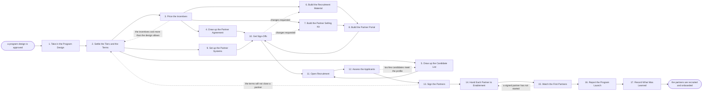

# Reference process: Launch Channel Program

`ref/mkt/channel-program v1`

**value stream:** [Concept-to-Market](../../streams/marketing/concept-to-market.md)
A partner manager takes an approved program design and turns it into a
program that partners can join. The agent settles what each tier asks of
a partner and what that tier gives back, puts numbers on the margins and
the rebates, has the agreement drawn up, and gets the materials, the
portal and the partner systems working before anyone is approached. It
then approaches the candidates on the list, reads what comes back
against the profile the program agreed, signs the candidates that meet
it, and starts a run of Enable Channel Partner for each partner that
signs. The run stays open past the first signature, because the program
still owes a report on how many partners were recruited and what those
partners produced in their first weeks.

## The activities

| # | Activity | What happens | Agents |
|---|---|---|---|
| 1 | Take in the Program Design | what the program must deliver, for whom, and by when | [partner-manager](../../agents/partner-manager.md) |
| 2 | Settle the Tiers and the Terms | what each tier asks of a partner and what it gives back | partner-manager · [decision-coordinator](../../agents/decision-coordinator.md) · leadership (person) |
| 3 | Price the Incentives | margins, rebates, and what the program will cost | [forecaster](../../agents/forecaster.md) · partner-manager · finance (person) |
| 4 | Draw up the Partner Agreement | the contract a partner signs, and how it ends | partner-manager · legal reviewer (person) |
| 5 | Draw up the Candidate List | the profile a partner has to meet, and who meets it | [researcher](../../agents/researcher.md) · partner-manager |
| 6 | Build the Recruitment Material | the pitch and the numbers a candidate is shown | [creative-producer](../../agents/creative-producer.md) · [copywriter](../../agents/copywriter.md) · [designer](../../agents/designer.md) |
| 7 | Build the Partner Selling Kit | the deck, the answers and the training partners get | [sales-enablement-manager](../../agents/sales-enablement-manager.md) · copywriter · designer · [video-editor](../../agents/video-editor.md) |
| 8 | Build the Partner Portal | where partners get materials and register deals | [web-producer](../../agents/web-producer.md) · partner-manager |
| 9 | Set up the Partner Systems | partner records, tiers, deal registration, leads | partner-manager · [conversion-tracker](../../agents/conversion-tracker.md) · [lead-scorer](../../agents/lead-scorer.md) · [audience-handover](../../agents/audience-handover.md) |
| 10 | Get Sign-Offs | brand, disclosure, legal and finance approve it | [brand-check](../../agents/brand-check.md) · [disclosure-check](../../agents/disclosure-check.md) · legal reviewer (person) · finance (person) |
| 11 | Open Recruitment | the approach goes out to the candidate partners | [campaign-manager](../../agents/campaign-manager.md) · [email-producer](../../agents/email-producer.md) · [consent-manager](../../agents/consent-manager.md) · partner-manager |
| 12 | Assess the Applicants | each candidate read against the profile and terms | partner-manager · researcher · finance (person) |
| 13 | Sign the Partners | the agreement is signed and the partner recorded | partner-manager · legal reviewer (person) |
| 14 | Hand Each Partner to Enablement | each signed partner starts its own enablement run | partner-manager |
| 15 | Watch the First Partners | which partners registered a deal and which stalled | [analytics](../../agents/analytics.md) · partner-manager |
| 16 | Report the Program Launch | results set against what the design promised | partner-manager · analytics |
| 17 | Record What Was Learned | what to repeat, what to avoid | partner-manager |

## The graph



## The document, with the blanks marked

```
PROCESS: channel program              id: <team>/channel-program   v1
from: ref/mkt/channel-program v1
owner: <who>                          effective: <date>
trigger: a channel program design is approved in <your planning process>
         watch: record=<the program design>
                system=<your planning process>
                change=<a program design is marked approved>
concurrency: one program per <market or product line> - <how many> open
             at once
goal: a program with terms a partner can sign, materials and a portal
      partners can use, and the partners the design called for
      recruited, signed and handed to enablement
phases:
  take-in-design    - human: read the approved design and write down
                      what the program must deliver, for whom, and by
                      when
                      owner: partner-manager   after: trigger
                      automation: <level>
  settle-terms      - convenes decide-and-announce: what each tier asks
                      of a partner and what that tier gives back, told
                      to every agent that builds against it at once
                      owner: decision-coordinator
                      after: take-in-design    by: <days>
                      automation: <level>
  price-incentives  - human: the margin, the rebate and the fund at each
                      tier, and what the program costs at <how many>
                      partners. <who> confirms the numbers
                      owner: forecaster        after: settle-terms
                      by: <days>               automation: <level>
  draw-agreement    - human: the contract a partner signs, what each
                      side owes under it, and how it ends
                      owner: <your legal role> after: price-incentives
                      by: <days>               automation: never
  candidate-list    - runs collect-and-report: the profile a partner has
                      to meet, and the candidates that meet it
                      owner: researcher        after: settle-terms
                      by: <days>               automation: <level>
  recruit-material  - runs build-by-talent: the pitch, the value story
                      and the numbers a candidate partner is shown
                      owner: creative-producer after: price-incentives
                      by: <days>               automation: <level>
  selling-kit       - runs build-by-talent: the deck, the objection
                      answers and the training a partner sells with
                      owner: sales-enablement-manager
                      after: price-incentives  by: <days>
                      automation: <level>
  build-portal      - human: the pages where a candidate applies, a
                      partner takes material at its version, and a
                      partner registers a deal
                      owner: web-producer
                      after: recruit-material + selling-kit
                      by: <days>               automation: <level>
  partner-systems   - human: the partner records, the tiers, the deal
                      registration, and the path a lead takes to a
                      partner with the consent record applied to it
                      owner: partner-manager   after: settle-terms
                      by: <days>               automation: <level>
  get-sign-offs     - convenes approval: brand, disclosure, legal and
                      finance sign, as named signers, against a version
                      owner: <your legal role>
                      after: draw-agreement + build-portal +
                             partner-systems
                      by: <days>               automation: never
  open-recruitment  - human: the approach reaches the candidates on the
                      list, on the channels the consent record allows
                      owner: campaign-manager
                      after: get-sign-offs + candidate-list
                      automation: <level>
  assess-applicants - runs assessment: each candidate scored against the
                      profile and against what the terms ask of them
                      owner: partner-manager   after: open-recruitment
                      by: <days>               automation: <level>
  sign-partners     - convenes approval: <who> decides to sign or to
                      decline, and a signed partner lands in the record
                      owner: partner-manager   after: assess-applicants
                      automation: never
  start-enablement  - human: the manager starts <your enable channel
                      partner process> once for each partner that signed
                      owner: partner-manager   after: sign-partners
                      automation: <level>
  watch-partners    - human: which partners finished onboarding, which
                      registered a deal, and which have not started
                      owner: analytics         after: start-enablement
                      automation: <level>
  report-program    - runs collect-and-report: partners signed, by tier,
                      and what they produced, set against the design
                      owner: partner-manager   after: watch-partners
                      by: <weeks>              automation: <level>
  record-learnings  - convenes debrief: what to repeat, what to avoid
                      owner: partner-manager   after: report-program
                      automation: <level>
run-scoped:
  status   - runs roll-call                    owner: partner-manager
             every: <cadence>
             from: settle-terms   until: sign-partners
  standing - runs collect-and-report           owner: partner-manager
             every: <cadence>
             from: start-enablement   until: run close
handoffs:
  take-in-design -> settle-terms [program-goal]: what the program must
    deliver, for whom and by when, in one line that every later
    decision can be tested against
  settle-terms -> price-incentives [tiers-and-terms]: the tiers, and
    what each one asks of a partner and gives back
  settle-terms -> candidate-list [partner-kind]: the kind of partner
    each tier is for
  settle-terms -> partner-systems [tier-entitlements]: the tiers as
    the systems have to hold them, and what each tier entitles a
    partner to
  price-incentives -> draw-agreement [priced-incentives]: the margin,
    the rebate and the fund at each tier, with the assumption written
    beside each number
  price-incentives -> recruit-material [numbers-for-candidates]: the
    same numbers, cut to what a candidate may be shown before signing
  price-incentives -> selling-kit [what-a-partner-may-say]: the tiers,
    and what a partner is allowed to say about the organization
  recruit-material + selling-kit -> build-portal [partner-material]:
    the material at its versions, and which tier may be shown each
    piece
  draw-agreement + build-portal + partner-systems -> get-sign-offs
    [program-at-a-version]: the agreement, the material and the portal
    at a version
  get-sign-offs -> open-recruitment [signed-program]: the approved
    program at the signed version. A later change voids the approval
    and sign-offs run again
  candidate-list -> open-recruitment [candidates]: the candidates,
    each with the tier it is approached for and the consent record
    covering the approach
  open-recruitment -> assess-applicants [applications]: what each
    candidate answered and what they sent
  assess-applicants -> sign-partners [candidate-scores]: each
    candidate scored against the profile, with the rule behind every
    failure, and a recommendation to sign or to decline
  sign-partners -> start-enablement [signed-partner]: the
    countersigned agreement, the tier, the partner contacts, and the
    date the tier starts from
  watch-partners -> report-program [partner-standing]: the standing of
    every signed partner, attributed to the system it was read from
  report-program -> record-learnings [the-report]: the report, as
    delivered
deviations:
  price-incentives -> settle-terms [incentives-cost-too-much]: the
    incentives cost more than the design allows, so the tiers and the
    terms are settled again
  get-sign-offs -> recruit-material [recruit-material-changes]: a
    signer comes back with changes to the recruitment material
  get-sign-offs -> selling-kit [selling-kit-changes]: a signer comes
    back with changes to the selling kit
  assess-applicants -> candidate-list [too-few-candidates]: too few
    candidates meet the profile, so the list is drawn up again
  sign-partners -> settle-terms [terms-will-not-close]: candidates
    across most of the list refuse the terms, so the terms are settled
    again
  watch-partners -> start-enablement [partner-has-not-started]: a
    signed partner has not started, so that one partner goes back to
    enablement while the rest of the program carries on
bindings:
  roster:  <who holds each role - agents claiming the abstract agents
           above, and named people for leadership, legal, finance and
           whoever signs contracts>
  systems: the partner record (write), the agreement record (read),
           the partner portal (write), the asset store (write),
           the enablement library (write), the CRM (write),
           the consent record (read), the training record (write),
           analytics (read), the model store (write)
  data:    brand guidelines <version>, <your claims register>,
           <your disclosure rules> <version>, <your partner profile>,
           the approved program design
policy:
  no candidate is approached before the agreement and the terms are
    signed off
  sign-off is a human gate and is never delegated to an agent
  a person decides whether a candidate is signed or declined
  what a partner is paid or discounted is set by <who>, and an agent
    never changes it
  nothing is released to a partner that their tier does not cover
  material changed after sign-off goes back through sign-offs
  a lead reaches a partner only where the consent record covers that
    transfer
measures:
  cycle time: <target> from the approved design to the first signed
              partner
  volume: <partners signed per period>, counted at each tier
  quality gate: no partner is signed without a countersigned agreement
                recorded against them, and no partner is given material
                above their tier
```

## The failure edges

- **A sign-off comes back with changes.** The run returns to the
  recruitment material or to the selling kit, and only the piece the
  signers named reopens. The signers see the changed version before any
  candidate does.
- **The incentives cost more than the design allows.** The forecaster
  reports the cost at each tier before anyone is approached, and <who>
  decides whether the partner numbers come down or the margins do.
  Opening a program the organization cannot fund is not one of the
  choices.
- **Too few candidates meet the profile.** The run goes back to the
  candidate list. <who> decides whether the profile widens or more
  candidates are found, because a widened profile changes who the
  program is for and the terms were priced against the profile the
  program started with.
- **A candidate will not accept the terms.** One refusal is a decline
  recorded against that candidate, with the reason the candidate gave.
  Refusals across most of the list send the run back to the terms,
  because the program is asking for something the market will not give.
- **A partner signs and then does nothing.** The watch activity names
  the partner and the run goes back to enablement for that partner
  alone. The rest of the program carries on while that one is chased.
- **A partner is signed at a tier the systems cannot hold.** The partner
  record and the portal are what let anyone answer what a partner is
  owed, so the run holds the signature until the record can carry it.
- **The trigger fires while a run is in flight.** Programs for different
  markets or product lines overlap, and the concurrency line says how
  many. The partner-manager agent takes one program at a time, so every
  run in flight needs its own holder of that role, and the runs read the
  agreement record and the standards read-only.
- **A run is abandoned.** Every candidate already approached is told the
  program is not opening. The portal comes down and its address is
  released, agreements already sent are withdrawn, and any partner who
  already signed keeps the terms they signed under until <who> ends
  those agreements. What the program cost to build is recorded anyway.
