# Reference process: Run Churn-Risk Play

`ref/mkt/churn-risk-play v1`

**value stream:** [Customer-to-Advocate](../../streams/marketing/customer-to-advocate.md)
A signal fires saying that one customer may be about to leave. A
lifecycle manager takes the signal, an account monitor reads the account
and says whether the risk is real, and the person who owns the account
decides whether the organization does anything about it. If the answer
is yes, someone chooses the intervention, someone sets the limits on
what may be offered, the message is written and signed, and the
intervention is delivered as a message or as a call from the account
owner. The run stays open long enough to see what the account did
afterwards, and it ends when that outcome is recorded against the
account.

## The activities

| # | Activity | What happens | Agents |
|---|---|---|---|
| 1 | Take in the Signal | what fired, on which account, and when | [lifecycle-manager](../../agents/lifecycle-manager.md) |
| 2 | Confirm the Signal | read usage, support, contract and renewal standing | [account-monitor](../../agents/account-monitor.md) |
| 3 | Decide Whether to Act | a person says intervene, keep watching or close | account owner (person) · lifecycle-manager |
| 4 | Choose the Intervention | what this account gets, and whether a person calls | lifecycle-manager · account owner (person) |
| 5 | Set the Limits on What May Be Offered | what may be credited, changed or promised | finance (person) · legal reviewer (person) |
| 6 | Write What Will Be Said | the words for this account in this situation | [copywriter](../../agents/copywriter.md) |
| 7 | Get Sign-Off | brand and legal approve what is being offered | [brand-check](../../agents/brand-check.md) · legal reviewer (person) |
| 8 | Prepare the Send | consent and suppression applied, schedule, proofs | [email-producer](../../agents/email-producer.md) |
| 9 | Deliver the Intervention | the message goes out or the account owner calls | email-producer · account owner (person) · lifecycle-manager |
| 10 | Watch What the Account Does | usage, replies, support and renewal after contact | account-monitor |
| 11 | Record the Outcome | what was offered, what happened, and the date | lifecycle-manager · account-monitor |
| 12 | Record What Was Learned | which signals were worth acting on | lifecycle-manager |

Most processes in this catalog start because a person asked for
something. This one starts because a system noticed something, and
nobody has yet agreed that the noticing was right. Activities 2 and 3
are there for that reason. The account monitor reads what the account
has actually done and reports it with the evidence attached, and then
the person who owns the account decides whether the organization
intervenes, keeps watching, or closes the run. That decision belongs to
a person every time, because a signal is a guess made by a system, and a
customer who receives a retention offer they did not need is worse off
than they were before it arrived. Two further decisions stay with
people: what may be credited, changed or promised to this account, and
whether the contact is a message or a call from the account owner.

## The graph

```mermaid
flowchart LR
  T([a churn risk signal fires]) --> A1[1. Take in the Signal]
  A1 --> A2[2. Confirm the Signal]
  A2 --> A3[3. Decide Whether to Act]
  A3 -. the signal describes nothing .-> A11[11. Record the Outcome]
  A3 --> A4[4. Choose the Intervention]
  A4 --> A5[5. Set the Limits on What May Be Offered]
  A5 --> A6[6. Write What Will Be Said]
  A5 -. the account owner is making the call .-> A9[9. Deliver the Intervention]
  A6 --> A7[7. Get Sign-Off]
  A7 -. changes requested .-> A6
  A7 -. the offer is outside the limits .-> A5
  A7 --> A8[8. Prepare the Send]
  A8 --> A9
  A9 --> A10[10. Watch What the Account Does]
  A10 -. the account got worse .-> A4
  A10 --> A11
  A11 --> A12[12. Record What Was Learned]
  A12 --> DONE([the outcome is recorded and the run is closed])
```



## The document, with the blanks marked

```
PROCESS: churn-risk play              id: <team>/churn-risk-play   v1
from: ref/mkt/churn-risk-play v1
owner: <who>                          effective: <date>
trigger: a churn risk signal fires in <your account health monitoring>
concurrency: one run per account - <how many> accounts open at once
goal: every churn risk signal answered, and every confirmed one
      answered with an intervention a person approved and an outcome
      recorded against the account
phases:
  take-in-signal   - system: the signal lands with the account it
                     names, what fired it, and the date it fired
                     owner: lifecycle-manager  after: trigger
                     automation: <level>
  confirm-signal   - human: the account's usage, support history,
                     contract position and renewal standing, read and
                     reported with the evidence under each line
                     owner: account-monitor    after: take-in-signal
                     by: <hours>               automation: <level>
  decide-to-act    - convenes decide-and-announce: the account owner
                     reads the confirmed picture and says intervene,
                     keep watching, or close the run
                     owner: <your account owner>
                     after: confirm-signal
                     by: <hours>               automation: never
  choose-play      - convenes decide-and-announce: which intervention
                     this account gets, by when, and whether a person
                     makes the contact instead of a message
                     owner: lifecycle-manager  after: decide-to-act
                     automation: <level>
  set-limits       - human: what may be credited, changed or promised
                     to this account, written as numbers and terms
                     owner: <your finance role> after: choose-play
                     by: <hours>               automation: never
  write-message    - human: the words for this account in this
                     situation, carrying only claims the register
                     supports and only offers the limits allow
                     owner: copywriter         after: set-limits
                     by: <hours>               automation: <level>
  get-sign-off     - convenes approval: brand and legal sign, as named
                     signers, against a version of what will be said
                     owner: <your legal role>  after: write-message
                     by: <hours>               automation: never
  prepare-send     - human: the audience for this account, the consent
                     and suppression rules applied, the schedule and
                     the proof copies
                     owner: email-producer     after: get-sign-off
                     automation: <level>
  deliver          - human: the named owner says go and the message
                     goes out, or the account owner makes the contact
                     owner: lifecycle-manager
                     after: prepare-send + set-limits
                     automation: <level>
  watch-account    - human: usage, replies, support tickets and
                     renewal standing after the contact
                     owner: account-monitor    after: deliver
                     until: <days>             automation: <level>
  record-outcome   - runs collect-and-report: what was offered, what
                     the account did, and the date it settled
                     owner: lifecycle-manager  after: watch-account
                     automation: <level>
  record-learnings - convenes debrief: which signals were worth acting
                     on, and which interventions worked
                     owner: lifecycle-manager  after: record-outcome
                     automation: <level>
run-scoped:
  standing - runs roll-call                    owner: account-monitor
             every: <cadence>
             from: confirm-signal   until: run close
  status   - runs collect-and-report           owner: lifecycle-manager
             every: <cadence>
             from: decide-to-act    until: run close
handoffs:
  take-in-signal -> confirm-signal: the account the signal names, what
    fired it, and the date and time it fired
  confirm-signal -> decide-to-act: whether the risk is real, with every
    system that was read, what it said, and when that reading was
    current. Anything that could not be read is named as unread
  decide-to-act -> choose-play: the decision in one line, the person
    who made it, the date, and what the intervention has to achieve
  choose-play -> set-limits: what is being proposed to this account,
    and whether a person is making the contact
  set-limits -> write-message: the numbers and terms the message may
    contain, and the ones it may not
  set-limits -> deliver: the same limits, when the account owner is
    making the contact instead of sending a message
  write-message -> get-sign-off: what will be said, at a version
  get-sign-off -> prepare-send: the approved wording at the signed
    version. A later change voids the approval and sign-off runs again
  prepare-send -> deliver: the audience count after consent and
    suppression, the proof record, and the schedule as it was set
  deliver -> watch-account: what was sent or said, to whom, on what
    date, and everything the account was promised
  watch-account -> record-outcome: the readings taken after the
    contact, each attributed to the system it came from
  record-outcome -> record-learnings: the outcome, as recorded
bindings:
  roster:  <who holds each role - agents claiming the abstract agents
           above, and named people for the account owner, finance and
           legal>
  systems: product usage data (read), the support system (read),
           the CRM (read), contract and renewal records (read),
           the account standing record (write),
           the program run record (write),
           the commitment record (write),
           the task queue for the people who make contact (write),
           the sending system (write),
           the live sends (trigger, cap: <n> contacts),
           the consent record (read), the suppression lists (read)
  data:    brand guidelines <version>, <your claims register>,
           <your retention offer limits> <version>, the signal that
           fired and the rule behind it
policy:
  a person decides whether the organization intervenes, and no
    intervention is delivered on a signal alone
  nothing is offered to an account beyond the limits <who> set, and an
    offer past those limits goes back to <who> before it is made
  sign-off is a human gate and is never delegated to an agent
  a message changed after sign-off goes back through sign-off
  every commitment made to the account is recorded with who made it
    and when it is due, and it is tracked until it is met
  an account in a contractual or legal dispute is not approached until
    <who> says it may be
  a request to stop being contacted ends the run and is recorded
    against the account
measures:
  cycle time: <target> from the signal firing to the intervention
              being delivered
  volume: <signals per period>, and how many of them were confirmed
  accuracy: <target> share of signals that described something real
  quality gate: no intervention is delivered without a recorded human
                decision and a signed version of what was said
```

## The failure edges

- **The signal describes nothing.** The account owner closes the run at
  decide-to-act. The run still records an outcome, saying which signal
  fired and that the reading did not support it, because the people who
  maintain the signals need to know how often that happens.
- **A sign-off comes back with changes.** The run returns to
  write-message, and only the part the signers named reopens. The
  signers see the changed version before it goes any further.
- **The intervention needs more than the limits allow.** The run goes
  back to set-limits, and finance and legal decide whether the limit
  moves for this account. Sending the offer while it sits outside the
  limits is not one of the choices.
- **The account gets worse after the contact.** Watch-account sends the
  run back to choose-play with the readings attached, and the second
  intervention gets its own limits and its own sign-off.
- **The customer asks to stop being contacted.** The run stops where it
  is, the request is recorded against the account, and anything already
  scheduled for that account is pulled before it sends.
- **A second signal fires on an account that already has a run open.**
  The new signal joins the open run and is recorded there. Two runs
  never contact the same account at the same time.
- **The account owner does not answer.** The run waits at decide-to-act
  and nothing is sent. After <how long> the wait goes to <who>, because
  a risk that nobody has answered is still a risk.
- **A run is abandoned.** The confirmed reading and any approved wording
  stay at their versions, so a later run can pick them up. Commitments
  already made to the customer still have to be met, and the commitment
  record is what a person checks to find them.
