# Reference process: Run Co-Marketing Campaign

`ref/mkt/co-marketing-campaign v1`

**value stream:** [Brief-to-Results](../../streams/marketing/brief-to-results.md)
Two organizations put one campaign in front of a shared audience. A
signed agreement starts the run. The agent that answers for the partner
relationship writes down what each side owes and by when, the two sides
settle how the leads will be split before anything is built, the joint
material is made and signed on both sides, the registration page and its
tracking go in, each side sends to its own audience, and each
organization receives its share of the leads with a record it can be
held to. The run closes when both sides agree on one set of numbers and
the learnings are written down. Settling the lead terms early matters
because the split rule decides which fields the form has to capture and
what the page has to tell a reader, and a split rule agreed after the
leads arrive turns into an argument.

## The activities

| # | Activity | What happens | Agents |
|---|---|---|---|
| 1 | Take in the Partner Agreement | what each side owes and what the campaign must do | [partner-manager](../../agents/partner-manager.md) · [campaign-manager](../../agents/campaign-manager.md) |
| 2 | Settle the Lead Terms | who gets which leads, which fields, on what basis | partner-manager · [audience-handover](../../agents/audience-handover.md) · [consent-manager](../../agents/consent-manager.md) · legal reviewer (person) |
| 3 | Plan the Joint Campaign | channels, dates, the cost share, and who owes what | campaign-manager · partner-manager · [media-buyer](../../agents/media-buyer.md) · leadership (person) |
| 4 | Brief the Makers | both sides hear the same request at the same time | campaign-manager · partner-manager · [copywriter](../../agents/copywriter.md) · [designer](../../agents/designer.md) · [video-editor](../../agents/video-editor.md) |
| 5 | Settle the Joint Direction | one concept both brands will put their name on | campaign-manager · partner-manager · copywriter · designer · video-editor · brand owner (person) · partner approver (person) |
| 6 | Produce the Joint Material | copy, images and video carrying both brands | [creative-producer](../../agents/creative-producer.md) · copywriter · designer · video-editor |
| 7 | Score against Both Rule Sets | our standards and the partner's, item by item | [brand-check](../../agents/brand-check.md) · partner-manager |
| 8 | Get Sign-Offs on Both Sides | every signer on both sides signs one version | partner-manager · brand owner (person) · legal reviewer (person) · partner approver (person) |
| 9 | Build the Registration Page | the page, the form, and what it tells a reader | [web-producer](../../agents/web-producer.md) · campaign-manager · partner-manager |
| 10 | Wire up the Split | tracking, the form fields, and where each lead goes | [conversion-tracker](../../agents/conversion-tracker.md) · audience-handover · consent-manager |
| 11 | Set up Each Side's Distribution | each side readies its own list, ads and posts | media-buyer · [email-producer](../../agents/email-producer.md) · consent-manager · partner-manager |
| 12 | Launch the Joint Campaign | both sides go live on the date they agreed | campaign-manager · partner-manager · web-producer |
| 13 | Watch the Joint Campaign | results, and whether each side did what it promised | [analytics](../../agents/analytics.md) · campaign-manager · partner-manager · [community-manager](../../agents/community-manager.md) |
| 14 | Split and Hand over the Leads | the split rule applied and each side's share delivered | audience-handover · [lead-scorer](../../agents/lead-scorer.md) · consent-manager · partner-manager |
| 15 | Agree the Joint Numbers | both sides' counts and costs matched into one report | partner-manager · audience-handover · analytics · [spend-reconciler](../../agents/spend-reconciler.md) · finance (person) |
| 16 | Record What Was Learned | what to repeat and what to avoid with this partner | campaign-manager · partner-manager |

## The graph

```mermaid
flowchart LR
  T([a partner agreement is signed]) --> A1[1. Take in the Partner Agreement]
  A1 --> A2[2. Settle the Lead Terms]
  A2 --> A3[3. Plan the Joint Campaign]
  A3 --> A4[4. Brief the Makers]
  A3 --> A11[11. Set up Each Side's Distribution]
  A4 --> A5[5. Settle the Joint Direction]
  A5 --> A6[6. Produce the Joint Material]
  A6 --> A7[7. Score against Both Rule Sets]
  A7 -. failures to fix .-> A6
  A7 --> A8[8. Get Sign-Offs on Both Sides]
  A8 -. changes requested on either side .-> A6
  A8 --> A9[9. Build the Registration Page]
  A9 --> A10[10. Wire up the Split]
  A10 --> A12[12. Launch the Joint Campaign]
  A11 --> A12
  A12 --> A13[13. Watch the Joint Campaign]
  A12 --> A14[14. Split and Hand over the Leads]
  A13 -. creative has to be replaced .-> A6
  A13 --> A15[15. Agree the Joint Numbers]
  A14 --> A15
  A15 -. a delivery that never arrived .-> A14
  A15 --> A16[16. Record What Was Learned]
  A16 --> DONE([the campaign is closed and the leads are settled])
```



## The document, with the blanks marked

```
PROCESS: co-marketing campaign        id: <team>/co-marketing-campaign  v1
from: ref/mkt/co-marketing-campaign v1
owner: <who>                          effective: <date>
trigger: a partner agreement is signed in <your partnership process>
concurrency: runs may overlap - <how many> partners live at once
goal: one campaign that both organizations signed, run on the date they
      agreed, with each side's leads delivered under the agreed split
      and one set of numbers both sides accept
phases:
  take-in-agreement - human: read the signed agreement and write down
                      what each side owes, by when, and what the
                      campaign has to do
                      owner: partner-manager    after: trigger
                      automation: <level>
  settle-lead-terms - convenes decide-and-announce: who gets which
                      lead, on what basis, which fields may cross, and
                      what the reader has to be told
                      owner: partner-manager    after: take-in-agreement
                      by: <days>                automation: <level>
  plan-campaign     - human: the channels, the dates, the cost share,
                      and what each side owes the run. <who> confirms
                      our share of the cost
                      owner: campaign-manager   after: settle-lead-terms
                      automation: <level>
  brief-makers      - convenes briefing: both sides hear the same
                      request at the same time
                      owner: campaign-manager   after: plan-campaign
                      automation: <level>
  settle-direction  - convenes bake-off: one concept both brands will
                      put their name on, with the reasons said out loud
                      owner: campaign-manager   after: brief-makers
                      by: <days>                automation: <level>
  produce-material  - runs build-by-talent: copy, images and video,
                      each carrying both brands
                      owner: creative-producer  after: settle-direction
                      by: <days>                automation: <level>
  score-both-rules  - runs assessment: our standards and the partner's,
                      item by item, every verdict citing its rule
                      owner: brand-check        after: produce-material
                      by: <days>                automation: <level>
  get-sign-offs     - convenes approval: every named signer on both
                      sides signs one version of the material
                      owner: partner-manager    after: score-both-rules
                      by: <days>                automation: never
  build-page        - human: the registration page, its form, and what
                      it tells a reader about where the lead goes
                      owner: web-producer       after: get-sign-offs
                      by: <days>                automation: <level>
  wire-the-split    - human: the tags, the form fields the split rule
                      needs, and the route each lead takes
                      owner: conversion-tracker after: build-page
                      automation: <level>
  ready-each-side   - human: each side readies its own list, its own
                      ads and its own posts against the plan
                      owner: media-buyer        after: plan-campaign
                      by: launch                automation: <level>
  launch            - human: both sides go live on the date they
                      agreed, and each one confirms that it went
                      owner: campaign-manager
                      after: wire-the-split + ready-each-side
                      automation: <level>
  watch             - human: the results, and whether each side did
                      what the agreement says it would
                      owner: analytics          after: launch
                      automation: <level>
  hand-over-leads   - human: the split rule applied, each side's share
                      delivered with a dated receipt
                      owner: audience-handover  after: launch
                      every: <cadence>          automation: <level>
  agree-numbers     - runs collect-and-report: both sides' counts and
                      costs matched into one set of figures
                      owner: partner-manager
                      after: watch + hand-over-leads
                      by: <days>                automation: <level>
  record-learnings  - convenes debrief: what to repeat and what to
                      avoid with this partner
                      owner: campaign-manager   after: agree-numbers
                      automation: <level>
run-scoped:
  obligations - runs roll-call                 owner: partner-manager
                every: <cadence>
                from: take-in-agreement   until: run close
  spend       - runs allocate-and-reconcile    owner: media-buyer
                from: plan-campaign   until: run close
  status      - runs collect-and-report        owner: analytics
                every: <cadence>
                from: launch   until: run close
handoffs:
  take-in-agreement -> settle-lead-terms: what each side owes and by
    when, in one record both organizations can be held to
  settle-lead-terms -> plan-campaign: the split rule, the fields that
    may cross, and the basis each transfer rests on
  settle-lead-terms -> wire-the-split: the same rule and the same
    fields, so that the form is built from the record the terms were
    written in
  plan-campaign -> brief-makers: the channels, the dates, the cost
    share, and what each side owes the run
  plan-campaign -> ready-each-side: the same plan. Both branches read
    one record
  settle-direction -> produce-material: the chosen concept, and why it
    won on both sides
  produce-material -> score-both-rules: the material at a version, with
    the partner's guidelines named at the version the agreement supplies
  score-both-rules -> get-sign-offs: the scored list, with the rule and
    the side it came from written against every failure
  get-sign-offs -> build-page: the approved material at the version
    both sides signed. A later change voids both signatures and the
    sign-offs run again
  build-page -> wire-the-split: the page and its form fields, while the
    page can still be changed
  wire-the-split -> launch: the tracking, the routing, and a dated test
    showing a lead arriving on each side
  ready-each-side -> launch: each side's list, ads and posts, ready to
    fire on the agreed date
  watch -> agree-numbers: the results, with every line attributed to
    the source it came from
  hand-over-leads -> agree-numbers: every delivery with its receipt,
    and every lead held back with the reason it was held
  agree-numbers -> record-learnings: the agreed figures, as delivered
bindings:
  roster:  <who holds each role - agents claiming the abstract agents
           above, named people for legal, brand and finance, and the
           named approver at the partner>
  systems: the asset store (write), the website (write),
           the CRM (write), analytics (read),
           ad platforms (write, cap: <n>/day),
           the sending system (write), the consent record (write),
           the transfer record (write)
  data:    brand guidelines <version>, <your claims register>,
           the partner's brand guidelines <version>,
           the partner's claims rules <version>,
           the signed agreement, the agreed lead terms
policy:
  nothing goes out until a named signer on each side has signed the
    same version
  material changed after sign-off voids both signatures and goes
    through the scoring and both sign-offs again
  sign-off is a human gate and is never delegated to an agent
  no lead crosses to the other organization unless the consent record
    covers that transfer, and a lead held back is recorded as held
  every delivery leaves a receipt naming what was sent, when, and
    under which agreement
measures:
  cycle time: <target> from the signed agreement to launch
  volume: <joint campaigns per period>
  quality gate: nothing publishes unsigned on either side, and no lead
                is delivered without its receipt
```

## The failure edges

- **A sign-off comes back with changes from either side.** The run
  returns to produce-material, and only the item the signers named
  reopens. The changed version is scored again and goes back to every
  signer on both sides, because the version one organization signed
  stops being the version that ships as soon as the other organization
  asks for a change.
- **The partner does not deliver its list, its assets or its share of
  the spend.** The partner-manager agent raises it on the day it becomes
  clear that the plan cannot be delivered as agreed, and a person
  decides whether the campaign runs smaller, moves its date, or stops.
- **A lead arrives that the consent record does not cover for
  transfer.** The audience-handover agent holds the lead back and
  records it as held, with the rule behind the hold, so that both sides
  work from the same count.
- **Both organizations already had the same contact.** The lead terms
  settled in activity 2 decide who owns the record. A case those terms
  do not cover goes to a person on each side, and the answer is written
  back into the terms.
- **The two sides' counts differ.** The run goes back to hand-over-leads
  and the difference is traced to the delivery it should have been in. A
  difference past the tolerance the process sets goes to finance on both
  sides.
- **Creative has to be replaced while the campaign is live.** The run
  returns to produce-material, and the replacement goes through the
  scoring and both sets of sign-offs before it runs.
- **The trigger fires while runs are in flight.** Joint campaigns
  overlap normally, and the concurrency line says how many. The
  partner-manager agent takes one partner at a time, so every run in
  flight needs its own holder of that role.
- **A run is abandoned.** The registration page comes down, the ads
  stop, and every lead already captured is still delivered under the
  terms that were agreed, because the agreement outlives the campaign.
