# Reference process: refresh competitive battlecard

`ref/mkt/competitive-battlecard v1`

**value stream:** [Concept-to-Market](../../streams/marketing/concept-to-market.md)
A sales enablement manager takes a move by a competitor, has it confirmed
against what that competitor actually published, works out which
battlecards the move puts in doubt, gets a source under every comparison
those cards make, has a person decide what the organization will say
about the competitor, has the card rewritten and checked, and puts the
new version in the hands of every rep. The trigger is an action by
somebody outside the organization, so a run begins from a report of
something that has already happened. Reps meet the move in live deals
while the run is open, and the dates in the run are set against how soon
that will happen. The run closes when the card is at its new version and
every rep has been told.

## The activities

| # | Activity | What happens | Seats |
|---|---|---|---|
| 1 | take in the move | record what the competitor did and where it was seen | [sales-enablement-manager](../../agents/sales-enablement-manager.md) · [coverage-monitor](../../agents/coverage-monitor.md) |
| 2 | confirm the move | read what the competitor published, at the source | [researcher](../../agents/researcher.md) |
| 3 | find the cards it touches | which cards and which claims the move puts in doubt | sales-enablement-manager |
| 4 | hear what reps are meeting | what the competitor is saying inside live deals | sales-enablement-manager · sales leader (person) |
| 5 | gather the proof | a source under every comparison the card makes | researcher · subject matter expert (person) |
| 6 | settle what may be said | a person decides the position on the competitor | [decision-coordinator](../../agents/decision-coordinator.md) · leadership (person) · legal reviewer (person) |
| 7 | write the card | the claims, the objection answers and the proof | [copywriter](../../agents/copywriter.md) · sales-enablement-manager |
| 8 | edit the card | cut what a rep cannot use inside a live call | [editor](../../agents/editor.md) |
| 9 | lay the card out | set out so a rep finds an answer while talking | [designer](../../agents/designer.md) |
| 10 | score the claims | every claim against the register at its version | [brand-check](../../agents/brand-check.md) |
| 11 | check the comparisons | the rules for naming another company in a market | [disclosure-check](../../agents/disclosure-check.md) |
| 12 | get sign-offs | legal, product and sales sign the exact wording | legal reviewer (person) · subject matter expert (person) · sales leader (person) |
| 13 | issue the version | the new card replaces the one reps carry now | sales-enablement-manager |
| 14 | notify sales | every rep hears which version is current, and when | sales-enablement-manager · sales leader (person) |
| 15 | hand on the claim change | a broken claim goes back for a new version | [standards-keeper](../../agents/standards-keeper.md) |
| 16 | say what partners may see | which partner tier is given which version | [partner-manager](../../agents/partner-manager.md) |

## The graph

```mermaid
flowchart LR
  T([a competitor moves]) --> A1[1. take in the move]
  A1 --> A2[2. confirm the move]
  A1 --> A4[4. hear what reps are meeting]
  A2 -. the move is not real .-> A14[14. notify sales]
  A2 --> A3[3. find the cards it touches]
  A3 --> A5[5. gather the proof]
  A4 --> A5
  A5 --> A6[6. settle what may be said]
  A5 --> A15[15. hand on the claim change]
  A6 -. the evidence will not carry a comparison .-> A5
  A6 --> A7[7. write the card]
  A7 --> A8[8. edit the card]
  A8 -. rewrite what the edit named .-> A7
  A8 --> A9[9. lay the card out]
  A9 --> A10[10. score the claims]
  A15 -. the register comes back at a new version .-> A10
  A10 -. a claim with no citation .-> A7
  A10 --> A11[11. check the comparisons]
  A11 -. the comparison breaks a rule .-> A7
  A11 --> A12[12. get sign-offs]
  A12 -. changes requested .-> A7
  A12 -. the position itself is in question .-> A6
  A12 --> A13[13. issue the version]
  A13 --> A14
  A13 --> A16[16. say what partners may see]
  A14 --> DONE([the card is at its new version and sales has been told])
  A16 --> DONE
```



## The document, with the blanks marked

```
PROCESS: competitive battlecard       id: <team>/competitive-battlecard   v1
from: ref/mkt/competitive-battlecard v1
owner: <who>                          effective: <date>
trigger: a competitor move is reported by <your competitive watch> or by
         a rep through <your sales channel>
concurrency: one run per move - <how many> live at once
goal: every battlecard the move touches brought to a version that is
      true on the day it is issued, signed by the people the process
      names, and in the hands of every rep who sells against that
      competitor
phases:
  take-in-move      - human: record what the competitor did, where it
                      was seen, and the date it was seen
                      owner: sales-enablement-manager  after: trigger
                      automation: <level>
  confirm-move      - human: read what the competitor published itself,
                      and record where it was read and when
                      owner: researcher         after: take-in-move
                      by: <hours>               automation: <level>
  find-cards        - human: which battlecards the move touches, which
                      claims on them, and which of those it contradicts
                      owner: sales-enablement-manager
                      after: confirm-move       automation: <level>
  hear-from-reps    - runs collect-and-report: what reps are being told
                      about this competitor inside open deals
                      owner: sales-enablement-manager
                      after: take-in-move
                      by: <days>                automation: <level>
  gather-proof      - runs build-by-talent: a source under every
                      comparison the card makes, and the product's own
                      answer from <your expert>
                      owner: researcher
                      after: find-cards + hear-from-reps
                      by: <days>                automation: <level>
  settle-position   - convenes decide-and-announce: a person decides
                      what the organization will say about the
                      competitor and what it will leave alone
                      owner: decision-coordinator
                      after: gather-proof
                      by: <days>                automation: never
  write-card        - human: the claims, the objection answers and the
                      proof points, each carrying its citation
                      owner: copywriter         after: settle-position
                      by: <days>                automation: <level>
  edit-card         - runs layered-passes: the structure pass, cutting
                      what a rep cannot use inside a live call
                      owner: editor             after: write-card
                      by: <days>                automation: <level>
  lay-out-card      - human: the card set out so a rep can find an
                      answer while a customer is talking
                      owner: designer           after: edit-card
                      by: <days>                automation: <level>
  score-claims      - runs layered-passes: every claim against the
                      claims register at its version
                      owner: brand-check        after: lay-out-card
                      by: <days>                automation: <level>
  check-comparisons - runs layered-passes: the disclosure rules for
                      naming another company, in every market the card
                      is used in
                      owner: disclosure-check   after: score-claims
                      by: <days>                automation: <level>
  get-sign-offs     - convenes approval: legal, product and sales sign,
                      as named signers, against a version of the card
                      owner: <your legal seat>  after: check-comparisons
                      by: <days>                automation: never
  issue-version     - human: the card lands in the enablement library at
                      a new number, and the version it replaces stops
                      being current that day
                      owner: sales-enablement-manager
                      after: get-sign-offs      automation: <level>
  notify-sales      - runs decide-and-announce: every rep hears which
                      version is current, from when, and what changed
                      owner: sales-enablement-manager
                      after: issue-version
                      by: <days>                automation: <level>
  claim-change      - human: a claim the move has broken is handed to
                      the keeper of the standards for a new version
                      owner: standards-keeper   after: gather-proof
                      automation: never
  partner-view      - human: which partner tier may be given the card,
                      and which version each tier gets
                      owner: partner-manager    after: issue-version
                      by: <days>                automation: <level>
run-scoped:
  status - runs roll-call                  owner: sales-enablement-manager
           every: <cadence>
           from: take-in-move   until: notify-sales
  watch  - runs collect-and-report         owner: coverage-monitor
           every: <cadence>
           from: take-in-move   until: run close
handoffs:
  take-in-move -> confirm-move: what was seen, where it was seen and on
    what date, in the competitor's own wording wherever that exists
  take-in-move -> hear-from-reps: the move, put to reps as a question
    they can answer from the deals they are sitting in
  confirm-move -> find-cards: what the competitor published, with the
    address it was read at and the date it was read
  find-cards -> gather-proof: the cards and the claims on them that the
    move puts in doubt, named one by one
  hear-from-reps -> gather-proof: what reps are being told, quoted, with
    the deal each quote came from
  gather-proof -> settle-position: every comparison with the source
    under it, and every comparison the evidence will not carry
  gather-proof -> claim-change: the register entry the evidence no
    longer supports, and what the evidence says instead
  settle-position -> write-card: what may be said about the competitor
    and what may not, with the reasons and any dissent recorded
  write-card -> edit-card: the card at a version
  edit-card -> lay-out-card: the edit worked through item by item
  lay-out-card -> score-claims: the card as a rep will see it
  score-claims -> check-comparisons: the scored list, with the register
    entry behind every failure
  check-comparisons -> get-sign-offs: the scored list, with the rule and
    the market behind every failure
  get-sign-offs -> issue-version: the approved card at the signed
    version. A later change voids the approval and sign-offs run again
  issue-version -> notify-sales: the new number, the date it is current
    from, and what changed since the version reps are carrying
  issue-version -> partner-view: the same card, and the line saying
    which of it may leave the organization
bindings:
  roster:  <who holds each seat - agents claiming the abstract agents
           above, and named people for sales, legal, leadership and the
           expert>
  systems: the enablement library (write), the competitive record
           (write), the standards store (write), the CRM (read),
           the usage record for the material (read),
           the notification channel (write), the asset store (write)
  data:    the claims register <version>, brand guidelines <version>,
           <your disclosure rules> <version>, the cards reps hold now,
           what the competitor published
policy:
  a comparison naming another organization reaches a rep only after a
    person has approved the exact wording
  every claim on the card carries the register entry it rests on, at
    that entry's version
  sign-off is a human gate and is never delegated to an agent
  a card changed after sign-off goes back through sign-offs
  a card resting on a claim the register no longer supports comes out
    of the reps' hands on the day it is found
  reps work from one version, and the version they hold is the one the
    library records
measures:
  cycle time: <target> from the move being reported to reps being told
  volume: <runs per period>
  quality gate: nothing reaches a rep unsigned, and no comparison
                reaches a rep without a source
```

## The failure edges

- **The move turns out not to have happened.** The confirmation reads
  the competitor's own material and finds nothing behind the report. The
  run goes straight to notify-sales, reps are told the answer they
  already have still stands, and the record says what was checked and on
  what date.
- **The evidence will not carry a comparison the card already makes.**
  The comparison comes off the card. The register entry it rested on
  goes to the standards keeper as a change, and the card is scored again
  against the version that comes back.
- **A sign-off comes back with changes.** The run returns to write-card,
  and only the part the signers named reopens. The signers see the
  changed version before it reaches any rep.
- **The people who decide will not agree what may be said.** The run
  stops at settle-position. The card reps are carrying stays current
  while the question is open, and if that card is now wrong then <who>
  withdraws it and reps are told there is no answer yet.
- **The competitor moves again while the run is open.** The watch line
  reports the second move into the run that is already open. <who>
  decides whether it becomes part of the same revision or opens its own
  run, and the concurrency line says how many runs may be open at once.
- **A rep uses the old card after the new one is issued.** The usage
  record shows which version was opened in which deal, and notify-sales
  runs again for the reps who never acknowledged the change.
- **A run is abandoned.** The evidence, the draft and the layout stay
  where they are at their versions, so a later run can pick them up. The
  card reps hold stays the current one, and if the move has made that
  card wrong, the seat that owns it withdraws it and says so.
