# Reference process: contact database hygiene

`ref/mkt/contact-database-hygiene v1`

An audience manager opens a hygiene cycle and says which records it
covers and what it has to fix in them. The fields go into one format,
the records that turn out to be the same person are merged, and the
records the organization should no longer be keeping come out once a
person has signed for them. The gaps the programs read are filled from
sources the organization licenses, everybody who has opted out is
suppressed in every system that holds a copy of the audience, and the
segments are rebuilt on the data as it now stands. Agents can hold
almost every seat here. The two failures worth guarding against are
removing somebody who should have stayed and sending to somebody who
asked not to be sent to, and most of the checking below is aimed at
those two.

## The activities

| # | Activity | What happens | Seats |
|---|---|---|---|
| 1 | open the cycle | say what this cycle covers and has to fix | [audience-manager](../../agents/audience-manager.md) |
| 2 | measure the base as it stands | counts, gaps, duplicates, bounces and inactivity | [analytics](../../agents/analytics.md) · audience-manager |
| 3 | confirm the rules in force | the consent and retention rules, at their versions | [consent-manager](../../agents/consent-manager.md) · legal reviewer (person) |
| 4 | brief the cycle | everyone hears the same request at once | audience-manager · [audience-operator](../../agents/audience-operator.md) · consent-manager · analytics |
| 5 | reconcile the consent record | opt-outs gathered from every system that holds them | consent-manager |
| 6 | standardize the fields | names, addresses and companies put in one format | audience-operator |
| 7 | propose the merges | candidate matches listed with what disagrees | audience-operator |
| 8 | merge the records | one record per person, strictest consent kept | audience-operator · consent-manager |
| 9 | list what comes out | the inactive, undeliverable and expired records | audience-manager · audience-operator |
| 10 | sign for the removals | a person signs the list before anything is removed | leadership (person) · sales leader (person) |
| 11 | remove the records | what was signed for comes out, and a copy is kept | audience-operator |
| 12 | fill the gaps | missing fields filled from licensed sources | audience-operator |
| 13 | apply the suppression | the suppression written into every list and system | consent-manager · audience-operator |
| 14 | rebuild the segments | segments rebuilt on the data as it now stands | audience-operator |
| 15 | score the finished change | every item scored against the approved rules | consent-manager |
| 16 | report the cycle | what changed, and how much of the base is reachable | analytics · audience-manager |
| 17 | record what was learned | what to fix where the records come in | audience-manager · consent-manager |

## The graph

```mermaid
flowchart LR
  T([a hygiene cycle opens]) --> A1[1. open the cycle]
  A1 --> A2[2. measure the base as it stands]
  A1 --> A3[3. confirm the rules in force]
  A2 --> A4[4. brief the cycle]
  A3 --> A4
  A4 --> A5[5. reconcile the consent record]
  A5 --> A6[6. standardize the fields]
  A6 -. more records than one change may touch .-> A1
  A6 --> A7[7. propose the merges]
  A7 --> A8[8. merge the records]
  A8 -. two records disagree on a field that matters .-> A7
  A8 --> A9[9. list what comes out]
  A9 --> A10[10. sign for the removals]
  A10 -. records the signers struck off .-> A9
  A10 --> A11[11. remove the records]
  A11 --> A12[12. fill the gaps]
  A12 -. a source whose license does not cover the sending .-> A3
  A12 --> A13[13. apply the suppression]
  A13 --> A14[14. rebuild the segments]
  A14 --> A15[15. score the finished change]
  A15 -. a merge carried a consent nobody gave .-> A8
  A15 -. a contact the suppression missed .-> A13
  A15 --> A16[16. report the cycle]
  A16 --> A17[17. record what was learned]
  A17 --> DONE([the database is deduped, enriched, suppressed and resegmented])
```



## The document, with the blanks marked

```
PROCESS: contact database hygiene     id: <team>/contact-database-hygiene   v1
from: ref/mkt/contact-database-hygiene v1
owner: <who>                          effective: <date>
trigger: a hygiene cycle opens on <your schedule>, or <who> calls one
concurrency: cycles do not overlap - one at a time, because two changes
             writing the same records cannot both be put back
goal: a contact base where one record stands for one person, the fields
      the programs read are filled, everybody who opted out is
      suppressed in every system that holds a copy of the audience, and
      the segments are rebuilt on the data as it now stands
phases:
  open-cycle        - human: read the schedule or the request and write
                      down which records this cycle covers and what it
                      has to fix in them
                      owner: audience-manager   after: trigger
                      automation: <level>
  measure-base      - runs collect-and-report: how many records there
                      are, how many are complete enough for the
                      programs to read, how many may be contacted
                      owner: analytics          after: open-cycle
                      by: <days>                automation: <level>
  confirm-rules     - human: the consent rules and the retention rules
                      that apply to this base, named at the versions in
                      force and confirmed by <your legal seat>
                      owner: <your legal seat>  after: open-cycle
                      by: <days>                automation: never
  brief-cycle       - convenes briefing: the scope and the rules, heard
                      by every seat at once
                      owner: audience-manager
                      after: measure-base + confirm-rules
                      automation: <level>
  reconcile-consent - human: every opt-out and every withdrawal, pulled
                      from every system that holds a copy of the
                      audience into one record
                      owner: consent-manager    after: brief-cycle
                      by: <days>                automation: <level>
  standardize       - human: names, addresses, companies and countries
                      written the same way, so that two records for one
                      person can be found at all
                      owner: audience-operator  after: reconcile-consent
                      by: <days>                automation: <level>
  propose-merges    - human: the candidate pairs, each with what
                      matched and what disagrees between them
                      owner: audience-operator  after: standardize
                      by: <days>                automation: <level>
  merge-records     - human: one record per person, keeping the
                      strictest consent of the records that went in
                      owner: audience-operator  after: propose-merges
                      by: <days>                automation: <level>
  list-removals     - human: the records that are undeliverable, past
                      the retention rule, or inactive for longer than
                      <how long>, each with the rule behind it
                      owner: audience-manager   after: merge-records
                      by: <days>                automation: <level>
  sign-removals     - convenes approval: a named person signs the list
                      of what is coming out, line by line
                      owner: <who owns the base>
                      after: list-removals
                      by: <days>                automation: never
  remove-records    - human: what was signed for comes out, with the
                      copy that puts it back tested before it goes
                      owner: audience-operator  after: sign-removals
                      automation: <level>
  fill-gaps         - human: the fields the programs read, filled from
                      the sources the organization licenses
                      owner: audience-operator  after: remove-records
                      by: <days>                automation: <level>
  apply-suppression - human: the suppression written into every list
                      and every system that holds a copy of the
                      audience, and each write confirmed
                      owner: consent-manager    after: fill-gaps
                      by: <days>                automation: <level>
  rebuild-segments  - human: the segments rebuilt on the data as it now
                      stands, with the counts before and after
                      owner: audience-operator  after: apply-suppression
                      by: <days>                automation: <level>
  score-change      - runs assessment: every item in the change scored
                      against the rules it was approved under
                      owner: consent-manager    after: rebuild-segments
                      by: <days>                automation: <level>
  report-cycle      - runs collect-and-report: what changed, and how
                      much of the base is reachable now
                      owner: audience-manager   after: score-change
                      automation: <level>
  record-learnings  - convenes debrief: what to fix where the records
                      come in, so that the next cycle finds less
                      owner: audience-manager   after: report-cycle
                      automation: <level>
run-scoped:
  status      - runs roll-call                 owner: audience-manager
                every: <cadence>
                from: brief-cycle   until: score-change
  withdrawals - runs collect-and-report        owner: consent-manager
                every: <cadence>
                from: open-cycle   until: run close
handoffs:
  open-cycle -> measure-base: what this cycle covers, written so that
    any record can be tested for whether it is in scope
  open-cycle -> confirm-rules: the sending each cleaned segment is
    meant to feed, so the rules can be read against it
  measure-base -> brief-cycle: a dated count of the base, saying how
    many records there are, how many are complete enough to use, and
    how many may be contacted
  confirm-rules -> brief-cycle: the consent and retention rules at the
    versions in force, and the date they were confirmed
  brief-cycle -> reconcile-consent: the request as every seat heard it,
    and the date the cycle is promised
  reconcile-consent -> standardize: the consent record as one list,
    naming for each contact the channels that are open to them
  standardize -> propose-merges: the records with their fields in one
    format, and the counts before and after
  propose-merges -> merge-records: the candidate pairs, each with what
    matched and what disagrees
  merge-records -> list-removals: one record per person, each merged
    record naming what went into it, what was kept and what was dropped
  list-removals -> sign-removals: the records proposed for removal,
    with the rule behind each one and the count
  sign-removals -> remove-records: the signed list, with anything the
    signers struck taken off it
  remove-records -> fill-gaps: the surviving records, and where the
    copy that puts the removals back is kept
  fill-gaps -> apply-suppression: every filled field naming the source
    it came from, the date it was read, and the sending its license
    covers
  apply-suppression -> rebuild-segments: the contacts that may be
    reached, channel by channel
  rebuild-segments -> score-change: the rebuilt segments with their
    counts, set beside the counts the cycle started from
  score-change -> report-cycle: a verdict per item, each citing the
    rule and the version it was scored against
  report-cycle -> record-learnings: the report, as delivered
bindings:
  roster:  <who holds each seat - agents claiming the abstract agents
           above, and named people for the legal confirmation and the
           removal signature>
  systems: the contact database (write, cap: <n> records per change),
           the consent record (write), the suppression lists (write),
           the change record store (write), the sending system (write),
           the CRM (write), enrichment sources (read),
           the live sends (trigger), analytics (read)
  data:    <your consent rules> <version>, <your retention rules>
           <version>, <your data standard> <version>, the licenses for
           <your enrichment sources>, the scope of this cycle
policy:
  nothing comes out of the database until a named person signs the list
    of what is coming out
  a merge keeps the strictest consent of the records that went into it
  every change lands with its counts before and after and a copy that
    puts it back, and the copy is tested before the change goes in
  a withdrawal is written into every system that holds a copy of the
    audience, and each write is confirmed
  a contact whose permission cannot be established either way is
    treated as not contactable, and the question goes to a person
  a field filled from an outside source is used only for the sending
    that source's license covers
  a segment this cycle rebuilt is not sent against until the change has
    been scored
measures:
  cycle time: <target> from the cycle opening to the segments rebuilt
  volume: <cycles per period>
  quality gate: every removal carries a signature, and every withdrawal
                is confirmed in every system that holds a copy of the
                audience
```

## The failure edges

- **An opt-out arrives while the cycle is running.** The withdrawals
  line writes it into the consent record as it arrives, and the
  suppression pass reads that record as it stands at the moment it runs
  rather than the copy the cycle started from. A contact who opts out
  after the segments are rebuilt is suppressed before the next send.
- **Two records look like the same person and disagree.** The operator
  does not choose. The pair goes back to propose-merges with the fields
  that disagree named on it, and it waits there for the
  audience-manager to say which value stands. Merging on a guess is how
  one person's opt-out gets replaced by another person's consent.
- **A merged record carries a consent nobody gave.** The scoring pass
  reads every merged record against the consent record, and a record
  that came out of a merge holding a permission neither original held
  sends the run back to merge-records. That merge is put back from the
  copy and made again.
- **A withdrawal does not reach every system.** The consent-manager
  confirms that each system took it, and a system it cannot confirm
  goes to a person by name with the contact and the system on it. The
  contact is treated as not contactable everywhere until that write is
  confirmed.
- **The removal list comes back unsigned or partly struck.** Nothing
  comes out. The audience-operator removes only what a person signed
  for, and the list goes back to list-removals so that the records the
  signers kept are taken off it before it is presented again.
- **A record was removed that should have stayed.** The copy taken
  before the change puts the record back in the database. The sends
  that already went out without it and the reports that already counted
  without it do not go back, so the report on the cycle says which
  records were restored and when.
- **An enriched field opens a channel nobody agreed to.** A phone
  number or a postal address filled from an outside source is not
  permission to use it. The field is written and marked as unusable for
  sending, and the license question goes back to confirm-rules for
  <your legal seat> to answer before any program reads that field.
- **A change would touch more records than its cap allows.** The
  operator stops and says how many records the change would reach. The
  audience-manager either splits the cycle into smaller changes or
  takes the cap to <who>, and the run returns to open-cycle with the
  scope rewritten.
- **The trigger fires while a cycle is in flight.** The second cycle
  waits. Two cycles writing the same records cannot both be put back,
  because their restore copies would overwrite each other.
- **A run is abandoned.** Each change that already went in stays in
  with its counts and its restore copy, and the audience-manager
  decides change by change what is put back. A base left between the
  merge and the suppression is not sent against until the suppression
  pass has run, because the records merged so far may be carrying a
  consent that nothing has checked yet.
