# Reference process: the content calendar

`ref/mkt/content-calendar v1`

A planning period opens and the department has to settle what it will
publish in that period. A coordinator takes in the goals the period was
given, reads what the last period actually delivered, lists the work
already in flight and the dates that are already fixed, and collects the
topics every seat wants made. Those candidates are weighed against what
people are searching for, what the site already covers, and how much the
production seats can carry. The people who decide cut the list to what
the period will hold, the agreed schedule is published where every
content process reads it, and each line becomes an approved request that
a run of long-form content, a refresh cycle, a newsletter issue or a
landing page starts from. This process publishes nothing of its own.
What it produces is a set of commitments that other processes work from.

## The activities

| # | Activity | What happens | Seats |
|---|---|---|---|
| 1 | take in the period's goals | what the period has to deliver, and by when | [decision-coordinator](../../agents/decision-coordinator.md) · leadership (person) |
| 2 | read the closed period | what published, what slipped, and how it did | [reporting-manager](../../agents/reporting-manager.md) · [analytics](../../agents/analytics.md) |
| 3 | list what is already committed | pieces in flight and the dates already fixed | [content-manager](../../agents/content-manager.md) · [campaign-manager](../../agents/campaign-manager.md) · [launch-coordinator](../../agents/launch-coordinator.md) |
| 4 | collect the topic candidates | every seat puts forward what it wants made | decision-coordinator · content-manager · campaign-manager · [community-manager](../../agents/community-manager.md) · [content-librarian](../../agents/content-librarian.md) · [search-optimizer](../../agents/search-optimizer.md) |
| 5 | read the search demand | the questions people ask, with the numbers | search-optimizer |
| 6 | check the library for overlap | where a live page already covers the topic | content-librarian |
| 7 | size the production capacity | how much work the makers can carry this period | content-manager · [editor](../../agents/editor.md) · [creative-producer](../../agents/creative-producer.md) |
| 8 | score the candidates | each topic set against the goals and the evidence | decision-coordinator · analytics · search-optimizer · content-librarian |
| 9 | check what needs clearing | topics needing a claim, a permission or a legal read | [standards-keeper](../../agents/standards-keeper.md) · legal reviewer (person) · rights approver (person) |
| 10 | draft the calendar | a slate with a format, a seat and a date on each | content-manager · content-librarian · creative-producer · editor |
| 11 | agree the calendar | the deciders cut it to what the period can carry | decision-coordinator · leadership (person) |
| 12 | publish the calendar | the agreed schedule where every seat reads it | content-manager · content-librarian |
| 13 | brief the department | every seat that makes or promotes hears the slate | decision-coordinator · content-manager · campaign-manager · creative-producer · editor |
| 14 | hand over the approved topics | each topic becomes a request a run can start from | content-manager · creative-producer · campaign-manager |
| 15 | record what the plan rests on | the assumptions, and the date the slate is re-cut | decision-coordinator |

## The graph

```mermaid
flowchart LR
  T([a planning period opens]) --> A1[1. take in the period's goals]
  A1 --> A2[2. read the closed period]
  A1 --> A3[3. list what is already committed]
  A2 --> A4[4. collect the topic candidates]
  A3 --> A4
  A3 --> A7[7. size the production capacity]
  A4 --> A5[5. read the search demand]
  A4 --> A6[6. check the library for overlap]
  A5 --> A8[8. score the candidates]
  A6 --> A8
  A7 --> A8
  A8 -. no candidate meets a goal .-> A4
  A8 --> A9[9. check what needs clearing]
  A9 -. a topic cannot be cleared .-> A8
  A9 --> A10[10. draft the calendar]
  A10 --> A11[11. agree the calendar]
  A11 -. cut past what capacity allows .-> A10
  A11 --> A12[12. publish the calendar]
  A12 -. a fixed date moves .-> A10
  A12 --> A13[13. brief the department]
  A13 --> A14[14. hand over the approved topics]
  A14 --> A15[15. record what the plan rests on]
  A15 --> DONE([the slate, its owners and its dates are agreed])
```



## The document, with the blanks marked

```
PROCESS: content calendar             id: <team>/content-calendar   v1
from: ref/mkt/content-calendar v1
owner: <who>                          effective: <date>
trigger: a planning period opens on <your planning cadence>
concurrency: one slate per period - the next period may open <how long>
             before the current one closes
goal: an agreed slate of topics, each with a format, a producing seat
      and a publish date, published where every content process reads
      it and handed over as approved requests
phases:
  take-in-goals    - human: read what the period has to deliver, for
                     whom and by when. <who> confirms it
                     owner: decision-coordinator  after: trigger
                     automation: <level>
  read-period      - runs collect-and-report: what published, what
                     slipped, and how each piece did against its promise
                     owner: reporting-manager     after: trigger
                     by: <days>                   automation: <level>
  list-commitments - human: the pieces already in production and the
                     dates the period cannot move, with the reason each
                     date is fixed
                     owner: content-manager       after: take-in-goals
                     automation: <level>
  collect-topics   - runs collect-and-report: every seat is asked the
                     same question, and each candidate keeps the seat
                     and the reason it came from
                     owner: decision-coordinator
                     after: read-period + list-commitments
                     by: <days>                   automation: <level>
  search-demand    - human: the questions people ask on each candidate
                     subject, each with its demand figure and the date
                     it was pulled
                     owner: search-optimizer      after: collect-topics
                     by: <days>                   automation: <level>
  library-overlap  - runs collect-and-report: the live pages that
                     already answer a candidate, and how they perform
                     owner: content-librarian     after: collect-topics
                     by: <days>                   automation: <level>
  size-capacity    - human: how much work each production seat can
                     carry this period, after the commitments already
                     listed
                     owner: content-manager       after: list-commitments
                     automation: <level>
  score-candidates - runs assessment: each candidate scored against the
                     period's goals, the demand, the overlap and the
                     capacity, with the reason behind every verdict
                     owner: decision-coordinator
                     after: search-demand + library-overlap
                            + size-capacity
                     by: <days>                   automation: <level>
  clearing-check   - runs assessment: the candidates that rest on a
                     claim, need somebody's permission, or raise a legal
                     question, each carrying the rule that flagged it
                     owner: standards-keeper      after: score-candidates
                     by: <days>                   automation: <level>
  draft-calendar   - human: the slate, each line carrying a format, a
                     producing seat, a publish date and its cleared
                     status
                     owner: content-manager       after: clearing-check
                     by: <days>                   automation: <level>
  agree-calendar   - convenes approval: the people who decide cut the
                     slate and sign it, as named signers, against a
                     version of the calendar
                     owner: decision-coordinator  after: draft-calendar
                     by: <days>                   automation: never
  publish-calendar - human: the agreed slate at a version, on the one
                     schedule every content process reads
                     owner: content-manager       after: agree-calendar
                     automation: <level>
  brief-department - convenes briefing: every seat that makes or
                     promotes hears the same slate at once
                     owner: decision-coordinator  after: publish-calendar
                     automation: <level>
  hand-over-topics - runs decide-and-announce: each line becomes an
                     approved request, and every seat hears which
                     requests it owns and from when
                     owner: content-manager       after: brief-department
                     automation: <level>
  record-basis     - convenes debrief: what the plan rests on, what was
                     not taken and why, and the date the slate comes
                     back up
                     owner: decision-coordinator  after: hand-over-topics
                     automation: <level>
run-scoped:
  status   - runs roll-call                   owner: decision-coordinator
             every: <cadence>
             from: collect-topics   until: agree-calendar
  capacity - runs collect-and-report          owner: content-manager
             every: <cadence>
             from: size-capacity    until: agree-calendar
handoffs:
  take-in-goals -> list-commitments: what the period has to deliver,
    in lines each candidate can be tested against
  read-period -> collect-topics: last period's slate set beside what it
    actually published, with the reason for every piece that slipped
  list-commitments -> collect-topics: the pieces already in production
    and the dates that cannot move
  list-commitments -> size-capacity: the same commitments, so capacity
    is counted against what those commitments leave free
  collect-topics -> search-demand: the candidate subjects, so demand is
    read against what the department actually put forward
  collect-topics -> library-overlap: the same candidates, so overlap is
    read against the whole library
  search-demand -> score-candidates: the demand figure for each subject
    and the date it was pulled
  library-overlap -> score-candidates: the live pages that already
    answer a candidate, with the numbers those pages are earning
  size-capacity -> score-candidates: what each production seat can
    carry this period, counted in pieces of work
  score-candidates -> clearing-check: the ranked candidates, each with
    the evidence its score rests on
  clearing-check -> draft-calendar: the flagged topics, each naming the
    rule that flagged it and the person who has to read it
  draft-calendar -> agree-calendar: the slate at a version, with what
    was left off it and why
  agree-calendar -> publish-calendar: the cut slate at the signed
    version, and anyone who disagreed with it
  publish-calendar -> brief-department: the published slate and the
    date it applies from
  brief-department -> hand-over-topics: the slate as every seat heard it
  hand-over-topics -> record-basis: the approved requests, naming the
    seat that took each one
bindings:
  roster:  <who holds each seat - agents claiming the abstract agents
           above, and named people for leadership, legal and rights>
  systems: the content plan and its schedule (write), the content
           inventory (read), the decision record (write),
           analytics (read), search demand data (read),
           the standards store (read), the notification channel (write)
  data:    <your claims register>, the marketing standards <version>,
           the content inventory <version>, the period's goals
policy:
  a date on the published slate is a commitment, and only the people
    who decide change it
  a topic flagged in the clearing check does not enter the slate until
    the person the flag names has read it
  nothing enters the slate without a format, a producing seat and a date
  a candidate that was not taken is recorded with the reason, so the
    seat that put it forward gets an answer
  the slate is published in one place, and work started from anywhere
    else is running on a commitment nobody agreed to
  a change after the slate is signed goes back through the approval and
    publishes as a new version
measures:
  cycle time: <target> from the period opening to the published slate
  volume: <topics per period>
  coverage: <how much> of the period's capacity is committed at
            publication
  quality gate: nothing sits on the slate without a producing seat, a
                date and a cleared status
```

## The failure edges

- **A topic cannot be cleared.** The check finds a topic resting on a
  claim the register does not support, or needing a permission nobody
  has. The run goes back to scoring, the topic is cut or held for a
  later period, and the record of what was not taken carries the reason.
- **The people who decide cut more than the draft expected.** The run
  returns to drafting the calendar. The seats whose topics were cut hear
  it in the briefing, and the record says which goal now has less work
  against it.
- **A fixed date moves after the calendar publishes.** A launch or a
  campaign shifts and the pieces tied to it shift with it. The run
  returns to drafting, the changed slate goes back to the people who
  decide, and it publishes as a new version. The version it replaces
  stays where it was.
- **Capacity turns out smaller than the figure the slate was built on.**
  Someone leaves, or an unplanned piece takes a week. The
  content-manager seat says so on the day the math stops working, and
  the people who decide cut the slate or move a date while there is
  still time to do either.
- **A commitment slips mid-period.** The slipped piece keeps its own run
  open, the slate is re-cut on the date set at the close of this run,
  and every process that triggers off the slate reads the new version.
- **No candidate meets the goals the period was given.** Scoring shows
  the slate would not deliver what was asked for. The run goes back to
  collecting candidates, and the decision-coordinator seat says which
  goal has nothing standing against it.
- **The standards change after the slate is agreed.** The
  standards-keeper seat issues a new version, and any topic on the slate
  that rested on a rule that changed goes back through the clearing
  check before its run starts.
- **A run is abandoned.** No slate is set for the period, and every
  content process is left triggering off last period's commitments. The
  decision-coordinator seat records that the period opened without an
  agreed slate, and the pieces already in production keep their dates.
