# Reference process: Run Conversion Experiment

`ref/mkt/conversion-experiment v1`

**value stream:** [Activity-to-Insight](../../streams/marketing/activity-to-insight.md)
A study manager takes a hypothesis, settles what the test changes and
which measure decides it, and has a statistician say how much traffic
the test needs and how long that will take. The versions are made,
approved and measured, the traffic starts splitting, and the run is held
to the length it was sized for. On the read date the statistician says
how big the difference between the versions is and how much of that
difference could be noise, and a named person decides whether the change
is rolled out or taken back out. The run closes when that decision is
recorded and the finding is filed with the numbers behind it.

## The activities

| # | Activity | What happens | Seats |
|---|---|---|---|
| 1 | Take in the Hypothesis | what the change is meant to do, and to whom | [study-manager](../../agents/study-manager.md) |
| 2 | Set the Terms of the Test | the change, the audience, the measure that decides | study-manager · [conversion-tracker](../../agents/conversion-tracker.md) · leadership (person) |
| 3 | Size the Test | the traffic it needs, how long, and the read date | [statistician](../../agents/statistician.md) · study-manager |
| 4 | Clear the Traffic | other tests and changes due on the same visitors | study-manager · [content-librarian](../../agents/content-librarian.md) · [audience-manager](../../agents/audience-manager.md) |
| 5 | Brief the Makers | everyone hears the same request at once | study-manager · [copywriter](../../agents/copywriter.md) · [designer](../../agents/designer.md) · [web-producer](../../agents/web-producer.md) · conversion-tracker · statistician |
| 6 | Produce the Variants | the copy and the visuals for each version | copywriter · designer |
| 7 | Build the Variants | each version assembled and the split set up | web-producer |
| 8 | Wire the Measurement | the deciding measure and the guardrails per version | conversion-tracker |
| 9 | Get Sign-Offs | brand, accessibility and legal clear every version | [brand-check](../../agents/brand-check.md) · [accessibility-check](../../agents/accessibility-check.md) · legal reviewer (person) |
| 10 | Check the Setup | each version serves and its numbers arrive | conversion-tracker · statistician · web-producer |
| 11 | Start the Test | the owner says go and the traffic starts splitting | study-manager · web-producer |
| 12 | Watch the Test Run | delivery, the split, and the guardrail measures | statistician · conversion-tracker · study-manager |
| 13 | Read the Result | the numbers, the difference, and how much is noise | [analytics](../../agents/analytics.md) · statistician · study-manager |
| 14 | Decide Roll out or Revert | a named person says roll it out or put it back | leadership (person) · study-manager |
| 15 | Carry out the Decision | one version for everyone, or the change comes out | web-producer · conversion-tracker · study-manager |
| 16 | Record What Was Learned | the finding is filed with the numbers behind it | study-manager · statistician |

## The graph

```mermaid
flowchart LR
  T([a hypothesis is accepted for testing]) --> A1[1. Take in the Hypothesis]
  A1 --> A2[2. Set the Terms of the Test]
  A2 --> A3[3. Size the Test]
  A2 --> A4[4. Clear the Traffic]
  A3 --> A5[5. Brief the Makers]
  A4 --> A5
  A5 --> A6[6. Produce the Variants]
  A6 --> A7[7. Build the Variants]
  A7 --> A8[8. Wire the Measurement]
  A8 --> A9[9. Get Sign-Offs]
  A9 -. changes requested .-> A6
  A9 --> A10[10. Check the Setup]
  A10 -. a version that will not serve .-> A7
  A10 -. numbers that do not arrive .-> A8
  A10 --> A11[11. Start the Test]
  A11 --> A12[12. Watch the Test Run]
  A12 -. a version changed mid-run .-> A9
  A12 -. a guardrail measure gets worse .-> A14
  A12 --> A13[13. Read the Result]
  A13 -. the traffic fell short .-> A12
  A13 --> A14[14. Decide Roll out or Revert]
  A14 --> A15[15. Carry out the Decision]
  A15 --> A16[16. Record What Was Learned]
  A16 --> DONE([the decision is recorded and the finding is filed])
```



## The document, with the blanks marked

```
PROCESS: conversion experiment        id: <team>/conversion-experiment   v1
from: ref/mkt/conversion-experiment v1
owner: <who>                          effective: <date>
trigger: a hypothesis is accepted for testing in <your planning process>
concurrency: runs may overlap - <how many> tests live on the same
             visitors at once
goal: a change tested against the version it replaces, read on the date
      the test was sized for, and rolled out or reverted by a named
      person
phases:
  take-in-hypothesis - human: write down what the change is meant to
                       do, to whom, and what would count as it having
                       worked
                       owner: study-manager      after: trigger
                       automation: <level>
  set-terms          - human: the change, the audience it is shown to,
                       the one measure that decides, and the measures
                       that must not get worse. <who> confirms them
                       owner: study-manager
                       after: take-in-hypothesis
                       automation: <level>
  size-test          - human: the traffic the test needs, how long that
                       takes, and the date the result may be read
                       owner: statistician       after: set-terms
                       by: <days>                automation: <level>
  clear-traffic      - human: the other tests and the other changes due
                       on the same visitors while this one runs
                       owner: study-manager      after: set-terms
                       by: <days>                automation: <level>
  brief-makers       - convenes briefing: the versions, the deciding
                       measure and the run length, heard by every seat
                       at once
                       owner: study-manager
                       after: size-test + clear-traffic
                       automation: <level>
  produce-variants   - runs build-by-talent: the copy and the visuals
                       for each version being compared
                       owner: study-manager      after: brief-makers
                       by: <days>                automation: <level>
  build-variants     - human: each version assembled in the site, and
                       the split set up to send visitors to them
                       owner: web-producer       after: produce-variants
                       by: <days>                automation: <level>
  wire-measurement   - human: the deciding measure and every guardrail
                       measure, counted separately on each version
                       owner: conversion-tracker after: build-variants
                       automation: <level>
  get-sign-offs      - convenes approval: brand, accessibility and
                       legal sign, as named signers, against every
                       version the test will show
                       owner: <your legal seat>  after: wire-measurement
                       by: <days>                automation: never
  check-setup        - runs assessment: a dry run showing each version
                       serving and each of its numbers arriving
                       owner: conversion-tracker after: get-sign-offs
                       by: <days>                automation: <level>
  start-test         - human: the named owner says go and the traffic
                       starts splitting
                       owner: study-manager      after: check-setup
                       automation: <level>
  watch-test         - human: delivery, the split as it is running, and
                       the guardrail measures
                       owner: statistician       after: start-test
                       automation: <level>
  read-result        - runs collect-and-report: the number on each
                       version, the size of the difference, and the
                       range around it
                       owner: statistician       after: watch-test
                       by: the read date         automation: <level>
  decide-outcome     - convenes decide-and-announce: a named person
                       says roll it out or put it back, with the
                       reasons said out loud
                       owner: study-manager      after: read-result
                       by: <days>                automation: never
  carry-out          - human: one version goes to everyone, or the
                       change comes out and the original stands
                       owner: web-producer       after: decide-outcome
                       by: <days>                automation: <level>
  record-learnings   - convenes debrief: the finding, filed with the
                       numbers and the design it rests on
                       owner: study-manager      after: carry-out
                       automation: <level>
run-scoped:
  health - runs collect-and-report              owner: statistician
           every: <cadence>
           from: start-test   until: read-result
  status - runs roll-call                       owner: study-manager
           every: <cadence>
           from: brief-makers   until: carry-out
handoffs:
  take-in-hypothesis -> set-terms: the hypothesis in one line the test
    can settle, and who it is about
  set-terms -> size-test: the deciding measure, the rate it runs at
    now, and the smallest improvement worth acting on
  set-terms -> clear-traffic: the audience the test runs on, and the
    dates it needs those visitors for
  size-test -> brief-makers: the traffic the test needs, the run
    length, the read date, and the rule saying what would end the test
    early
  clear-traffic -> brief-makers: the tests and changes already booked
    on the same visitors, and what was moved to make room
  brief-makers -> produce-variants: the request as every seat heard it,
    and which version each maker is building
  produce-variants -> build-variants: the copy and the visuals for
    every version, at a version
  build-variants -> wire-measurement: each version as it will be
    served, and the rule that decides which visitor sees which one
  wire-measurement -> get-sign-offs: every version at a version, with
    the deciding measure and the guardrail measures named against it
  get-sign-offs -> check-setup: the approved versions at the signed
    version. A later change voids the approval and sign-offs run again
  check-setup -> start-test: a dated record showing every version
    serving and every measure arriving
  start-test -> watch-test: the time the split started, and the date
    the result may be read
  watch-test -> read-result: the traffic each version got, set against
    the traffic the test was sized for
  read-result -> decide-outcome: the number on each version with the
    range around it, the size of the difference, whether that
    difference is larger than the noise, and what the guardrail
    measures did
  decide-outcome -> carry-out: the decision, the person who made it,
    and the version that stands
  carry-out -> record-learnings: what is live now, and the numbers the
    decision rested on
bindings:
  roster:  <who holds each seat - agents claiming the abstract agents
           above, and named people for leadership and legal>
  systems: the website's content system (write), the website (write),
           the traffic splitting system (write),
           analytics platforms (write), the test register (write),
           the calculation record (write), the CRM (read)
  data:    brand guidelines <version>, <your claims register>,
           <your accessibility standard> <version>, the hypothesis as
           it was accepted, the current rate of the deciding measure
policy:
  the deciding measure is not read before the date the test was sized
    for, whoever asks for it
  a test that ends with less traffic than it was sized for is recorded
    as undecided
  only a named person ends a running test early, and the reason is
    recorded with the partial numbers
  sign-off is a human gate and is never delegated to an agent
  a version changed after sign-off goes back through sign-offs, and the
    traffic count starts again
  nothing starts splitting traffic without a recorded go from the named
    owner
measures:
  cycle time: <target> from the hypothesis to the read
  volume: <tests per period>
  quality gate: no result is reported without the range around it and
                the traffic it rests on
```

## The failure edges

- **Somebody asks for the result before the read date.** The
  statistician seat releases the measures that say whether the test is
  healthy and holds the deciding measure until the date the test was
  sized for. Ending a test early is a decision for a named person, who
  records the reason and accepts a weaker result than the one the test
  was sized to give. This is the failure that spoils the most tests,
  because a difference that looks large in the first days of a run
  often shrinks as the rest of the traffic arrives.
- **A guardrail measure gets worse while the test is live.** The
  statistician seat reports it on the day it is seen, and it goes to a
  person who decides whether the test carries on or stops. Stopping is
  a decision somebody makes, and the run never does it by itself.
- **The read date arrives with less traffic than the test was sized
  for.** The result is recorded as undecided, and the choice to run the
  test longer or to drop it goes to a person. The difference the test
  happened to see is filed with the traffic it rests on, so nobody
  reads it later as a finding.
- **Another change lands on the same visitors mid-run.** Clearing the
  traffic is meant to prevent this. When it happens anyway the test is
  recorded as spoiled, and the run goes back to clear-traffic before it
  starts again. A spoiled test is never read as a result.
- **A version is changed after sign-off.** The approval is void and the
  run returns to get-sign-offs. The traffic count also starts again
  from the moment the changed version went live, because the versions
  before and after the change are two different tests.
- **The trigger fires while runs are in flight.** Tests overlap
  normally, and the concurrency line says how many may run on the same
  visitors at once. Where two tests want the same visitors, the rule
  that settles which one takes them is applied at clear-traffic.
- **A run is abandoned.** The split comes down, the version that stood
  before the test stands for everyone again, and the traffic the test
  did get is filed with the reason the run stopped, so the next
  hypothesis on the same page starts from what is already known.
