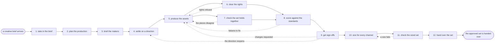

# Reference process: produce creative assets

`ref/mkt/creative-assets v1`

A creative producer takes an approved brief, settles on a direction,
gets the copy, images and video made, puts the finished set in front of
the people who sign it, cuts every approved asset to the sizes each
channel requires, and hands the set back to the process that asked for
it. A campaign or a launch asks for the assets once, and what comes back
has already been scored against the standards, signed, and cut to the
sizes the channels need.

## The activities

| # | Activity | What happens | Seats |
|---|---|---|---|
| 1 | take in the brief | work out which assets the brief actually needs | [creative-producer](../../agents/creative-producer.md) |
| 2 | plan the production | every asset listed, with its size and its due date | creative-producer |
| 3 | brief the makers | say what is needed, at what size, and by when | creative-producer · [copywriter](../../agents/copywriter.md) · [designer](../../agents/designer.md) · [video-editor](../../agents/video-editor.md) |
| 4 | settle on a direction | weigh concepts until one is worth backing | creative-producer · copywriter · designer |
| 5 | produce the assets | copy, images and video, made to the direction | copywriter · designer · video-editor |
| 6 | clear the rights | confirm the images, footage, fonts and music are ours | rights approver (person) · creative-producer |
| 7 | check the set holds together | read the pieces together and fix what disagrees | creative-producer |
| 8 | score against the standards | brand, claims and accessibility, scored with citations | [brand-check](../../agents/brand-check.md) · [accessibility-check](../../agents/accessibility-check.md) |
| 9 | get sign-offs | brand and legal approve the material | brand owner (person) · legal reviewer (person) |
| 10 | size for every channel | each asset cut to every channel's requirements | designer · video-editor · copywriter |
| 11 | check the sized set | score the sized versions before they go out | accessibility-check · brand-check · creative-producer |
| 12 | hand over the set | the approved set goes back to who asked for it | creative-producer |

## The graph



## The document, with the blanks marked

```
PROCESS: produce creative assets      id: <team>/creative-assets   v1
from: ref/mkt/creative-assets v1
owner: <who>                          effective: <date>
trigger: a creative brief is approved in <your requesting process>
concurrency: runs may overlap - <how many> sets in production at once
goal: copy, images and video that brand and legal have signed, cut to
      the sizes every channel in the brief requires, handed back to the
      process that asked for them
phases:
  take-in-brief    - human: read the brief and work out which assets it
                     actually needs, and what each one is for
                     owner: creative-producer  after: trigger
                     automation: <level>
  plan-production  - human: list every asset with its size, the seat
                     that owes it, and the date it is due
                     owner: creative-producer  after: take-in-brief
                     automation: <level>
  brief-makers     - convenes briefing: every producing seat hears the
                     same request at once
                     owner: creative-producer  after: plan-production
                     automation: <level>
  settle-direction - convenes bake-off: two or three concepts, one
                     chosen, with the reasons said out loud
                     owner: creative-producer  after: brief-makers
                     by: <days>                automation: <level>
  produce-assets   - runs build-by-talent: copy, images and video, each
                     made to the chosen direction
                     owner: creative-producer  after: settle-direction
                     by: <days>                automation: <level>
  clear-rights     - human: <who> confirms the organization holds the
                     rights to every image, clip, font and track used
                     owner: <your rights approver>
                     after: produce-assets     by: <days>
                     automation: never
  check-the-set    - human: read the pieces side by side and fix what
                     disagrees where they meet
                     owner: creative-producer  after: produce-assets
                     automation: <level>
  score-standards  - runs assessment: brand, claims and accessibility,
                     every verdict citing the rule it was scored on
                     owner: creative-producer
                     after: clear-rights + check-the-set
                     automation: <level>
  get-sign-offs    - convenes approval: brand and legal sign, as named
                     signers, against a version of the set
                     owner: <your legal seat>  after: score-standards
                     by: <days>                automation: never
  size-per-channel - runs build-by-talent: every approved asset cut to
                     the sizes and lengths each channel requires
                     owner: creative-producer  after: get-sign-offs
                     by: <days>                automation: <level>
  check-the-sizes  - runs assessment: the sized versions scored again,
                     because a resize can break what was signed
                     owner: creative-producer  after: size-per-channel
                     automation: <level>
  hand-over        - human: the set goes back to the process that asked
                     for it, at the version the signers approved
                     owner: creative-producer  after: check-the-sizes
                     automation: <level>
run-scoped:
  status - runs roll-call                     owner: creative-producer
           every: <cadence>
           from: brief-makers   until: hand-over
handoffs:
  take-in-brief -> plan-production: the list of assets the brief needs,
    and what each one has to do
  plan-production -> brief-makers: the plan, saying what each seat owes
    and when it is due
  settle-direction -> produce-assets: the chosen concept, and why it won
  produce-assets -> clear-rights: every source used, named, with where
    it came from and the license it was used under
  produce-assets -> check-the-set: the pieces at a version
  clear-rights + check-the-set -> score-standards: the set at a version,
    with the rights settled
  score-standards -> get-sign-offs: the scores, so the signers read the
    exceptions instead of everything
  get-sign-offs -> size-per-channel: the approved set at the signed
    version. A later change voids the approval and sign-offs run again
  size-per-channel -> check-the-sizes: every channel version, named
    against the master it was cut from
  check-the-sizes -> hand-over: the set as it will actually be used,
    with the scores attached
bindings:
  roster:  <who holds each seat - agents claiming the abstract agents
           above, and named people for rights, brand and legal>
  systems: the asset store (write), the review record (write),
           licensed image, footage and music sources (read),
           the production plan (write)
  data:    the creative brief, brand guidelines <version>,
           <your claims register>, <your accessibility standard>
           <version>, the licenses the organization holds
policy:
  nothing leaves this process unsigned
  no asset ships until a person has confirmed the organization holds the
    rights to everything in it
  an asset changed after sign-off goes back through sign-offs
  every claim in the copy cites <your claims register>
measures:
  cycle time: <target> from the brief to the handover
  volume: <sets per period>
  rework: <how many> sets come back from sign-off with changes
  quality gate: nothing hands over unsigned, and nothing hands over with
    a rights question still open
```

## The failure edges

- **A sign-off comes back with changes.** The run returns to producing
  the assets, and only the piece the signers named reopens. When the
  changes are large enough to put the direction itself back in question,
  the producer says so and the run returns to settling the direction,
  which costs the schedule a round.
- **A rights approver refuses a source.** The piece goes back to the
  seat that made it and gets remade from something the organization
  holds. The refusal is recorded against the asset, and the run does not
  settle it by using the source anyway.
- **A standard fails.** Brand-check and accessibility-check report every
  failure with the rule attached, the seat that made the piece fixes
  what was named, and the same scoring runs again. Only a person can
  waive a finding, and that decision is recorded with the failure
  attached to it.
- **A signed set goes stale before it is used.** Sign-off was given
  against a version of the brief, the brand guidelines and the claims
  register. When any of those is re-versioned before the set ships, the
  set is scored again and signed again.
- **The trigger fires while runs are in flight.** Sets overlap normally.
  The concurrency line says how many, and runs share the brand
  guidelines, the claims register and the accessibility standard
  read-only.
- **A run is abandoned.** The producer records which pieces were
  finished and where the drafts sit, so a later run can start from them.
  Anything already handed over stays handed over, and the process that
  asked for the assets is told the rest is not coming.
