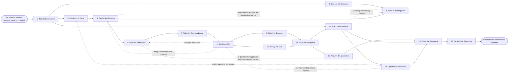

# Reference process: Manage Crisis Communication

`ref/mkt/crisis-communication v1`

**value stream:** [Story-to-Coverage](../../streams/marketing/story-to-coverage.md)
A communications manager takes an incident that is going to become
public, has the facts confirmed by the people who know them, puts out a
short holding line while a person decides what the organization will
say, drives the wording through legal and leadership, issues it to the
press, customers, staff and partners at the same time, answers what
comes back, corrects the record when a fact changes, and reviews
afterwards what was known at each point. A person decides what the
organization says, and no agent in this process issues anything while
that decision is still open. The run stays open past the last statement,
because the review of what was known and when it was known is part of
the work.

## The activities

| # | Activity | What happens | Agents |
|---|---|---|---|
| 1 | Take in the Incident | record what happened and who already knows | [comms-manager](../../agents/comms-manager.md) · [community-manager](../../agents/community-manager.md) |
| 2 | Confirm the Facts | establish what happened from the people who know | [researcher](../../agents/researcher.md) · subject matter expert (person) · comms-manager |
| 3 | Size up the Exposure | who is affected and how far the story will travel | comms-manager · [coverage-monitor](../../agents/coverage-monitor.md) · [press-relations](../../agents/press-relations.md) · legal reviewer (person) |
| 4 | Issue a Holding Line | a first short word out while the facts are confirmed | comms-manager · [copywriter](../../agents/copywriter.md) · legal reviewer (person) · leadership (person) |
| 5 | Decide the Position | a person decides what the company will say | leadership (person) · legal reviewer (person) · comms-manager |
| 6 | Draft the Statement | the words the company will say, at a version | copywriter · press-relations · comms-manager |
| 7 | Tailor for Each Audience | versions for press, customers, staff and partners | copywriter · press-relations · community-manager |
| 8 | Get Sign-Offs | legal and leadership sign the exact wording | [brand-check](../../agents/brand-check.md) · legal reviewer (person) · leadership (person) |
| 9 | Brief the Speakers | everyone who may be asked gets the same answers | comms-manager · spokesperson (person) · press-relations · community-manager |
| 10 | Notify the Staff | staff hear it from the company before the press | comms-manager · copywriter · leadership (person) |
| 11 | Issue the Response | the statement goes out on every channel named | comms-manager · [web-producer](../../agents/web-producer.md) · [email-producer](../../agents/email-producer.md) · press-relations · community-manager |
| 12 | Answer the Questions | reporters, customers and the public get replies | community-manager · press-relations · spokesperson (person) |
| 13 | Track the Coverage | what is published and said, hour by hour | coverage-monitor · [analytics](../../agents/analytics.md) · community-manager |
| 14 | Update the Response | new facts change the statement, at a new version | comms-manager · researcher · copywriter · legal reviewer (person) |
| 15 | Close the Response | a person says the active response is over | leadership (person) · comms-manager |
| 16 | Review the Response | what was known when, and what to change | comms-manager · leadership (person) · legal reviewer (person) · coverage-monitor |

## The graph



## The document, with the blanks marked

```
PROCESS: crisis communication         id: <team>/crisis-communication   v1
from: ref/mkt/crisis-communication v1
owner: <who>                          effective: <date>
trigger: an incident that will become public is reported to <your
         escalation channel>
concurrency: one response per incident - <how many> live at once
goal: a response issued on every channel the incident reaches, saying
      the same thing to every audience, corrected when the facts move,
      and reviewed afterwards against what was known at each point
phases:
  take-in-incident  - human: write down what happened, the time it was
                      reported, who reported it, and who already knows
                      owner: comms-manager      after: trigger
                      automation: <level>
  confirm-facts     - convenes briefing: the people handling the
                      incident say what is established and what is not
                      owner: comms-manager      after: take-in-incident
                      by: <hours>               automation: <level>
  size-exposure     - human: who is affected, which audiences have to
                      hear it, and how far the story is likely to reach
                      owner: comms-manager      after: take-in-incident
                      by: <hours>               automation: <level>
  holding-line      - human: a short first statement saying only what is
                      established, signed by <who> before it goes out
                      owner: comms-manager      after: size-exposure
                      by: <hours>               automation: never
  decide-position   - convenes decide-and-announce: <who> decides what
                      the organization will say about what happened
                      owner: <who decides>
                      after: confirm-facts + holding-line
                      by: <hours>               automation: never
  draft-statement   - human: the words the organization will say, at a
                      version, every fact carrying the source under it
                      owner: copywriter         after: decide-position
                      by: <hours>               automation: <level>
  tailor-audiences  - runs build-by-talent: the press, the customer, the
                      staff and the partner version, all saying the same
                      thing
                      owner: comms-manager      after: draft-statement
                      by: <hours>               automation: <level>
  get-sign-offs     - convenes approval: legal and <who> sign, as named
                      signers, against a version of the exact wording
                      owner: <your legal role>  after: tailor-audiences
                      by: <hours>               automation: never
  brief-speakers    - convenes briefing: everyone who may be asked hears
                      the approved answers and where the rest goes
                      owner: comms-manager      after: get-sign-offs
                      by: <hours>               automation: <level>
  notify-staff      - human: staff are told before the statement reaches
                      the press, and are told where their questions go
                      owner: comms-manager      after: get-sign-offs
                      automation: <level>
  issue-response    - human: <who> says go, and the statement goes out
                      on every channel the exposure named
                      owner: comms-manager
                      after: brief-speakers + notify-staff
                      automation: never
  answer-questions  - human: reporters, customers and the public get
                      answers taken from the approved wording
                      owner: comms-manager      after: issue-response
                      automation: <level>
  track-coverage    - runs collect-and-report: what ran, where it ran,
                      when it appeared, and what it actually said
                      owner: coverage-monitor   after: take-in-incident
                      every: <interval>         automation: <level>
  update-response   - human: a new fact, or a published fact that is
                      wrong, changes the wording at a new version
                      owner: comms-manager      after: track-coverage
                      by: <hours>               automation: <level>
  close-response    - human: <who> says the active response is over and
                      names who holds the standing answers afterwards
                      owner: <who decides>
                      after: answer-questions + track-coverage
                      automation: never
  review-response   - convenes debrief: what was known at each point,
                      what was said, and what changes before next time
                      owner: comms-manager      after: close-response
                      by: <days>                automation: <level>
run-scoped:
  status  - runs roll-call                      owner: comms-manager
            every: <interval>
            from: take-in-incident   until: close-response
  numbers - runs collect-and-report             owner: analytics
            every: <interval>
            from: issue-response   until: run close
handoffs:
  take-in-incident -> confirm-facts: what was reported, the time it was
    reported, and who already knows
  take-in-incident -> size-exposure: the same record. Both branches read
    one incident record
  take-in-incident -> track-coverage: what to watch for, before anything
    has been said
  confirm-facts -> decide-position: what is established, what is still
    open, and the time each fact was established
  size-exposure -> holding-line: the audiences that have to hear
    something, and how soon each one has to hear it
  holding-line -> decide-position: the words already said in public,
    which the position has to hold
  decide-position -> draft-statement: the position a named person
    decided, and the questions that stay unanswered on purpose
  draft-statement -> tailor-audiences: the statement at a version, every
    fact carrying its source and the time it was established
  tailor-audiences -> get-sign-offs: the four versions under one version
    number, so the signers read them against each other
  get-sign-offs -> brief-speakers: the approved wording at the signed
    version, and the questions it does not answer
  get-sign-offs -> notify-staff: the staff version at the signed version
  brief-speakers -> issue-response: who may speak, on what, and where
    every other question is sent
  issue-response -> answer-questions: what went out, on which channel,
    at what time
  issue-response -> track-coverage: the same record, so a mention can be
    traced back to what was sent
  track-coverage -> update-response: what ran, quoted, with anything
    wrong set beside the source that corrects it
  update-response -> get-sign-offs: the changed wording at a new
    version, because a change voids the approval
  close-response -> review-response: the timeline at its final version,
    and every version of every audience's wording
bindings:
  roster:  <who holds each role - agents claiming the abstract agents
           above, and named people for leadership, legal, the expert and
           the spokesperson>
  systems: the incident record (read), the message record (write),
           the announcement timeline (write), the website (write),
           the outbound mail system (write), the social inboxes (write),
           the press and analyst contact record (write),
           the coverage record (write), analytics (read),
           the staged releases (trigger)
  data:    brand guidelines <version>, <your claims register>,
           <your standing crisis plan> <version>, the incident record
policy:
  a person decides what the organization says, at every version
  nothing goes out unsigned, and the holding line counts as something
    going out
  wording changed after sign-off goes back through sign-offs
  no agent answers a question the approved wording does not cover, and an
    unanswerable question goes to <who> within <how long>
  a fact that turns out to be wrong is corrected in a new version, and
    the version it corrects stays where it is
  every audience is told the same thing, and staff are told before the
    press
  no agent asks an outside publication for a correction - <who> decides
    whether to ask, and a person asks
  an incident that reaches a regulator, a customer's data or somebody's
    safety goes to <who> before anything is said in public
measures:
  cycle time: <target> from the incident report to the holding line, and
              <target> from the incident report to the full response
  volume: <responses per period>
  quality gate: nothing goes out unsigned, and every fact in what goes
                out carries the time it was established
```

## The failure edges

- **The story breaks before the facts are confirmed.** The holding line
  goes out while confirm-facts is still running, and it says only what
  has been established by then. The coverage that broke the story is
  logged against the timeline, so the review can see that the
  organization was answering something already public.
- **Leadership cannot agree on the position.** The run stops at
  decide-position. The holding line stands as the last thing the
  organization has said, nothing further goes out, and the deadline on
  that decision belongs to <who>. Publishing while the position is open
  is not one of the choices.
- **Legal declines the wording.** The run returns to draft-statement and
  only the part legal named reopens. The audience versions are rebuilt
  from the corrected statement, because all four have to keep saying the
  same thing as each other. When a signer objects to the position
  itself, the run goes further back, to decide-position, and a person
  decides it again.
- **A fact in the issued response turns out to be wrong.** The
  coverage-monitor agent or the people handling the incident raise it,
  update-response writes the correction, and the correction goes back
  through sign-offs before it is issued. The version it corrects stays
  where it is, and the timeline records when the organization learned it
  was wrong.
- **A reporter publishes something wrong.** The coverage-monitor agent
  records the wrong sentence with the source that corrects it, and
  escalates. A person decides whether to ask for a correction, and a
  person asks.
- **Someone inside talks to the press before the staff are told.** The
  staff notice and the response are issued together rather than in
  sequence, and the review records that the sequence was lost. A
  shortened timeline leaves the wording alone, and what goes out is
  still the version the signers approved.
- **A question arrives that the approved wording does not answer.** The
  agent holding the conversation escalates before replying, every time.
  If the answer matters enough to give, the run goes back to
  draft-statement and the new wording is signed like any other.
- **The incident gets worse while the response is live.** The run
  re-enters at confirm-facts and walks forward from there. The statement
  already issued stays where it is, and the next one says what changed.
- **The incident never becomes public.** A person closes the run at
  close-response with nothing having been issued outside the
  organization. What was known and when stays recorded, because the
  reason for keeping that record does not depend on the story running.
- **The trigger fires while a response is live.** Two incidents at once
  need two holders of the comms-manager agent. The two runs share one
  set of approved wording only when a person says they are the same
  story.
- **A run is abandoned.** Any statement already issued stays published
  at its version, the holding line is not quietly deleted, and the
  review still happens.
