# Reference process: the customer case study

`ref/mkt/customer-case-study v1`

**value stream:** [Idea-to-Asset](../../streams/marketing/idea-to-asset.md)
An advocacy manager finds a customer willing to be named, agrees with
that customer what may be used and for how long, and a content manager
has the story researched, written, edited and signed off inside those
terms. The customer then reads the finished story and clears their own
words before anything goes live. The run stays open past publication,
because the agreement has an end date and the customer can withdraw at
any point.

## The activities

| # | Activity | What happens | Seats |
|---|---|---|---|
| 1 | take in the candidate | the customer, and what their story could show | [advocacy-manager](../../agents/advocacy-manager.md) |
| 2 | check where the account stands | usage, support history, and the renewal position | [account-monitor](../../agents/account-monitor.md) |
| 3 | make the ask | the customer is asked and agrees to take part | advocacy-manager |
| 4 | agree what the customer will do | what may be used, where, as whom, until when | advocacy-manager · customer (person) · legal reviewer (person) |
| 5 | clear the rights | the logo, the footage, the appearance release | [rights-register](../../agents/rights-register.md) · rights approver (person) |
| 6 | brief the story | every seat hears the same request at once | [content-manager](../../agents/content-manager.md) · advocacy-manager · [researcher](../../agents/researcher.md) · [copywriter](../../agents/copywriter.md) · [editor](../../agents/editor.md) · [creative-producer](../../agents/creative-producer.md) |
| 7 | verify the customer's results | the numbers read from the systems that hold them | researcher · account-monitor |
| 8 | interview the customer | the customer says what happened, in their words | researcher · customer (person) |
| 9 | agree what the story argues | the argument, and the order the story tells it in | content-manager · editor · copywriter |
| 10 | write the draft | the story is written to the agreed shape | copywriter |
| 11 | edit the draft | the editor says what has to be rewritten | editor |
| 12 | check the facts | every claim is read against the source under it | researcher |
| 13 | make the visuals | photography, the quote card, the video cut | creative-producer · [designer](../../agents/designer.md) · [video-editor](../../agents/video-editor.md) |
| 14 | get internal sign-offs | brand and legal approve the story | [brand-check](../../agents/brand-check.md) · brand owner (person) · legal reviewer (person) |
| 15 | get the customer's approval | the customer clears their own words at a version | advocacy-manager · customer (person) |
| 16 | build the page | the story becomes a page in the site | [web-producer](../../agents/web-producer.md) |
| 17 | check the finished page | accessibility, load time, links, title, headings | [accessibility-check](../../agents/accessibility-check.md) · [search-optimizer](../../agents/search-optimizer.md) |
| 18 | publish | the owner says go and the page goes live | content-manager · web-producer |
| 19 | hand the story to sales | the slide, the one-pager, what it may be used for | [sales-enablement-manager](../../agents/sales-enablement-manager.md) · advocacy-manager |
| 20 | watch performance | traffic, use in deals, what readers do next | [analytics](../../agents/analytics.md) · content-manager |
| 21 | record what was learned | what to repeat, what to avoid | content-manager · advocacy-manager |

## The graph

```mermaid
flowchart LR
  T([a customer is willing to be named]) --> A1[1. take in the candidate]
  A1 --> A2[2. check where the account stands]
  A2 -. the account is not one to point at .-> A1
  A2 --> A3[3. make the ask]
  A3 --> A4[4. agree what the customer will do]
  A4 --> A5[5. clear the rights]
  A4 --> A6[6. brief the story]
  A6 --> A7[7. verify the customer's results]
  A6 --> A8[8. interview the customer]
  A7 -. the numbers do not hold .-> A3
  A7 --> A9[9. agree what the story argues]
  A8 --> A9
  A9 --> A10[10. write the draft]
  A9 --> A13[13. make the visuals]
  A5 --> A13
  A10 --> A11[11. edit the draft]
  A11 -. rewrite what the edit named .-> A10
  A11 --> A12[12. check the facts]
  A12 -. a claim with no source .-> A10
  A12 --> A14[14. get internal sign-offs]
  A13 --> A14
  A14 -. changes requested .-> A10
  A14 -. changes requested .-> A13
  A14 --> A15[15. get the customer's approval]
  A15 -. the customer asks for changes .-> A10
  A15 -. the customer asks for changes .-> A13
  A15 --> A16[16. build the page]
  A16 --> A17[17. check the finished page]
  A17 -. failures to fix .-> A16
  A17 --> A18[18. publish]
  A18 --> A19[19. hand the story to sales]
  A18 --> A20[20. watch performance]
  A20 -. the customer withdraws .-> A16
  A19 --> A21[21. record what was learned]
  A20 --> A21
  A21 --> DONE([the story is live and the customer has cleared it])
```



## The document, with the blanks marked

```
PROCESS: customer case study          id: <team>/customer-case-study v1
from: ref/mkt/customer-case-study v1
owner: <who>                          effective: <date>
trigger: a customer is willing to be named in a story
concurrency: runs overlap - <how many> stories in production at once
goal: a published story about one named customer, cleared by that
      customer at the version that published, used inside the terms
      they agreed to and for as long as those terms run
phases:
  take-in-candidate  - human: name the customer and write down what
                       their story could show a reader
                       owner: advocacy-manager   after: trigger
                       automation: <level>
  check-standing     - human: read the product usage, the support
                       history, the contract and the renewal position
                       owner: account-monitor    after: take-in-candidate
                       by: <days>                automation: <level>
  make-ask           - human: ask the customer, and record the answer
                       that came back whichever way it went
                       owner: advocacy-manager   after: check-standing
                       automation: <level>
  agree-terms        - convenes approval: the customer and <your legal
                       seat> sign what may be used, in which channels,
                       under which name and title, and until when
                       owner: advocacy-manager   after: make-ask
                       by: <days>                automation: never
  clear-rights       - human: the customer's logo, the footage, the
                       photography and the appearance release, checked
                       against what the organization may use
                       owner: rights-register    after: agree-terms
                       by: <days>                automation: <level>
  brief-story        - convenes briefing: the agreed terms and what the
                       story has to show, heard by every seat at once
                       owner: content-manager    after: agree-terms
                       automation: <level>
  verify-results     - human: every number the story will use, read
                       from the system that holds it, with its date
                       owner: researcher         after: brief-story
                       by: <days>                automation: <level>
  interview-customer - human: the interview, recorded, marked with what
                       the customer agreed could be quoted
                       owner: researcher         after: brief-story
                       by: <days>                automation: <level>
  agree-story        - convenes decide-and-announce: what the story
                       argues, and the order of its sections
                       owner: content-manager
                       after: verify-results + interview-customer
                       automation: <level>
  write-draft        - human: the story written to the agreed shape,
                       with the customer's words used as they were said
                       owner: copywriter         after: agree-story
                       by: <days>                automation: <level>
  edit-draft         - runs layered-passes: the structure and argument
                       pass, item by item, back to the writer
                       owner: editor             after: write-draft
                       by: <days>                automation: <level>
  check-facts        - runs layered-passes: the fact pass, every claim
                       against the source it cites
                       owner: researcher         after: edit-draft
                       by: <days>                automation: <level>
  make-visuals       - runs build-by-talent: the photography, the quote
                       card and the video cut, inside the cleared
                       rights
                       owner: creative-producer
                       after: agree-story + clear-rights
                       by: <days>                automation: <level>
  internal-sign-offs - convenes approval: brand and legal sign, as
                       named signers, against a version of the story
                       owner: <your legal seat>
                       after: check-facts + make-visuals
                       by: <days>                automation: never
  customer-approval  - convenes approval: the customer signs the story
                       at a version, as the named signer
                       owner: advocacy-manager
                       after: internal-sign-offs
                       by: <days>                automation: never
  build-page         - human: the cleared story assembled into a page,
                       with a preview link and its address set
                       owner: web-producer       after: customer-approval
                       by: <days>                automation: <level>
  check-page         - runs assessment: the accessibility and technical
                       standards, and the search check
                       owner: content-manager    after: build-page
                       by: <days>                automation: <level>
  publish            - human: the named owner says go and the producer
                       puts the page live
                       owner: content-manager    after: check-page
                       automation: <level>
  hand-to-sales      - human: the slide, the one-pager, and the note
                       saying what the story may be used for and until
                       when
                       owner: sales-enablement-manager
                       after: publish
                       by: <days>                automation: <level>
  watch              - human: traffic, the deals the story gets used
                       in, and what readers do after they read it
                       owner: analytics          after: publish
                       automation: <level>
  record-learnings   - convenes debrief: what to repeat, what to avoid
                       owner: content-manager
                       after: hand-to-sales + watch
                       automation: <level>
run-scoped:
  permission  - runs roll-call                 owner: advocacy-manager
                every: <cadence>
                from: customer-approval   until: the agreement ends
  status      - runs roll-call                 owner: content-manager
                every: <cadence>
                from: brief-story   until: publish
  performance - runs collect-and-report        owner: analytics
                every: <cadence>
                from: publish   until: run close
handoffs:
  take-in-candidate -> check-standing: the account, and the question
    the standing check has to answer about it
  check-standing -> make-ask: where the account stands, with the system
    each reading came from and the date it was current
  make-ask -> agree-terms: what the customer agreed to in principle,
    and anything they said they will not do
  agree-terms -> brief-story: the terms as signed, so that no seat
    plans anything the customer did not agree to
  agree-terms -> clear-rights: the marks, the footage and the people
    the story will use, and the channels it will run on
  brief-story -> verify-results: the numbers the story will rest on,
    and where each one is expected to be found
  verify-results -> agree-story: each number with its source and the
    date it was read
  interview-customer -> agree-story: what the customer said,
    attributed, and marked with what may be quoted
  agree-story -> write-draft: the argument and the sections
  agree-story -> make-visuals: the visuals the story needs
  clear-rights -> make-visuals: what may be used, on which channels,
    and what may not be used at all
  edit-draft -> write-draft: the edit at a version, item by item, in
    terms the writer can work through without coming back to ask
  check-facts -> internal-sign-offs: the story at a version, with every
    claim carrying the source it rests on
  make-visuals -> internal-sign-offs: the visual set at a version
  internal-sign-offs -> customer-approval: the story the organization
    has signed, at that version and no later one
  customer-approval -> build-page: the story at the version the
    customer cleared. A later change voids the clearance and the story
    goes back to the customer
  check-page -> publish: the scored list, with the rule behind every
    failure
  publish -> hand-to-sales: the live address, the version that
    published, and the date the agreement runs out
  watch -> record-learnings: the numbers set against what the story was
    approved to do
bindings:
  roster:  <who holds each seat - agents claiming the abstract agents
           above, and named people for the customer, legal, brand and
           rights>
  systems: the advocacy record (write), the rights and permissions
           record (write), the account standing record (read),
           the content plan (write), the asset store (write),
           the source record (write), the website (write),
           analytics (read), the CRM (read),
           the sales material store (write)
  data:    brand guidelines <version>, <your claims register>,
           <your style guide> <version>,
           <your accessibility standard> <version>,
           the customer's agreement at its version
policy:
  the customer approves their own words, and that approval is a human
    gate that is never delegated to an agent
  a story changed after the customer cleared it goes back to the
    customer before it goes any further
  nothing publishes without the customer's clearance recorded against
    the version that publishes
  a withdrawal is acted on within <how long>, at whatever stage the
    story has reached
  every number about the customer carries the system it was read from
    and the date it was read
  the customer is offered nothing of value in return for the story
  the story comes down on the date the agreement ends, unless the
    customer has agreed in writing to extend it
measures:
  cycle time: <target> from the customer agreeing to publication
  volume: <stories per period>
  quality gate: nothing publishes without the customer's recorded
                clearance at the published version
```

## The failure edges

- **The customer asks for changes to their own words.** The run goes
  back to the draft, or to the visuals when the change is to a picture
  or a video, and only what the customer named reopens. The corrected
  version goes back to the customer, and the internal signers see it
  again before it publishes.
- **The customer withdraws before publication.** The run stops where it
  is. Nothing about that customer publishes, the advocacy-manager seat
  records the withdrawal with its date and the reason the customer
  gave, and the drafts and the visuals stay in the asset store marked
  as material that may not be used. A person decides whether the
  customer may be asked again and when.
- **The customer withdraws after publication.** The page comes down
  within the time the policy sets, and the run returns to build-page so
  that the producer records what now stands at the address. The story
  is pulled out of the sales material as well, because the sales team
  holds its own copy of it. The advocacy-manager seat puts this in
  front of a person on the day it arrives.
- **The account stops being one to point at.** The account-monitor seat
  finds a support problem, a dispute or a renewal in trouble after the
  ask has already gone out. The run pauses and a person decides whether
  it continues, and the story does not publish while that question is
  open.
- **The numbers do not hold up.** The researcher reports what the
  systems actually say, and the run goes back to the ask, because the
  story the customer agreed to tell is no longer the story the evidence
  supports. The customer hears what changed before anything is
  rewritten around it.
- **The agreement runs out.** The rights-register seat warns before the
  end date. The advocacy-manager seat asks the customer to extend it,
  and the story comes down on the date if there is no extension in
  writing.
- **An internal sign-off comes back with changes.** The run returns to
  the draft or to the visuals, and only the piece the signers named
  reopens. The customer never sees a version the organization has not
  signed.
- **The check on the finished page fails.** The findings go back to
  build-page with the rule attached to each one, the web-producer seat
  fixes what the findings name, and the same check runs again on the
  fixed page.
- **The trigger fires while runs are in flight.** Stories overlap
  normally, and the concurrency line says how many. The
  advocacy-manager seat holds the standing record across every run, so
  that two runs never approach the same customer at once.
- **A run is abandoned.** The draft, the evidence and the visuals stay
  where they are at their versions. The customer is told that the story
  is not going ahead, and the agreement is closed out, so that a later
  run starts by asking again instead of assuming the old permission
  still stands.
