# Reference process: Publish Customer Newsletter

`ref/mkt/customer-newsletter v1`

**value stream:** [Customer-to-Advocate](../../streams/marketing/customer-to-advocate.md)
A content manager opens a publishing cycle, settles what the issue
carries, gets the permission for the customer story it features, has the
items written and the visuals made, has the issue built and proofed in
the sending system, sends it once the named owner says go, and reports
how it did against what the issue was for. The run stays open past the
send, because subscribers reply for days afterwards and the manager
still owes a report. Every check in this process happens before the
send, because a sent issue cannot be recalled.

## The activities

| # | Activity | What happens | Seats |
|---|---|---|---|
| 1 | Open the Issue | settle what the issue is for and when it sends | [content-manager](../../agents/content-manager.md) |
| 2 | Settle the Lineup | choose the items the issue carries | content-manager · leadership (person) |
| 3 | Check Where the Account Stands | whether the customer can be asked at all | [account-monitor](../../agents/account-monitor.md) |
| 4 | Clear the Customer Story | permission for the story and what it may say | [advocacy-manager](../../agents/advocacy-manager.md) · account owner (person) · rights approver (person) |
| 5 | Brief the Makers | everyone hears the same request at once | content-manager · [copywriter](../../agents/copywriter.md) · [designer](../../agents/designer.md) · [editor](../../agents/editor.md) · [email-producer](../../agents/email-producer.md) |
| 6 | Write the Draft | the items, the subject lines and the calls to action | copywriter |
| 7 | Make the Visuals | images and diagrams sized for mail | designer |
| 8 | Edit the Draft | the editor says what has to be rewritten | editor |
| 9 | Build the Issue | template, links, plain text, and who receives it | email-producer |
| 10 | Wire up the Measurement | link tracking and what counts as a conversion | [conversion-tracker](../../agents/conversion-tracker.md) |
| 11 | Proof the Issue | test copies read the way a subscriber gets them | email-producer · [accessibility-check](../../agents/accessibility-check.md) · content-manager |
| 12 | Get Sign-Offs | brand, claims and legal approve the issue | [brand-check](../../agents/brand-check.md) · brand owner (person) · legal reviewer (person) |
| 13 | Send the Issue | the owner says go and the issue goes out | content-manager · email-producer |
| 14 | Watch the Results | delivery, opens, clicks, unsubscribes, conversions | email-producer · [analytics](../../agents/analytics.md) · content-manager |
| 15 | Answer the Replies | reply to what subscribers write back | [community-manager](../../agents/community-manager.md) |
| 16 | Report the Results | results set against what the issue was for | content-manager · analytics |
| 17 | Record What Was Learned | what to repeat, what to avoid | content-manager |

The customer story runs on its own branch from activity 3 to activity 4.
It rejoins the rest of the run at the sign-offs, because the permission
is one of the things the signers read. The items in an issue point at
pieces that already went through their own research, fact checking and
sign-off, so this process checks the issue itself and does not check
each piece again.

## The graph

```mermaid
flowchart LR
  T([a publishing cycle opens]) --> A1[1. Open the Issue]
  A1 --> A2[2. Settle the Lineup]
  A2 --> A3[3. Check Where the Account Stands]
  A2 --> A5[5. Brief the Makers]
  A3 -. the account cannot be asked .-> A2
  A3 --> A4[4. Clear the Customer Story]
  A4 -. the customer declines .-> A2
  A4 -. the terms narrow what was written .-> A6
  A4 --> A12[12. Get Sign-Offs]
  A5 --> A6[6. Write the Draft]
  A5 --> A7[7. Make the Visuals]
  A6 --> A8[8. Edit the Draft]
  A8 -. rewrite what the edit named .-> A6
  A8 --> A9[9. Build the Issue]
  A7 --> A9
  A9 --> A10[10. Wire up the Measurement]
  A10 -. the issue has to change .-> A9
  A10 --> A11[11. Proof the Issue]
  A11 -. failures to fix .-> A9
  A11 --> A12
  A12 -. changes requested .-> A6
  A12 -. changes requested .-> A7
  A12 --> A13[13. Send the Issue]
  A13 --> A14[14. Watch the Results]
  A13 --> A15[15. Answer the Replies]
  A14 --> A16[16. Report the Results]
  A15 --> A16
  A16 --> A17[17. Record What Was Learned]
  A17 --> DONE([the issue is sent and reported])
```



## The document, with the blanks marked

```
PROCESS: customer newsletter          id: <team>/customer-newsletter  v1
from: ref/mkt/customer-newsletter v1
owner: <who>                          effective: <date>
trigger: a publishing cycle opens in <your newsletter schedule>
concurrency: one issue at a time per newsletter - <how many> issues in
             production at once across <how many> newsletters
goal: an issue that carries what the lineup promised, sends on its date
      to the subscribers entitled to receive it, and is reported
      against what the issue was for
phases:
  open-issue       - human: read the cycle and write down what this
                     issue is for, who it goes to, and its send date
                     owner: content-manager    after: trigger
                     automation: <level>
  settle-lineup    - convenes decide-and-announce: the items this issue
                     carries, in order, with what each one is for
                     owner: content-manager    after: open-issue
                     by: <days>                automation: <level>
  check-standing   - human: whether the account the issue means to
                     feature is in a state where it can be asked
                     owner: account-monitor    after: settle-lineup
                     automation: <level>
  clear-story      - human: the account owner asks the customer, and
                     what may be said and quoted is agreed in writing
                     owner: advocacy-manager   after: check-standing
                     by: <days>                automation: never
  brief-makers     - convenes briefing: the lineup and the send date,
                     heard by every seat at once
                     owner: content-manager    after: settle-lineup
                     automation: <level>
  write-draft      - runs build-by-talent: the items, the subject lines
                     and the call to action in each item
                     owner: copywriter         after: brief-makers
                     by: <days>                automation: <level>
  make-visuals     - runs build-by-talent: the images and the diagrams,
                     at the widths and file sizes mail will carry
                     owner: designer           after: brief-makers
                     by: <days>                automation: <level>
  edit-draft       - runs layered-passes: the structure and argument
                     pass, item by item, back to the writer
                     owner: editor             after: write-draft
                     by: <days>                automation: <level>
  build-issue      - human: the template, every link, the plain-text
                     version, and the segment this issue goes to
                     owner: email-producer
                     after: edit-draft + make-visuals
                     by: <days>                automation: <level>
  wire-measurement - human: the tracking on every link and the actions
                     that count as a conversion for this issue
                     owner: conversion-tracker after: build-issue
                     automation: <level>
  proof-issue      - runs assessment: proof copies read as a subscriber
                     receives them, scored against the standards
                     owner: content-manager    after: wire-measurement
                     by: <days>                automation: <level>
  get-sign-offs    - convenes approval: brand, claims and legal sign, as
                     named signers, against a version of the issue
                     owner: <your legal seat>
                     after: proof-issue + clear-story
                     by: <days>                automation: never
  send-issue       - human: the named owner says go and the producer
                     releases the send
                     owner: content-manager    after: get-sign-offs
                     automation: never
  watch-results    - human: what was delivered, what bounced, who
                     complained, who left, and what converted
                     owner: analytics          after: send-issue
                     automation: <level>
  answer-replies   - human: reply to what subscribers write back, and
                     flag what needs a person
                     owner: community-manager  after: send-issue
                     automation: <level>
  report-results   - runs collect-and-report: the numbers set against
                     what the issue was for
                     owner: content-manager
                     after: watch-results + answer-replies
                     by: <days>                automation: <level>
  record-learnings - convenes debrief: what to repeat, what to avoid
                     owner: content-manager    after: report-results
                     automation: <level>
run-scoped:
  status  - runs roll-call                     owner: content-manager
            every: <cadence>
            from: brief-makers   until: send-issue
  results - runs collect-and-report            owner: analytics
            every: <cadence>
            from: send-issue   until: run close
handoffs:
  open-issue -> settle-lineup: what this issue is for, who receives it,
    and the date it sends
  settle-lineup -> check-standing: the customer the issue means to
    feature, and what the issue wants to say about them
  settle-lineup -> brief-makers: the items in order, with what each one
    is for and what it links to
  check-standing -> clear-story: where the account stands, with the
    evidence under it and the date each reading was current
  clear-story -> get-sign-offs: the permission at the wording the
    customer agreed to, naming what may be used and until when
  brief-makers -> write-draft: the request as every seat heard it, and
    the date the issue is promised
  edit-draft -> write-draft: the edit at a version, item by item, in
    terms the writer can work through without coming back to ask
  edit-draft -> build-issue: the copy at a version, with the subject
    lines and the call to action in each item
  make-visuals -> build-issue: the images at a version, at the widths
    and file sizes mail will carry
  build-issue -> wire-measurement: the issue as it will be sent, while
    it can still be changed
  wire-measurement -> proof-issue: the issue with its tracking on, and
    a dated test showing each conversion arriving
  proof-issue -> get-sign-offs: the scored proof, with the rule behind
    every failure, and the audience count for this send
  get-sign-offs -> send-issue: the approved issue at the signed
    version. A later change voids the approval and sign-offs run again
  send-issue -> watch-results: the send record, naming who said go,
    which version went out and which segment received it
  report-results -> record-learnings: the report, as delivered
bindings:
  roster:  <who holds each seat - agents claiming the abstract agents
           above, and named people for the account owner, legal, brand,
           rights and leadership>
  systems: the content plan (write), the asset store (write),
           the sending system (write), the live sends (trigger),
           the contact database (read), the consent record (read),
           the suppression lists (read), the advocacy record (write),
           the account standing record (read), analytics (read),
           the CRM (read), the review record (write)
  data:    brand guidelines <version>, <your claims register>,
           <your style guide> <version>,
           <your accessibility standard> <version>,
           the permission recorded for the featured customer
policy:
  no claim ships without a citation in <your claims register>
  sign-off is a human gate and is never delegated to an agent
  an issue changed after sign-off goes back through sign-offs
  nothing sends without a recorded go from the named owner
  a customer is named only where a recorded permission covers this
    issue, at the wording that customer agreed to
  the ask that gets that permission is made by a person
  every issue carries a working unsubscribe path, and a subscriber who
    leaves is out of the audience for the next send
measures:
  cycle time: <target> from the cycle opening to the send
  volume: <issues per period>
  quality gate: nothing sends unsigned, and no issue sends with a
                broken link or an unsubscribe path nobody tested
```

## The failure edges

- **The account is in no state to be asked.** The account-monitor seat
  reports a dispute, an open escalation or a renewal in trouble, and the
  run goes back to the lineup for a replacement item. Nobody asks that
  customer for this issue.
- **The customer declines, or agrees to less than the issue wanted.** A
  refusal sends the run back to the lineup with the reason and the date
  that customer may be asked again. A narrower agreement sends the run
  back to the draft, and the item is rewritten to what the customer
  agreed to or dropped from the issue.
- **A sign-off comes back with changes.** The run returns to the draft
  or to the visuals, and only the item the signers named reopens. The
  issue is built and proofed again before it goes any further.
- **A proof renders badly or a link is wrong.** The findings go back to
  build-issue with the rule attached to each one, the producer fixes
  what the findings name, and the same proof runs again on the fixed
  issue.
- **A mistake is found after the send.** An issue cannot be recalled,
  so the only remedy is a correction sent to the same segment. A person
  decides whether the correction is worth another send and what it
  says.
- **Delivery goes wrong while the send is going out.** Bounces or
  complaints past the threshold the process sets stop the send. Whether
  to stop it, and what to tell the people who already received it, are
  a person's calls.
- **The trigger fires while a run is in flight.** Issues of one
  newsletter run one at a time, and separate newsletters overlap
  normally. Runs share their reference data read-only.
- **A run is abandoned.** The draft and the visuals stay where they are
  at their versions, so a later issue can pick them up. The unsent issue
  stays in the sending system with sending switched off, and any
  permission the customer gave is recorded as unused, with the date it
  expires.
