# Reference process: recruit a customer reference

`ref/mkt/customer-reference v1`

An advocacy manager takes in a request for a customer reference, works
out what the reference has to be able to show, and draws up a list of
customers who fit. An account monitor reads each of those accounts and
reports whether it is in good enough standing to be approached, and a
researcher verifies the results the reference would rest on. The person
who owns the account says whether the customer can be asked now and then
makes the ask. When a customer agrees, the process settles what the
customer is willing to do, waits for the customer's own approvals, gets
legal and rights to confirm what the permission covers, and writes the
reference onto the standing list with its limits and the date it runs
out. The run closes when the requester has a cleared, willing customer
to use. It stops before any story, quote or case study is made, because
producing that material is separate work that reads this list.

## The activities

| # | Activity | What happens | Seats |
|---|---|---|---|
| 1 | take in the reference request | work out what the reference is for and by when | [advocacy-manager](../../agents/advocacy-manager.md) |
| 2 | set the reference profile | the segment, the use and the result it must show | advocacy-manager |
| 3 | draw up the candidate list | pull the accounts that match the profile | advocacy-manager |
| 4 | check each account's standing | support history, renewal position, contract terms | [account-monitor](../../agents/account-monitor.md) |
| 5 | verify the customer's results | the numbers, and where each one came from | [researcher](../../agents/researcher.md) |
| 6 | rank the shortlist | order the candidates by fit and by readiness | advocacy-manager |
| 7 | clear the ask | the account owner says whether to ask now | advocacy-manager · account owner (person) |
| 8 | write the request | what is being asked, in writing, for them to read | [copywriter](../../agents/copywriter.md) · advocacy-manager |
| 9 | ask the customer | the person with the relationship makes the request | account owner (person) |
| 10 | agree what the customer will do | a logo, a quote, a story, calls, stage time | account owner (person) · outside contact (person) · advocacy-manager |
| 11 | get the customer's approvals | their own legal and communications people sign | outside contact (person) · advocacy-manager |
| 12 | get the internal sign-offs | legal and rights confirm what the permission covers | legal reviewer (person) · rights approver (person) · advocacy-manager |
| 13 | record the reference | the permission, its limits and the date it runs out | advocacy-manager |
| 14 | hand the reference over | the requester gets a cleared, willing customer | advocacy-manager |
| 15 | record what was learned | who declined, why, and when to ask again | advocacy-manager |

## The graph

```mermaid
flowchart LR
  T([a reference is needed]) --> A1[1. take in the reference request]
  A1 --> A2[2. set the reference profile]
  A2 --> A3[3. draw up the candidate list]
  A3 --> A4[4. check each account's standing]
  A3 --> A5[5. verify the customer's results]
  A4 --> A6[6. rank the shortlist]
  A5 --> A6
  A6 -. nobody fits the profile .-> A2
  A6 -. no candidate is left to ask .-> A15[15. record what was learned]
  A6 --> A7[7. clear the ask]
  A7 -. this account cannot be asked now .-> A6
  A7 --> A8[8. write the request]
  A8 --> A9[9. ask the customer]
  A9 -. the customer declines .-> A6
  A9 --> A10[10. agree what the customer will do]
  A10 --> A11[11. get the customer's approvals]
  A11 -. the customer's own people cut the ask .-> A10
  A11 --> A12[12. get the internal sign-offs]
  A12 -. signed with limits .-> A10
  A12 --> A13[13. record the reference]
  A13 --> A14[14. hand the reference over]
  A14 --> A15
  A15 --> DONE([a cleared, willing customer is on the list])
```



## The document, with the blanks marked

```
PROCESS: customer reference           id: <team>/customer-reference  v1
from: ref/mkt/customer-reference v1
owner: <who>                          effective: <date>
trigger: a reference is needed by <your sales or marketing process>
concurrency: runs may overlap - <how many> requests open at once
goal: a customer who has agreed in writing to act as a reference, with
      the permission recorded, its limits stated, and the date it runs
      out set
phases:
  take-in-request  - human: read the request and write down what the
                     reference is for, who will use it, and by when
                     owner: advocacy-manager   after: trigger
                     automation: <level>
  set-profile      - human: the customer segment, the product use and
                     the result the reference has to be able to show
                     owner: advocacy-manager   after: take-in-request
                     automation: <level>
  list-candidates  - human: the customers who match the profile, each
                     carrying the reason it was put on the list
                     owner: advocacy-manager   after: set-profile
                     by: <days>                automation: <level>
  check-standing   - runs assessment: each candidate's support history,
                     renewal position and contract terms, read and dated
                     owner: account-monitor    after: list-candidates
                     by: <days>                automation: <level>
  verify-results   - human: the numbers a reference claim would rest on,
                     each with the system it came from and the date
                     owner: researcher         after: list-candidates
                     by: <days>                automation: <level>
  rank-shortlist   - runs decide-and-announce: the candidates in the
                     order they should be approached, with the reasons
                     owner: advocacy-manager
                     after: check-standing + verify-results
                     automation: <level>
  clear-the-ask    - human: the person who owns the account says whether
                     this customer can be asked now
                     owner: advocacy-manager   after: rank-shortlist
                     by: <days>                automation: <level>
  write-request    - human: what is being asked, in writing, plain
                     enough for the customer's own lawyers to read
                     owner: copywriter         after: clear-the-ask
                     by: <days>                automation: <level>
  ask-customer     - human: the person who owns the account puts the
                     request to the customer
                     owner: <your account owner>
                     after: write-request      automation: never
  agree-terms      - human: what the customer will do, in which
                     channels, under whose name and title, until when
                     owner: advocacy-manager   after: ask-customer
                     by: <days>                automation: <level>
  customer-signs   - human: the customer's own legal and communications
                     people approve what was agreed
                     owner: <your account owner>
                     after: agree-terms
                     by: <weeks>               automation: never
  get-sign-offs    - convenes approval: legal and rights sign, as named
                     signers, against the agreed terms at a version
                     owner: <your legal seat>  after: customer-signs
                     by: <days>                automation: never
  record-reference - human: the permission, its limits and the date it
                     runs out, written onto the standing reference list
                     owner: advocacy-manager   after: get-sign-offs
                     automation: <level>
  hand-over        - human: the requester is told which customer agreed,
                     to what, and what the permission leaves out
                     owner: advocacy-manager   after: record-reference
                     automation: <level>
  record-learnings - convenes debrief: who declined, the reason each one
                     gave, and the date they may be asked again
                     owner: advocacy-manager   after: hand-over
                     automation: <level>
run-scoped:
  standing - runs roll-call                    owner: account-monitor
             every: <cadence>
             from: rank-shortlist   until: record-reference
  program  - runs collect-and-report           owner: advocacy-manager
             every: <cadence>
             from: take-in-request   until: run close
handoffs:
  take-in-request -> set-profile: what the reference is for and who
    will use it, in one line every later decision can be tested against
  set-profile -> list-candidates: the segment, the product use and the
    result, written so that a candidate can be judged against them
  list-candidates -> check-standing: the candidate accounts by name
  list-candidates -> verify-results: the same accounts, and the result
    each one is being put forward to show
  check-standing -> rank-shortlist: each account's standing, with the
    system that was read and the date the reading was current
  verify-results -> rank-shortlist: the numbers, each with the source
    recorded under it
  rank-shortlist -> clear-the-ask: the ordered candidates, and the
    reason each one sits where it does
  clear-the-ask -> write-request: the customer to approach, and
    anything the account owner said to keep out of the request
  write-request -> ask-customer: the request in writing, ready for the
    customer to pass around inside their own company
  ask-customer -> agree-terms: the customer's answer, and the name of
    the person at the customer who gave it
  agree-terms -> customer-signs: what the customer said they would do,
    in the customer's own words
  customer-signs -> get-sign-offs: the agreed terms at a version, with
    the customer's approval attached
  get-sign-offs -> record-reference: the signed permission at the
    version the signers saw. A later change voids the approval and
    sign-offs run again
  record-reference -> hand-over: the entry on the reference list, with
    its limits and the date it runs out
  hand-over -> record-learnings: the entry as delivered, and every
    refusal collected along the way
bindings:
  roster:  <who holds each seat - agents claiming the abstract agents
           above, and named people for the account owner, the customer
           contact, legal and rights>
  systems: the advocacy record (write), the CRM (read),
           the account standing record (write),
           the rights and permissions record (write),
           the outreach channel (write, cap: <n> asks per customer per
           period), product usage data (read), the support system
           (read), contract and renewal records (read),
           the source record (write)
  data:    <your reference agreement wording> <version>,
           <your claims register>, the reference request,
           the reference profile at a version
policy:
  a customer is asked only after the person who owns the account has
    cleared the ask
  sign-off is a human gate and is never delegated to an agent
  nothing the customer said is used beyond what the recorded permission
    covers
  a permission whose date has run out is renewed before the reference
    is used again
  a customer who withdraws permission is recorded the same day, and
    everyone using that reference is told
  an ask that would give the customer anything of value goes to <who>
    before it is made
measures:
  cycle time: <target> from the request to a cleared reference
  volume: <live references on the list>, and <asks per period>
  refusals: <share> of asks that come back as a no, with the reasons
  quality gate: no reference is handed over without a recorded
                permission and a date it runs out
```

## The failure edges

- **The customer declines.** The run returns to rank-shortlist and the
  next candidate is approached. The refusal is recorded at
  record-learnings with the reason the customer gave and the date they
  may be asked again, even when the run later succeeds with somebody
  else.
- **The account turns bad between the shortlist and the ask.** The
  standing roll-call reports the change, clear-the-ask drops that
  customer, and the run carries on with the next candidate. Nobody
  approaches an account the account-monitor seat has said should be
  left alone.
- **The customer's own people cut the ask down.** The run goes back to
  agree-terms, because what the customer will do has to be written
  again before anyone signs it.
- **A sign-off comes back with limits.** The run returns to agree-terms
  and the customer is asked to accept the narrower permission. Handing
  over a reference on terms the signers refused is not one of the
  choices.
- **No candidate fits the profile.** The run goes back to set-profile,
  where <who> either widens the profile or accepts a weaker match, and
  that decision is recorded.
- **No willing customer is found.** The run closes at record-learnings
  with every refusal and its reason, and the requester is told early
  enough to plan around it.
- **A permission is withdrawn after the reference is on the list.** The
  entry is marked withdrawn the same day, everyone using it is told,
  and a person decides what already published comes down.
- **The trigger fires while runs are in flight.** Requests overlap
  normally, and the concurrency line says how many. Two runs may want
  the same customer, so the reference list is read before an ask is
  made and the ask is recorded against the customer as soon as it goes
  out.
