# Reference process: Conduct Customer Research

`ref/mkt/customer-research v1`

**value stream:** [Market-to-Audience](../../streams/marketing/market-to-audience.md)
A study manager takes a question the organization cannot answer from
what it already holds, decides whether to put it to people in
interviews, in a survey or through a panel, and works out with a
statistician how many answers the study needs before anybody is asked.
The sample is drawn and checked against the consent record, the
questions are written at a version and tried on a few people first, and
the study goes into the field once the sample and the questions have
been signed. The run ends with findings that carry the responses behind
them. This process creates evidence that did not exist before by asking
people. Reading what customers already did is a separate process.

## The activities

| # | Activity | What happens | Agents |
|---|---|---|---|
| 1 | Take in the Question | work out what the study must settle and by when | [study-manager](../../agents/study-manager.md) · requester (person) |
| 2 | Check What Is Already Known | whether the record already answers the question | [researcher](../../agents/researcher.md) · [analytics](../../agents/analytics.md) |
| 3 | Choose the Method | interviews, a survey or a panel, and why that one | study-manager · [statistician](../../agents/statistician.md) |
| 4 | Brief the Study | every agent hears the question and the method at once | study-manager · statistician · [consent-manager](../../agents/consent-manager.md) · [audience-manager](../../agents/audience-manager.md) · researcher |
| 5 | Say How Much Data It Needs | how many responses, settled before any are asked | statistician |
| 6 | Define the Sample | who gets asked, how many, and how they are drawn | study-manager · audience-manager |
| 7 | Check Who May Be Contacted | the consent record applied to the drawn sample | consent-manager |
| 8 | Arrange the Outside Sample | what the contact base cannot supply is bought | [supplier-manager](../../agents/supplier-manager.md) · [supplier-check](../../agents/supplier-check.md) |
| 9 | Cover the Cost | incentives and outside costs, against what is left | [budget-keeper](../../agents/budget-keeper.md) · finance (person) |
| 10 | Write the Questions | every question and everything shown, at a version | study-manager · subject matter expert (person) |
| 11 | Try the Questions on a Few People | a handful answer first and the wording is fixed | study-manager |
| 12 | Get Sign-Offs | legal and the owner approve before anybody is asked | legal reviewer (person) · leadership (person) |
| 13 | Field the Study | invitations go out and the responses come in | study-manager · [audience-operator](../../agents/audience-operator.md) |
| 14 | Watch the Sample Fill | how many answered against how many are needed | study-manager · statistician |
| 15 | Close the Study | asking stops and the responses are fixed | study-manager |
| 16 | Work out the Figures | which data holds, each figure with its range | statistician |
| 17 | Write the Findings | each finding with the responses recorded under it | study-manager |
| 18 | Check the Findings Hold | every figure read against its data and its method | statistician |
| 19 | Deliver the Findings | the report goes to whoever asked, with its evidence | study-manager · [decision-coordinator](../../agents/decision-coordinator.md) · requester (person) |
| 20 | Record What Was Learned | what to repeat, what to avoid | study-manager |

## The graph

```mermaid
flowchart LR
  T([a knowledge gap is raised]) --> A1[1. Take in the Question]
  A1 --> A2[2. Check What Is Already Known]
  A2 --> A3[3. Choose the Method]
  A3 --> A4[4. Brief the Study]
  A4 --> A5[5. Say How Much Data It Needs]
  A4 --> A10[10. Write the Questions]
  A5 --> A6[6. Define the Sample]
  A6 --> A7[7. Check Who May Be Contacted]
  A6 --> A8[8. Arrange the Outside Sample]
  A7 -. too few may be contacted .-> A6
  A8 --> A9[9. Cover the Cost]
  A10 --> A11[11. Try the Questions on a Few People]
  A11 -. a question reads two ways .-> A10
  A7 --> A12[12. Get Sign-Offs]
  A9 --> A12
  A11 --> A12
  A12 -. changes requested .-> A6
  A12 -. changes requested .-> A10
  A12 --> A13[13. Field the Study]
  A13 --> A14[14. Watch the Sample Fill]
  A14 -. too few answers so far .-> A13
  A14 --> A15[15. Close the Study]
  A15 --> A16[16. Work out the Figures]
  A16 -. the sample fell short .-> A13
  A16 --> A17[17. Write the Findings]
  A17 --> A18[18. Check the Findings Hold]
  A18 -. a figure does not follow .-> A17
  A18 --> A19[19. Deliver the Findings]
  A19 --> A20[20. Record What Was Learned]
  A20 --> DONE([the findings are delivered with their evidence])
```



## The document, with the blanks marked

```
PROCESS: customer research            id: <team>/customer-research   v1
from: ref/mkt/customer-research v1
owner: <who>                          effective: <date>
trigger: a knowledge gap is raised in <your planning process>, or a
         study in a standing series comes round again
         watch: record=<knowledge gap>
                system=<your planning process>
                change=<a gap is raised that the record cannot answer>
         or watch: record=<standing study>
                system=<your study schedule>
                change=<a study in the series comes round again>
concurrency: runs overlap - <how many> studies in the field at once.
             One study at a time against the same contacts, so the same
             people are not asked twice inside <what period>
goal: findings that answer the question the run opened on, each one
      carrying the responses it rests on, delivered on the date they
      were promised
phases:
  take-in-question - human: read the gap and write down what the study
                     has to settle, for whom, and by when
                     owner: study-manager      after: trigger
                     automation: <level>
  check-known      - human: whether the organization's own record or a
                     source it already holds answers the question
                     owner: researcher         after: take-in-question
                     by: <days>                automation: <level>
  choose-method    - human: interviews, a survey or a panel, chosen for
                     what the question needs, written down with the
                     reason it was chosen over the others
                     owner: study-manager      after: check-known
                     automation: <level>
  brief-the-study  - convenes briefing: the question, the method and
                     the due date, heard by every agent at once
                     owner: study-manager      after: choose-method
                     automation: <level>
  size-the-sample  - human: how many responses the study needs, and
                     what that number was computed from
                     owner: statistician       after: brief-the-study
                     by: <days>                automation: <level>
  define-sample    - human: who gets asked, how many of them, and how
                     they are drawn from <your contact base>
                     owner: study-manager      after: size-the-sample
                     by: <days>                automation: <level>
  check-consent    - runs assessment: the drawn sample scored against
                     the consent rules in force, contact by contact
                     owner: consent-manager    after: define-sample
                     automation: <level>
  outside-sample   - runs collect-and-report: the same requirements put
                     to every provider that can supply the people the
                     study needs. The phase closes with nothing bought
                     when the contact base covers the sample
                     owner: supplier-manager   after: define-sample
                     by: <days>                automation: <level>
  cover-the-cost   - runs allocate-and-reconcile: the incentives and
                     the outside costs, drawn against <which allocation>
                     owner: budget-keeper      after: outside-sample
                     automation: <level>
  write-questions  - human: every question and every piece of material,
                     in the order it is put to people, at a version
                     owner: study-manager      after: brief-the-study
                     by: <days>                automation: <level>
  try-questions    - human: a handful of people answer first, and what
                     they read differently is reworded
                     owner: study-manager      after: write-questions
                     by: <days>                automation: <level>
  get-sign-offs    - convenes approval: legal and the named owner sign,
                     as named signers, against a version of the sample
                     and a version of the questions
                     owner: <your legal role>
                     after: check-consent + cover-the-cost +
                            try-questions
                     by: <days>                automation: never
  field-the-study  - human: the invitations go out, the interviews are
                     held, and the responses land as they were given
                     owner: study-manager      after: get-sign-offs
                     by: <days>                automation: <level>
  watch-sample     - runs roll-call: how many have answered, who has
                     not, and what the study is waiting on
                     owner: study-manager      after: field-the-study
                     every: <cadence>          automation: <level>
  close-the-study  - human: asking stops on the date or on the count,
                     and the responses are fixed at a version
                     owner: study-manager      after: watch-sample
                     automation: <level>
  work-out-figures - human: which responses can be relied on, and each
                     figure with its method, its exclusions and the
                     range around it
                     owner: statistician       after: close-the-study
                     by: <days>                automation: <level>
  write-findings   - human: what the study found, each finding with the
                     responses recorded under it
                     owner: study-manager      after: work-out-figures
                     by: <days>                automation: <level>
  check-findings   - runs layered-passes: the numbers pass, every
                     figure against the data and the method beside it
                     owner: statistician       after: write-findings
                     by: <days>                automation: <level>
  deliver-findings - runs collect-and-report: the findings on their
                     date, complete or not, with the evidence attached
                     owner: study-manager      after: check-findings
                     automation: <level>
  record-learnings - convenes debrief: what to repeat, what to avoid
                     owner: study-manager      after: deliver-findings
                     automation: <level>
run-scoped:
  spend  - runs allocate-and-reconcile        owner: budget-keeper
           from: cover-the-cost   until: run close
  status - runs roll-call                     owner: study-manager
           every: <cadence>
           from: brief-the-study   until: deliver-findings
handoffs:
  take-in-question -> check-known [the-question]: the gap written as a
    question a study can answer, and the date the answer is owed
  check-known -> choose-method [what-is-known]: what is already known,
    where each part of it came from, and the part of the question
    nothing on hand answers
  choose-method -> brief-the-study [chosen-method]: the method and the
    reason it was chosen over the others
  brief-the-study -> size-the-sample [sizing-inputs]: the question, the
    size of the difference that would matter to the decision, and the
    confidence the study is being run to
  brief-the-study -> write-questions [question-brief]: the question as
    every agent heard it, and the earlier version of every question a
    repeated study reuses
  size-the-sample -> define-sample [response-count]: how many responses
    the study needs and what that number was computed from
  define-sample -> check-consent [drawn-sample]: the drawn sample,
    contact by contact, with the source each contact came from
  define-sample -> outside-sample [sample-shortfall]: the people the
    contact base cannot supply, and what the study needs them to be
  check-consent -> get-sign-offs [contactable-sample]: the sample that
    may be contacted, the count removed, and the rule behind each
    removal
  outside-sample -> cover-the-cost [provider-quotes]: what each
    provider would charge for the sample, and what it would deliver
  cover-the-cost -> get-sign-offs [study-cost]: what the study will
    draw, and the allocation it draws against
  write-questions -> try-questions [draft-questions]: the questions at
    a version, in the order they are put to people
  try-questions -> get-sign-offs [piloted-questions]: the questions at
    the version the pilot left them at, and what the pilot changed
  get-sign-offs -> field-the-study [approved-study]: the approved
    sample and the approved questions at their signed versions. A later
    change voids the approval and sign-offs run again
  field-the-study -> watch-sample [responses-arriving]: the responses
    as they arrive, each marked with the version of the questions it
    answered
  watch-sample -> close-the-study [sample-fill]: the count answered set
    against the count the study planned for, said on the day the study
    closes
  close-the-study -> work-out-figures [fixed-responses]: the responses
    fixed at a version, with every response that was removed and the
    rule that removed it
  work-out-figures -> write-findings [the-figures]: every figure with
    the data behind it, the method used, the exclusions applied and the
    range around it
  write-findings -> check-findings [draft-findings]: the findings at a
    version, each with the responses recorded under it
  check-findings -> deliver-findings [checked-findings]: the findings
    with every figure checked against the data and the method beside
    it, and every figure that could not be computed marked as such
  deliver-findings -> record-learnings [the-report]: the report, as
    delivered
deviations:
  check-consent -> define-sample [too-few-may-be-contacted]: the
    consent check removes most of the sample, so more contacts are
    drawn or the sample is bought
  try-questions -> write-questions [question-reads-two-ways]: the pilot
    shows a question reading two ways, so it is reworded at a new
    version
  get-sign-offs -> define-sample [sign-off-changes-to-sample]: a signer
    comes back with changes to who is asked, and only that part reopens
  get-sign-offs -> write-questions [sign-off-changes-to-questions]: a
    signer comes back with changes to what is asked, and only that part
    reopens
  watch-sample -> field-the-study [too-few-answers-so-far]: fewer have
    answered than the study planned for, so it keeps fielding
  work-out-figures -> field-the-study [sample-fell-short]: the study
    closed short of what it needed, and a person decides whether it
    keeps fielding or reports with the shortfall named
  any -> work-out-figures [participant-withdraws]: a participant asks
    to be withdrawn after the findings are written, so every figure
    that rested on what they said is worked out again and the findings
    are reissued
bindings:
  roster:  <who holds each role - agents claiming the abstract agents
           above, and named people for the requester, legal, finance
           and the expert>
  systems: the study record (write), the questions and material
           (write), the response record (write), the calculation record
           (write), the survey and interview system (trigger),
           the contact database (read), the consent record (read),
           the sending system (write), the meeting calendar (write),
           the supplier record (write), the budget record (write),
           analytics (read)
  data:    <your consent rules> <version>, the question that opened the
           run, the earlier studies in the series at the versions they
           ran under, the terms attached to every sample bought from
           outside
policy:
  nobody is asked anything until the sample and the questions have
    been signed
  sign-off is a human gate and is never delegated to an agent
  an incentive offered to participants is approved by a person before
    anything is offered to anybody
  every finding carries the responses it rests on, and a finding
    resting on fewer responses than the study needed says so
  every figure carries its method, its exclusions and the range around
    it
  responses are kept as they were given, and a response left out of a
    count is left out under a named rule
  a question in a repeated study is reworded only when <who> agrees,
    because the readings before and after the change stop being
    comparable
  a running test is not stopped early because the numbers already read
    well
  a participant who asks to be withdrawn is withdrawn, and any finding
    that rested on what they said is corrected
  a finding is never removed from the report because somebody asked.
    <who> decides, and the decision is recorded with the findings
measures:
  cycle time: <target> from the question to the delivered findings
  completion: <share> of drawn samples that fill to the count the
              study planned for
  volume: <studies per period>
  quality gate: no finding is delivered without the responses under it,
                and no figure without its method and its range
```

## The failure edges

- **The question turns out to be already answered.** The researcher
  reports what already answers it and where that came from, the study
  manager takes the answer back to whoever asked, and the run closes
  without anybody being asked anything. A study fielded for an answer
  the organization already holds uses up the willingness of the people
  it asks to answer the next one.
- **The consent check removes most of the sample.** The run goes back
  to define-sample. The study manager either draws more contacts or the
  study buys the sample it cannot reach, and the consent check runs
  again on the sample that comes back.
- **The pilot shows a question reading two ways.** The run returns to
  write-questions and the reworded question goes in as a new version.
  The answers the pilot gave to the old wording are kept with the
  version they answered and are left out of the count.
- **A sign-off comes back with changes.** The run returns to the sample
  or to the questions, and only the part the signers named reopens. A
  question changed after fielding has started means the responses
  already given answered a different question, and the statistician
  says what that does to the reading before the study goes on.
- **The study closes short of what it needed.** The statistician says
  so before any number from it is read as a result, and <who> decides
  whether the study keeps fielding, reports with the shortfall named
  against every finding, or is dropped.
- **A participant says something that has to reach somebody outside the
  study.** A customer about to leave, a complaint about the product, or
  a legal or safety matter goes out the day it is heard and does not
  wait for the report.
- **A participant withdraws after the findings are written.** Their
  responses come out of the count, the statistician recomputes every
  figure that rested on them, and the findings are reissued at a new
  version to everybody who received the first one.
- **The trigger fires while runs are in flight.** Studies overlap
  normally, and the concurrency line says how many. The rule that keeps
  the same people from being asked twice inside one period is checked
  at define-sample, and a contact another study is already asking is
  left out.
- **A run is abandoned.** The questions and the responses stay where
  they are at their versions, so a later study can read what was asked
  and what came back. Anybody already invited is told the study has
  stopped, an incentive already promised is still paid, and the spend
  line reconciles anyway.
