# Reference process: Solicit Customer Reviews

`ref/mkt/customer-reviews v1`

**value stream:** [Customer-to-Advocate](../../streams/marketing/customer-to-advocate.md)
An advocacy manager takes a review goal, has the rules of every target
site read and written down, agrees with a legal reviewer what may be
offered and what has to be disclosed, picks customers who are eligible
to be asked and clears that list with the people who own those
relationships, has the ask written and checked and signed, sends it,
answers what comes back, replies to the reviews that appear, and reports
what landed against the goal. Each review site publishes its own rules
about who may be asked and about what may be offered in return, and
those rules decide most of what this process is allowed to do, so they
are read and recorded before a word of the ask is written.

## The activities

| # | Activity | What happens | Agents |
|---|---|---|---|
| 1 | Take in the Review Goal | which sites, how many reviews, and by when | [advocacy-manager](../../agents/advocacy-manager.md) |
| 2 | Read the Site Rules | each site's policy on asking and on incentives | [researcher](../../agents/researcher.md) · advocacy-manager |
| 3 | Set the Rules for Asking | what may be offered and what must be disclosed | advocacy-manager · legal reviewer (person) |
| 4 | Choose the Customers to Ask | pick who may be asked, against stated criteria | advocacy-manager · [account-monitor](../../agents/account-monitor.md) |
| 5 | Clear the List with Account Owners | the relationship owners confirm or remove names | account owner (person) · advocacy-manager |
| 6 | Write the Ask | the message, the reminder and the disclosure line | [copywriter](../../agents/copywriter.md) · advocacy-manager |
| 7 | Check the Ask against the Rules | the message and any incentive scored site by site | [brand-check](../../agents/brand-check.md) · researcher |
| 8 | Get Sign-Offs | a person approves the disclosure and the incentive | legal reviewer (person) · finance (person) |
| 9 | Set up the Practical Side | the send list, the schedule, and a link per site | [email-producer](../../agents/email-producer.md) · [conversion-tracker](../../agents/conversion-tracker.md) · advocacy-manager |
| 10 | Send the Ask | the first ask goes out to the cleared list | email-producer · advocacy-manager |
| 11 | Send the Reminder | one reminder to those who have not answered | email-producer · advocacy-manager |
| 12 | Answer What Comes Back | questions, opt-outs and complaints from the ask | [community-manager](../../agents/community-manager.md) · advocacy-manager |
| 13 | Watch the Reviews Land | count what appears on each site against the goal | [coverage-monitor](../../agents/coverage-monitor.md) · [analytics](../../agents/analytics.md) |
| 14 | Reply to the Reviews | reply on the site to what customers wrote | community-manager · advocacy-manager |
| 15 | Report against the Goal | the reviews landed, set beside what was asked for | advocacy-manager · analytics |
| 16 | Record What Was Learned | what to repeat, what to avoid | advocacy-manager |

## The graph

```mermaid
flowchart LR
  T([a review goal is set]) --> A1[1. Take in the Review Goal]
  A1 --> A2[2. Read the Site Rules]
  A2 --> A3[3. Set the Rules for Asking]
  A3 --> A4[4. Choose the Customers to Ask]
  A3 --> A6[6. Write the Ask]
  A4 --> A5[5. Clear the List with Account Owners]
  A5 -. a name is taken off .-> A4
  A6 --> A7[7. Check the Ask against the Rules]
  A7 -. a site rule is broken .-> A6
  A7 --> A8[8. Get Sign-Offs]
  A8 -. changes requested .-> A6
  A8 --> A9[9. Set up the Practical Side]
  A5 --> A9
  A9 --> A10[10. Send the Ask]
  A10 --> A11[11. Send the Reminder]
  A10 --> A12[12. Answer What Comes Back]
  A11 --> A12
  A10 --> A13[13. Watch the Reviews Land]
  A11 --> A13
  A13 -. a site removes what landed .-> A2
  A13 --> A14[14. Reply to the Reviews]
  A13 --> A15[15. Report against the Goal]
  A12 --> A15
  A14 --> A15
  A15 --> A16[16. Record What Was Learned]
  A16 --> DONE([the reviews are collected on the target sites])
```



## The document, with the blanks marked

```
PROCESS: solicit customer reviews     id: <team>/customer-reviews   v1
from: ref/mkt/customer-reviews v1
owner: <who>                          effective: <date>
trigger: a review goal is set in <your advocacy planning process>
concurrency: runs may overlap - <how many> live at once, and one
      customer is asked by one run at a time
goal: reviews collected on the sites the goal names, with every ask
      made inside the rules of the site it points to and inside the
      disclosure rules that apply
phases:
  take-in-goal     - human: read the goal and write down which sites
                     count, how many reviews each one needs, and by when
                     owner: advocacy-manager   after: trigger
                     automation: <level>
  read-site-rules  - human: each target site's published policy on who
                     may be asked and on what may be offered, quoted and
                     dated at the version that was read
                     owner: researcher         after: take-in-goal
                     by: <days>                automation: <level>
  set-ask-rules    - convenes decide-and-announce: what may be offered,
                     what must be disclosed, and who may be asked
                     owner: <your legal role>  after: read-site-rules
                     automation: never
  choose-customers - human: the customers eligible under those rules,
                     each with the account standing behind the choice
                     owner: advocacy-manager   after: set-ask-rules
                     by: <days>                automation: <level>
  clear-the-list   - human: the person who owns each relationship
                     confirms the name or takes it off the list
                     owner: advocacy-manager   after: choose-customers
                     by: <days>                automation: never
  write-the-ask    - human: the ask, the reminder and the disclosure
                     line, written to the rules that were set
                     owner: copywriter         after: set-ask-rules
                     by: <days>                automation: <level>
  check-the-ask    - runs assessment: the message and anything offered
                     alongside it, scored against each site's rules and
                     against <your disclosure rules>
                     owner: advocacy-manager   after: write-the-ask
                     by: <days>                automation: <level>
  get-sign-offs    - convenes approval: legal and <who> sign the
                     disclosure and anything offered, as named signers,
                     against a version of the ask
                     owner: <your legal role>  after: check-the-ask
                     by: <days>                automation: never
  practical-side   - human: the send list with consent, opt-out and
                     suppression applied, the schedule, and one link
                     per site
                     owner: email-producer
                     after: get-sign-offs + clear-the-list
                     by: send-the-ask          automation: <level>
  send-the-ask     - human: the named owner says go and the sending
                     system takes it from there
                     owner: advocacy-manager   after: practical-side
                     automation: <level>
  send-reminder    - human: <how many> reminders to the customers who
                     have not answered, and none to anyone who declined
                     owner: advocacy-manager   after: send-the-ask
                     by: <days>                automation: <level>
  answer-replies   - human: answer the questions, record every opt-out,
                     and put complaints in front of a person
                     owner: community-manager  after: send-the-ask
                     automation: <level>
  watch-reviews    - human: read the target sites and record each review
                     that appears, with its date and its wording
                     owner: coverage-monitor   after: send-the-ask
                     automation: <level>
  reply-to-reviews - human: reply on the site to what customers wrote,
                     inside what that site allows a company to post
                     owner: community-manager  after: watch-reviews
                     automation: <level>
  report-goal      - runs collect-and-report: the reviews that landed on
                     each site, set against what the goal asked for
                     owner: advocacy-manager
                     after: watch-reviews + reply-to-reviews
                     automation: <level>
  record-learnings - convenes debrief: what to repeat, what to avoid
                     owner: advocacy-manager   after: report-goal
                     automation: <level>
run-scoped:
  status - runs roll-call                     owner: advocacy-manager
           every: <cadence>
           from: choose-customers   until: run close
  asks   - runs collect-and-report            owner: advocacy-manager
           every: <cadence>
           from: send-the-ask   until: run close
           what was asked for, what was agreed, and what was refused
handoffs:
  take-in-goal -> read-site-rules: the sites the goal names, and how
    many reviews each one has to carry
  read-site-rules -> set-ask-rules: each site's rules, quoted, with the
    address they were read at and the date they were read
  set-ask-rules -> choose-customers: who may be asked, and how long it
    has to be since that customer was last asked for anything
  set-ask-rules -> write-the-ask: what may be offered, what must be
    disclosed, and the wording each site requires
  choose-customers -> clear-the-list: the candidate names, each with the
    account standing that put it on the list
  clear-the-list -> practical-side: the cleared names, with every
    removal and the reason it was removed
  write-the-ask -> check-the-ask: the ask and the reminder at a version,
    with anything offered alongside them stated in full
  check-the-ask -> get-sign-offs: the scored ask, every finding citing
    the site rule it was scored against
  get-sign-offs -> practical-side: the approved ask at the signed
    version. A later change voids the approval and sign-offs run again
  send-the-ask -> watch-reviews: the date the ask went out and the list
    it went to, so a review can be traced back to it
  watch-reviews -> reply-to-reviews: each review with its site, its
    date, its author and its wording
  report-goal -> record-learnings: the report, as delivered
bindings:
  roster:  <who holds each role - agents claiming the abstract agents
           above, and named people for legal, finance and the owner of
           each customer relationship>
  systems: the review sites (read), the review site accounts (write),
           the sending system (write, cap: <n> contacts per send),
           the advocacy record (write), the account standing record
           (read), the CRM (read), the consent record (read),
           the suppression lists (read), analytics (write)
  data:    the review goal, each target site's rules <date read>,
           <your disclosure rules> <version>, brand guidelines
           <version>, <your claims register>
policy:
  the rules of every site the ask points to are read and recorded
    before the ask is written
  every ask carries the disclosure the site's rules and <your
    disclosure rules> require
  no customer is chosen by how favourably that customer is expected to
    write
  nothing of value is offered in return for a review unless the site's
    rules allow it and <who> approves it in writing
  sign-off is a human gate and is never delegated to an agent
  an ask changed after sign-off goes back through sign-offs
  a customer who declines is recorded as declined, and is not asked
    again for <how long>
  nobody writes, edits or posts a review on a customer's behalf
measures:
  cycle time: <target> from the goal to the first ask
  volume: <reviews per period>, and <asks per customer per period>
  quality gate: no ask goes out unsigned, and every ask that goes out
                carries its disclosure
```

## The failure edges

- **The check finds the ask breaks a site's rules.** The run returns to
  write-the-ask with the rule quoted beside the sentence that broke it.
  Where the whole approach is what the site forbids, the run goes back
  to set-ask-rules and the legal reviewer decides what the ask can be.
- **A sign-off comes back with changes.** The run returns to
  write-the-ask, and only the part the signers named reopens. The
  signers see the changed version before anything is sent.
- **A site changes its rules while the run is live.** Sending stops, the
  run returns to read-site-rules, and the ask is scored again against
  the new rules before another message goes out. An ask already sent
  under the old rules is recorded with the version it was sent under.
- **An account owner takes a name off the list.** The name comes out and
  the reason is recorded against the customer, so a later run does not
  put it back. Nobody overrules a removal without going to the person
  who made it.
- **A customer asks for something in return.** The advocacy manager
  escalates it and stops there. A person decides whether anything may be
  offered, and the answer is written into the rules for asking rather
  than settled for one customer.
- **A review site removes what landed or flags the profile.** The run
  stops sending and returns to read-site-rules, and <who> decides what
  is corrected and what is withdrawn. Reviews already collected stay in
  the report with the site's action recorded beside them.
- **A negative review arrives.** The community manager escalates it
  before replying, and does the same with any review that names an
  employee or reads like a legal threat. A person approves the reply.
- **The goal is not met by the date.** The run reports what landed
  against what was asked for and closes. Asking the same customers again
  starts a new run, and only after the interval the policy sets.
- **The trigger fires while runs are in flight.** Runs overlap normally,
  and the concurrency line says how many. The advocacy record is what
  keeps two runs from asking the same customer, because every ask lands
  there dated before the next run picks its list.
- **A run is abandoned.** Any send still scheduled is pulled, the
  customers already asked are told that nothing further is coming, and
  the advocacy record keeps every ask that went out so a later run knows
  who has already been approached.
