# Reference process: Develop Marketing Strategy

`ref/mkt/develop-marketing-strategy v1`

**value stream:** [Objective-to-Commitment](../../streams/marketing/objective-to-commitment.md)
The business hands marketing a set of objectives and a market position,
and the run has to come back with agreed choices about which markets and
segments the organization competes in and what it will win on. A
decision coordinator writes down what the run has to settle and by when,
and commissions four kinds of evidence: what the closed periods
delivered against what was committed, what the market looks like and how
buyers buy in each segment, what each rival sells and claims, and what
buyers and the people working the deals say. From that evidence the
coordinator builds two or three ways the organization could compete. A
forecaster puts a cost, a return and a written assumption on each one,
the capacity manager and the budget keeper say what each one would take
to run, and the standards keeper reads each one against the positioning
and the customer profile the organization has already agreed. Leadership
and the sales leader choose one set of choices in a room and say why.
The agreed strategy is written down with its reasons and its
disagreement, the measures it will be reported against are named,
leadership and finance sign it, and the standards keeper issues it as a
numbered version. The last activities hand the strategy to the processes
that plan and run the work, and set the date and the conditions that
bring the choices back up.

What this run produces is a judgement. The agents in it assemble the
evidence and write down what was decided. The choices are made by named
people, and raising the automation level moves none of that. This run
settles where the organization competes and what it wins on, and it
stops there. What the organization says it stands for is settled by the
positioning process, which reads the strategy this run issues. Which
accounts the organization sells to is settled by the customer profile
process, which reads it too. The annual planning process turns the
agreed strategy into initiatives, money and a calendar, and activity 15
hands the strategy to it.

## The activities

| # | Activity | What happens | Agents |
|---|---|---|---|
| 1 | Take in the Objectives | the objectives, and what this run has to settle | leadership (person) · [decision-coordinator](../../agents/decision-coordinator.md) |
| 2 | Read the Closed Periods | last period's results set against what was committed | [reporting-manager](../../agents/reporting-manager.md) · [analytics](../../agents/analytics.md) |
| 3 | Map the Market and Its Segments | the segments, their size, and how buyers buy in each | [researcher](../../agents/researcher.md) · [forecaster](../../agents/forecaster.md) |
| 4 | Read What the Rivals Are Doing | what each rival sells, to whom, and on what claims | researcher · [coverage-monitor](../../agents/coverage-monitor.md) |
| 5 | Hear from Buyers and the Field | what buyers weigh, and what sellers see in the deals | [study-manager](../../agents/study-manager.md) · [statistician](../../agents/statistician.md) · researcher · sales leader (person) · subject matter expert (person) |
| 6 | Draft the Strategic Options | two or three ways the organization could compete | decision-coordinator · researcher · forecaster |
| 7 | Put Numbers on Each Option | the cost, the return, and the assumptions under them | forecaster · analytics |
| 8 | Check What Each Option Would Take | what each option would need in money and in people | [capacity-manager](../../agents/capacity-manager.md) · [budget-keeper](../../agents/budget-keeper.md) · decision-coordinator |
| 9 | Check the Options against What Is Agreed | each option read against the positioning and the profile | [standards-keeper](../../agents/standards-keeper.md) · decision-coordinator |
| 10 | Choose Where to Play and How to Win | leadership picks one set of choices and says why | leadership (person) · sales leader (person) · decision-coordinator |
| 11 | Write down the Agreed Strategy | the choices, the reasons, and who disagreed | decision-coordinator |
| 12 | Name What the Strategy Will Be Judged By | the measures the strategy will be reported against | reporting-manager · analytics · decision-coordinator |
| 13 | Get Sign-Offs | leadership and finance sign the strategy | leadership (person) · finance (person) |
| 14 | Issue the Strategy at a Version | the strategy numbered, and its readers told | standards-keeper |
| 15 | Hand the Strategy to the Work that Follows | each receiving agent says what it changes | decision-coordinator · [campaign-manager](../../agents/campaign-manager.md) · [content-manager](../../agents/content-manager.md) · [media-buyer](../../agents/media-buyer.md) · [audience-manager](../../agents/audience-manager.md) |
| 16 | Set the Review Conditions | the review date, and what would reopen the choices | decision-coordinator · leadership (person) |
| 17 | Record What Was Learned | what to repeat, what to avoid | decision-coordinator |

## The graph

```mermaid
flowchart LR
  T([the business sets its objectives for the period]) --> A1[1. Take in the Objectives]
  A1 --> A2[2. Read the Closed Periods]
  A1 --> A3[3. Map the Market and Its Segments]
  A1 --> A4[4. Read What the Rivals Are Doing]
  A1 --> A5[5. Hear from Buyers and the Field]
  A2 --> A6[6. Draft the Strategic Options]
  A3 --> A6
  A4 --> A6
  A5 --> A6
  A6 --> A7[7. Put Numbers on Each Option]
  A7 -. no option reaches the objectives .-> A6
  A6 --> A8[8. Check What Each Option Would Take]
  A8 -. no option fits the period .-> A6
  A6 --> A9[9. Check the Options against What Is Agreed]
  A9 -. an option needs a standard changed .-> A6
  A7 --> A10[10. Choose Where to Play and How to Win]
  A8 --> A10
  A9 --> A10
  A10 -. the room cannot agree .-> A6
  A10 --> A11[11. Write down the Agreed Strategy]
  A11 --> A12[12. Name What the Strategy Will Be Judged By]
  A12 -. a choice cannot be measured .-> A10
  A12 --> A13[13. Get Sign-Offs]
  A13 -. changes requested .-> A10
  A13 --> A14[14. Issue the Strategy at a Version]
  A14 --> A15[15. Hand the Strategy to the Work that Follows]
  A15 --> A16[16. Set the Review Conditions]
  A16 --> A17[17. Record What Was Learned]
  A17 --> DONE([the strategy is agreed, issued and in use])
```



## The document, with the blanks marked

```
PROCESS: develop marketing strategy  id: <team>/marketing-strategy  v1
from: ref/mkt/develop-marketing-strategy v1
owner: <who>                          effective: <date>
trigger: the business issues its objectives for the period, or the
         review date on the recorded strategy arrives
         watch: record=<the objectives for the period>
                system=<where the business issues them>
                change=<the objectives for the period are issued>
         or watch: record=<the recorded strategy>
                system=<your review schedule>
                change=<the review date on the strategy arrives>
concurrency: one run at a time, because two agreed strategies for one
             business leave nobody with one. A change inside the
             period goes in as a new version of the same strategy
goal: agreed choices about which markets and segments the organization
      competes in and what it wins on, recorded with the reasons
      behind them and the disagreement with them, signed, issued at a
      version, and in use by every process that plans work
phases:
  take-in-objectives - convenes briefing: the objectives as the
                       business stated them, what this run has to
                       settle, who decides it, what evidence each agent
                       owes, and the date the answer is due
                       owner: decision-coordinator
                       after: trigger
                       automation: never
  read-periods       - runs collect-and-report: what the closed
                       periods delivered, each result set beside what
                       that period committed to
                       owner: reporting-manager
                       after: take-in-objectives
                       by: <weeks>          automation: <level>
  map-market         - human: the segments the organization could
                       compete in, how large each one is, how buyers
                       in it buy, and where the count came from
                       owner: researcher
                       after: take-in-objectives
                       by: <weeks>          automation: <level>
  read-rivals        - runs collect-and-report: what each rival sells,
                       who it sells to, what it charges where the
                       price is public, and what it claims
                       owner: researcher
                       after: take-in-objectives
                       by: <weeks>          automation: <level>
  hear-first-hand    - runs build-by-talent: a study of what buyers
                       weigh when they choose, and what the people
                       working the deals saw in the deals they won and
                       lost
                       owner: study-manager
                       after: take-in-objectives
                       by: <weeks>          automation: <level>
  draft-options      - runs build-by-talent: two or three ways the
                       organization could compete, each written out
                       with the evidence behind it
                       owner: decision-coordinator
                       after: read-periods + map-market + read-rivals
                              + hear-first-hand
                       by: <weeks>          automation: <level>
  size-options       - human: what each option would cost and return
                       at each level of spend, with the assumptions
                       written beside every number
                       owner: forecaster    after: draft-options
                       by: <weeks>          automation: <level>
  check-feasible     - system: what each option would need in money
                       and in agents, set against what is left in the
                       budget and what room the period has
                       owner: capacity-manager
                       after: draft-options
                       by: <days>           automation: <level>
  check-standards    - runs assessment: each option scored against the
                       positioning, the promise and the customer
                       profile at the versions in force
                       owner: standards-keeper
                       after: draft-options
                       by: <days>           automation: <level>
  choose-strategy    - convenes bake-off: two or three options, one
                       set of choices made, with the reasons said out
                       loud and the disagreement said out loud
                       owner: decision-coordinator
                       after: size-options + check-feasible +
                              check-standards
                       by: <days>           automation: never
  write-strategy     - human: the markets and segments chosen, what
                       the organization will win on in each, what was
                       turned down and why, who agreed, and who
                       disagreed and on what
                       owner: decision-coordinator
                       after: choose-strategy
                       automation: <level>
  name-measures      - human: the measure each choice will be reported
                       against, defined so the period report can
                       produce it without argument
                       owner: reporting-manager
                       after: write-strategy
                       automation: <level>
  get-sign-offs      - convenes approval: <who> and finance sign, as
                       named signers, against a version of the
                       strategy
                       owner: <your finance role>
                       after: name-measures
                       by: <days>           automation: never
  issue-version      - human: the signed strategy issued as a numbered
                       version, with the version it replaces left
                       readable
                       owner: standards-keeper
                       after: get-sign-offs
                       automation: <level>
  hand-over          - runs decide-and-announce: every agent that plans
                       work hears the strategy at once and says what
                       it changes because of it
                       owner: decision-coordinator
                       after: issue-version
                       by: <days>           automation: <level>
  set-review         - human: the date the choices come back up, and
                       the conditions that would bring them back
                       sooner
                       owner: decision-coordinator
                       after: hand-over     automation: <level>
  record-learnings   - convenes debrief: what to repeat, what to avoid
                       owner: decision-coordinator
                       after: set-review    automation: <level>
run-scoped:
  outstanding - runs roll-call             owner: decision-coordinator
                every: <cadence>
                from: take-in-objectives   until: hand-over
handoffs:
  take-in-objectives -> read-periods / map-market / read-rivals /
    hear-first-hand [the-objectives]: the objectives, what each agent
    owes, and the date it is owed. Four agents read one record
  read-periods -> draft-options [closed-period-results]: each result of
    the closed periods beside what that period committed to, with the
    source under every line
  map-market -> draft-options [market-map]: the segments, the size of
    each one and where that count came from, and how buyers in each one
    buy
  read-rivals -> draft-options [rival-reading]: what each rival sells
    and claims, with the material it was read from and the date it was
    read, and every rival nobody could read marked as unread
  hear-first-hand -> draft-options [first-hand-accounts]: what buyers
    and sellers said, attributed to the person who said it, with the
    sample the study drew and what its findings will and will not carry
  draft-options -> size-options [options-to-cost]: the options in the
    form they will be costed in
  draft-options -> check-feasible [options-to-resource]: the same
    options, with what each one would ask the department to run
  draft-options -> check-standards [options-to-score]: the same options
    again. Three branches read one record
  size-options -> choose-strategy [option-numbers]: the cost and the
    return of each option at each level of spend, with the assumptions
    beside the numbers and every rate that could not be sourced marked
    unsourced
  check-feasible -> choose-strategy [option-demands]: what each option
    would need in money and in agents, what is left in the budget, what
    room the period has, and what each option would displace
  check-standards -> choose-strategy [standards-verdicts]: a verdict on
    every option, naming the standard and the version it was scored
    against
  choose-strategy -> write-strategy [the-choices]: the chosen set of
    choices, why it won over the others, and everyone who disagreed and
    on what
  write-strategy -> name-measures [agreed-wording]: the choices in the
    wording they were agreed in
  name-measures -> get-sign-offs [strategy-with-measures]: the strategy
    at a version, with the measure each choice will be reported against
  get-sign-offs -> issue-version [signed-strategy]: the strategy at the
    signed version. A later change voids the approval and the signers
    see it again
  issue-version -> hand-over [issued-version]: the strategy at its
    number, and what changed from the version it replaces
  hand-over -> set-review [what-changes]: what each receiving agent
    said it would change, and the date it said it by
  set-review -> record-learnings [review-conditions]: the review date
    and the conditions that bring the choices back sooner
deviations:
  size-options -> draft-options [no-option-reaches-objectives]: the
    numbers on every option fall short of what the business asked for,
    so the options are drafted again
  check-feasible -> draft-options [no-option-fits-the-period]: the
    department cannot run any option as drafted, so the options come
    back cut to what it can carry
  check-standards -> draft-options [standard-needs-changing]: an option
    rests on a standard this run cannot settle, so it goes back marked
    unsettled until the owning process issues a version
  choose-strategy -> draft-options [room-cannot-agree]: the room does
    not agree, and a person decides whether a narrower set of choices
    is drafted or the run waits for more evidence
  name-measures -> choose-strategy [choice-cannot-be-measured]: no
    measure can produce a number for a choice, so the choice itself is
    taken up again
  get-sign-offs -> choose-strategy [sign-off-changes]: a signer comes
    back with changes, and only the part they named reopens
  any -> take-in-objectives [objectives-change]: the business changes
    its objectives while the run is open, so what the run has to settle
    is taken in again and a person says whether it is still the right
    question
bindings:
  roster:  <who holds each role - agents claiming the abstract agents
           above, and named people for leadership, the sales side,
           finance and the expert>
  systems: the strategy store (write), the decision record (write),
           the evidence store (write), the model store (write),
           the study record (write), the standards store (write),
           the review schedule (write),
           the notification channel (write), the report store (read),
           analytics platforms (read), the CRM (read),
           licensed market data (read), public web sources (read),
           the book of work (read), the budget record (read)
  data:    the objectives the business set for the period, the closed
           periods' reports, the positioning and the promise at their
           versions, the customer profile at its version, <your market
           definitions>, <your measure definitions> at a version
policy:
  the choices are made by named people and are never delegated to an
    agent
  the people who sell what the strategy commits to sit in the room
    where it is chosen, and a strategy chosen without them is not
    recorded
  every fact in the evidence carries the source it came from and the
    date it was read
  a rate the model cannot source is reported as unsourced, and no
    estimate is put in its place
  no option reaches the room without a cost, a return, the assumptions
    those rest on, and a verdict against every standard in force
  an option that needs the positioning changed goes to <your
    positioning process> before it can be chosen
  an option that names a segment nobody has profiled goes to <your
    customer profile process> before it can be chosen
  a disagreement is recorded with the strategy, naming who disagreed
    and what they disagreed with
  sign-off is a human gate and is never delegated to an agent
  the run does not close until every agent that plans work has said
    what it changes because of the strategy, and an agent that changes
    nothing says why
  an issued strategy is never edited in place. A change goes out as a
    new version saying what moved and why, and the version it replaces
    stays readable
measures:
  cycle time: <target> from the objectives arriving to the issued
              strategy
  reach: every process that plans work told within <days> of the
         version being issued
  follow-through: <share> of the plans made since the strategy issued
                  that name the choice they rest on
  quality gate: no strategy issues without its evidence, its
                disagreement, and an answer from every agent that plans
                work against it
```

## The failure edges

- **No option reaches the objectives.** The numbers on every option fall
  short of what the business asked for, and the run goes back to
  drafting options. Leadership widens what marketing may propose, takes
  the shortfall back to the business, or accepts the gap in writing, and
  whichever it does is recorded with the strategy.
- **No option fits the period.** The book of work or the budget record
  says the department cannot run any option as it is drafted. The run
  returns to drafting, and the options that come back are cut to what
  the department can carry. Leadership can instead decide what gets
  displaced, and what it displaced is recorded with the strategy.
- **An option needs a standard changed.** This run cannot settle what
  the organization says it stands for or which accounts it sells to, so
  the question leaves this process for the one that owns that standard.
  The option stays in the run marked as resting on a standard that has
  not been settled, and it cannot be chosen until the version issues.
- **The room does not agree.** The coordinator records what each side
  said and takes the disagreement to <who>. Choosing a narrower set of
  choices and waiting for more evidence are both a person's call, and
  the coordinator makes neither.
- **A choice cannot be measured.** The reporting-manager names the
  choice that no measure can produce a number for, and the run returns
  to the choice itself. The choice is reworded so it can be reported on,
  or it stays and is recorded as a choice that will be judged by what
  people see rather than by a number.
- **A sign-off comes back with changes.** The run returns to the choice,
  and only the part the signers named reopens. The signers see the
  changed version before it is issued.
- **The business changes its objectives while the run is open.** The
  coordinator takes the change back to the first activity and <who> says
  whether the run is still answering the right question. If it is not,
  the run closes and the evidence it gathered stays at its version for
  the run that replaces it.
- **The strategy is agreed and nothing changes because of it.** This is
  the failure the process exists to prevent, and it leaves no trace
  unless somebody goes looking for it. The process answers it in three
  places: every agent that plans work says at the handover what it
  changes, the measures are named before the strategy is signed, and the
  follow-through measure is read on the review date against the plans
  made since.
- **The trigger fires while a run is in flight.** Only one run is open
  at a time, because a second one would produce a second agreed strategy
  and leave the organization with neither. A second set of objectives
  either goes into the open run as more evidence, or waits for the
  version to issue, and <who> decides which.
- **A run is abandoned.** The strategy in force stays in force and
  nothing about it changes. The evidence, the options and the numbers
  stay where they are at their versions, so a later run can pick them up
  with the dates they were gathered on. The department gets a record
  saying the period opened without an agreed strategy, what it is
  working to instead, and who decided that.
