# Reference process: Run Display Retargeting Campaign

`ref/mkt/display-retargeting v1`

**value stream:** [Brief-to-Results](../../streams/marketing/brief-to-results.md)
A campaign manager takes an audience of people who have already visited
the site and buys display advertising back to them. Before anything is
bought, the team works out which of those visitors the consent record
allows to be advertised to, and writes down who must never see these
ads at all. The pools are built with those people taken out, the
banners are made and signed off, and the buy goes live with a limit on
how many times one person may be shown an ad. The run closes once
somebody has read the delivered frequency back against that limit,
checked that nobody on the suppression list was served, and recorded
the pools, the caps and the exclusions at a version.

## The activities

| # | Activity | What happens | Agents |
|---|---|---|---|
| 1 | Take in the Audience and the Goal | what the retargeting has to bring back, and by when | [campaign-manager](../../agents/campaign-manager.md) |
| 2 | Set the Parameters | placements, dates, budget and what a result is worth | campaign-manager · [media-planner](../../agents/media-planner.md) · leadership (person) |
| 3 | Check Who May Be Retargeted | the consent record says who may be advertised to | [consent-manager](../../agents/consent-manager.md) · legal reviewer (person) |
| 4 | Define the Retargeting Pools | which visits qualify and how long a visitor stays in | [audience-manager](../../agents/audience-manager.md) · [analytics](../../agents/analytics.md) |
| 5 | Build the Suppression List | who must never see these ads, with a reason each | audience-manager · consent-manager · [account-monitor](../../agents/account-monitor.md) |
| 6 | Tag the Site | the tag fires only where consent covers it | [conversion-tracker](../../agents/conversion-tracker.md) · consent-manager |
| 7 | Build the Audience Pools | the pools are assembled and their counts checked | [audience-operator](../../agents/audience-operator.md) · audience-manager |
| 8 | Apply the Suppression | everyone on the list comes out of every pool | audience-operator · consent-manager |
| 9 | Make the Ad Set | banners in every size, with enough versions to rotate | [creative-producer](../../agents/creative-producer.md) · [copywriter](../../agents/copywriter.md) · [designer](../../agents/designer.md) |
| 10 | Get Sign-Offs | brand and legal approve the ads and the targeting | [brand-check](../../agents/brand-check.md) · [disclosure-check](../../agents/disclosure-check.md) · brand owner (person) · legal reviewer (person) |
| 11 | Set the Exposure Rules | how often one person sees an ad, and for how long | [media-buyer](../../agents/media-buyer.md) · audience-manager · brand owner (person) |
| 12 | Check the Buy Before Switch-On | the caps, pools and exclusions are as agreed | [buy-check](../../agents/buy-check.md) · media-buyer |
| 13 | Launch the Campaigns | the campaigns go live with the caps already set | media-buyer · campaign-manager |
| 14 | Check the Caps Are Holding | delivered frequency read against the cap that was set | buy-check · analytics |
| 15 | Check the Suppression Is Holding | no impressions went to anyone the list took out | consent-manager · audience-operator |
| 16 | Record What Is in Force | the pools, the caps and the exclusions, at a version | campaign-manager · media-buyer |

## The graph

```mermaid
flowchart LR
  T([an audience of known visitors is approved]) --> A1[1. Take in the Audience and the Goal]
  A1 --> A2[2. Set the Parameters]
  A2 --> A3[3. Check Who May Be Retargeted]
  A2 --> A9[9. Make the Ad Set]
  A2 --> A11[11. Set the Exposure Rules]
  A3 --> A4[4. Define the Retargeting Pools]
  A3 --> A5[5. Build the Suppression List]
  A3 --> A6[6. Tag the Site]
  A4 --> A7[7. Build the Audience Pools]
  A6 --> A7
  A7 -. the pool is too small to deliver .-> A4
  A5 --> A8[8. Apply the Suppression]
  A7 --> A8
  A9 --> A10[10. Get Sign-Offs]
  A10 -. changes requested .-> A9
  A8 --> A12[12. Check the Buy Before Switch-On]
  A10 --> A12
  A11 --> A12
  A12 -. a cap is not set as it was agreed .-> A11
  A12 -. an exclusion is missing from a pool .-> A8
  A12 --> A13[13. Launch the Campaigns]
  A13 --> A14[14. Check the Caps Are Holding]
  A13 --> A15[15. Check the Suppression Is Holding]
  A14 -. the delivered count runs past the cap .-> A11
  A15 -. somebody on the list was served .-> A8
  A14 --> A16[16. Record What Is in Force]
  A15 --> A16
  A16 --> DONE([retargeting is live and frequency is capped])
```



## The document, with the blanks marked

```
PROCESS: display retargeting          id: <team>/display-retargeting   v1
from: ref/mkt/display-retargeting v1
owner: <who>                          effective: <date>
trigger: an audience of known visitors is approved for advertising in
         <your audience process>
concurrency: runs may overlap - <how many> live at once
goal: display advertising running against the approved pools, with
      everyone on the suppression list kept out of every pool and the
      delivered frequency inside the ceiling <who> set
phases:
  take-in-audience  - human: read the audience and write down what the
                      retargeting has to bring back, and by when
                      owner: campaign-manager    after: trigger
                      automation: <level>
  set-parameters    - human: the placements, the dates, the budget and
                      what one result is worth. <who> commits the money
                      owner: campaign-manager    after: take-in-audience
                      automation: <level>
  check-consent     - runs assessment: which visitors the consent
                      record allows to be advertised to, under the
                      rules <your legal reviewer> says are in force
                      owner: consent-manager     after: set-parameters
                      by: <days>                 automation: <level>
  define-pools      - human: which visits put somebody in a pool, and
                      how long that person stays in it after the visit
                      owner: audience-manager    after: check-consent
                      by: <days>                 automation: <level>
  suppression-list  - human: everyone who must never see these ads,
                      with the reason beside each entry: customers
                      already bought, people who asked not to be shown
                      ads, and accounts <who> has ruled out
                      owner: audience-manager    after: check-consent
                      by: <days>                 automation: <level>
  tag-the-site      - human: the measurement on the site, firing only
                      where the consent record covers it, and one real
                      visit put through the whole path
                      owner: conversion-tracker  after: check-consent
                      by: launch                 automation: <level>
  build-pools       - runs build-by-talent: each pool assembled in the
                      audience tools and its count read back against
                      what the definition said to expect
                      owner: audience-operator
                      after: define-pools + tag-the-site
                      by: <days>                 automation: <level>
  apply-suppression - human: every entry on the suppression list is
                      taken out of every pool, and the count removed is
                      recorded pool by pool
                      owner: audience-operator
                      after: build-pools + suppression-list
                      by: launch                 automation: <level>
  make-the-ads      - runs build-by-talent: banners in every size the
                      placements take, with enough versions that one
                      person is not shown the same picture every time
                      owner: creative-producer   after: set-parameters
                      by: <days>                 automation: <level>
  get-sign-offs     - convenes approval: brand, disclosure and legal
                      sign, as named signers, against a version of the
                      ads and of the targeting they will run against
                      owner: <your legal role>   after: make-the-ads
                      by: <days>                 automation: never
  exposure-rules    - convenes decide-and-announce: how many times one
                      person may be served an ad in a period, how long
                      a visitor stays targetable, and what happens to
                      somebody who has been shown enough. <who> puts
                      the number on it
                      owner: media-buyer         after: set-parameters
                      by: <days>                 automation: <level>
  check-the-buy     - runs assessment: the campaign as configured read
                      against the plan and the rules it was bought
                      under, before anything is switched on
                      owner: buy-check
                      after: apply-suppression + get-sign-offs +
                             exposure-rules
                      by: launch                 automation: <level>
  launch            - human: the manager says go and the buyer turns
                      the campaigns on with the caps already set
                      owner: media-buyer         after: check-the-buy
                      automation: <level>
  check-frequency   - runs assessment: the delivered impressions per
                      person, counted across every campaign in this run
                      at once, read against the ceiling that was set
                      owner: buy-check           after: launch
                      every: <cadence>           automation: <level>
  check-suppression - runs assessment: the delivery record read against
                      the suppression list, entry by entry, to find any
                      impression served to somebody who was taken out
                      owner: consent-manager     after: launch
                      every: <cadence>           automation: <level>
  record-in-force   - human: the pools, the caps, the membership
                      windows and the exclusions written down at a
                      version, as they actually stand in the platforms
                      owner: campaign-manager
                      after: check-frequency + check-suppression
                      automation: <level>
run-scoped:
  spend     - runs allocate-and-reconcile      owner: media-buyer
              cap: <n>/day
              from: launch   until: run close
  frequency - runs collect-and-report          owner: analytics
              every: <cadence>
              from: launch   until: run close
  consent   - runs collect-and-report          owner: consent-manager
              every: <cadence>
              from: launch   until: run close
handoffs:
  take-in-audience -> set-parameters: what the retargeting has to bring
    back, in one line that every later decision can be tested against
  set-parameters -> check-consent: the placements and the markets the
    ads will run in, because the rules differ by market
  set-parameters -> make-the-ads / exposure-rules: the same parameters.
    Both branches read one record
  check-consent -> define-pools: which visitors may be advertised to at
    all, with the rule behind every exclusion and the version it was
    read at
  check-consent -> tag-the-site: which consent states the tag may fire
    under
  define-pools -> build-pools: each pool's entry condition, how long
    membership lasts, and the count the definition expects
  suppression-list -> apply-suppression: the list at a version, with a
    reason on every entry
  build-pools -> apply-suppression: the assembled pools and their
    counts, before any of them is attached to a campaign
  get-sign-offs -> check-the-buy: the approved ads at the signed
    version. A banner changed afterward voids the approval and sign-offs
    run again
  exposure-rules -> check-the-buy: the frequency ceiling, the period it
    is counted over, and the membership window, as the buyer has to
    configure them
  apply-suppression -> check-the-buy: the counts removed, pool by pool,
    so the check has a figure to test each pool against
  check-the-buy -> launch: the scored list, with the plan line or the
    rule behind every failure
  check-frequency + check-suppression -> record-in-force: the delivered
    figures beside the settings they were read against
bindings:
  roster:  <who holds each role - agents claiming the abstract agents
           above, and named people for the budget, brand and legal
           agents>
  systems: ad platforms (write, cap: <n>/day),
           the audience tools in the ad platforms (write),
           the consent record (read), the suppression lists (write),
           the contact database (read), the website (write:
           measurement code only), analytics (write: tags and
           conversion definitions; read: reporting),
           the media plan record (read),
           the placement and delivery record (read),
           the asset store (write)
  data:    brand guidelines <version>, <your claims register>,
           <your consent rules> <version>, the disclosure rules for
           <each market the ads run in> <version>, the approved
           audience and the goal it was given
policy:
  a visitor the consent record does not cover is never put in a pool
  sign-off is a human gate and is never delegated to an agent
  an ad changed after sign-off goes back through sign-offs
  no campaign switches on until the suppression list has been applied to
    every pool it targets and the removal counted
  the frequency ceiling is set by <who>, and no agent raises it without
    going back to <who>
  a person served the ads more than <n> times in <period> comes out of
    every pool in the run
  a visitor who has not returned within <how long> comes out of every
    pool, whether or not the campaign is still running
  a withdrawal of consent reaches every pool within <how long>, and the
    consent-manager confirms that each pool took it
  a buy with a known failure switches on only when <who> accepts the
    failure in writing, and the acceptance is recorded with the failure
measures:
  frequency: delivered impressions per person per <period>, against <n>
  suppression: impressions served to anyone on the list, against <n>
  cost per result: <target>
  cycle time: <target> from the approved audience to the ads being live
  quality gate: no campaign switches on against a pool the suppression
                list has not been applied to
```

## The failure edges

- **A sign-off comes back with changes.** The run returns to the ad
  set, and only the banners the signers named reopen. A size that was
  not named keeps its approval, and the signers see the changed version
  before it is loaded against a campaign.
- **The delivered count runs past the cap.** The check on frequency
  sends the run back to the exposure rules. The buyer lowers the cap in
  every campaign in the run at once, because the person on the other end
  is counting all of them together, and the run records what the
  delivered figure was when the check found it.
- **Somebody on the suppression list was served an ad.** The check on
  suppression sends the run back to apply-suppression with the entries
  that were served. The operator takes them out of every pool again,
  and the consent-manager says whether the campaigns stay on while that
  happens.
- **A pool turns out too small to deliver.** Building the pools sends
  the run back to the definition. The audience-manager either widens
  which visits qualify or lengthens how long somebody stays in, and the
  widened definition goes past the consent-manager before it is built,
  because a longer window can reach visitors whose consent has since
  lapsed.
- **Consent is withdrawn while the campaigns are live.** The withdrawal
  reaches the suppression lists first and every pool after that, and
  the consent-manager confirms each pool took it. A withdrawal it
  cannot confirm goes to a person while the money is still being spent.
- **The check before switch-on finds a failure.** The findings go back
  with the plan line or the rule attached to each one. The buyer fixes
  what the findings name and the same check runs again on the fixed
  configuration. Switching on with a known failure is a decision a
  person makes and signs for.
- **The trigger fires while runs are in flight.** Runs overlap normally
  and the concurrency line says how many. Two runs pointed at
  overlapping pools serve the same person twice over, so the frequency
  ceiling is counted across every run reaching that person, and a new
  pool definition is read against the pools already live before it is
  built.
- **A run is abandoned.** Somebody has to turn the campaigns off,
  because an abandoned run goes on spending and on serving until a
  person stops it. The pools and the suppression list stay where they
  are at their versions so a later run can pick them up, the site
  measurement stays in place so the clicks already bought can be
  counted, and the spend line reconciles anyway.
