# Reference process: enable channel partner

`ref/mkt/enable-channel-partner v1`

A partner manager takes a partner that has just signed or renewed an
agreement and gets that partner's people to the point where they can
position the product and sell it. The run works out what the partner
sells and to whom, writes down what their people have to be able to
demonstrate, and agrees a plan with the partner, because the
organization does not employ the people it is teaching. It then decides
what this partner is entitled to see, has the pitch and the objection
answers made and signed, puts the approved set where the partner can
reach it at any hour, runs a session, answers what comes back over the
following weeks, checks that the partner's people can pitch, and hands
over the campaign kit, the deal registration and the leads. The run
stays open past the handover, because the partner manager still owes a
report on whether the partner can sell. A renewing partner already
holds a certification, and the check at activity 2 can send the run
past most of the production so that it covers only what has changed
since that partner was last checked.

## The activities

| # | Activity | What happens | Seats |
|---|---|---|---|
| 1 | take in the partner | who the partner is, what they sell, and to whom | [partner-manager](../../agents/partner-manager.md) · leadership (person) |
| 2 | check what the partner holds | what they were certified on, and what changed since | partner-manager · [account-monitor](../../agents/account-monitor.md) |
| 3 | list what the partner must demonstrate | the things they have to show they can do, written down | partner-manager · [sales-enablement-manager](../../agents/sales-enablement-manager.md) · subject matter expert (person) |
| 4 | agree the partner's plan | who takes part, how much time, and by when | partner-manager · partner staff (person) · leadership (person) |
| 5 | decide what the partner may see | which material this partner is entitled to | partner-manager · legal reviewer (person) · leadership (person) |
| 6 | brief the makers | every producing seat hears the same request at once | sales-enablement-manager · partner-manager · [creative-producer](../../agents/creative-producer.md) · [copywriter](../../agents/copywriter.md) · [designer](../../agents/designer.md) |
| 7 | produce the partner material | the pitch, the objection answers, the demo script | copywriter · designer · [video-editor](../../agents/video-editor.md) · creative-producer · sales-enablement-manager |
| 8 | get sign-offs | brand, legal and rights approve what goes outside | [brand-check](../../agents/brand-check.md) · [disclosure-check](../../agents/disclosure-check.md) · [rights-register](../../agents/rights-register.md) · brand owner (person) · legal reviewer (person) · rights approver (person) |
| 9 | publish the material | the approved set lands where the partner can get it | partner-manager · [web-producer](../../agents/web-producer.md) · [email-producer](../../agents/email-producer.md) |
| 10 | run the session | a live session, recorded for whoever missed it | partner-manager · [broadcast-operator](../../agents/broadcast-operator.md) · subject matter expert (person) · partner staff (person) |
| 11 | answer the partner's questions | what comes back after the session, answered and filed | partner-manager · sales-enablement-manager · subject matter expert (person) |
| 12 | check the partner can pitch | they demonstrate, and are scored against the criteria | partner-manager · subject matter expert (person) · leadership (person) |
| 13 | hand over the selling kit | the campaign kit, deal registration, and the leads | [campaign-manager](../../agents/campaign-manager.md) · [audience-handover](../../agents/audience-handover.md) · [lead-scorer](../../agents/lead-scorer.md) · partner-manager · leadership (person) |
| 14 | watch what the partner does | material use, registered deals, and what they ask | [analytics](../../agents/analytics.md) · account-monitor · partner-manager |
| 15 | report against the plan | what the partner can do, set against what was agreed | partner-manager · analytics |
| 16 | record what was learned | what to repeat, what to avoid | partner-manager |

## The graph

```mermaid
flowchart LR
  T([a partner agreement is signed or renewed]) --> A1[1. take in the partner]
  A1 --> A2[2. check what the partner holds]
  A2 --> A3[3. list what the partner must demonstrate]
  A3 --> A4[4. agree the partner's plan]
  A3 --> A5[5. decide what the partner may see]
  A4 --> A6[6. brief the makers]
  A5 --> A6
  A6 --> A7[7. produce the partner material]
  A7 --> A8[8. get sign-offs]
  A8 -. changes requested .-> A7
  A8 --> A9[9. publish the material]
  A2 -. a current certification still covers this .-> A9
  A9 --> A10[10. run the session]
  A10 --> A11[11. answer the partner's questions]
  A10 --> A12[12. check the partner can pitch]
  A11 -. the material answers it wrongly .-> A7
  A12 -. the criteria are not met .-> A10
  A12 --> A13[13. hand over the selling kit]
  A13 --> A14[14. watch what the partner does]
  A14 --> A15[15. report against the plan]
  A11 --> A15
  A15 --> A16[16. record what was learned]
  A16 --> DONE([the partner can position and sell the product])
```



## The document, with the blanks marked

```
PROCESS: enable channel partner    id: <team>/enable-channel-partner  v1
from: ref/mkt/enable-channel-partner v1
owner: <who>                          effective: <date>
trigger: a partner agreement is signed or renewed in <your partner
         process>
concurrency: runs overlap - <how many> partners in enablement at once
goal: a partner whose named people can position the product, answer the
      objections it draws and sell it, certified against a version of
      the criteria and holding the kit to sell with
phases:
  take-in-partner  - human: read the signed agreement and write down
                     what the partner sells, to whom, and in which
                     markets
                     owner: partner-manager    after: trigger
                     automation: <level>
  check-standing   - human: what this partner was certified on before,
                     on which version of the criteria, and what has
                     changed in the product and the criteria since
                     owner: partner-manager    after: take-in-partner
                     automation: <level>
  list-criteria    - human: the things the partner's people have to
                     show they can do, written down and issued at a
                     version before any teaching starts
                     owner: partner-manager    after: check-standing
                     by: <days>                automation: <level>
  agree-plan       - convenes decide-and-announce: who from the partner
                     takes part, how much of their time it takes, and
                     the dates both sides accept. <who> agrees it with
                     the partner's own management
                     owner: partner-manager    after: list-criteria
                     by: <days>                automation: never
  set-entitlement  - human: which material this partner's tier may be
                     shown, confirmed by <who> against the agreement
                     owner: partner-manager    after: list-criteria
                     automation: never
  brief-makers     - convenes briefing: the criteria, the entitlement
                     and the dates, heard by every producing seat at
                     once
                     owner: sales-enablement-manager
                     after: agree-plan + set-entitlement
                     automation: <level>
  produce-material - runs build-by-talent: the pitch, the answers to
                     the objections the product draws, the demo script,
                     and the material the partner puts its own name on
                     owner: sales-enablement-manager
                     after: brief-makers
                     by: <days>                automation: <level>
  get-sign-offs    - convenes approval: brand, disclosure, legal and
                     rights sign, as named signers, against a version
                     of the material, and rights covers the partner's
                     own channels as well as the organization's
                     owner: <your legal seat>  after: produce-material
                     by: <days>                automation: never
  publish-material - human: the approved set lands in the partner
                     portal at its version, and the partner is told it
                     is there and what changed
                     owner: partner-manager    after: get-sign-offs
                     by: <days>                automation: <level>
  run-session      - human: a live walk-through with someone who knows
                     the product answering questions, recorded and
                     posted for whoever could not attend
                     owner: partner-manager    after: publish-material
                     by: <days>                automation: <level>
  answer-questions - runs collect-and-report: what the partner asks
                     after the session, answered, filed against the
                     material, and counted, so that a repeated question
                     reopens the material
                     owner: partner-manager    after: run-session
                     automation: <level>
  check-the-pitch  - runs assessment: the partner's people demonstrate
                     and are scored against each criterion, with the
                     evidence under every verdict. <who> confirms the
                     certification and the version it was earned on
                     owner: partner-manager    after: run-session
                     by: <days>                automation: never
  hand-over-kit    - human: the campaign kit, the deal registration
                     route and the leads the agreement allows, released
                     once the certification is recorded
                     owner: partner-manager    after: check-the-pitch
                     automation: <level>
  watch            - human: which material the partner opened, which
                     deals they registered, and what they keep asking
                     owner: analytics          after: hand-over-kit
                     automation: <level>
  report-partner   - runs collect-and-report: what the partner can do
                     and what they have delivered, set against what was
                     agreed at agree-plan
                     owner: partner-manager
                     after: answer-questions + watch
                     by: <weeks>               automation: <level>
  record-learnings - convenes debrief: what to repeat, what to avoid
                     owner: partner-manager    after: report-partner
                     automation: <level>
run-scoped:
  status    - runs roll-call                    owner: partner-manager
              every: <cadence>
              from: agree-plan   until: check-the-pitch
  questions - runs collect-and-report           owner: partner-manager
              every: <cadence>
              from: publish-material   until: run close
  delivery  - runs collect-and-report           owner: analytics
              every: <cadence>
              from: hand-over-kit   until: run close
handoffs:
  take-in-partner -> check-standing: what the partner sells, to whom,
    in which markets, and the tier the agreement puts them in
  check-standing -> list-criteria: the certification this partner
    already holds, the version it was earned on, and the list of what
    has changed since that version
  check-standing -> publish-material: for a renewing partner whose
    certification still stands, the same list of changes, which is all
    the run has to cover
  list-criteria -> agree-plan: the criteria at a version, so the
    partner knows what they are agreeing to be checked against
  list-criteria -> set-entitlement: the criteria, so the entitlement
    decision covers everything a partner needs to meet them
  agree-plan -> brief-makers: the named people from the partner, the
    time they have committed, and the dates both sides accepted
  set-entitlement -> brief-makers: what this tier may be shown, and
    what has to be cut or rewritten before it leaves the organization
  produce-material -> get-sign-offs: the material at a version, every
    claim carrying the register entry it rests on, and every source
    carrying what it is licensed for
  get-sign-offs -> publish-material: the approved material at the
    signed version. A later change voids the approval and sign-offs
    run again
  publish-material -> run-session: the address the partner reads from,
    and the version that sits there on the day of the session
  run-session -> check-the-pitch: the recording, who attended, and the
    questions asked in the room
  answer-questions -> produce-material: a question the material
    answers wrongly, or the same question asked <how many> times
  check-the-pitch -> hand-over-kit: the scored list for each person,
    the certification, the version of the criteria it was earned on,
    and the date it expires
  hand-over-kit -> watch: the kit at its version, the deal
    registration route, and the leads that were transferred
  report-partner -> record-learnings: the report, as delivered
bindings:
  roster:  <who holds each seat - agents claiming the abstract agents
           above, and named people for the partner's own staff, the
           expert, legal, brand and rights>
  systems: the partner record (write), the agreement record (read),
           the partner portal (write), the training record (write),
           the enablement library (write), the asset store (write),
           the broadcast platform (write), the sending system (write),
           the CRM (write), the consent record (read),
           analytics (read)
  data:    brand guidelines <version>, <your claims register>,
           <your competitive record> <version>,
           <your tier rules> <version>, the signed partner agreement,
           the demonstration criteria <version>
policy:
  nothing reaches a partner that has not passed its sign-offs
  what a partner may be shown is set by their tier and confirmed by a
    person before anything is released
  sign-off is a human gate and is never delegated to an agent
  material changed after sign-off goes back through sign-offs
  a certification records the version of the criteria it was earned
    against and the date it stops being current
  the kit and the leads are released only after the certification is
    recorded
  no contact or lead reaches a partner's system until the consent
    record has been applied to that transfer
  the organization asks the partner's people for time and records what
    they agreed to, because it does not employ them
measures:
  cycle time: <target> from the signed agreement to a certified partner
  coverage: <share> of the partner's named people certified
  volume: <partners enabled per period>
  quality gate: nothing reaches a partner unsigned, and no kit is
                handed over before the certification is recorded
```

## The failure edges

- **A sign-off comes back with changes.** The run returns to
  produce-material, and only the piece the signers named reopens. The
  signers see the changed version before the partner does, and a
  version already in the portal is replaced with a new one that carries
  its own number.
- **The partner's people never take part.** The run closes without a
  certification. The kit, the deal registration route and the leads are
  not handed over, and the report at report-partner says which people
  were named at agree-plan and which of them turned up.
- **The same question keeps coming back.** A question the partner asks
  <how many> times means the material answers it badly, and the run
  goes back to produce-material. The rewritten piece goes through
  sign-offs and into the portal like any other version, and the partner
  is told what changed.
- **The demonstration does not meet the criteria.** The verdict names
  the criteria that failed with the evidence under each one, the
  partner decides whether that person tries again, and the run holds at
  check-the-pitch. Handing the leads to an uncertified partner is not
  one of the choices.
- **The criteria change after a partner was certified.** Every
  certification records the version it was earned on, so the
  organization can see who is current without checking anyone again.
  <who> decides which changes are large enough to expire a
  certification, and the partners whose certification expires start a
  new run at check-standing.
- **A partner asks for material their tier does not cover.** The
  request goes to a person with the agreement attached, because showing
  a partner more than their tier allows changes what the organization
  owes them.
- **The organization cannot see the partner's own pipeline.** The run
  reads its own portal, its own registered deals and its own inbox, and
  everything about the partner's own pipeline arrives because the
  partner reported it. The report at report-partner says which figures
  came from the partner and on what date.
- **The trigger fires while runs are in flight.** Partners overlap
  normally, and the concurrency line says how many. The partner-manager
  seat takes one partner at a time, so every run in flight needs its
  own holder of that seat, and the runs share the criteria, the
  material and the tier rules read-only.
- **A run is abandoned.** The material stays in the enablement library
  at its version for the next partner. Anything already released into
  the portal comes down, the leads that were transferred are recalled
  under the agreement's terms, and the partner is told the run has
  stopped and why.
