# Reference process: Engage Marketing Agency

`ref/mkt/engage-marketing-agency v1`

**value stream:** [Objective-to-Commitment](../../streams/marketing/objective-to-commitment.md)
An agency supplies both people and work from outside the organization.
This process starts when the department finds that it cannot do
something or cannot carry it, and it runs through deciding whether an
agency is the right answer, settling which work stays inside and which
work is handed over, going to market with one scope and one set of
questions, scoring what comes back, choosing one agency, settling the
contract, giving that agency the access its scope needs, and briefing
it. The run closes once the agency has been briefed and the record of
what the engagement rests on has been written down. Directing the
agency's work afterwards belongs to the agents that own each run.

## The activities

| # | Activity | What happens | Agents |
|---|---|---|---|
| 1 | Take in the Gap | what the department cannot do or cannot carry | [decision-coordinator](../../agents/decision-coordinator.md) · [capacity-manager](../../agents/capacity-manager.md) · requester (person) |
| 2 | Choose the Route | weigh building inside against hiring outside | decision-coordinator · capacity-manager · [forecaster](../../agents/forecaster.md) · leadership (person) |
| 3 | Decide What Is Handed Over | what stays inside and what the agency does | decision-coordinator · capacity-manager · leadership (person) |
| 4 | Write the Scope | the work handed over, its deliverables and dates | [supplier-manager](../../agents/supplier-manager.md) · capacity-manager · [standards-keeper](../../agents/standards-keeper.md) |
| 5 | Set the Budget and the Term | what the engagement can cost and how long it runs | [budget-keeper](../../agents/budget-keeper.md) · forecaster · finance (person) |
| 6 | Set the Selection Criteria | how a proposal is scored, fixed before any arrive | decision-coordinator · supplier-manager · [supplier-check](../../agents/supplier-check.md) |
| 7 | Build the Candidate List | find agencies that could do it, drop the rest | supplier-manager · [researcher](../../agents/researcher.md) |
| 8 | Issue the Request | every agency gets the same scope and questions | supplier-manager |
| 9 | Hear the Pitches | each agency presents against the same request | supplier-manager · supplier-check · leadership (person) |
| 10 | Score the Proposals | every verdict names the criterion behind it | supplier-check · forecaster |
| 11 | Check the References | talk to their clients and check their standing | researcher · supplier-manager |
| 12 | Choose the Agency | named people pick one and say why | decision-coordinator · leadership (person) |
| 13 | Settle the Contract | rates, ownership of the work, notice, data terms | supplier-manager · legal reviewer (person) · finance (person) |
| 14 | Set up the Access | accounts and systems, with a date they come back | supplier-manager · [consent-manager](../../agents/consent-manager.md) · systems owner (person) · security reviewer (person) |
| 15 | Brief the Agency | the goal, the audience, the standards, the measures | supplier-manager · standards-keeper · [analytics](../../agents/analytics.md) · leadership (person) |
| 16 | Record What Was Learned | what to repeat, what to avoid | decision-coordinator · supplier-manager |

## The graph

```mermaid
flowchart LR
  T([a capability or capacity gap is raised]) --> A1[1. Take in the Gap]
  A1 --> A2[2. Choose the Route]
  A2 --> A3[3. Decide What Is Handed Over]
  A2 -. the gap is filled inside .-> A16[16. Record What Was Learned]
  A3 --> A4[4. Write the Scope]
  A4 --> A5[5. Set the Budget and the Term]
  A4 --> A7[7. Build the Candidate List]
  A5 --> A6[6. Set the Selection Criteria]
  A6 --> A8[8. Issue the Request]
  A7 --> A8
  A8 --> A9[9. Hear the Pitches]
  A9 --> A10[10. Score the Proposals]
  A10 -. an answer the request asked for is missing .-> A8
  A10 -. no candidate clears the criteria .-> A7
  A10 --> A11[11. Check the References]
  A11 -. a reference contradicts the proposal .-> A10
  A11 --> A12[12. Choose the Agency]
  A12 -. no agency is worth taking .-> A7
  A12 --> A13[13. Settle the Contract]
  A13 -. terms the organization will not accept .-> A12
  A13 --> A14[14. Set up the Access]
  A14 --> A15[15. Brief the Agency]
  A15 -. the scope has moved since it was priced .-> A13
  A15 --> A16
  A16 --> DONE([the agency is briefed and the engagement is recorded])
```



## The document, with the blanks marked

```
PROCESS: engage marketing agency      id: <team>/engage-agency   v1
from: ref/mkt/engage-marketing-agency v1
owner: <who>                          effective: <date>
trigger: a capability or capacity gap is raised in <your planning
         process>
         watch: record=<capability gap> system=<your planning process>
                change=<a gap the department cannot cover is raised>
concurrency: runs may overlap - <how many> searches open at once
goal: one agency selected against criteria fixed before any proposal
      arrived, contracted, given the access its scope needs, and
      briefed on what the organization expects of it
phases:
  take-in-gap      - human: write down what the department cannot do
                     or cannot carry, for what work, and by when
                     owner: decision-coordinator  after: trigger
                     automation: <level>
  choose-route     - convenes decide-and-announce: build the
                     capability inside, hire people, or engage an
                     agency. <who> decides
                     owner: decision-coordinator  after: take-in-gap
                     automation: <level>
  split-the-work   - convenes decide-and-announce: the work that stays
                     inside and the work the agency takes on, named
                     activity by activity
                     owner: decision-coordinator  after: choose-route
                     automation: <level>
  write-scope      - human: turn the split into deliverables, dates
                     and the standards the work has to meet
                     owner: supplier-manager      after: split-the-work
                     by: <days>                   automation: <level>
  set-budget       - human: what the engagement may cost across its
                     term, against what the allocation still holds.
                     <who> commits the money
                     owner: budget-keeper         after: write-scope
                     automation: never
  set-criteria     - human: the criteria a proposal is scored on, at a
                     version, dated before any candidate is looked at
                     owner: decision-coordinator  after: set-budget
                     automation: <level>
  build-list       - human: the agencies that could do this work, and
                     the requirement each dropped candidate failed
                     owner: supplier-manager      after: write-scope
                     by: <days>                   automation: <level>
  issue-request    - runs collect-and-report: the same scope, the same
                     questions and the same deadline to every
                     candidate, and a question one asks is answered to
                     all of them
                     owner: supplier-manager
                     after: set-criteria + build-list
                     by: <days>                   automation: <level>
  hear-pitches     - convenes bake-off: each agency presents against
                     the same request, on one format and one time
                     allowance
                     owner: supplier-manager      after: issue-request
                     by: <days>                   automation: <level>
  score-proposals  - runs assessment: every criterion gets a verdict,
                     and every verdict cites the criterion it was
                     scored against
                     owner: supplier-check        after: hear-pitches
                     by: <days>                   automation: <level>
  check-references - human: the agency's own clients, its standing,
                     and who would actually do the work
                     owner: researcher            after: score-proposals
                     by: <days>                   automation: <level>
  choose-agency    - convenes decide-and-announce: named people take
                     one agency and say what decided it
                     owner: decision-coordinator
                     after: check-references      automation: never
  settle-contract  - convenes approval: the rates, the term, the
                     notice period, who owns the work, and how the
                     organization's data is handled
                     owner: <your legal role>     after: choose-agency
                     by: <days>                   automation: never
  set-up-access    - human: each system the scope needs, granted by
                     the person who owns it, with the date the access
                     comes back
                     owner: supplier-manager      after: settle-contract
                     automation: never
  brief-agency     - convenes briefing: the goal, who the work is for,
                     the standards at their versions, and what will be
                     measured
                     owner: supplier-manager      after: set-up-access
                     by: <days>                   automation: <level>
  record-learnings - convenes debrief: what to repeat, what to avoid,
                     and which candidates were tried
                     owner: decision-coordinator  after: brief-agency
                     automation: <level>
run-scoped:
  status - runs roll-call                     owner: supplier-manager
           every: <cadence>
           from: issue-request   until: choose-agency
  money  - runs allocate-and-reconcile        owner: budget-keeper
           from: set-budget   until: run close
handoffs:
  take-in-gap -> choose-route [gap-and-capacity]: the gap in one line,
    with what the department already holds and what room is left in the
    period
  choose-route -> split-the-work [chosen-route]: the chosen route, and
    what ruled the other routes out
  split-the-work -> write-scope [work-split]: the work the agency takes
    on, activity by activity, and the work that stays inside
  write-scope -> set-budget [deliverables-and-dates]: the deliverables
    and the dates, priced across a term rather than as a single job
  write-scope -> build-list [agreed-scope]: the scope, so candidates are
    found against the work rather than against a category
  set-criteria -> issue-request [selection-criteria]: the criteria at a
    version, with the date they were fixed
  issue-request -> hear-pitches [proposals]: every proposal at the
    version it arrived in, with the date it arrived
  hear-pitches -> score-proposals [pitch-record]: what each agency
    showed, recorded against the agency that showed it
  score-proposals -> choose-agency [score-sheets]: one sheet per
    candidate, every criterion carrying a verdict and the evidence
    behind it
  check-references -> choose-agency [reference-findings]: what each
    client said, attributed and dated, and anything that contradicts
    the proposal
  choose-agency -> settle-contract [chosen-agency]: the chosen agency,
    the scope it was chosen against, and the budget and term set earlier
  settle-contract -> set-up-access [signed-terms]: the signed terms, and
    the systems the scope requires the agency to reach
  set-up-access -> brief-agency [access-grants]: what was granted, to
    whom, by whom, and the date it comes back
  brief-agency -> record-learnings [engagement-record]: the briefing as
    the agency heard it, and the record of what the engagement rests on
deviations:
  choose-route -> record-learnings [gap-filled-inside]: the gap is
    filled inside instead, so no agency is engaged and the scope, the
    search, the contract and the briefing do not run; what was decided
    and why is recorded the same way
  score-proposals -> issue-request [answer-missing]: an answer the
    request asked for is missing, so it is asked of every candidate
    again on the same day
  score-proposals -> build-list [no-candidate-clears]: no candidate
    clears the criteria, so the candidate list is built again
  check-references -> score-proposals [reference-contradicts]: a
    reference contradicts the proposal, so the criterion it touches is
    scored again
  choose-agency -> build-list [none-worth-taking]: no agency on the
    sheet is worth taking, so the list is built again
  settle-contract -> choose-agency [terms-refused]: the agency wants
    terms the organization will not accept, so the choice is made again
    from the sheet
  brief-agency -> settle-contract [scope-moved]: the scope has moved
    since it was priced, so the contract is settled again against the
    work as it now stands
bindings:
  roster:  <who holds each role - agents claiming the abstract agents
           above, and named people for leadership, legal, finance, the
           system owners and the security reviewer>
  systems: the supplier record (write), the requirements record
           (write), the scoring record (write), the budget record
           (read), the book of work (read), the agreements and their
           terms (read), the notification channel (write)
  data:    brand guidelines <version>, <your positioning> <version>,
           <your security and privacy standard> <version>, the agreed
           scope, the selection criteria <version>
policy:
  the criteria are written down and dated before any candidate is
    looked at
  every candidate gets the same scope, the same questions and the same
    deadline, and an answer given to one is given to all of them
  the agent that ran the search does not score what it found
  no agreement is entered into by an agent, and no agent releases a
    payment
  access is granted per system by the person who owns that system, and
    every grant carries the date it comes back
  work handed to the agency stays inside the agreed split, and a change
    to the split goes back to <who>
measures:
  cycle time: <target> from the gap to the briefing
  volume: <engagements per period>
  quality gate: nothing is signed unread, and no candidate is scored
                against criteria written after it arrived
```

## The failure edges

- **No candidate clears the criteria.** The run goes back to the
  candidate list, and <who> decides whether to widen the search, change
  the scope, or stop. Lowering a criterion after the proposals have
  been read is recorded as a change with the scores it affects, because
  the earlier scores were made against the old list.
- **A candidate's question shows the scope is wrong.** The answer goes
  to every candidate on the same day, and a change large enough to move
  what is being priced sends the run back to the scope with a new
  deadline for everybody.
- **A reference contradicts the proposal.** The run returns to scoring,
  the criterion the contradiction touches is scored again, and what the
  client said stays in the record whichever way the score comes out.
- **The contract cannot be agreed.** The run goes back to the choice,
  and the people who chose take the next agency on the sheet or stop
  the search. An agency the organization walks away from stays in the
  supplier record with the reason.
- **The scope has moved by the time of the briefing.** The run goes
  back to the contract, because the agency was priced against a
  different piece of work.
- **The gap is filled inside instead.** The run closes at the record
  without an agency, and the decision and its reasons are written down
  the same way, so the next search starts from what was already tried.
- **The engagement ends and the access is still live.** Every grant
  carries the date it comes back, and the person who owns each system
  removes it on that date. Access that outlives the engagement is
  raised as soon as it is found.
- **The trigger fires while runs are in flight.** Searches overlap
  normally, and the concurrency line says how many. Two searches that
  reach the same candidates share their criteria read-only and score
  separately.
- **A run is abandoned.** The candidates are told, the requirements and
  the scores stay at their versions for the next search, any access
  already granted is removed, and the money line reconciles anyway.
