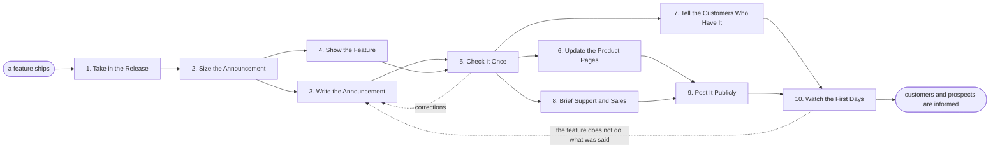

# Reference process: Announce Feature Release

`ref/mkt/feature-release v1`

**value stream:** [Concept-to-Market](../../streams/marketing/concept-to-market.md)
A feature has shipped and the people who could use it have not heard
about it yet. A communications manager takes in what changed, decides
which channels this release earns, has the announcement written and
checked once, updates the pages that describe the product, tells the
customers who already have the feature, tells support and sales what to
say when a customer asks, posts it where prospects will see it, and
watches the first few days. This is the smaller version of the product
launch process. It leaves out the positioning bake-off, the launch
coordinator, the paid media, the press outreach, the sequenced launch
day and the closing debrief, because one feature does not carry enough
weight to pay for them. A release that changes what a customer is
charged, or that has a date committed to it, runs as a product launch
instead.

## The activities

| # | Activity | What happens | Seats |
|---|---|---|---|
| 1 | Take in the Release | what shipped, who it affects, why it matters | [comms-manager](../../agents/comms-manager.md) · subject matter expert (person) |
| 2 | Size the Announcement | which channels this release earns | comms-manager |
| 3 | Write the Announcement | the release note and the shorter versions | [copywriter](../../agents/copywriter.md) · comms-manager · subject matter expert (person) |
| 4 | Show the Feature | screenshots and a short clip of it working | [designer](../../agents/designer.md) · [video-editor](../../agents/video-editor.md) |
| 5 | Check It Once | accuracy, brand and plain reading in one pass | [editor](../../agents/editor.md) · [brand-check](../../agents/brand-check.md) |
| 6 | Update the Product Pages | the feature page, the docs entry, the search terms | [web-producer](../../agents/web-producer.md) · [search-optimizer](../../agents/search-optimizer.md) |
| 7 | Tell the Customers Who Have It | the in-product notice and the email go out | [in-product-producer](../../agents/in-product-producer.md) · [email-producer](../../agents/email-producer.md) |
| 8 | Brief Support and Sales | what to say when a customer asks about it | [sales-enablement-manager](../../agents/sales-enablement-manager.md) · support leader (person) |
| 9 | Post It Publicly | the blog post, the social posts, the community thread | comms-manager · [community-manager](../../agents/community-manager.md) |
| 10 | Watch the First Days | adoption, questions, and anything reported wrong | [analytics](../../agents/analytics.md) · community-manager |

## The graph



## The document, with the blanks marked

```
PROCESS: feature release              id: <team>/feature-release   v1
from: ref/mkt/feature-release v1
owner: <who>                          effective: <date>
trigger: a feature reaches customers in <your release process>
concurrency: runs may overlap - <how many> live at once
goal: every channel the sizing named carries the announcement, the
      customers who have the feature hear about it from inside the
      product, and support and sales can answer for it
phases:
  take-in-release  - human: what shipped, who it affects and why it
                     matters, from the people who built it
                     owner: comms-manager      after: trigger
                     automation: <level>
  size-announce    - human: decide which channels this release earns
                     and the date the announcement goes out
                     owner: comms-manager      after: take-in-release
                     automation: <level>
  write-announce   - runs build-by-talent: the release note, the
                     in-product wording, the email and the post, all
                     from one set of facts
                     owner: comms-manager      after: size-announce
                     by: <days>                automation: <level>
  show-feature     - human: screenshots of the shipped feature and a
                     short clip of it working
                     owner: comms-manager      after: size-announce
                     by: <days>                automation: <level>
  check-once       - convenes approval: one pass over everything
                     customer-facing, signed against a version by the
                     signers <who> named
                     owner: <your standards seat>
                     after: write-announce + show-feature
                     by: <days>                automation: never
  update-pages     - human: the feature page, the docs entry, the
                     search terms and any redirect the page needs
                     owner: web-producer       after: check-once
                     automation: <level>
  tell-customers   - human: the notice goes to the accounts that have
                     the feature, and the email goes to the customers
                     on those accounts
                     owner: in-product-producer
                     after: check-once         automation: <level>
  brief-support    - convenes briefing: support and sales hear what the
                     feature does, what it does not do, and the answers
                     to the questions it will raise
                     owner: sales-enablement-manager
                     after: check-once         automation: <level>
  post-publicly    - human: the blog post, the social posts and the
                     community thread go out
                     owner: comms-manager
                     after: update-pages + brief-support
                     automation: <level>
  watch-first-days - runs collect-and-report: adoption, the questions
                     coming in, and anything customers report as wrong
                     owner: analytics
                     after: tell-customers + post-publicly
                     every: <cadence>          until: <days> after the
                     announcement              automation: <level>
handoffs:
  take-in-release -> size-announce: what shipped and who it affects, in
    the words of the people who built it
  size-announce -> write-announce / show-feature: the channels this
    release earns and the date. Both branches read one record
  write-announce + show-feature -> check-once: everything
    customer-facing, at a version
  check-once -> update-pages / tell-customers / brief-support: the
    approved wording and visuals at the signed version. A later change
    voids the approval and the check runs again
  update-pages -> post-publicly: the page the public post links to,
    live at its address
  brief-support -> post-publicly: support and sales hold the answers
    before the questions arrive
  tell-customers + post-publicly -> watch-first-days: what was sent,
    who it reached, and where it was published
bindings:
  roster:  <who holds each seat - agents claiming the abstract agents
           above, and named people for the product, support and sales
           seats>
  systems: the CMS (write), the documentation site (write),
           the product's messaging system (write, cap: <n> accounts
           per notice), email platform (write),
           the enablement library (write),
           the account and entitlement record (read),
           analytics (read)
  data:    what shipped at its version, brand guidelines <version>,
           <your claims register>
policy:
  nothing customer-facing publishes before the check has signed it
  a statement about what the feature does is confirmed by the person
    who built it
  the notice and the email reach only the accounts that have the
    feature
  a release that changes what a customer pays runs as a product launch
measures:
  cycle time: <days> from the feature shipping to the announcement
  coverage: every channel the sizing named carries it
  quality gate: nothing publishes unsigned
```

## The failure edges

- **The announcement says something the feature does not do.** The run
  returns to write-announce, the person who built the feature confirms
  the correction, and anything already published is corrected in place
  with a line saying what changed.
- **The check comes back with changes.** Only the piece the signers
  named reopens. The announcement date holds unless the correction
  changes what the announcement claims.
- **The feature is on for some accounts only.** The notice and the
  email go to the accounts that have it, and the public post says who
  can use it today and when the rest of the customers get it.
- **A question arrives before support has been briefed.** Support gets
  the answers straight away, ahead of everything else in flight, and
  the rest of the run carries on from where it was.
- **The release turns out to be bigger than a feature.** When it moves
  a price, needs reporters, or has a date somebody committed to, this
  run stops and a product launch run opens, carrying across the work
  already done.
- **A run is abandoned.** Staged page updates are pulled, the loaded
  email is cancelled, and any notice already running inside the product
  is switched off.
