# Reference process: Host Field Event

`ref/mkt/field-event v1`

**value stream:** [Story-to-Coverage](../../streams/marketing/story-to-coverage.md)
An event manager takes a target audience and a date, settles what kind of
event it will be and what happens in the room, has the venue and the
suppliers booked, gets the speakers lined up, fills the room, has the
material made and signed off, runs the event on the day, follows up with
everyone who came, and reports what the event produced. The event can be
a dinner, a breakfast briefing, a half-day workshop or a stop on a
roadshow, and the activities are the same for all of them. The run stays
open past the day of the event, because the manager still owes the
follow-up and the report.

## The activities

| # | Activity | What happens | Seats |
|---|---|---|---|
| 1 | Take in the Audience and Date | work out who the event is for and what it must do | [event-manager](../../agents/event-manager.md) |
| 2 | Settle the Format and Program | the kind of event, its length, and the agenda | event-manager · [event-program](../../agents/event-program.md) · leadership (person) |
| 3 | Book the Venue and Suppliers | the room, the food, the equipment and the orders | [event-operations](../../agents/event-operations.md) · event-manager · finance (person) · legal reviewer (person) |
| 4 | Line up the Speakers | ask, confirm and brief the people who will speak | event-program · [advocacy-manager](../../agents/advocacy-manager.md) · subject matter expert (person) · account owner (person) |
| 5 | Build the Invitation List | decide who to invite and how many need to come | event-manager · [email-producer](../../agents/email-producer.md) |
| 6 | Produce the Invitation and Materials | the invitation, the signage, the badges, the slides | [creative-producer](../../agents/creative-producer.md) · [copywriter](../../agents/copywriter.md) · [designer](../../agents/designer.md) |
| 7 | Get Sign-Offs | brand and legal approve the material | [brand-check](../../agents/brand-check.md) · brand owner (person) · legal reviewer (person) |
| 8 | Open Registration | the registration page, with its tracking wired up | [web-producer](../../agents/web-producer.md) · [conversion-tracker](../../agents/conversion-tracker.md) |
| 9 | Promote the Event | email, social and paid, pointed at registration | [campaign-manager](../../agents/campaign-manager.md) · email-producer · [media-buyer](../../agents/media-buyer.md) · [community-manager](../../agents/community-manager.md) |
| 10 | Work the Registration List | chase, confirm, remind and manage the waitlist | email-producer · event-manager |
| 11 | Prepare the Run of Show | the minute-by-minute plan and a speaker rehearsal | event-manager · event-operations · event-program · event staff (person) |
| 12 | Run the Event | check people in, run the program, keep to time | event-manager · event staff (person) · subject matter expert (person) · outside contact (person) |
| 13 | Capture the Event on Record | recordings, photos and quotes people agreed to | creative-producer · [video-editor](../../agents/video-editor.md) · rights approver (person) |
| 14 | Follow up with the People Who Came | send the material and route the interested people | event-manager · copywriter · email-producer · [lead-scorer](../../agents/lead-scorer.md) |
| 15 | Report How the Event Did | attendance, cost, and what the event produced | event-manager · [analytics](../../agents/analytics.md) |
| 16 | Record What Was Learned | what to repeat, what to avoid | event-manager |

## The graph

```mermaid
flowchart LR
  T([a target audience and a date are set]) --> A1[1. Take in the Audience and Date]
  A1 --> A2[2. Settle the Format and Program]
  A2 --> A3[3. Book the Venue and Suppliers]
  A2 --> A4[4. Line up the Speakers]
  A2 --> A5[5. Build the Invitation List]
  A2 --> A6[6. Produce the Invitation and Materials]
  A6 --> A7[7. Get Sign-Offs]
  A7 -. changes requested .-> A6
  A7 --> A8[8. Open Registration]
  A8 --> A9[9. Promote the Event]
  A5 --> A9
  A9 --> A10[10. Work the Registration List]
  A10 -. registration behind its number .-> A9
  A4 -. the agenda has to change .-> A2
  A3 --> A11[11. Prepare the Run of Show]
  A4 --> A11
  A10 --> A11
  A11 -. a speaker withdraws .-> A4
  A11 -. what the room needs has changed .-> A3
  A11 --> A12[12. Run the Event]
  A12 --> A13[13. Capture the Event on Record]
  A12 --> A14[14. Follow up with the People Who Came]
  A13 --> A14
  A14 --> A15[15. Report How the Event Did]
  A15 --> A16[16. Record What Was Learned]
  A16 --> DONE([the event is reported and the run is closed])
```



## The document, with the blanks marked

```
PROCESS: field event                  id: <team>/field-event   v1
from: ref/mkt/field-event v1
owner: <who>                          effective: <date>
trigger: an audience and a date are set in <your planning process>
concurrency: runs overlap - <how many> events in flight at once
goal: an event that fills the room it was sized for, runs on its date,
      follows up everyone who came, and is reported against what it was
      asked to do
phases:
  take-in-audience - human: read the audience and the date, and write
                     down what the event has to deliver and for whom
                     owner: event-manager      after: trigger
                     automation: <level>
  settle-format    - convenes decide-and-announce: the kind of event,
                     how long it runs, and the shape of the program.
                     The deadline list goes out the same day
                     owner: event-manager      after: take-in-audience
                     by: <days>                automation: <level>
  book-suppliers   - human: the quotes, then the orders for the room,
                     the food, the equipment and the freight
                     owner: event-operations   after: settle-format
                     by: <days before the event>
                     automation: <level>
  line-up-speakers - convenes briefing: each speaker hears what the
                     session is for, who is in the audience, and what
                     is due when
                     owner: event-program      after: settle-format
                     by: <days>                automation: <level>
  build-list       - human: who is invited, and how many of them have
                     to come for the event to be worth running
                     owner: event-manager      after: settle-format
                     by: <days>                automation: <level>
  produce-material - runs build-by-talent: the invitation, the signage,
                     the badges and the slides
                     owner: creative-producer  after: settle-format
                     by: <days>                automation: <level>
  get-sign-offs    - convenes approval: brand and legal sign, as named
                     signers, against a version of the material
                     owner: <your legal seat>  after: produce-material
                     by: <days>                automation: never
  registration     - human: the page, its address, and the tracking on
                     the form, tested with a real submission
                     owner: web-producer       after: get-sign-offs
                     by: <days>                automation: <level>
  promote          - human: the invitation email, the social posts and
                     the paid distribution, pointed at registration
                     owner: campaign-manager
                     after: registration + build-list
                     automation: <level>
  work-the-list    - human: chase the people who have not answered,
                     confirm the ones who have, remind everybody, and
                     keep the waitlist moving
                     owner: event-manager      after: promote
                     automation: <level>
  run-of-show      - human: the minute-by-minute plan for the day, and
                     the rehearsal that puts every speaker in the room
                     before an audience is in it
                     owner: event-manager
                     after: book-suppliers + line-up-speakers +
                            work-the-list
                     by: <days>                automation: <level>
  run-the-event    - human: check people in, run the program to time,
                     and make the calls the day needs
                     owner: event-manager      after: run-of-show
                     automation: <level>
  capture-record   - human: the recordings, the photographs and the
                     quotes, each carrying the permission it rests on
                     owner: creative-producer  after: run-the-event
                     automation: <level>
  follow-up        - human: the material to everyone who came, and the
                     interested people passed to <who takes them next>
                     owner: event-manager
                     after: run-the-event + capture-record
                     by: <days>                automation: <level>
  report-event     - runs collect-and-report: attendance, cost, and
                     what the event produced, set beside what the event
                     was asked to do
                     owner: event-manager      after: follow-up
                     by: <weeks>               automation: <level>
  record-learnings - convenes debrief: what to repeat, what to avoid
                     owner: event-manager      after: report-event
                     automation: <level>
run-scoped:
  status        - runs roll-call                owner: event-manager
                  every: <cadence>
                  from: settle-format   until: run-the-event
  registrations - runs collect-and-report       owner: event-manager
                  every: <cadence>
                  from: promote   until: run-the-event
  speakers      - runs collect-and-report       owner: event-program
                  every: <cadence>
                  from: line-up-speakers   until: run-of-show
  orders        - runs allocate-and-reconcile   owner: event-operations
                  from: book-suppliers   until: run close
handoffs:
  take-in-audience -> settle-format: who the event is for and what it
    has to deliver, in one line that every later decision can be tested
    against
  settle-format -> book-suppliers: what the room has to hold, what the
    program needs in it, and the date each order has to be placed by
  settle-format -> line-up-speakers: the sessions the program needs,
    and the date each speaker's material is due
  settle-format -> build-list: the number of people the event needs in
    the room
  settle-format -> produce-material: what has to be written, designed
    and printed, and when each piece is due
  produce-material -> get-sign-offs: the material at a version
  get-sign-offs -> registration: the approved material at the signed
    version. A later change voids the approval and sign-offs run again
  build-list -> promote: the audience for the invitation, with the
    consent, opt-out and suppression rules already applied
  book-suppliers -> run-of-show: what was ordered, what arrived, and
    what is still missing
  line-up-speakers -> run-of-show: the agenda at a version, with every
    speaker's material at the version that will be shown
  work-the-list -> run-of-show: the confirmed headcount, on the date
    the catering and the badge orders need it
  run-the-event -> follow-up: who came, what they asked about, and what
    they were promised in the room
  capture-record -> follow-up: the recordings and the photographs
    people agreed to, at their versions
  report-event -> record-learnings: the report, as delivered
bindings:
  roster:  <who holds each seat - agents claiming the abstract agents
           above, and named people for leadership, finance, legal,
           brand, rights, the experts, the customers who speak, and the
           staff in the room on the day>
  systems: the event plan and its schedule (write),
           the invitation and attendance record (write),
           the order and contract record (write),
           supplier ordering and booking systems (write, cap: <n>),
           the agenda and its schedule (write),
           the speaker record (write), the advocacy record (write),
           the asset store (write), the sending system (write),
           the live sends (trigger, cap: <n> contacts),
           the website (write), analytics (write), the CRM (write),
           ad platforms (write, cap: <n>/day)
  data:    brand guidelines <version>, <your claims register>,
           the venue and supplier rules at their versions,
           the consent record, the suppression lists,
           the contact records, the audience and the date
policy:
  sign-off is a human gate and is never delegated to an agent
  material changed after sign-off goes back through sign-offs
  a contract, an insurance certificate or a waiver is signed by a
    person
  no order is placed past <the limit> without a named person's approval
  every order is recorded with the date it must be cancelled by
  a person's name, picture or words are used only where that person
    agreed, and the agreement is recorded with what it covers
  cancelling or postponing the event is a person's decision
  nothing is promised to an attendee in the room that the organization
    has not already agreed to
measures:
  attendance: <target> of the people who registered come
  cycle time: <target> from the date being set to the first invitation
  cost: <target> per person who attended
  quality gate: nothing goes out unsigned, and no recording is used
                without the permission behind it
```

## The failure edges

- **A sign-off comes back with changes.** The run returns to
  produce-material, and only the piece the signers named reopens.
  Registration waits, because the page carries the approved words.
- **Registration falls behind the number the event needs.** The run
  goes back to promote and to work-the-list while there is still time
  to fix it. If the number is still short at <the date>, a person
  decides whether the event runs smaller, moves, or is cancelled.
- **A speaker withdraws.** The run returns to line-up-speakers for a
  replacement. When no replacement can be found in time, the agenda
  changes, the run goes back to settle-format, and everyone who
  registered is told what changed.
- **A supplier misses a deadline or fails to deliver.** The
  event-operations seat raises it on the day it becomes clear, and a
  person decides whether to order elsewhere, withhold payment, or run
  the event without that piece.
- **A cancellation deadline is about to pass.** The seat holding the
  order raises it while the money can still be saved, and a person
  decides whether the event still needs what was ordered.
- **Somebody refuses to be recorded.** The recording or the photograph
  comes out of the capture record and out of the follow-up material,
  and the refusal is written down against the person who gave it.
- **The event is cancelled or postponed.** A person makes that call.
  The orders are cancelled as far as their deadlines allow, everyone
  who registered is told, the promotion stops, and the orders line
  reconciles what was already committed.
- **The trigger fires while runs are in flight.** Events overlap
  normally, and the concurrency line says how many. The event-manager
  seat takes one event at a time, so every run in flight needs its own
  holder of that seat, and the runs share their reference data
  read-only.
- **A run is abandoned.** The material stays where it is at its
  versions, the registration page comes down and its address is
  released, the people who registered are told, and the orders line
  reconciles anyway.
