# Reference process: the ideal customer profile

`ref/mkt/ideal-customer-profile v1`

A decision coordinator takes a question about who the organization
should be selling to, works out what that question has to settle and by
when, and has three kinds of evidence gathered: what the organization's
own record says about who bought and who stayed, what the market outside
looks like, and what the people who work the accounts say about the
deals they have closed and lost. A forecaster tests which account traits
actually separate the customers that worked out from the ones that did
not. Two or three candidate profiles go in front of the people who have
to live with the answer, and one of them is chosen in a room the sales
side sits in. The run ends with the agreed profile written down at a
version, carrying its firmographics, its qualifying signals, its
disqualifiers, and the names of everyone who agreed and everyone who did
not. What this process produces is an agreement, so the last activities
hand the profile to the seats that will qualify accounts against it and
set the date it comes back up.

## The activities

| # | Activity | What happens | Seats |
|---|---|---|---|
| 1 | take in the question | work out what the profile must settle and by when | [decision-coordinator](../../agents/decision-coordinator.md) · leadership (person) |
| 2 | read the customer record | who bought, who stayed, who left, and what they share | [analytics](../../agents/analytics.md) · [forecaster](../../agents/forecaster.md) |
| 3 | gather the outside evidence | market reports, public data, and who else sells here | [researcher](../../agents/researcher.md) |
| 4 | collect the first-hand accounts | what sellers and customers say about which deals fit | researcher · sales leader (person) · subject matter expert (person) |
| 5 | find the traits that predict a win | which traits separate the wins from everything else | forecaster · analytics |
| 6 | draft the candidate profiles | two or three shapes of buyer, each with its evidence | decision-coordinator · forecaster · researcher |
| 7 | name the qualifying signals | the facts that say an account fits, and their sources | forecaster · decision-coordinator |
| 8 | test the signal coverage | how often each signal is filled in, and what it costs | [lead-scorer](../../agents/lead-scorer.md) · forecaster |
| 9 | test the candidates against the record | would each profile have picked the customers that won | forecaster · analytics |
| 10 | size each candidate market | how many accounts of that shape actually exist | researcher · forecaster |
| 11 | clear the data and the targeting | source terms, and whether the traits may be targeted | researcher · legal reviewer (person) |
| 12 | settle on one profile | one profile chosen, with the reasons said out loud | decision-coordinator · leadership (person) · sales leader (person) |
| 13 | write down the agreed profile | firmographics, signals, disqualifiers, and who agreed | decision-coordinator |
| 14 | issue the profile as a version | the profile numbered, and the seats that read it told | [standards-keeper](../../agents/standards-keeper.md) |
| 15 | hand over the profile | each receiving seat says what it changes | decision-coordinator · lead-scorer · [audience-manager](../../agents/audience-manager.md) · [campaign-manager](../../agents/campaign-manager.md) · [media-buyer](../../agents/media-buyer.md) |
| 16 | set the review conditions | the review date, and what would change the answer | decision-coordinator · leadership (person) |
| 17 | record what was learned | what to repeat, what to avoid | decision-coordinator |

## The graph

```mermaid
flowchart LR
  T([a go-to-market question is asked]) --> A1[1. take in the question]
  A1 --> A2[2. read the customer record]
  A1 --> A3[3. gather the outside evidence]
  A1 --> A4[4. collect the first-hand accounts]
  A2 --> A5[5. find the traits that predict a win]
  A3 --> A5
  A4 --> A5
  A5 --> A6[6. draft the candidate profiles]
  A6 --> A7[7. name the qualifying signals]
  A7 --> A8[8. test the signal coverage]
  A8 -. no signal can be seen early enough .-> A7
  A6 --> A9[9. test the candidates against the record]
  A9 -. no candidate holds up .-> A6
  A6 --> A10[10. size each candidate market]
  A10 -. the market is too small .-> A6
  A7 --> A11[11. clear the data and the targeting]
  A11 -. a source or a trait is ruled out .-> A6
  A8 --> A12[12. settle on one profile]
  A9 --> A12
  A10 --> A12
  A11 --> A12
  A12 -. the room cannot agree .-> A6
  A12 --> A13[13. write down the agreed profile]
  A13 --> A14[14. issue the profile as a version]
  A14 --> A15[15. hand over the profile]
  A15 --> A16[16. set the review conditions]
  A16 --> A17[17. record what was learned]
  A17 --> DONE([the profile is agreed and in use])
```



## The document, with the blanks marked

```
PROCESS: ideal customer profile       id: <team>/ideal-customer-profile   v1
from: ref/mkt/ideal-customer-profile v1
owner: <who>                          effective: <date>
trigger: a go-to-market question is opened in <your planning process>,
         or the review date on a recorded profile arrives
concurrency: one run at a time for the same product or market, because
             two agreed profiles for one product leave nobody with one.
             Runs for different markets overlap
goal: one agreed profile, carrying its firmographics, its qualifying
      signals and its disqualifiers, recorded with the reasons behind
      it and the disagreement with it, and in use by every seat that
      qualifies an account
phases:
  take-in-question - convenes briefing: what the profile has to settle,
                     who decides it, what evidence each seat owes, and
                     the date the answer is due
                     owner: decision-coordinator  after: trigger
                     automation: <level>
  read-record      - human: who bought, who stayed, who left, and what
                     those accounts have in common
                     owner: analytics             after: take-in-question
                     by: <days>                   automation: <level>
  outside-evidence - human: the market reports, the public data, and
                     who else sells into this market
                     owner: researcher            after: take-in-question
                     by: <days>                   automation: <level>
  first-hand       - human: what the people who work the accounts say
                     about the deals, and what customers say themselves
                     owner: researcher            after: take-in-question
                     by: <days>                   automation: <level>
  find-traits      - human: which account traits separate the customers
                     that stayed from the ones that left, and how
                     strongly each trait does it
                     owner: forecaster
                     after: read-record + outside-evidence + first-hand
                     by: <days>                   automation: <level>
  draft-candidates - runs build-by-talent: two or three shapes of
                     buyer, each written out with its evidence
                     owner: decision-coordinator  after: find-traits
                     by: <days>                   automation: <level>
  name-signals     - human: the facts that say an account fits, each
                     with the source it would be read from
                     owner: forecaster            after: draft-candidates
                     by: <days>                   automation: <level>
  test-coverage    - system: how often each signal is already filled
                     in, what it costs to fill the rest, and which
                     signals cannot be seen before the first call
                     owner: lead-scorer           after: name-signals
                     automation: <level>
  back-test        - system: each candidate run backwards over the
                     record, to see which customers it would have
                     picked and what became of them
                     owner: forecaster            after: draft-candidates
                     by: <days>                   automation: <level>
  size-market      - human: how many accounts of each shape exist, and
                     where that count came from
                     owner: researcher            after: draft-candidates
                     by: <days>                   automation: <level>
  clear-data       - convenes approval: legal signs that the analysis
                     may rest on this data and that these traits may be
                     used to target
                     owner: <your legal seat>     after: name-signals
                     by: <days>                   automation: never
  settle-profile   - convenes bake-off: two or three candidates, one
                     chosen, with the reasons said out loud
                     owner: decision-coordinator
                     after: test-coverage + back-test + size-market +
                            clear-data
                     by: <days>                   automation: never
  write-profile    - human: the firmographics, the qualifying signals,
                     the disqualifiers, who agreed, and who disagreed
                     and on what
                     owner: decision-coordinator  after: settle-profile
                     automation: <level>
  issue-version    - human: the agreed profile issued as a numbered
                     version, with the version it replaces left readable
                     owner: standards-keeper      after: write-profile
                     automation: <level>
  hand-over        - runs decide-and-announce: every seat that
                     qualifies an account hears the profile at once and
                     says what it changes because of it
                     owner: decision-coordinator  after: issue-version
                     by: <days>                   automation: <level>
  set-review       - human: the date the profile comes back up, and the
                     conditions that would bring it back sooner
                     owner: decision-coordinator  after: hand-over
                     automation: <level>
  record-learnings - convenes debrief: what to repeat, what to avoid
                     owner: decision-coordinator  after: set-review
                     automation: <level>
run-scoped:
  outstanding - runs roll-call              owner: decision-coordinator
                every: <cadence>
                from: take-in-question   until: hand-over
handoffs:
  take-in-question -> read-record / outside-evidence / first-hand: the
    question, what each seat owes, and the date it is owed. Three seats
    read one record
  read-record -> find-traits: the accounts, what each one bought and
    renewed, and when each one left
  outside-evidence -> find-traits: the market evidence, with a source
    line under every fact and the date it was read
  first-hand -> find-traits: what the sellers and the customers said,
    attributed to the person who said it
  find-traits -> draft-candidates: the traits that separate the
    customers who stayed, each with how strongly it does that and the
    assumptions the number rests on
  draft-candidates -> name-signals: the candidate profiles, each with
    the evidence behind it
  draft-candidates -> back-test: the candidates in the form they will
    be tested in
  draft-candidates -> size-market: the same candidates. Three branches
    read one record
  name-signals -> test-coverage: each signal, with the source it would
    be read from
  name-signals -> clear-data: the signals, the data sets under them,
    and the terms each set came with
  test-coverage -> settle-profile: how often each signal is present,
    what the rest cost to fill, and which ones arrive too late to
    qualify on
  back-test -> settle-profile: what each candidate would have selected,
    and what actually happened to those accounts
  size-market -> settle-profile: how many accounts of each shape exist,
    and where the count came from
  clear-data -> settle-profile: the data the analysis may rest on, and
    the traits that may be used to target
  settle-profile -> write-profile: the chosen profile, why it won over
    the others, and everyone who disagreed and on what
  write-profile -> issue-version: the profile in the wording it was
    agreed in
  issue-version -> hand-over: the profile at its number, and what
    changed from the version it replaces
  hand-over -> set-review: what each receiving seat said it would
    change, and the date it said it by
  set-review -> record-learnings: the review date and the conditions
    that bring the profile back sooner
bindings:
  roster:  <who holds each seat - agents claiming the abstract agents
           above, and named people for leadership, the sales side and
           legal>
  systems: the customer and revenue record (read), the CRM (read),
           analytics platforms (read), enrichment sources (read),
           licensed market data (read, cap: <what may be bought
           without asking>), the model store (write),
           the evidence store (write), the decision record (write),
           the standards store (write), the review schedule (write),
           the notification channel (write)
  data:    the go-to-market question, <your market definitions>,
           <your account and revenue history> over <what period>,
           the terms attached to every data set the analysis rests on
policy:
  every fact in the evidence carries the source it came from and the
    date it was read
  a rate the model cannot source is reported as unsourced, and no
    estimate is put in its place
  no candidate reaches the room without a back-test saying which
    customers it would have picked
  a qualifying signal that cannot be seen before the first call is
    marked as such, and <who> decides whether to keep it
  the profile is chosen by named people, and the choice is never
    delegated to an agent
  the people who qualify accounts sit in the room where the profile is
    settled, and a profile settled without them is not recorded
  a disagreement is recorded with the profile, naming who disagreed and
    what they disagreed with
  the run does not close until every seat that qualifies an account has
    said what it changes because of the profile, and a seat that
    changes nothing says why
  a recorded profile is never edited in place. A change goes in as a
    new version, and the version it replaces stays readable
measures:
  cycle time: <target> from the question to the recorded profile
  signal coverage: <share> of the qualifying signals that can be read
                   before anyone talks to the account
  fit: <share> of the accounts won since the profile was agreed that
       the profile would have picked, read on the review date
  quality gate: no profile is recorded without its back-test, its
                disagreement, and an answer from every seat that
                qualifies against it
```

## The failure edges

- **The evidence contradicts the profile the room wants.** The
  coordinator puts the contradiction in front of the room and it stays
  in the record whichever way the room decides. Leaving it out is not
  one of the choices.
- **No candidate survives the back-test.** The run returns to
  draft-candidates, and the traits the failed candidates were built on
  go back with it, so the next set rests on what the record supports.
- **The market for the chosen shape is too small.** Sizing sends the run
  back to draft-candidates. A profile that describes a few dozen
  accounts is still a real answer, and <who> decides whether to widen it
  or to accept how few accounts it covers.
- **A qualifying signal cannot be seen before the first call.** The run
  goes back to name-signals. Either the signal is replaced with one that
  can be read in advance, or it stays and is marked as a signal that
  only confirms a fit after somebody is already working the account.
- **Legal rules out a source or a trait.** Every candidate resting on it
  goes back to draft-candidates to be rebuilt without it or dropped.
  Better analysis does not overturn this check, because the question it
  answers is whether the organization may use the data at all.
- **The room does not agree.** The coordinator records what each side
  said and takes the disagreement to <who>. Deciding on a thinner
  agreement and waiting for more evidence are both a person's call, and
  the coordinator makes neither.
- **The profile is agreed and nobody qualifies against it.** This is the
  failure the process exists to prevent, and it leaves no trace unless
  somebody goes looking for it. The process answers it in three places:
  the sales side sits in the room where the profile is settled, every
  receiving seat says at the handover what it changes, and the fit
  measure is read on the review date against the accounts the
  organization has won since.
- **The trigger fires while a run is in flight.** Two runs against the
  same product do not overlap, because the second one would produce a
  second agreed profile and leave the organization with neither. A
  question about a different product or a different market starts its
  own run, and a question about the product already under way joins the
  run in flight.
- **A run is abandoned.** The evidence stays where it is at its
  versions, and a later run picks it up with the dates it was gathered
  on. No profile is recorded, the seats that qualify accounts keep
  working to the profile they already had, and the coordinator records
  that the question went unanswered and why.
