# Reference process: Run Influencer Campaign

`ref/mkt/influencer-campaign v1`

**value stream:** [Brief-to-Results](../../streams/marketing/brief-to-results.md)
A campaign manager takes a target audience, has outside creators found
and checked, gets the shortlist cleared by the people who decide who the
organization is willing to be seen with, agrees terms with each creator,
briefs them, reads what they made before it goes out, and confirms that
every agreed post is live and carries the disclosure its market
requires. The run stays open until the disclosure check has passed on
every post. A post that runs without its disclosure breaks advertising
law in most markets, and the organization that paid for it is the party
held responsible.

## The activities

| # | Activity | What happens | Seats |
|---|---|---|---|
| 1 | Take in the Audience | work out who to reach and what the run must do | [campaign-manager](../../agents/campaign-manager.md) |
| 2 | Set the Parameters | markets, platforms, dates, budget and deliverables | campaign-manager · leadership (person) |
| 3 | Read the Disclosure Rules | what each market requires a paid post to say | [researcher](../../agents/researcher.md) · [disclosure-check](../../agents/disclosure-check.md) · legal reviewer (person) |
| 4 | Draw up the Candidate List | creators whose following matches the audience | [creator-relations](../../agents/creator-relations.md) · researcher |
| 5 | Vet the Candidates | check the audience is real and the history is clean | creator-relations |
| 6 | Clear the Shortlist | brand and legal accept who the organization pays | creator-relations · brand owner (person) · legal reviewer (person) |
| 7 | Approach the Creators | make the offer and find out who is interested | creator-relations |
| 8 | Settle the Terms | deliverables, dates, usage rights, disclosure, fee | creator-relations · [rights-register](../../agents/rights-register.md) · rights approver (person) · finance (person) |
| 9 | Set up the Tracking | links and codes so each creator can be counted | [conversion-tracker](../../agents/conversion-tracker.md) · [media-buyer](../../agents/media-buyer.md) |
| 10 | Brief the Creators | what the campaign is for and what must be said | campaign-manager · creator-relations · [copywriter](../../agents/copywriter.md) · disclosure-check |
| 11 | Collect the Drafts | each creator sends what the deal said they owe | creator-relations |
| 12 | Review the Drafts | each draft read against the rules before it runs | [brand-check](../../agents/brand-check.md) · disclosure-check · creator-relations · legal reviewer (person) |
| 13 | Publish the Posts | the creators post on the dates that were agreed | creator-relations · campaign-manager |
| 14 | Record the Live Posts | every agreed post is found and kept as it ran | [coverage-monitor](../../agents/coverage-monitor.md) · creator-relations |
| 15 | Check the Disclosure | every live post carries the disclosure required | disclosure-check · legal reviewer (person) |
| 16 | Correct What Failed | the creator corrects or takes down what failed | creator-relations · legal reviewer (person) |

## The graph

```mermaid
flowchart LR
  T([a target audience is handed to the campaign]) --> A1[1. Take in the Audience]
  A1 --> A2[2. Set the Parameters]
  A2 --> A3[3. Read the Disclosure Rules]
  A2 --> A4[4. Draw up the Candidate List]
  A2 --> A9[9. Set up the Tracking]
  A4 --> A5[5. Vet the Candidates]
  A5 --> A6[6. Clear the Shortlist]
  A6 -. too few creators cleared .-> A4
  A6 --> A7[7. Approach the Creators]
  A7 -. too few accepted .-> A4
  A7 --> A8[8. Settle the Terms]
  A8 --> A10[10. Brief the Creators]
  A3 --> A10
  A9 --> A10
  A10 --> A11[11. Collect the Drafts]
  A11 --> A12[12. Review the Drafts]
  A12 -. changes requested .-> A11
  A12 --> A13[13. Publish the Posts]
  A13 --> A14[14. Record the Live Posts]
  A14 -. an agreed post never ran .-> A13
  A14 --> A15[15. Check the Disclosure]
  A15 -. a post missing its disclosure .-> A16[16. Correct What Failed]
  A16 --> A15
  A15 --> DONE([every agreed post is live and disclosed])
```



## The document, with the blanks marked

```
PROCESS: influencer campaign          id: <team>/influencer-campaign v1
from: ref/mkt/influencer-campaign v1
owner: <who>                          effective: <date>
trigger: an audience is handed to a campaign in <your planning process>
concurrency: runs may overlap - <how many> live at once
goal: every creator the campaign agreed terms with has published what
      the deal named, on the date it named, carrying the disclosure the
      market it ran in requires
phases:
  take-in-audience - human: read the audience the run was given and
                     write down what the campaign has to do with it
                     owner: campaign-manager   after: trigger
                     automation: <level>
  set-parameters   - human: the markets, the platforms, the dates, the
                     deliverables and the money. <who> confirms the
                     budget
                     owner: campaign-manager   after: take-in-audience
                     automation: <level>
  disclosure-rules - human: pull what each market and each platform
                     requires a paid post to say. <your legal
                     reviewer> confirms which version is in force
                     owner: researcher         after: set-parameters
                     by: <days>                automation: <level>
  candidate-list   - human: the creators whose following matches the
                     audience, each with the figures behind it
                     owner: creator-relations  after: set-parameters
                     by: <days>                automation: <level>
  vet-candidates   - runs assessment: each candidate scored on whether
                     the audience is real and the history is clean
                     owner: creator-relations  after: candidate-list
                     by: <days>                automation: <level>
  clear-shortlist  - convenes approval: brand and legal accept, as
                     named signers, who the organization will pay
                     owner: <your legal seat>  after: vet-candidates
                     by: <days>                automation: never
  approach         - human: the offer goes to each cleared creator and
                     the answer lands against their name
                     owner: creator-relations  after: clear-shortlist
                     by: <days>                automation: <level>
  settle-terms     - convenes approval: the deliverables, the dates,
                     the usage rights, the disclosure and the fee, each
                     signed by the person who answers for it
                     owner: creator-relations  after: approach
                     by: <days>                automation: never
  set-up-tracking  - human: the link, the code and the parameters that
                     make each creator countable on their own
                     owner: conversion-tracker after: set-parameters
                     by: brief-creators        automation: <level>
  brief-creators   - convenes briefing: what the campaign is for, what
                     the deal requires, and what has to be disclosed
                     owner: campaign-manager
                     after: settle-terms + disclosure-rules +
                            set-up-tracking
                     automation: <level>
  collect-drafts   - human: each creator sends what the deal said they
                     owe, on the date it was due
                     owner: creator-relations  after: brief-creators
                     by: <days>                automation: <level>
  review-drafts    - convenes approval: brand, disclosure and legal
                     read each draft against the rules, as named
                     signers, before it goes out
                     owner: <your legal seat>  after: collect-drafts
                     by: <days>                automation: never
  publish-posts    - human: the creators post on the agreed dates, on
                     their own accounts
                     owner: creator-relations  after: review-drafts
                     automation: <level>
  record-posts     - human: every agreed post is found and kept as it
                     ran, with its address and the date it appeared
                     owner: coverage-monitor   after: publish-posts
                     by: <days>                automation: <level>
  check-disclosure - runs assessment: every live post scored against
                     the disclosure rules of the market it ran in
                     owner: disclosure-check   after: record-posts
                     by: <days>                automation: <level>
  correct-failed   - human: the seat holding the deal goes back to the
                     creator, and <who> decides what is asked for
                     owner: creator-relations  after: check-disclosure
                     by: <hours>               automation: <level>
run-scoped:
  status  - runs roll-call                     owner: campaign-manager
            every: <cadence>
            from: brief-creators   until: check-disclosure
  replies - runs collect-and-report            owner: community-manager
            every: <cadence>
            from: publish-posts   until: run close
            what people asked on the organization's own channels once
            the creator posts went out
  fees    - runs allocate-and-reconcile        owner: spend-reconciler
            from: settle-terms   until: run close
handoffs:
  take-in-audience -> set-parameters: who the campaign is for, in one
    line that every later decision can be tested against
  set-parameters -> disclosure-rules: the markets and the platforms the
    work will run in
  set-parameters -> candidate-list: the audience, the markets, the
    deliverables and what there is to spend
  set-parameters -> set-up-tracking: the same parameters. Both branches
    read one record
  disclosure-rules -> brief-creators: what each market requires a paid
    post to say, quoted, at the version in force, with the date it was
    read
  candidate-list -> vet-candidates: each candidate with the audience
    figures, the source they came from and the date they were read
  vet-candidates -> clear-shortlist: the scored list, with the
    criterion behind every verdict
  clear-shortlist -> approach: the creators the signers accepted, and
    the ones they refused with the reason
  approach -> settle-terms: who accepted, and the terms each of them
    asked for
  settle-terms -> brief-creators: the deal at the version it was
    agreed, naming every deliverable, the date each one is due, the
    channels the work may run on, how long the organization may use it,
    what the disclosure has to say, and the fee
  set-up-tracking -> brief-creators: the link and the code each creator
    puts in their post, one set per creator
  brief-creators -> collect-drafts: the request as every creator heard
    it, the date each deliverable is due, and the disclosure wording
    that has to appear
  collect-drafts -> review-drafts: each draft at the version the
    creator sent it
  review-drafts -> publish-posts: the approved drafts at the signed
    version. A later change voids the approval and the review runs
    again
  publish-posts -> record-posts: what each creator says they posted,
    where they posted it, and on what date
  record-posts -> check-disclosure: every live post as it ran, with its
    address, the date it appeared and the market it ran in
  check-disclosure -> correct-failed: the failures, each with the rule
    and the market named
  correct-failed -> check-disclosure: the corrected post, scored again
    before the run closes
bindings:
  roster:  <who holds each seat - agents claiming the abstract agents
           above, and named people for legal, brand, rights and
           finance>
  systems: the creator record (write), the deal record (write),
           the contact log (write),
           the outreach channel (write, cap: <n> creators/run),
           audience measurement sources (read),
           the rights record (write), the review record (write),
           the coverage record (write), analytics (write),
           the CRM (write), tracking and URL tooling (write)
  data:    the disclosure rules for each market <version>,
           brand guidelines <version>, <your claims register>,
           the audience definition, the deals as agreed
policy:
  the version of each market's disclosure rules is confirmed by a
    person before any deal is agreed
  no creator is offered money before the audience check and the history
    check have both been read by a person
  the disclosure the market requires is written into the deal, and a
    creator who will not carry it is not paid to publish
  sign-off is a human gate and is never delegated to an agent
  a draft changed after sign-off goes back through the review
  a live post that fails the disclosure check is corrected or taken
    down, and the run stays open until the check passes on it
  the fee is released only after the disclosure check has passed on
    everything that creator published
measures:
  cycle time: <target> from the audience to the first post live
  volume: <creators per period>
  quality gate: every agreed post live, and every live post carrying
                the disclosure its market requires
```

## The failure edges

- **The signers clear too few creators.** The run goes back to the
  candidate list, and the creator-relations seat finds more candidates
  against the same audience. The signers read the new candidates before
  anybody is approached.
- **Too few creators accept the offer.** The run goes back to the
  candidate list. If the fee is the reason they declined, <who> decides
  whether the budget moves or the campaign asks for fewer deliverables.
- **A review comes back with changes.** The run returns to the drafts,
  the creator-relations seat takes the changes to the creator, and only
  what the signers named reopens. The signers read the version that
  comes back before it goes out.
- **A creator will not make the change the review asked for.** The deal
  says what that creator owes, and <who> decides whether the
  deliverable is dropped, given to another creator, or accepted as it
  stands. Publishing a draft the signers refused is not one of the
  choices.
- **A live post carries no disclosure, or carries one a reader has to
  expand to see.** The disclosure check reports it with the rule and
  the market named, the creator-relations seat goes back to the creator
  the same day, and the check runs again on the corrected post. The run
  does not close while a post is live without the disclosure its market
  requires.
- **A creator will not correct a live post.** This is a contract
  question and it goes to <who> with the deal and the failing post
  attached. The organization can ask the platform to take the post
  down, hold the fee under the terms of the deal, or record in writing
  that it accepts the failure.
- **An agreed post never appears.** The creator-relations seat records
  the deliverable as outstanding and goes back to the creator for a new
  date. A deliverable still outstanding at <how long> goes to <who>, who
  decides whether the fee is reduced or the deal ends.
- **The checks say a creator's audience is bought.** The candidate is
  refused before any money is committed. A run that wants that creator
  anyway needs <who> to accept the finding in writing, and the finding
  stays on the creator's record.
- **A creator becomes the subject of a public argument while their post
  is live.** The creator-relations seat raises it the day it starts,
  and <who> decides whether the post stays up, comes down, or is left
  alone with no further deliverables commissioned.
- **A disclosure rule changes after the posts are live.** The
  disclosure-check seat reports the published work the new rule fails,
  and <who> decides whether those posts are corrected, taken down, or
  left as they are. The decision is recorded against each post.
- **The trigger fires while runs are in flight.** Campaigns overlap
  normally, and the concurrency line says how many. One creator can be
  wanted by two runs at once, so the deal record is read across every
  run in flight before a creator is approached again.
- **A run is abandoned.** A deal already agreed is still a commitment,
  so each creator is told in writing what the organization is
  cancelling and what it still owes. Posts already live still go
  through the disclosure check, and the fees line reconciles anyway.
