# Reference process: Publish Landing Page

`ref/mkt/landing-page v1`

**value stream:** [Idea-to-Asset](../../streams/marketing/idea-to-asset.md)
A campaign needs somewhere to send the people it reaches. A content
manager takes the request, settles what the page has to make a visitor
do, gets the copy and the visuals made, has the page built and the
measurement put on it, gets it signed and published, and then watches
what the page converts and changes it where the numbers say people are
leaving.

## The activities

| # | Activity | What happens | Agents |
|---|---|---|---|
| 1 | Take in the Request | what the page is for and who it is for | [content-manager](../../agents/content-manager.md) · [campaign-manager](../../agents/campaign-manager.md) |
| 2 | Set the Parameters | the audience, the action asked for, the date | content-manager · campaign-manager |
| 3 | Name the Search Terms | what the page has to cover to be found | [search-optimizer](../../agents/search-optimizer.md) |
| 4 | Brief the Makers | everyone hears the same request at once | content-manager · [researcher](../../agents/researcher.md) · [copywriter](../../agents/copywriter.md) · [editor](../../agents/editor.md) · [designer](../../agents/designer.md) · [video-editor](../../agents/video-editor.md) · [web-producer](../../agents/web-producer.md) · [conversion-tracker](../../agents/conversion-tracker.md) · search-optimizer |
| 5 | Produce the Material | the words and the visuals, with the sources cited | researcher · copywriter · designer · video-editor |
| 6 | Edit the Draft | the editor says what has to be rewritten | editor · copywriter |
| 7 | Build the Page | copy and design assembled into a working page | web-producer |
| 8 | Wire the Tracking | tags, conversions, the form connected to the CRM | conversion-tracker |
| 9 | Score the Page | brand, claims, accessibility and search checked | [brand-check](../../agents/brand-check.md) · [accessibility-check](../../agents/accessibility-check.md) · search-optimizer |
| 10 | Get Sign-Offs | brand, legal, accuracy and image rights sign | brand owner (person) · legal reviewer (person) · subject matter expert (person) · rights approver (person) |
| 11 | Publish | the owner says go and the page goes live | content-manager · web-producer |
| 12 | Hand It to the Campaign | the address and the tracking go to the campaign | content-manager · conversion-tracker · campaign-manager · [media-buyer](../../agents/media-buyer.md) |
| 13 | Watch It Convert | traffic and conversions against the goal | [analytics](../../agents/analytics.md) · content-manager |
| 14 | Fix What the Numbers Show | change the page where people are leaving | content-manager · copywriter · designer · web-producer |
| 15 | Record What Was Learned | what to repeat, what to avoid | content-manager |

## The graph

```mermaid
flowchart LR
  T([a campaign needs a page]) --> A1[1. Take in the Request]
  A1 --> A2[2. Set the Parameters]
  A2 --> A3[3. Name the Search Terms]
  A3 --> A4[4. Brief the Makers]
  A4 --> A5[5. Produce the Material]
  A5 --> A6[6. Edit the Draft]
  A6 -. rewrites asked for .-> A5
  A6 --> A7[7. Build the Page]
  A7 --> A8[8. Wire the Tracking]
  A8 -. the form needs another field .-> A7
  A8 --> A9[9. Score the Page]
  A9 -. copy or an asset failed .-> A5
  A9 -. the page itself failed .-> A7
  A9 --> A10[10. Get Sign-Offs]
  A10 -. changes requested .-> A5
  A10 --> A11[11. Publish]
  A11 --> A12[12. Hand It to the Campaign]
  A12 --> A13[13. Watch It Convert]
  A13 --> A14[14. Fix What the Numbers Show]
  A14 -. new copy or new assets .-> A5
  A13 --> A15[15. Record What Was Learned]
  A14 --> A15
  A15 --> DONE([the page is live, measured and converting])
```



## The document, with the blanks marked

```
PROCESS: publish landing page         id: <team>/landing-page   v1
from: ref/mkt/landing-page v1
owner: <who>                          effective: <date>
trigger: a campaign or a content plan asks for a page in <your planning
         process>
concurrency: runs may overlap - <how many> pages in build at once, and
             no two runs claim the same address
goal: a page live at a known address, measured end to end, and
      converting against what the request asked it to do
phases:
  take-in-request  - human: read the request, work out what the page is
                     for and who it is for
                     owner: content-manager    after: trigger
                     automation: <level>
  set-parameters   - human: the audience, the one action the page asks
                     for, and the date it has to be live
                     owner: content-manager    after: take-in-request
                     automation: <level>
  search-terms     - human: what people search for on this subject, and
                     what the page has to cover to be found at all
                     owner: search-optimizer   after: set-parameters
                     by: <days>                automation: <level>
  brief-makers     - convenes briefing: every agent that makes or
                     measures the page hears the request at once
                     owner: content-manager    after: search-terms
                     automation: <level>
  produce-material - runs build-by-talent: the words, the images and
                     any video, with a source under every claim
                     owner: content-manager    after: brief-makers
                     by: <days>                automation: <level>
  edit-draft       - runs draft-review-merge: the editor holds the
                     version and says what has to be rewritten
                     owner: editor             after: produce-material
                     by: <days>                automation: <level>
  build-page       - human: the copy and the design assembled into a
                     working page, with a preview link
                     owner: web-producer       after: edit-draft
                     automation: <level>
  wire-tracking    - human: the tags, the conversions, the tracking
                     parameters, and the form connected to the CRM
                     owner: conversion-tracker after: build-page
                     automation: <level>
  score-page       - runs layered-passes: brand and claims, then
                     accessibility and the technical checks, then the
                     search check, each against a named standard
                     owner: content-manager    after: wire-tracking
                     by: <days>                automation: <level>
  get-sign-offs    - convenes approval: brand, legal, accuracy and
                     image rights sign, as named signers, against a
                     version
                     owner: <your legal role>  after: score-page
                     by: <days>                automation: never
  publish          - human: the named owner says go, and the producer
                     puts the page live at its address
                     owner: content-manager    after: get-sign-offs
                     automation: <level>
  hand-over        - human: the address, the tracking parameters and
                     what counts as a conversion go to the campaign
                     owner: content-manager    after: publish
                     automation: <level>
  watch-page       - human: traffic and conversions, read against what
                     the request asked the page to do
                     owner: analytics          after: hand-over
                     automation: <level>
  fix-page         - human: change the page where the numbers say
                     people are leaving
                     owner: content-manager    after: watch-page
                     automation: <level>
  record-learnings - convenes debrief: what to repeat, what to avoid
                     owner: content-manager
                     after: watch-page + fix-page
                     automation: <level>
run-scoped:
  performance - runs collect-and-report      owner: analytics
                every: <cadence>
                from: publish   until: run close
  page-health - runs assessment              owner: accessibility-check
                every: <cadence>
                from: publish   until: run close
handoffs:
  take-in-request -> set-parameters: what the page is for, in one line
    that every later decision can be tested against
  set-parameters -> search-terms: the subject, the audience, and the
    action the page asks a visitor to take
  search-terms -> brief-makers: the search requirement at a version,
    with the demand figure behind every term
  brief-makers -> produce-material: the request, the search requirement
    and the action, heard by every agent at the same time
  produce-material -> edit-draft: the copy at a version, and a source
    line under every claim it makes
  edit-draft -> build-page: the copy the editor holds as finished, and
    the assets at their versions
  build-page -> wire-tracking: the page as it is actually built, on
    staging, with the form fields it currently has
  wire-tracking -> score-page: the page with its measurement on it, and
    a test record showing a real submission arriving in the CRM
  score-page -> get-sign-offs: the scores, each citing the standard,
    its version and the rule applied
  get-sign-offs -> publish: the approved page at the signed version. A
    later change voids the approval and sign-offs run again
  publish -> hand-over: the live address, and the version that went
    live
  hand-over -> watch-page: the tracking parameters, and the list of
    what counts as a conversion on this page
  watch-page -> fix-page: where people leave the page, with the numbers
    and their sources attached
  fix-page -> record-learnings: every change made to the live page,
    with the result it had
bindings:
  roster:  <who holds each role - agents claiming the abstract agents
           above, and named people for brand, legal, accuracy and
           rights>
  systems: the website's content system (write), the staging site
           (read), redirects and address settings (write), analytics
           (write), the CRM (write, cap: <which objects and fields>),
           ad platform conversion settings (write), the asset store
           (write)
  data:    brand guidelines <version>, <your claims register>, <your
           accessibility standard> <version>, the request the page was
           asked for
policy:
  nothing publishes unsigned
  no claim on the page ships without a citation in <your claims
    register>
  the page does not go live until a real submission has been put
    through every conversion on it and the test record is filed
  a page changed after sign-off goes back through sign-offs
  a failure the accessibility standard names is fixed before publish,
    or <who> records the decision to publish with the failure attached
  a conversion definition does not change while results are being
    reported against it, unless <who> agrees and the change is dated
measures:
  cycle time: <target> from the request to live
  conversion rate: <target> on the action the page asks for
  volume: <pages per period>
  quality gate: nothing publishes unsigned, and no conversion goes
                live unverified
```

## The failure edges

- **A sign-off comes back with changes.** The run returns to
  produce-material, and only the piece the signers named reopens. The
  page is built again, scored again, and put back in front of the same
  signers.
- **A score comes back failed.** The agent that made the piece fixes it
  and the examiner scores it again. A failure in the copy or an asset
  sends the run back to produce-material, and a failure in the page
  itself goes back to build-page. Neither examiner waives its own
  findings, so the run moves on only after the failure is fixed, or
  after a person records the decision to publish with the failure
  attached.
- **A conversion cannot be verified.** The conversion-tracker records it
  as unverified, and <who> decides whether the page goes live with a
  conversion nobody has watched work end to end.
- **The page goes stale while it is live.** The offer changes, a number
  on the page gets old, or a link it depends on breaks. The standing
  performance readout and the standing health check are there to catch
  it, and the change goes back through produce-material and the
  sign-offs like any other change.
- **The trigger fires while runs are in flight.** Pages are built in
  parallel and the concurrency line says how many. Two runs must never
  claim the same address, so a run that would take an address another
  page already uses stops and asks before it publishes.
- **A run is abandoned.** A page that never went live is left at its
  version with the reason written down. A page that did go live either
  comes down or redirects to a page that still answers the visitor, the
  redirect is recorded, and the campaigns pointing at the old address
  are turned off before the page disappears.
