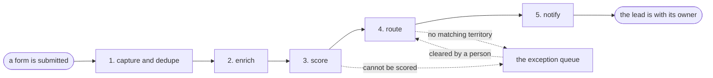

# Reference process: inbound lead routing

`ref/mkt/lead-routing v1`

A form is submitted, and within a minute the lead is deduplicated,
enriched, scored, and sitting in the right person's queue with the
evidence attached. This process runs hundreds of times a week, no run
lasts longer than a few minutes, and no person touches the ordinary
case - which makes it the opposite end of the automation range from the
social campaign, and the reason to read the two side by side.

## The activities

| # | Activity | What happens | Seats |
|---|---|---|---|
| 1 | capture and dedupe | the submission lands, duplicates are merged into the existing record | [lead-scorer](../../agents/lead-scorer.md) |
| 2 | enrich | company size, industry and geography get filled in from the data sources | lead-scorer |
| 3 | score | the lead is scored against the current model, with the inputs recorded | lead-scorer |
| 4 | route | the lead is assigned by territory and score | lead-scorer |
| 5 | notify | the owner is told, with the score and the evidence behind it | lead-scorer |

Two people appear in this process, and neither is in the path of a run:
a sales operations person clears the exception queue, and
[analytics](../../agents/analytics.md) reports weekly on scoring
accuracy so the model earns its autonomy continuously rather than once.

## The graph



## The document, with the blanks marked

```
PROCESS: inbound lead routing         id: <team>/lead-routing   v1
from: ref/mkt/lead-routing v1
owner: <who>                          effective: <date>
trigger: a form is submitted on <your properties>
concurrency: runs may overlap freely - runs never touch each other
goal: every submission scored and in the right queue within <minutes>,
      with the evidence attached
phases:
  capture - system: the submission lands, duplicates are merged
            owner: lead-scorer        after: trigger
            automation: autonomous
  enrich  - system: firmographics filled from <your data sources>
            owner: lead-scorer        after: capture
            automation: autonomous
  score   - system: scored against the model at its current version,
            inputs recorded with the score
            owner: lead-scorer        after: enrich
            automation: autonomous
  route   - system: assigned by territory and score
            owner: lead-scorer        after: score
            automation: autonomous
  notify  - system: the owner is told, with the evidence
            owner: lead-scorer        after: route
            automation: autonomous
handoffs:
  capture -> enrich: one record per real lead, duplicates merged
  enrich -> score: the record, with every filled field naming its source
  score -> route: the score, the model version, and the inputs
  route -> notify: the assignment and the reason for it
bindings:
  roster:  <the agent claiming lead-scorer> ·
           <who clears the exception queue> ·
           <the agent claiming analytics>
  systems: the CRM (write), <your enrichment sources> (read),
           the notification channel (write)
  data:    the scoring model at a version, the territory map at a
           version
policy:
  every score records the model version and the inputs it was computed
    from
  a lead that cannot be scored or routed goes to the exception queue,
    and the queue is cleared within <hours>
measures:
  cycle time: <minutes> from submission to the owner's queue
  volume: <runs per week>
  quality gate: <sample size> of scores reviewed weekly against actual
    outcomes
```

## The failure edges

- **A lead cannot be scored.** Missing or contradictory data sends it to
  the exception queue instead of guessing. A person clears the queue,
  and what they decide feeds the next model version.
- **No territory matches.** Same queue, same person, same feedback loop.
- **The model drifts.** The weekly accuracy report is the tripwire: when
  scores stop predicting outcomes, the model goes back through review,
  and that change is an amendment with a version - the same way an
  activity earned autonomy in the first place.
- **A run is abandoned.** It never is; a run costs seconds. A submission
  that fails midway restarts from capture, because every phase is safe
  to repeat.

## Why this one is in the catalog

Every phase is autonomous, and the process earns that trust with
records rather than with confidence: every score can be replayed from
its model version and inputs, exceptions go to a person by rule, and a
weekly sample checks the machine against reality. Full autonomy is
reasonable here for the same reasons it is not reasonable for the
social campaign, and reading the two documents side by side shows
exactly where the difference lives.
