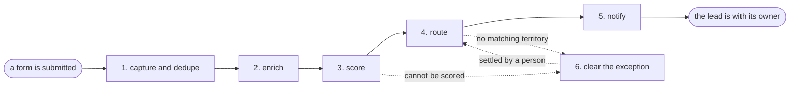

# Reference process: inbound lead routing

`ref/mkt/lead-routing v1`

**value stream:** [Inquiry-to-Owner](../../streams/marketing/inquiry-to-owner.md)
A form is submitted, and within a minute the lead is deduplicated,
enriched, scored, and sitting in the right person's queue with the
evidence attached. This process runs hundreds of times a week, no run
lasts longer than a few minutes, and no person touches the ordinary
case - which makes it the opposite end of the automation range from the
social campaign, and the reason to read the two side by side.

## The activities

| # | Activity | What happens | Seats |
|---|---|---|---|
| 1 | capture and dedupe | the submission lands and duplicates merge into one record | [lead-scorer](../../agents/lead-scorer.md) |
| 2 | enrich | company size, industry and geography get filled in | lead-scorer |
| 3 | score | scored against the current model, with the inputs recorded | lead-scorer |
| 4 | route | the lead is assigned by territory and score | lead-scorer |
| 5 | notify | the owner is told, with the score and the evidence behind it | lead-scorer |
| 6 | clear the exception | a person settles a lead no rule could place | sales operations (person) · lead-scorer |

Activity 6 is the only place a person touches a run, and it happens
only when a lead cannot be scored or cannot be placed in a territory.
Activities 1 through 5 run unattended every time.
[analytics](../../agents/analytics.md) sits outside every run and
reports each week on how well the scores predicted what the leads went
on to do. That report is how the scoring model keeps the autonomy the
first five activities are given.

## The graph



## The document, with the blanks marked

```
PROCESS: inbound lead routing         id: <team>/lead-routing   v1
from: ref/mkt/lead-routing v1
owner: <who>                          effective: <date>
trigger: a form is submitted on <your properties>
concurrency: runs may overlap freely - runs never touch each other
goal: every submission scored and in the right queue within <minutes>,
      with the evidence attached
phases:
  capture         - system: the submission lands, duplicates are merged
                    owner: lead-scorer        after: trigger
                    automation: autonomous
  enrich          - system: firmographics filled from <your data
                    sources>
                    owner: lead-scorer        after: capture
                    automation: autonomous
  score           - system: scored against the model at its current
                    version, inputs recorded with the score
                    owner: lead-scorer        after: enrich
                    automation: autonomous
  route           - system: assigned by territory and score
                    owner: lead-scorer        after: score
                    automation: autonomous
  notify          - system: the owner is told, with the evidence
                    owner: lead-scorer        after: route
                    automation: autonomous
  clear-exception - human: a lead that score or route could not settle
                    waits in the queue until a person settles it, and
                    what they decided is recorded against the lead
                    owner: <your sales operations seat>
                    after: score or route, whichever could not finish
                    by: <hours>               automation: never
handoffs:
  capture -> enrich: one record per real lead, duplicates merged
  enrich -> score: the record, with every filled field naming its source
  score -> route: the score, the model version, and the inputs
  route -> notify: the assignment and the reason for it
  clear-exception -> route: the lead as the person settled it, with
    what they decided and why, so the routing can finish
bindings:
  roster:  <the agent claiming lead-scorer> ·
           <who clears the exception queue> ·
           <the agent claiming analytics>
  systems: the CRM (write), <your enrichment sources> (read),
           the notification channel (write)
  data:    the scoring model at a version, the territory map at a
           version
policy:
  every score records the model version and the inputs it was computed
    from
  a lead that cannot be scored or routed goes to the exception queue,
    and the queue is cleared within <hours>
measures:
  cycle time: <minutes> from submission to the owner's queue
  volume: <runs per week>
  quality gate: <sample size> of scores reviewed weekly against actual
    outcomes
```

## The failure edges

- **A lead cannot be scored.** Missing or contradictory data sends the
  lead to activity 6 rather than letting the model guess. A person
  settles it, the lead goes back to route, and what the person decided
  feeds the next version of the model.
- **No territory matches.** The lead goes to activity 6 the same way,
  the same person settles it, and what they decided feeds the next
  version of the territory map.
- **The model drifts.** The weekly accuracy report is the tripwire: when
  scores stop predicting outcomes, the model goes back through review,
  and that change is an amendment with a version - the same way an
  activity earned autonomy in the first place.
- **A run is abandoned.** It never is; a run costs seconds. A submission
  that fails midway restarts from capture, because every phase is safe
  to repeat.

## Why this one is in the catalog

The five activities that run on every lead are autonomous, and the
process earns that trust with the records it leaves. Every score can be
replayed from the model version and the inputs behind it. A lead that no
rule settles goes to a person. A weekly sample checks the scores against
what those leads went on to do. No activity in the social campaign gets
this much room, and reading the two documents side by side shows where
the difference lives.
