# Reference process: Maintain Lead Scoring Model

`ref/mkt/lead-scoring-model v1`

**value stream:** [Inquiry-to-Owner](../../streams/marketing/inquiry-to-owner.md)
The scoring model behind inbound lead routing stops matching what leads
actually do, or a new fact about a lead becomes available that the model
does not read. This process is how that model changes. An analytics
agent reads how the scores of the last period compare with what those
leads went on to do, a forecaster fits two or three candidate models on
the organization's own record, and each candidate is run over leads that
have already closed and then run on live leads beside the model in
production. The people who work the leads sit in the room where one
candidate is chosen. The run ends with the chosen model issued as a
numbered version, scoring every lead, and watched through its first
weeks against what those leads do. Lead routing keeps running on the
current version the whole time this process is open.

## The activities

| # | Activity | What happens | Agents |
|---|---|---|---|
| 1 | Take in the Drift or the Signal | work out what the model must fix and by when | [decision-coordinator](../../agents/decision-coordinator.md) · [analytics](../../agents/analytics.md) |
| 2 | Read How the Model Has Scored | scores set against what those leads went on to do | analytics · [forecaster](../../agents/forecaster.md) |
| 3 | Read the Exception Queue | the leads no rule could settle, and how they settled | [lead-scorer](../../agents/lead-scorer.md) · analytics |
| 4 | Hear from the People Who Work the Leads | where the scores were wrong, in their own words | [researcher](../../agents/researcher.md) · sales operations (person) · sales leader (person) |
| 5 | Gather the Candidate Signals | facts that might predict a win, and their sources | forecaster · researcher |
| 6 | Clear the New Signals | the terms on each source, and what may be scored on | researcher · [consent-manager](../../agents/consent-manager.md) · legal reviewer (person) |
| 7 | Test the Signal Coverage | how often each signal is filled in, and how early | lead-scorer · forecaster |
| 8 | Fit the Candidate Models | two or three candidates, each with its assumptions | forecaster |
| 9 | Back-Test the Candidates | each candidate run over the leads already closed | forecaster · analytics |
| 10 | Check What Each Does to Routing | how the tiers and the territory queues would shift | lead-scorer · forecaster · sales operations (person) |
| 11 | Choose the Model | one candidate chosen, with the reasons said out loud | decision-coordinator · sales leader (person) · leadership (person) |
| 12 | Run It Beside the Live Model | both score live leads, only the current one routes | lead-scorer · forecaster · analytics |
| 13 | Issue the Model as a Version | the model numbered, and the agents that read it told | [standards-keeper](../../agents/standards-keeper.md) |
| 14 | Hand over the Model | each receiving agent says what it changes | decision-coordinator · lead-scorer · [audience-manager](../../agents/audience-manager.md) · [campaign-manager](../../agents/campaign-manager.md) |
| 15 | Put It into Production | the new version starts scoring every lead | lead-scorer |
| 16 | Watch the First Weeks | the new scores set against what the leads did | analytics · lead-scorer |
| 17 | Set the Review Conditions | the review date, and what brings the model back | decision-coordinator · sales leader (person) |
| 18 | Record What Was Learned | what to repeat, what to avoid | decision-coordinator |

## The graph

```mermaid
flowchart LR
  T([scores stop predicting, or a new signal appears]) --> A1[1. Take in the Drift or the Signal]
  A1 --> A2[2. Read How the Model Has Scored]
  A1 --> A3[3. Read the Exception Queue]
  A1 --> A4[4. Hear from the People Who Work the Leads]
  A2 --> A5[5. Gather the Candidate Signals]
  A3 --> A5
  A4 --> A5
  A5 --> A6[6. Clear the New Signals]
  A5 --> A7[7. Test the Signal Coverage]
  A6 -. a source is ruled out .-> A5
  A7 -. the signal arrives too late .-> A5
  A6 --> A8[8. Fit the Candidate Models]
  A7 --> A8
  A8 --> A9[9. Back-Test the Candidates]
  A8 --> A10[10. Check What Each Does to Routing]
  A9 -. no candidate beats the model in use .-> A8
  A10 -. a territory queue would be flooded .-> A8
  A9 --> A11[11. Choose the Model]
  A10 --> A11
  A11 -. the room cannot agree .-> A8
  A11 --> A12[12. Run It Beside the Live Model]
  A12 -. it behaves differently on live leads .-> A8
  A12 --> A13[13. Issue the Model as a Version]
  A13 --> A14[14. Hand over the Model]
  A14 --> A15[15. Put It into Production]
  A15 --> A16[16. Watch the First Weeks]
  A16 -. the new version scores worse .-> A11
  A16 --> A17[17. Set the Review Conditions]
  A17 --> A18[18. Record What Was Learned]
  A18 --> DONE([the recalibrated model is in production])
```



## The document, with the blanks marked

```
PROCESS: lead scoring model           id: <team>/lead-scoring-model   v1
from: ref/mkt/lead-scoring-model v1
owner: <who>                          effective: <date>
trigger: the accuracy report on <your lead routing process> shows the
         scores have drifted, or a new signal about a lead becomes
         available, or the review date on the model in production
         arrives
concurrency: one run at a time for one scoring model, because two runs
             would put two models into production. Runs against
             different models overlap, and lead routing keeps scoring
             on the current version throughout
goal: one recalibrated model in production as a numbered version, with
      the back-test, the routing effect and the shadow run behind it,
      and every agent that reads a score told what changed
phases:
  take-in-trigger - convenes briefing: what the model has to fix, who
                    decides it, what evidence each agent owes, and the
                    date the answer is due
                    owner: decision-coordinator  after: trigger
                    automation: <level>
  read-scoring    - human: the scores of the last <period> set against
                    what those leads went on to do, split by tier
                    owner: analytics          after: take-in-trigger
                    by: <days>                automation: <level>
  read-exceptions - system: the leads that could not be scored or
                    routed, and what a person decided about each one
                    owner: lead-scorer        after: take-in-trigger
                    automation: <level>
  first-hand      - human: what the people who work the leads say
                    about the scores those leads arrived with
                    owner: researcher         after: take-in-trigger
                    by: <days>                automation: <level>
  gather-signals  - human: the facts that might predict a win, each
                    with the source it would be read from
                    owner: forecaster
                    after: read-scoring + read-exceptions + first-hand
                    by: <days>                automation: <level>
  clear-signals   - convenes approval: legal signs that each new
                    source may be used to score a person, and the
                    consent record says which contacts it covers
                    owner: <your legal role>  after: gather-signals
                    by: <days>                automation: never
  test-coverage   - system: how often each signal is already filled
                    in, what the rest cost to fill, and which ones
                    arrive after the lead has been routed
                    owner: lead-scorer        after: gather-signals
                    automation: <level>
  fit-candidates  - runs build-by-talent: two or three candidate
                    models, each carrying the data it was fit on and
                    the assumptions it rests on
                    owner: forecaster
                    after: clear-signals + test-coverage
                    by: <days>                automation: <level>
  back-test       - system: each candidate run over the leads that
                    have already closed, to see what it would have
                    scored them and what those leads did
                    owner: forecaster         after: fit-candidates
                    by: <days>                automation: <level>
  routing-effect  - system: how many leads land in each tier and each
                    territory queue under each candidate
                    owner: lead-scorer        after: fit-candidates
                    automation: <level>
  choose-model    - convenes bake-off: two or three candidates, one
                    chosen, with the reasons said out loud
                    owner: decision-coordinator
                    after: back-test + routing-effect
                    by: <days>                automation: never
  shadow-run      - system: both models score every live lead for
                    <how long>, and only the version in production
                    routes anything
                    owner: lead-scorer        after: choose-model
                    by: <days>                automation: <level>
  issue-version   - human: the chosen model issued as a numbered
                    version, with the version it replaces left readable
                    owner: standards-keeper   after: shadow-run
                    automation: <level>
  hand-over       - runs decide-and-announce: every agent that reads a
                    score hears the new version at once and says what
                    it changes because of it
                    owner: decision-coordinator  after: issue-version
                    by: <days>                automation: <level>
  cut-over        - system: the new version starts scoring every lead,
                    and the version it replaced stays readable
                    owner: lead-scorer        after: hand-over
                    automation: <level>
  watch-new-model - human: the first <how long> of scores set against
                    what those leads went on to do
                    owner: analytics          after: cut-over
                    by: <weeks>               automation: <level>
  set-review      - human: the date the model comes back up, and the
                    drift that brings it back sooner
                    owner: decision-coordinator
                    after: watch-new-model    automation: <level>
  record-learnings - convenes debrief: what to repeat, what to avoid
                     owner: decision-coordinator  after: set-review
                     automation: <level>
run-scoped:
  outstanding - runs roll-call              owner: decision-coordinator
                every: <cadence>
                from: take-in-trigger   until: hand-over
  accuracy    - runs collect-and-report     owner: analytics
                every: <cadence>
                from: cut-over   until: run close
handoffs:
  take-in-trigger -> read-scoring / read-exceptions / first-hand: what
    the model has to fix, what each agent owes, and the date it is
    owed. Three agents read one record
  read-scoring -> gather-signals: the scores of the period set beside
    what each lead went on to do, each score naming the model version
    it was computed under
  read-exceptions -> gather-signals: the leads no rule could settle,
    what the person decided about each one, and the field that was
    missing
  first-hand -> gather-signals: what the people who work the leads
    said, attributed to the person who said it
  gather-signals -> clear-signals: each candidate signal, the source it
    would be read from, and the terms that source came with
  gather-signals -> test-coverage: the same signals, in the form they
    would be read in. Two branches read one record
  clear-signals -> fit-candidates: the signals the model may be fit on,
    and which contacts the consent record covers for each one
  test-coverage -> fit-candidates: how often each signal is present,
    what the rest cost to fill, and which ones arrive after the lead
    has been routed
  fit-candidates -> back-test: each candidate at a version, with the
    data it was fit on and the assumptions it rests on
  fit-candidates -> routing-effect: the same candidates. Two branches
    read one record
  back-test -> choose-model: what each candidate would have scored the
    closed leads, and what those leads actually did
  routing-effect -> choose-model: how many leads land in each tier and
    each territory queue under each candidate, set beside what the
    model in production does now
  choose-model -> shadow-run: the chosen candidate, why it won over
    the others, and everyone who disagreed and on what
  shadow-run -> issue-version: both scores for every lead of the
    shadow period, and every lead the two models would have routed to
    different owners
  issue-version -> hand-over: the model at its number, and what
    changed from the version it replaces
  hand-over -> cut-over: what each receiving agent said it would
    change, and the date it said it by
  cut-over -> watch-new-model: the date the new version started
    scoring, and the last lead the version it replaced scored
  watch-new-model -> set-review: the first weeks of scores set against
    what those leads did
  set-review -> record-learnings: the review date, and the drift that
    brings the model back sooner
bindings:
  roster:  <who holds each role - agents claiming the abstract agents
           above, and named people for the sales side, leadership and
           legal>
  systems: the CRM (read), enrichment sources (read),
           analytics platforms (read),
           the customer and revenue record (read),
           the consent record (read), the model store (write),
           the standards store (write), the decision record (write),
           the review schedule (write),
           the notification channel (write)
  data:    the model in production at its version, the territory map
           at its version, <your lead record> over <what period>,
           the terms attached to every source the model reads
policy:
  every score records the model version and the inputs it was computed
    from
  a model in production is never edited in place. A change goes in as
    a new numbered version, and the version it replaces stays readable
  no candidate reaches the room without a back-test over the leads
    that have already closed
  a signal that cannot be read before the lead is routed is marked as
    such, and <who> decides whether the model may score on it
  a rate the model cannot source is reported as unsourced, and no
    estimate is put in its place
  no new signal is scored on until legal has signed that its source
    may be used and the consent record has been applied to it
  the model that goes into production is chosen by named people, and
    the choice is never delegated to an agent
  the people who work the leads sit in the room where the model is
    chosen, and a model chosen without them is not issued
  the run does not close until every agent that reads a score has said
    what it changes, and an agent that changes nothing says why
measures:
  cycle time: <target> from the trigger to the new version scoring
  accuracy: <share> of the leads scored in the top tier that went on
            to <what counts as a win>, read on the review date
  coverage: <share> of the signals the model reads that are filled in
            before a lead is routed
  quality gate: no version reaches production without its back-test,
                its routing effect and its shadow run
```

## The failure edges

- **No candidate beats the model already in use.** The run returns to
  fit-candidates with the back-test results attached, and the agents try
  a different set of signals. If the second attempt also fails, the run
  closes with the model in production unchanged, and the reason is
  recorded against the trigger that opened it.
- **A candidate would flood a territory queue.** The routing effect
  sends the run back to fit-candidates. Rebuilding the candidate and
  changing the thresholds it routes on are both answers, and <who>
  decides which one the run takes.
- **Legal rules out a source.** Every candidate fit on that source goes
  back to fit-candidates to be rebuilt without it. A better back-test
  does not overturn this check, because the question it answers is
  whether the organization may score on the data at all.
- **A signal arrives after the lead has been routed.** The run goes back
  to gather-signals. Either the signal is replaced with one that can be
  read at the moment of scoring, or it stays and the model uses it only
  where a lead is scored again later.
- **The shadow run disagrees with the back-test.** The candidate scored
  the closed leads well and scores live leads differently, so the run
  returns to fit-candidates. The leads the two models disagreed on go
  back with it.
- **The new version scores worse after it goes live.** The watch on the
  first weeks is what catches this, and the run returns to choose-model.
  Putting the previous version back and correcting the new one are both
  a person's call, and whichever the room chooses goes through the
  shadow run, the version and the handover again.
- **The trigger fires while a run is in flight.** Two runs against the
  same model do not overlap, because the second one would put a second
  model into production. A new signal raised while a run is open joins
  the run in flight if the evidence has not been gathered yet, and waits
  for the next run if it has.
- **A run is abandoned.** The candidates stay in the model store at
  their versions, carrying the data they were fit on, and a later run
  picks them up with the dates behind them. Nothing is issued, lead
  routing keeps scoring on the version it already had, and the
  coordinator records that the drift went unanswered and why.
