# Reference process: Produce Long-Form Content

`ref/mkt/long-form-content v1`

**value stream:** [Idea-to-Asset](../../streams/marketing/idea-to-asset.md)
A content manager takes an approved topic, has the evidence gathered and
the piece written, sends it through an edit and a fact check, gets the
visuals made and the whole thing signed off, has it built into a page and
put live, promotes it, and reports how it did against what the topic was
approved to do. The piece can be an article or a longer guide, and the
activities are the same for both. The run stays open past publication,
because the manager still owes a report on how the piece performed.

## The activities

| # | Activity | What happens | Agents |
|---|---|---|---|
| 1 | Take in the Topic | work out what the piece must do and by when | [content-manager](../../agents/content-manager.md) |
| 2 | Set the Search Terms | the terms and questions the piece has to cover | [search-optimizer](../../agents/search-optimizer.md) |
| 3 | Brief the Piece | everyone hears the same request at once | content-manager · [researcher](../../agents/researcher.md) · [copywriter](../../agents/copywriter.md) · [editor](../../agents/editor.md) · [creative-producer](../../agents/creative-producer.md) · search-optimizer |
| 4 | Gather the Evidence | sources, data, and the interview with the expert | researcher · subject matter expert (person) |
| 5 | Agree the Outline | what the piece argues and the order of its sections | content-manager · editor · copywriter |
| 6 | Write the Draft | the piece is written to the outline | copywriter |
| 7 | Edit the Draft | the editor says what has to be rewritten | editor |
| 8 | Check the Facts | every claim is read against the source under it | researcher · subject matter expert (person) |
| 9 | Make the Visuals | diagrams, images and video for the piece | creative-producer · [designer](../../agents/designer.md) · [video-editor](../../agents/video-editor.md) |
| 10 | Get Sign-Offs | brand, legal and rights approve the piece | [brand-check](../../agents/brand-check.md) · brand owner (person) · legal reviewer (person) · rights approver (person) |
| 11 | Build the Page | the copy and the design become a page in the site | [web-producer](../../agents/web-producer.md) |
| 12 | Wire up the Measurement | tags, conversions, and the form into the CRM | [conversion-tracker](../../agents/conversion-tracker.md) |
| 13 | Check the Finished Page | accessibility, load time, links, title, headings | [accessibility-check](../../agents/accessibility-check.md) · search-optimizer |
| 14 | Publish | the owner says go and the page goes live | content-manager · web-producer |
| 15 | Promote the Piece | email, social and paid, and replies to readers | [campaign-manager](../../agents/campaign-manager.md) · [media-buyer](../../agents/media-buyer.md) · [community-manager](../../agents/community-manager.md) |
| 16 | Watch Performance | traffic, conversions and what readers asked | [analytics](../../agents/analytics.md) · content-manager |
| 17 | Report How the Piece Did | results set against what the piece promised | content-manager · analytics |
| 18 | Record What Was Learned | what to repeat, what to avoid | content-manager |

## The graph

```mermaid
flowchart LR
  T([a topic is approved]) --> A1[1. Take in the Topic]
  A1 --> A2[2. Set the Search Terms]
  A2 --> A3[3. Brief the Piece]
  A3 --> A4[4. Gather the Evidence]
  A4 --> A5[5. Agree the Outline]
  A5 --> A6[6. Write the Draft]
  A5 --> A9[9. Make the Visuals]
  A6 --> A7[7. Edit the Draft]
  A7 -. rewrite what the edit named .-> A6
  A7 --> A8[8. Check the Facts]
  A8 -. a claim with no source .-> A6
  A8 --> A10[10. Get Sign-Offs]
  A9 --> A10
  A10 -. changes requested .-> A6
  A10 -. changes requested .-> A9
  A10 --> A11[11. Build the Page]
  A11 --> A12[12. Wire up the Measurement]
  A12 -. the page has to change .-> A11
  A12 --> A13[13. Check the Finished Page]
  A13 -. failures to fix .-> A11
  A13 --> A14[14. Publish]
  A14 --> A15[15. Promote the Piece]
  A14 --> A16[16. Watch Performance]
  A15 --> A17[17. Report How the Piece Did]
  A16 --> A17
  A17 --> A18[18. Record What Was Learned]
  A18 --> DONE([the piece is live and the run is closed])
```



## The document, with the blanks marked

```
PROCESS: long-form content            id: <team>/long-form-content   v1
from: ref/mkt/long-form-content v1
owner: <who>                          effective: <date>
trigger: a topic is approved in <your content planning process>
concurrency: runs overlap - <how many> pieces in production at once
goal: an article or guide that is sourced, signed, published on its
      date, promoted, and reported against what the topic was approved
      to do
phases:
  take-in-topic    - human: read the approved topic and write down what
                     the piece has to do, for whom, and by when
                     owner: content-manager    after: trigger
                     automation: <level>
  search-terms     - human: the terms and questions the piece has to
                     cover to be found, each with its demand figure
                     owner: search-optimizer   after: take-in-topic
                     by: <days>                automation: <level>
  brief-the-piece  - convenes briefing: the request and the search
                     terms, heard by every agent at once
                     owner: content-manager    after: search-terms
                     automation: <level>
  gather-evidence  - runs build-by-talent: the primary sources, the
                     numbers, and the interview with <your expert>
                     owner: researcher         after: brief-the-piece
                     by: <days>                automation: <level>
  agree-outline    - convenes decide-and-announce: what the piece
                     argues, and the order of its sections
                     owner: content-manager    after: gather-evidence
                     automation: <level>
  write-draft      - human: the piece written to the outline, every
                     claim carrying the source the researcher found
                     owner: copywriter         after: agree-outline
                     by: <days>                automation: <level>
  edit-draft       - runs layered-passes: the structure and argument
                     pass, item by item, back to the writer
                     owner: editor             after: write-draft
                     by: <days>                automation: <level>
  check-facts      - runs layered-passes: the fact pass, every claim
                     against the source it cites
                     owner: researcher         after: edit-draft
                     by: <days>                automation: <level>
  make-visuals     - runs build-by-talent: the diagrams, the images and
                     the video the piece needs
                     owner: creative-producer  after: agree-outline
                     by: <days>                automation: <level>
  get-sign-offs    - convenes approval: brand, legal and rights sign, as
                     named signers, against a version of the piece
                     owner: <your legal role>
                     after: check-facts + make-visuals
                     by: <days>                automation: never
  build-page       - human: the approved copy and design assembled into
                     a page, with a preview link and its address set
                     owner: web-producer       after: get-sign-offs
                     by: <days>                automation: <level>
  wire-measurement - human: the tags, the conversions that count, and
                     the form on the page connected to the CRM
                     owner: conversion-tracker after: build-page
                     automation: <level>
  check-page       - runs assessment: the accessibility and
                     technical standards, and the search check
                     owner: content-manager    after: wire-measurement
                     by: <days>                automation: <level>
  publish          - human: the named owner says go and the producer
                     puts the page live
                     owner: content-manager    after: check-page
                     automation: <level>
  promote          - human: the email, the social posts and the paid
                     distribution, and replies to what readers say
                     owner: campaign-manager   after: publish
                     automation: <level>
  watch            - human: traffic, conversions, and the questions
                     readers keep asking
                     owner: analytics          after: publish
                     automation: <level>
  report-piece     - runs collect-and-report: the numbers set against
                     what the piece was approved to do
                     owner: content-manager    after: promote + watch
                     by: <weeks>               automation: <level>
  record-learnings - convenes debrief: what to repeat, what to avoid
                     owner: content-manager    after: report-piece
                     automation: <level>
run-scoped:
  status      - runs roll-call                 owner: content-manager
                every: <cadence>
                from: brief-the-piece   until: publish
  performance - runs collect-and-report        owner: analytics
                every: <cadence>
                from: publish   until: run close
  spend       - runs allocate-and-reconcile    owner: media-buyer
                from: promote   until: run close
handoffs:
  take-in-topic -> search-terms: what the piece has to do and for whom,
    in one line that every later decision can be tested against
  search-terms -> brief-the-piece: the terms and the questions, each
    with the demand figure behind it and the date it was pulled
  brief-the-piece -> gather-evidence: the request as every agent heard
    it, and the date the piece is promised
  gather-evidence -> agree-outline: the evidence, with a source line
    for every fact
  agree-outline -> write-draft: the argument and the sections, and the
    search terms each section has to answer
  agree-outline -> make-visuals: the sections that need a diagram, an
    image or a video
  edit-draft -> write-draft: the edit at a version, item by item, in
    terms the writer can work through without coming back to ask
  check-facts -> get-sign-offs: the draft at a version, with every
    claim carrying the source it rests on
  make-visuals -> get-sign-offs: the visual set at a version
  get-sign-offs -> build-page: the approved piece at the signed
    version. A later change voids the approval and sign-offs run again
  build-page -> wire-measurement: the page and its form fields, while
    the page can still be changed
  wire-measurement -> check-page: the page as it will be served, and a
    dated test showing each conversion arriving
  check-page -> publish: the scored list, with the rule behind every
    failure
  publish -> promote: the live address, the tracking parameters, and
    what the piece is meant to make a reader do
  report-piece -> record-learnings: the report, as delivered
bindings:
  roster:  <who holds each role - agents claiming the abstract agents
           above, and named people for the expert, legal, brand and
           rights>
  systems: the content plan (write), the asset store (write),
           the website (write), the website (trigger), analytics (write),
           the CRM (write), ad platforms (write, cap: <n>/day),
           the source record (write)
  data:    brand guidelines <version>, <your claims register>,
           <your style guide> <version>,
           <your accessibility standard> <version>, the approved topic
policy:
  every claim in the piece carries a source recorded against it
  sign-off is a human gate and is never delegated to an agent
  a piece changed after sign-off goes back through sign-offs
  nothing goes live without a recorded go from the named owner
  the expert the piece is built on confirms it is accurate before it
    publishes
  a page with a known accessibility failure publishes only when <who>
    accepts the failure in writing, and the acceptance is recorded
measures:
  cycle time: <target> from the approved topic to publication
  volume: <pieces per period>
  quality gate: nothing publishes unsigned, and no claim publishes
                without its source
```

## The failure edges

- **A sign-off comes back with changes.** The run returns to the draft
  or to the visuals, and only the piece the signers named reopens. The
  signers see the changed version before it goes any further.
- **A claim turns out to have no source.** The researcher reports it as
  unsourced and the run goes back to the draft. The writer cuts the
  sentence or the researcher finds the source, and the fact pass runs
  again on the version that comes back.
- **The expert will not confirm the piece.** The run stops at the
  sign-offs and <who> decides whether the piece is corrected, held, or
  dropped. Publishing it while the expert disagrees is not one of the
  choices.
- **The check on the finished page fails.** The findings go back to
  build-page with the rule attached to each one, the web-producer fixes
  what the findings name, and the same check runs again on the fixed
  page.
- **The evidence goes stale.** A piece that sits between the fact pass
  and publication for longer than <how long> goes through the fact pass
  again before it goes live, because the numbers in it may have moved.
- **The trigger fires while runs are in flight.** Pieces overlap
  normally, and the concurrency line says how many. The content-manager
  agent takes one piece at a time, so every run in flight needs its own
  holder of that role, and the runs share their reference data
  read-only.
- **A run is abandoned.** The draft, the evidence and the visuals stay
  where they are at their versions, so a later run can pick them up. An
  unpublished page comes down from staging and its address is released,
  any promotion already booked is cancelled, and the spend line
  reconciles anyway.
