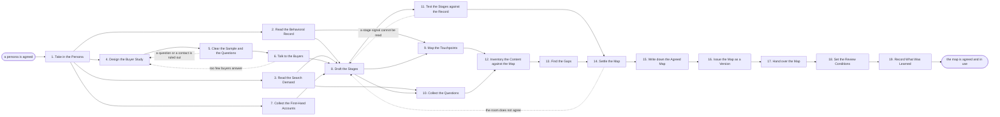

# Reference process: Map Buyer Journey

`ref/mkt/map-buyer-journey v1`

**value stream:** [Market-to-Audience](../../streams/marketing/market-to-audience.md)
A decision coordinator takes one agreed persona and works out how people
of that persona buy. Analytics reads what those buyers did in the months
before they bought, a study manager asks recent buyers what they were
trying to settle at each point, a search optimizer reads what people
search on the subject, and a researcher collects what the people who
deal with buyers get asked. The coordinator turns that evidence into a
set of stages, each carrying a signal that says a buyer has entered it,
and the run then records every place the buyer meets the organization
and every question the buyer needs answered at each stage. A content
librarian matches what is already published against those questions, and
the questions with nothing behind them become the gap list. The map is
agreed by the people who will plan against it, issued at a version, and
handed to the agents that plan content and design campaigns. Those
agents can rely on four things from a recorded map: the stages with the
signal that marks each one, the touchpoints placed against a stage with
the agent that owns each, the questions in the words buyers used, and
the gaps ranked by how many buyers reach the question.

## The activities

| # | Activity | What happens | Agents |
|---|---|---|---|
| 1 | Take in the Persona | which persona, which purchase, what the map answers | [decision-coordinator](../../agents/decision-coordinator.md) · leadership (person) |
| 2 | Read the Behavioral Record | what buyers of this persona did before they bought | [analytics](../../agents/analytics.md) |
| 3 | Read the Search Demand | what people search on this subject, and in what order | [search-optimizer](../../agents/search-optimizer.md) |
| 4 | Design the Buyer Study | the method, who gets asked, and every question asked | [study-manager](../../agents/study-manager.md) · [statistician](../../agents/statistician.md) |
| 5 | Clear the Sample and the Questions | the rules scored, and legal signs before anyone is asked | [consent-manager](../../agents/consent-manager.md) · legal reviewer (person) |
| 6 | Talk to the Buyers | recent buyers say what they were trying to settle | study-manager |
| 7 | Collect the First-Hand Accounts | what the people who deal with buyers get asked | [researcher](../../agents/researcher.md) · subject matter expert (person) |
| 8 | Draft the Stages | the steps a buyer moves through, and what marks each | decision-coordinator · study-manager · researcher |
| 9 | Map the Touchpoints | every place the buyer meets the organization | [audience-manager](../../agents/audience-manager.md) · [content-librarian](../../agents/content-librarian.md) · analytics |
| 10 | Collect the Questions | what the buyer needs answered at each stage | study-manager · search-optimizer · researcher |
| 11 | Test the Stages against the Record | whether each signal can be read, and who moved that way | statistician · analytics |
| 12 | Inventory the Content against the Map | which published piece answers which question | content-librarian · [content-manager](../../agents/content-manager.md) |
| 13 | Find the Gaps | the questions with nothing published behind them | content-librarian · search-optimizer · decision-coordinator |
| 14 | Settle the Map | the people who plan against it agree it, or send it back | decision-coordinator · leadership (person) · subject matter expert (person) |
| 15 | Write down the Agreed Map | stages, touchpoints, questions, gaps, and who agreed | decision-coordinator |
| 16 | Issue the Map as a Version | the map numbered, and the agents that read it told | [standards-keeper](../../agents/standards-keeper.md) |
| 17 | Hand over the Map | each receiving agent says what it changes | decision-coordinator · content-manager · [campaign-manager](../../agents/campaign-manager.md) · audience-manager · search-optimizer |
| 18 | Set the Review Conditions | the review date, and what would change the answer | decision-coordinator · leadership (person) |
| 19 | Record What Was Learned | what to repeat, what to avoid | decision-coordinator |

## The graph



## The document, with the blanks marked

```
PROCESS: map buyer journey            id: <team>/map-buyer-journey   v1
from: ref/mkt/map-buyer-journey v1
owner: <who>                          effective: <date>
trigger: a persona is agreed in <your profile process>, or the review
         date on a recorded map arrives, or <what change in the market
         brings the map back sooner>
         watch: record=<persona> system=<your profile process>
                change=<a persona is agreed at a version>
         or watch: record=<recorded map>
                system=<your review schedule>
                change=<the review date on the map arrives>
         or watch: record=<market signal>
                system=<where the market change is seen>
                change=<what change in the market brings the map back
                sooner>
concurrency: one run at a time for the same persona and the same
             purchase, because two maps of one journey leave the
             planning agents with neither. Runs for different personas
             overlap
goal: one agreed map of how a persona buys, carrying its stages with
      the signal that marks each one, its touchpoints, the questions
      buyers ask at each stage, and the questions nothing published
      answers
phases:
  take-in-persona   - convenes briefing: which persona, which purchase,
                      what the map has to answer, what evidence each
                      agent owes, and the date it is owed
                      owner: decision-coordinator after: trigger
                      automation: <level>
  read-behavior     - human: what buyers of this persona did in the
                      months before they bought, and in what order
                      owner: analytics           after: take-in-persona
                      by: <days>                 automation: <level>
  read-search       - human: what people search on this subject, and
                      which questions come early and which come late
                      owner: search-optimizer    after: take-in-persona
                      by: <days>                 automation: <level>
  design-study      - human: the method, who gets asked, how many
                      responses the findings will need, and every
                      question in the wording it will be asked in
                      owner: study-manager       after: take-in-persona
                      by: <days>                 automation: <level>
  clear-study       - convenes approval: the consent-manager scores the
                      sample and the questions against the rules in
                      force, and legal signs before anyone is asked
                      owner: <your legal role>   after: design-study
                      by: <days>                 automation: never
  talk-to-buyers    - human: recent buyers are asked what they were
                      trying to settle at each point and where they
                      went to settle it
                      owner: study-manager       after: clear-study
                      by: <days>                 automation: <level>
  first-hand        - human: what the people who deal with buyers say
                      they get asked, and at what point they get asked
                      owner: researcher          after: take-in-persona
                      by: <days>                 automation: <level>
  draft-stages      - runs build-by-talent: the stages a buyer moves
                      through, each with the signal that says a buyer
                      has entered it and the signal that says the buyer
                      has left it
                      owner: decision-coordinator
                      after: read-behavior + read-search +
                             talk-to-buyers + first-hand
                      by: <days>                 automation: <level>
  map-touchpoints   - human: every place a buyer of this persona meets
                      the organization, each placed against a stage and
                      carrying the agent that owns it
                      owner: audience-manager    after: draft-stages
                      by: <days>                 automation: <level>
  collect-questions - runs collect-and-report: what the buyer needs
                      answered at each stage, each question in the
                      words a buyer used and carrying where it was
                      heard
                      owner: study-manager       after: draft-stages
                      by: <days>                 automation: <level>
  test-stages       - system: each stage signal run over the record, to
                      see whether it can be read at all and how many
                      buyers moved the way the stages say they do
                      owner: statistician        after: draft-stages
                      by: <days>                 automation: <level>
  inventory-content - runs collect-and-report: every recorded question
                      put to the library, and every published piece
                      that answers one recorded at its address
                      owner: content-librarian
                      after: map-touchpoints + collect-questions
                      by: <days>                 automation: <level>
  find-gaps         - human: the questions nothing published answers,
                      and the questions answered by something buyers
                      cannot find, ranked by how many buyers reach them
                      owner: content-librarian   after: inventory-content
                      by: <days>                 automation: <level>
  settle-map        - convenes approval: the people who will plan
                      against the map agree it, and a changes-requested
                      goes back to the stage or the question the
                      signers named
                      owner: decision-coordinator
                      after: test-stages + find-gaps
                      by: <days>                 automation: never
  write-map         - human: the stages and their signals, the
                      touchpoints, the questions, the gaps, who agreed,
                      and who disagreed and on what
                      owner: decision-coordinator after: settle-map
                      automation: <level>
  issue-version     - human: the agreed map issued as a numbered
                      version, with the version it replaces left
                      readable
                      owner: standards-keeper    after: write-map
                      automation: <level>
  hand-over         - runs decide-and-announce: every agent that plans
                      content or designs campaigns hears the map at
                      once and says what it changes because of it
                      owner: decision-coordinator after: issue-version
                      by: <days>                 automation: <level>
  set-review        - human: the date the map comes back up, and the
                      conditions that would bring it back sooner
                      owner: decision-coordinator after: hand-over
                      automation: <level>
  record-learnings  - convenes debrief: what to repeat, what to avoid
                      owner: decision-coordinator after: set-review
                      automation: <level>
run-scoped:
  outstanding - runs roll-call             owner: decision-coordinator
                every: <cadence>
                from: take-in-persona   until: hand-over
handoffs:
  take-in-persona -> read-behavior / read-search / design-study /
    first-hand [persona-and-owings]: the persona at its version, the
    purchase the map covers, what each agent owes, and the date it is
    owed. Four branches read one record
  read-behavior -> draft-stages [buyer-paths]: the paths those buyers
    took, with the period the paths were read over and the source under
    every figure
  read-search -> draft-stages [search-demand]: what people search on the
    subject, each term with its demand figure and the date that figure
    was pulled
  read-search -> collect-questions [search-terms-for-questions]: the
    same list, so a question people type and a question a buyer says out
    loud land in one place
  design-study -> clear-study [study-design]: who is sampled, how the
    sample is drawn, and every question at the version it will be asked
    in
  clear-study -> talk-to-buyers [cleared-study]: the sample and the
    questions as they were approved. A question changed afterwards goes
    back through the check before anyone is asked it
  talk-to-buyers -> draft-stages [buyer-answers]: what buyers said,
    attributed to the person who said it, with what each said about when
    it happened
  first-hand -> draft-stages [first-hand-accounts]: what the people who
    deal with buyers say they get asked, attributed the same way
  draft-stages -> map-touchpoints [drafted-stages]: the stages in order,
    each with the signal that says a buyer entered it
  draft-stages -> collect-questions [stages-for-questions]: the same
    stages, so every question lands against one of them
  draft-stages -> test-stages [stages-to-test]: the same stages, in the
    form the record will be run over
  map-touchpoints -> inventory-content [touchpoints]: every touchpoint,
    its stage, and the agent that owns it
  collect-questions -> inventory-content [buyer-questions]: the
    questions per stage, in the words buyers used
  test-stages -> settle-map [signal-readability]: whether each stage
    signal can be read from a system in use, how many buyers each stage
    holds, and which stages the record cannot see at all
  inventory-content -> find-gaps [content-inventory]: which published
    piece answers which question, each at its address and its version
  find-gaps -> settle-map [gap-list]: the questions nothing answers and
    the questions answered by something buyers cannot find, ranked
  settle-map -> write-map [agreed-map]: the agreed map, the reasons
    behind it, and anyone who disagreed and on what
  write-map -> issue-version [written-map]: the map in the wording it
    was agreed in
  issue-version -> hand-over [versioned-map]: the map at its number, and
    what changed from the version it replaces
  hand-over -> set-review [adoption-answers]: what each receiving agent
    said it would change, and the date it said it by
  set-review -> record-learnings [review-conditions]: the review date
    and the conditions that bring the map back sooner
deviations:
  clear-study -> design-study [study-item-ruled-out]: consent rules out
    part of the sample or a question, so the study is designed again
    without it
  talk-to-buyers -> design-study [too-few-answers]: too few buyers
    answer, so the study is designed again or what came in is reported
    with the shortfall recorded against it
  test-stages -> draft-stages [signal-cannot-be-read]: a stage signal
    cannot be read from any system, so the stages are drafted again
    around something the record can see
  settle-map -> draft-stages [room-does-not-agree]: the room does not
    agree on the stages, so they are drafted again with what each side
    said
bindings:
  roster:  <who holds each role - agents claiming the abstract agents
           above, and named people for leadership, the experts who deal
           with buyers, and legal>
  systems: analytics platforms (read), the CRM (read), the customer and
           revenue record (read), search demand and ranking data
           sources (read), the site's search performance data (read),
           the CMS (read), the content inventory (read), the contact
           database (read), the consent record (read), the survey and
           interview system (trigger), the study record (write), the
           response record (write), the evidence store (write), the
           decision record (write), the standards store (write), the
           review schedule (write), the notification channel (write),
           the meeting calendar (write, cap: <what may be set without
           asking>)
  data:    the persona at its version, <your buying history> over <what
           period>, the rules in force for contacting people, the
           earlier maps of this journey at the versions they were
           agreed at
policy:
  every stage carries a signal that can be read from a system somebody
    already runs, and a stage whose signal cannot be read is recorded
    as a stage nobody can count
  every question reaches the map in the words a buyer used, with the
    response or the search figure it came from recorded under it
  nobody is asked anything until the consent-manager has scored the
    sample and the questions against the rules in force
  no finding rests on fewer responses than the statistician said the
    study needed, and a finding that does is marked as such before it
    is written
  the map is agreed by named people, and the agreement is never
    delegated to an agent
  the agents that plan content and design campaigns sit in the room
    where the map is agreed, and a map agreed without them is not
    recorded
  a gap is recorded whether or not anybody intends to fill it, because
    what gets made is a separate decision made in a separate process
  a disagreement is recorded with the map, naming who disagreed and
    what they disagreed with
  a recorded map is never edited in place. A change goes in as a new
    version, and the version it replaces stays readable
measures:
  cycle time: <target> from the persona to the recorded map
  stage coverage: <share> of the stages whose entry signal can be read
                  from a system already in use
  question coverage: <share> of the recorded questions with a published
                     piece answering them, read on the review date
  quality gate: no map is recorded without its evidence, its gap list,
                and an answer from every agent that plans against it
```

## The failure edges

- **A stage signal cannot be read from any system.** The run returns to
  draft-stages. Either the stage is redrawn around something the record
  can see, or it stays and is recorded as a stage nobody can count, and
  the agents that plan against the map are told which stages those are.
- **Too few buyers answer.** The run returns to design-study. The
  statistician says what the shortfall does to each finding, and <who>
  decides whether to go back into the field or to report on what came in
  with the shortfall recorded against it.
- **Consent rules out part of the sample or a question.** The study goes
  back to design-study to be redrawn without it. Better evidence does
  not overturn this check, because the question it answers is whether
  these people may be asked at all.
- **The room does not agree on the stages.** The run returns to
  draft-stages with what each side said. Deciding on thinner evidence
  and waiting for more evidence are both a person's call, and the
  coordinator makes neither.
- **Something already published answers a question and buyers never find
  it.** This is recorded as its own kind of gap, with the piece and its
  address beside the question, so the agents that plan content can tell
  a question that needs something written from one that needs something
  found.
- **The gap list is longer than the department can fill.** The map
  records every gap and ranks them by how many buyers reach the
  question. Choosing which gaps get filled belongs to content planning
  and campaign design, and this run does not make that choice.
- **The persona changes while the run is in flight.** The map names the
  persona at the version it was built on. A new version of the persona
  goes to <who>, who decides whether the run continues against the
  version it started with or starts again.
- **The trigger fires while a run is in flight.** Two runs against the
  same persona and purchase do not overlap, because the second one would
  produce a second map and leave the planning agents with neither. A
  different persona starts its own run.
- **A run is abandoned.** The evidence stays where it is at its
  versions, and a later run picks it up with the dates it was gathered
  on. No map is recorded, the planning agents keep working to the map
  they already had, and the coordinator records that the question went
  unanswered and why.
