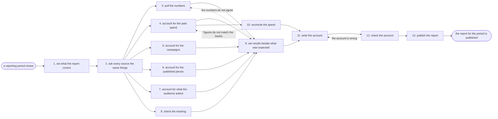

# Reference process: the marketing performance report

`ref/mkt/marketing-performance-report v1`

A reporting period closes, and the department has to say what happened
during it. The reporting manager settles what the report covers, asks
every campaign, every published piece and every channel for the same
things, sets each result beside what that run said it would do, and
writes the account of why the numbers moved. The report goes out on the
date it is due, and a source that did not answer in time appears in it
as missing.

## The activities

| # | Activity | What happens | Seats |
|---|---|---|---|
| 1 | set what the report covers | the period, the runs in it, and the questions | [reporting-manager](../../agents/reporting-manager.md) · leadership (person) |
| 2 | ask every source the same things | one request, one format, one due date | reporting-manager |
| 3 | pull the numbers | results from every channel, with their sources | [analytics](../../agents/analytics.md) |
| 4 | account for the paid spend | spend by campaign and channel, and what it returned | [media-buyer](../../agents/media-buyer.md) |
| 5 | account for the campaigns | what each campaign did against its brief | [campaign-manager](../../agents/campaign-manager.md) |
| 6 | account for the published pieces | how each piece performed and where it ranked | [content-manager](../../agents/content-manager.md) · [search-optimizer](../../agents/search-optimizer.md) |
| 7 | account for what the audience asked | the questions and the complaints of the period | [community-manager](../../agents/community-manager.md) |
| 8 | check the tracking | where measurement was broken and for how long | [conversion-tracker](../../agents/conversion-tracker.md) |
| 9 | set results beside what was expected | each result next to what that run committed to | reporting-manager |
| 10 | reconcile the spend | the spend figures checked against the books | media-buyer · finance (person) |
| 11 | write the account | why the numbers moved, in plain words | reporting-manager |
| 12 | check the account | the seats it names confirm it is accurate | campaign-manager · content-manager · media-buyer |
| 13 | publish the report | the report goes out on its date, at a version | reporting-manager |

## The graph



## The document, with the blanks marked

```
PROCESS: marketing performance report id: <team>/marketing-performance-report   v1
from: ref/mkt/marketing-performance-report v1
owner: <who>                          effective: <date>
trigger: a reporting period closes on <your reporting calendar>
concurrency: runs may overlap - a period can close while the last
             report is still open
goal: every run of the period represented, each result set beside what
      that run said it would do, and the account published on its date
phases:
  set-scope        - human: the period, the runs it covers, and the
                     questions <who> wants the report to answer
                     owner: reporting-manager   after: trigger
                     automation: <level>
  ask-sources      - runs collect-and-report: one request, one
                     format and one due date, sent to every source
                     owner: reporting-manager   after: set-scope
                     automation: <level>
  pull-numbers     - human: the results from every channel, each line
                     carrying its source and the date it was pulled
                     owner: analytics           after: ask-sources
                     by: <days>                 automation: <level>
  paid-account     - human: what was spent by campaign and by channel,
                     and what that spend returned
                     owner: media-buyer         after: ask-sources
                     by: <days>                 automation: <level>
  campaign-account - human: what each campaign of the period did
                     against the brief it was run from
                     owner: campaign-manager    after: ask-sources
                     by: <days>                 automation: <level>
  content-account  - human: how each published piece performed and
                     where it ranked, against the request it came from
                     owner: content-manager     after: ask-sources
                     by: <days>                 automation: <level>
  audience-account - human: the questions and the complaints people
                     brought during the period
                     owner: community-manager   after: ask-sources
                     by: <days>                 automation: <level>
  check-tracking   - system: where measurement was broken during the
                     period, on which pages, and for how long
                     owner: conversion-tracker  after: ask-sources
                     by: <days>                 automation: <level>
  set-against-plan - human: each result put next to what that run
                     committed to, and every gap marked as a gap
                     owner: reporting-manager
                     after: pull-numbers + paid-account +
                            campaign-account + content-account +
                            audience-account + check-tracking
                     automation: <level>
  reconcile-spend  - convenes approval: finance signs that the spend
                     figures in the report match the books
                     owner: <your finance seat> after: paid-account
                     by: <days>                 automation: never
  write-account    - human: why the numbers moved, in words a reader
                     outside the department can follow
                     owner: reporting-manager
                     after: set-against-plan + reconcile-spend
                     by: <days>                 automation: <level>
  check-account    - convenes approval: every seat the account names
                     confirms what it says about their runs
                     owner: reporting-manager   after: write-account
                     by: <days>                 automation: <level>
  publish-report   - human: the report goes to <who> and to the
                     department, at a version, on its date
                     owner: reporting-manager   after: check-account
                     automation: <level>
run-scoped:
  outstanding - runs roll-call                owner: reporting-manager
                every: <cadence>
                from: ask-sources   until: publish-report
handoffs:
  set-scope -> ask-sources: the period, the runs it covers and the
    questions, in one record every source is asked from
  ask-sources -> pull-numbers / paid-account / campaign-account /
    content-account / audience-account / check-tracking: the same
    request and the same due date. Six sources read one record
  pull-numbers -> set-against-plan: the results, each line naming its
    source and the date it was pulled
  paid-account -> reconcile-spend: the spend by campaign and by
    channel, at the figures the report will carry
  set-against-plan -> write-account: each result beside the commitment
    it is measured against, with every gap left visible
  reconcile-spend -> write-account: the spend figures as finance signed
    them
  write-account -> check-account: the account at a version
  check-account -> publish-report: the account, with every correction
    the named seats asked for and every disagreement recorded
bindings:
  roster:  <who holds each seat - agents claiming the abstract agents
           above, and named people for leadership and finance>
  systems: analytics platforms (read), ad platforms (read),
           the CRM (read), the report store (write)
  data:    what each run of the period committed to, <your measure
           definitions> at a version, the reporting calendar
policy:
  every line in the report names the source it came from
  the report publishes on its date whether or not every source
    answered, and a source that did not answer appears as missing
  two sources that disagree both appear in the report
  a number is removed or restated only when <who> decides it, the
    decision is recorded with the report, and the change goes out as a
    new version
measures:
  cycle time: <days> from the period closing to publication
  coverage: <share> of the period runs represented in the report
  quality gate: every line carries its source
```

## The failure edges

- **The spend does not match the books.** Finance names the figures
  that are wrong and the run returns to the paid account. Only those
  lines reopen, and the report date does not move because one line did.
- **A seat says the account is wrong about its run.** The run returns
  to write-account, and only the part that seat named changes. If the
  disagreement stands, both accounts of what happened go into the
  report and the reader decides between them.
- **A number changes after it was reported.** Platforms restate results
  inside their attribution windows, and a source sometimes answers
  after the report is out. Every line records the date it was pulled, a
  line pulled before its window closed is pulled again before
  publication, and a change after publication goes out as a new version
  that says what moved and why. The version it corrects stays where it
  is.
- **The trigger fires while a run is in flight.** A period closes while
  the last report is still open, and the new run starts anyway on its
  own scope and its own date. Each report names the period it covers,
  and the late one is still finished.
- **A run is abandoned.** The period still gets a record. The reporting
  manager files what was gathered, says the period went unreported, and
  says why, because a silent gap in the record costs more than a short
  report.
