# Reference process: the media plan

`ref/mkt/media-plan v1`

An objective arrives with an approved budget behind it, and the
department has to come out of this process with a plan the buying seats
can spend against. The seats here work out which launches and campaigns
need distribution, settle who the plan is bought against, clear the data
behind that targeting, read what each channel has cost and returned,
draft two or three ways of splitting the money, and model what each
split would deliver. Leadership picks one split, and the flighting and
the channel audience targets are laid out under it. Four of the fourteen
activities turn on a person: the objective and the budget arrive from
leadership, the legal reviewer clears the data sources and the traits
that may be targeted, leadership picks the split, and leadership and
finance sign the plan and the money. Raising the automation level moves
none of those four. The run closes when the plan is committed at a
version and every seat that will spend has heard it. This process places
no orders. The channel processes place them against the plan it commits,
and moving money once the flights are running is a separate process.

## The activities

| # | Activity | What happens | Seats |
|---|---|---|---|
| 1 | take in the objective and the budget | what the money must achieve, and by when | leadership (person) · [media-planner](../../agents/media-planner.md) |
| 2 | collect what the plan must carry | the launches and campaigns that need distribution | media-planner · [campaign-manager](../../agents/campaign-manager.md) · [launch-coordinator](../../agents/launch-coordinator.md) · [content-manager](../../agents/content-manager.md) |
| 3 | settle the audience to reach | who the plan buys against, and how many of them | media-planner · [researcher](../../agents/researcher.md) · [audience-manager](../../agents/audience-manager.md) |
| 4 | clear the targeting and the data | source terms, consent, and whether traits may be used | [consent-manager](../../agents/consent-manager.md) · researcher · legal reviewer (person) |
| 5 | gather the channel evidence | what each channel has cost, delivered and returned | [analytics](../../agents/analytics.md) · researcher · [media-buyer](../../agents/media-buyer.md) |
| 6 | draft the candidate mixes | two or three splits of the money across the channels | media-planner · media-buyer · [forecaster](../../agents/forecaster.md) |
| 7 | model each mix | the reach, the cost and the result each split predicts | forecaster · media-planner |
| 8 | choose the mix | the people who decide pick one split of the money | leadership (person) · [decision-coordinator](../../agents/decision-coordinator.md) · media-planner |
| 9 | lay out the flighting | when each channel runs, and at what weight | media-planner · campaign-manager · launch-coordinator |
| 10 | set the channel audience targets | the audience each channel is bought against | media-planner · media-buyer · audience-manager |
| 11 | settle what counts as a result | what the plan is judged on, and where it is counted | [conversion-tracker](../../agents/conversion-tracker.md) · analytics · media-planner |
| 12 | get the plan approved | leadership and finance sign the mix and the money | leadership (person) · finance (person) · media-planner |
| 13 | hand the plan to the buying seats | every seat that will spend hears the same plan | media-planner · media-buyer · campaign-manager |
| 14 | record what the plan rests on | the assumptions, and what would reopen the plan | media-planner · forecaster |

## The graph

```mermaid
flowchart LR
  T([an objective and a budget arrive]) --> A1[1. take in the objective and the budget]
  A1 --> A2[2. collect what the plan must carry]
  A1 --> A5[5. gather the channel evidence]
  A2 --> A3[3. settle the audience to reach]
  A3 --> A4[4. clear the targeting and the data]
  A4 -. a source or a trait is ruled out .-> A3
  A4 --> A6[6. draft the candidate mixes]
  A5 --> A6
  A6 --> A7[7. model each mix]
  A7 -. no split reaches the objective .-> A6
  A7 --> A8[8. choose the mix]
  A8 -. nothing on the table is worth backing .-> A6
  A8 -. the budget cannot buy the objective .-> A1
  A8 --> A9[9. lay out the flighting]
  A8 --> A10[10. set the channel audience targets]
  A9 --> A11[11. settle what counts as a result]
  A10 --> A11
  A11 -. a result cannot be counted .-> A8
  A11 --> A12[12. get the plan approved]
  A12 -. changes requested .-> A9
  A12 -. changes requested .-> A10
  A12 --> A13[13. hand the plan to the buying seats]
  A13 --> A14[14. record what the plan rests on]
  A14 --> DONE([the plan is committed and the buying seats have it])
```



## The document, with the blanks marked

```
PROCESS: media plan                   id: <team>/media-plan   v1
from: ref/mkt/media-plan v1
owner: <who>                          effective: <date>
trigger: an objective and its budget are approved in <your planning
         process>
concurrency: one run at a time per budget and period - two runs cannot
             commit the same money, and a change after the plan is
             committed goes in as a new version
goal: a committed plan carrying the split of the money across channels,
      the dates and the weight each channel runs at, the audience each
      channel is bought against, and what the plan will be judged on
phases:
  take-in-objective - human: read what the money has to achieve and by
                      when, and write it down as the line every later
                      decision is tested against
                      owner: media-planner       after: trigger
                      automation: never
  collect-demand    - runs collect-and-report: one request and one
                      format to every seat with work that needs
                      distribution in the period
                      owner: media-planner       after: take-in-objective
                      by: <days>                 automation: <level>
  settle-audience   - human: who the plan is bought against, how many of
                      them there are, and where they can be reached
                      owner: media-planner       after: collect-demand
                      by: <days>                 automation: <level>
  clear-targeting   - convenes approval: the data sources, the consent
                      behind them, and the traits that may be used for
                      targeting, signed by <your legal seat>
                      owner: consent-manager     after: settle-audience
                      by: <days>                 automation: never
  channel-evidence  - runs collect-and-report: what each channel has
                      cost, what it delivered, and what it returned,
                      with the source under every line
                      owner: analytics           after: take-in-objective
                      by: <days>                 automation: <level>
  draft-mixes       - human: two or three splits of the money across the
                      channels, each one written out with what it would
                      rule out
                      owner: media-planner
                      after: clear-targeting + channel-evidence
                      by: <days>                 automation: <level>
  model-mixes       - runs build-by-talent: the reach, the cost and the
                      result each split predicts, with the assumptions
                      written beside every number
                      owner: forecaster          after: draft-mixes
                      by: <days>                 automation: <level>
  choose-mix        - convenes decide-and-announce: <who> picks one
                      split, says what was left out and why, and the
                      department hears it at once
                      owner: decision-coordinator after: model-mixes
                      by: <days>                 automation: never
  lay-flighting     - human: when each channel runs and at what weight,
                      against the dates the work in the plan already has
                      owner: media-planner       after: choose-mix
                      by: <days>                 automation: <level>
  channel-targets   - human: the audience each channel is bought
                      against, drawn from the cleared definitions at
                      their versions
                      owner: media-planner       after: choose-mix
                      by: <days>                 automation: <level>
  settle-results    - human: what the plan is judged on, defined so the
                      report can produce it, and where each result is
                      counted
                      owner: conversion-tracker
                      after: lay-flighting + channel-targets
                      automation: <level>
  approve-plan      - convenes approval: <who> and finance sign, as
                      named signers, against a version of the plan
                      owner: <your finance seat> after: settle-results
                      by: <days>                 automation: never
  hand-over         - convenes briefing: every seat that will spend
                      hears the same plan, its lines, and what each line
                      may be bought against
                      owner: media-planner       after: approve-plan
                      by: <days>                 automation: <level>
  record-basis      - human: what the plan rests on, and the conditions
                      that bring it back to be changed
                      owner: media-planner       after: hand-over
                      automation: <level>
run-scoped:
  status   - runs roll-call                    owner: media-planner
             every: <cadence>
             from: take-in-objective   until: hand-over
  evidence - runs collect-and-report           owner: analytics
             every: <cadence>
             from: collect-demand   until: choose-mix
handoffs:
  take-in-objective -> collect-demand: what the money has to achieve, by
    when, and the figure it has to achieve it with
  take-in-objective -> channel-evidence: the period the evidence has to
    cover and the channels it has to cover
  collect-demand -> settle-audience: every piece of work that needs
    distribution, with its dates and what it is meant to reach
  settle-audience -> clear-targeting: the audience the plan will buy
    against, and the sources each part of it came from
  clear-targeting -> draft-mixes: the sources and the traits that may be
    used, and the ones that were ruled out, each with the reason
  channel-evidence -> draft-mixes: what each channel has cost,
    delivered and returned, with the source and the date under each line
  draft-mixes -> model-mixes: the candidate splits, each one written in
    the same format so the numbers can be set side by side
  model-mixes -> choose-mix: what each split predicts, the assumptions
    it carries, and every rate that could not be sourced marked
    unsourced
  choose-mix -> lay-flighting: the chosen split, the money on each
    channel, and the record of what was left out and why
  choose-mix -> channel-targets: the same split. Both branches read one
    record
  lay-flighting -> settle-results: the dates and the weight on every
    line
  channel-targets -> settle-results: the audience on every line, at the
    version of the definition it was drawn from
  settle-results -> approve-plan: the plan at a version, with the
    measure each line will be reported against and a dated test showing
    each result arriving
  approve-plan -> hand-over: the plan at the signed version. A later
    change voids the approval and the signers see it again
  hand-over -> record-basis: what each buying seat took away, and
    anything a seat said it could not buy at the rates in the plan
bindings:
  roster:  <who holds each seat - agents claiming the abstract agents
           above, and named people for leadership, legal and finance>
  systems: the media plan record (write), the decision record (write),
           the model store (write), analytics platforms (read),
           ad platforms (read), the CRM (read),
           licensed market data (read), the notification channel (write)
  data:    the approved budget at its version, the audience definitions
           at their versions, the agreed rates, fees and discounts at
           their versions, the marketing standards at their versions,
           <your measure definitions> at a version, <your consent
           record>, the calendar the plan has to sit inside
policy:
  every figure in the plan names the source or the model version it
    came from
  a rate the model cannot source appears in the plan as unsourced, and
    nobody fills it in with a figure that merely looks reasonable
  the split of the money is decided by named people and is never
    delegated to an agent
  no line is committed against an audience the data clearance has not
    passed, and the clearance names the sources and the traits it
    cleared
  the plan commits the budget it was given and never adds to it. More
    money comes from <your planning process> as a new approval
  the plan takes effect only when <who> and finance have signed the
    version that takes effect
  a change to a committed plan goes out as a new version saying which
    lines moved, by how much and why, and the version it replaces stays
    where it was
measures:
  cycle time: <target> from the objective arriving to the committed plan
  coverage: <share> of the plan's lines carrying dates, a weight, an
            audience and a number
  quality gate: no line is committed without a modelled result under it
                and the assumptions that result rests on
```

## The failure edges

- **No split reaches the objective.** The model says every candidate
  falls short, and the run goes back to the drafting. The planner tries
  a different split, or the run goes back to the objective and
  leadership lowers what the money is asked to achieve. Whichever
  happens is recorded with the plan.
- **A data source or a trait is ruled out.** The clearance names what
  may not be used, and the run returns to the audience. The audience is
  rebuilt from what was cleared, and a channel that can only be bought
  on a ruled-out trait comes out of the candidate mixes.
- **The model cannot source a rate.** The rate is reported as unsourced
  and stays unsourced in the plan. Leadership decides whether to commit
  money on a stated assumption, and that assumption goes into the record
  of what the plan rests on.
- **A result the plan is judged on cannot be counted.** The
  conversion-tracker seat says so before the money is committed, and the
  run returns to the choice. The people who decide either pick a result
  that can be counted or accept in writing that the line will not be
  measured.
- **The signers send part of the plan back.** The run returns to the
  flighting or to the channel targets, and only the part the signers
  named reopens. The signers see the changed version before anything
  else moves.
- **The rates on offer will not fill the plan.** A channel costs more
  than the line allows for, and the planner reports it while the plan
  can still be changed. The money moves between lines within the same
  total, or the weight on that channel comes down.
- **The objective or the budget changes after the plan is committed.**
  The plan reopens at the activity the change actually touches and goes
  out as a new version saying which lines moved. Buys already placed
  against the version it replaces stay readable at that version, so they
  can still be checked against the plan they were placed under.
- **A run is abandoned.** The evidence, the candidate mixes and the
  numbers stay where they are at their versions. The buying seats are
  told there is no committed plan for the period and which version they
  are still working to, and no money is committed against a plan that
  was never signed.
