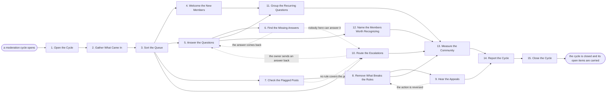

# Reference process: Moderate User Community

`ref/mkt/moderate-community v1`

**value stream:** [Customer-to-Advocate](../../streams/marketing/customer-to-advocate.md)
The community is open all the time, and this process covers one duty
period of it. A community manager takes in what members posted, sorts it
by urgency, greets the people who just arrived, answers the questions the
published material can answer, and sends the rest to whoever can answer
them. A moderator reads the posts that were reported, acts on the ones
that break a rule, and records the rule behind every action. The cycle
ends with a report and a list of the items still open, and the next cycle
starts by picking those items up. The adopting organization decides how
long a cycle is, and a shift, a day and a week all work.

## The activities

| # | Activity | What happens | Agents |
|---|---|---|---|
| 1 | Open the Cycle | duty starts and last cycle's open items carry in | [community-manager](../../agents/community-manager.md) |
| 2 | Gather What Came In | new posts, questions and reports are collected | community-manager |
| 3 | Sort the Queue | each item is typed and put in order of urgency | community-manager |
| 4 | Welcome the New Members | arrivals get a greeting, the rules and the basics | community-manager |
| 5 | Answer the Questions | replies drawn from what published material says | community-manager |
| 6 | Find the Missing Answers | questions the material cannot answer go to a person | community-manager · subject matter expert (person) |
| 7 | Check the Flagged Posts | each one is scored against the rule it may break | [moderator](../../agents/moderator.md) |
| 8 | Remove What Breaks the Rules | posts hidden or removed, accounts restricted | moderator |
| 9 | Hear the Appeals | a member objects and a person decides what stands | moderator · community owner (person) |
| 10 | Route the Escalations | legal, press and product items go to their owner | community-manager · legal reviewer (person) · [press-relations](../../agents/press-relations.md) · subject matter expert (person) |
| 11 | Group the Recurring Questions | what keeps being asked is collected in one place | community-manager · [content-manager](../../agents/content-manager.md) |
| 12 | Name the Members Worth Recognizing | members who help other members are passed on | community-manager · [advocacy-manager](../../agents/advocacy-manager.md) |
| 13 | Measure the Community | volume, sentiment, reply time, what went unanswered | [analytics](../../agents/analytics.md) · community-manager |
| 14 | Report the Cycle | what came in, what was answered, what is open | community-manager · analytics |
| 15 | Close the Cycle | open items are named and carried to the next run | community-manager |

## The graph



## The document, with the blanks marked

```
PROCESS: moderate user community    id: <team>/moderate-community   v1
from: ref/mkt/moderate-community v1
owner: <who>                          effective: <date>
trigger: the clock - a cycle opens every <period>, and no one has to
         ask for it
         watch: every=<period>
concurrency: cycles run one after another - <how many> agents are on
             duty inside a cycle
goal: every question answered or put in front of somebody who can
      answer it, every post that breaks a rule acted on with the rule
      recorded, and every item still open named at the close
phases:
  open-cycle        - human: the cycle opens and the items the last
                      cycle left open are read back in
                      owner: community-manager   after: trigger
                      automation: <level>
  gather-items      - system: the posts, questions and reports that
                      arrived this cycle are collected into one queue
                      owner: community-manager   after: open-cycle
                      automation: <level>
  sort-queue        - human: every item is typed as a question, a
                      report, an escalation or an arrival, and ordered
                      owner: community-manager   after: gather-items
                      automation: <level>
  welcome-members   - human: the members who arrived this cycle get a
                      greeting, the rules, and where to start
                      owner: community-manager   after: sort-queue
                      automation: <level>
  answer-questions  - human: replies drawn from published material,
                      with the source of each answer recorded
                      owner: community-manager   after: sort-queue
                      by: <first reply target>   automation: <level>
  missing-answers   - human: a question published material cannot
                      answer goes to <your expert> and comes back
                      owner: community-manager   after: answer-questions
                      by: <hours>                automation: <level>
  check-flagged     - runs assessment: the community rules named at a
                      version, and a verdict on every reported post
                      owner: moderator           after: sort-queue
                      by: <hours>                automation: <level>
  act-on-breaches   - human: the post is hidden, removed or restricted,
                      and the member is told which rule it was
                      owner: moderator           after: check-flagged
                      automation: <level>
  hear-appeals      - convenes decide-and-announce: the member objects,
                      <who> decides, and the moderator carries it out
                      owner: <your community owner>
                      after: act-on-breaches     automation: never
  route-escalations - human: legal, press, product and safety items go
                      to the owner your organization names for each
                      owner: community-manager   after: sort-queue
                      automation: <level>
  group-questions   - runs collect-and-report: what members keep
                      asking, grouped, with how often each came up
                      owner: community-manager
                      after: welcome-members + answer-questions
                      automation: <level>
  name-members      - human: the members who answered other members are
                      written down and passed to the advocacy programs
                      owner: community-manager   after: answer-questions
                      automation: <level>
  measure           - human: volume, first reply time, sentiment, and
                      what went unanswered
                      owner: analytics
                      after: act-on-breaches + route-escalations +
                             group-questions + name-members
                      automation: <level>
  report-cycle      - runs collect-and-report: what came in, what was
                      answered, what was removed, what is still open
                      owner: community-manager
                      after: measure + hear-appeals
                      automation: <level>
  close-cycle       - human: the open items are named and written to
                      the queue the next cycle opens on
                      owner: community-manager   after: report-cycle
                      automation: <level>
run-scoped:
  queue-age - runs roll-call                   owner: community-manager
              every: <cadence>
              from: sort-queue   until: close-cycle
  actions   - runs collect-and-report          owner: moderator
              every: <cadence>
              from: open-cycle   until: close-cycle
handoffs:
  open-cycle -> sort-queue [carried-items]: the items the last cycle
    left open, each with what is still owed on it and who owes it
  gather-items -> sort-queue [incoming-queue]: everything that arrived
    this cycle, in one queue, with the time each item arrived
  sort-queue -> answer-questions [sorted-questions]: the questions in
    the order they will be answered, the oldest ones first
  sort-queue -> check-flagged [reported-posts]: the reported posts as
    they stood when they were reported, with who reported each one and
    why
  sort-queue -> route-escalations [escalation-items]: the items marked
    legal, press, product or safety, with what the member actually said
  answer-questions -> missing-answers [unanswered-question]: the
    question, the published material already checked against it, and
    who is being asked
  missing-answers -> answer-questions [expert-answer]: the answer, and
    where it can be published so the next member finds it without
    asking
  check-flagged -> act-on-breaches [rule-verdicts]: the verdict on each
    post, naming the rule and the version of the rules it was scored
    against
  act-on-breaches -> hear-appeals [action-record]: the post as it
    stood, the rule, the action taken, how long it lasts, and what the
    member was told
  hear-appeals -> act-on-breaches [appeal-decision]: the decision, and
    whether the action stands, is shortened, or is undone
  answer-questions -> group-questions [replies-and-questions]: every
    reply with the question behind it, so what keeps being asked can be
    counted
  answer-questions -> name-members [member-replies]: the replies
    members wrote to other members, with what each of those members did
  group-questions -> report-cycle [recurring-questions]: the recurring
    questions with their counts, handed to whoever owns the published
    material
  measure -> report-cycle [cycle-numbers]: the numbers, each attributed
    to the source it came from
  report-cycle -> close-cycle [cycle-report]: the report as delivered,
    and the list of items nobody closed
deviations:
  missing-answers -> answer-questions [answer-returned]: the person the
    question was put to answers it, so the reply to the member is
    written from what came back
  missing-answers -> route-escalations [no-one-can-answer]: nobody the
    question was put to can answer it, so it goes to the owner your
    organization names for that subject
  check-flagged -> route-escalations [no-rule-covers-it]: the post
    breaks no rule that exists, so a person decides what the rules
    should say before the post is acted on
  hear-appeals -> act-on-breaches [action-reversed]: the appeal is
    upheld, so the moderator carries out what the person hearing it
    decided
  route-escalations -> answer-questions [owner-answered]: the owner the
    item went to sends an answer back, and the member is replied to
bindings:
  roster:  <who holds each role - agents claiming the abstract agents
           above, and named people for the community owner, the expert
           and legal>
  systems: the community platform (write, cap: <which actions>),
           the moderation queue (write), the social inboxes (write),
           the member messaging channel (write),
           the escalation channel (write), the content plan (write),
           analytics (read)
  data:    the community rules <version>, <your published material>,
           <your claims register>, the items the last cycle left open
policy:
  every action against a post records the rule it was taken under and
    the version of the rules that rule came from
  a member whose post is acted on is told what happened and how to put
    the decision in front of a person
  an appeal is decided by a person and is never delegated to an agent
  anything describing harm to a person goes to <who> before anything
    else is done with it
  a question published material cannot answer is put to a person
  removing a member permanently is a person's decision
  the cycle closes on its clock even when the queue still has items in
    it, and those items are named in the report
measures:
  first reply: <target> from a question arriving to its first reply
  answered: <target> share of the cycle's questions answered inside
            the cycle
  carried: <target> items still open when the cycle closes
  quality gate: no post is acted on without the rule recorded against
                it
```

## The failure edges

- **A member appeals a removal.** The run goes back to act-on-breaches,
  where the moderator carries out whatever the person hearing the appeal
  decided. A reversal lands as its own record and the original action
  stays where it is, so the history of the account reads correctly
  afterwards.
- **A post breaks no rule that exists.** The moderator has nothing to
  score it against, so the post goes to route-escalations and a person
  decides what the rules should say. The moderator acts on the post only
  after the rules are amended through their own process.
- **A question is still open when the cycle closes.** The item is named
  in the report and written to the queue that the next cycle opens on.
  The format has no line that moves an open item from one run to the
  next, so the queue is the only thing carrying that state, and a reader
  of either run's records cannot see that the two runs are connected.
- **A legal demand or a press inquiry arrives.** It goes to
  route-escalations before anybody replies to the member, and the agent
  that owns it is the one that answers.
- **The same breach shows up across many members at once.** The
  moderator escalates the pattern and leaves the individual posts alone
  until it hears back, because a breach arriving that way usually means
  a coordinated push or a rule that has stopped working.
- **A cycle opens with nobody on duty.** The items sit in the queue and
  age, and the queue-age roll-call is what makes that visible. The
  adopting organization decides how long an item may sit before it
  reaches a person by another route.
