# Reference process: Name Product or Company

`ref/mkt/name-product v1`

**value stream:** [Promise-to-Perception](../../streams/marketing/promise-to-perception.md)
A decision coordinator takes in a request for a name, writes down what
the name has to do and which markets it has to work in, has a long list
of candidates written and screened, sends the survivors through the
public registers and through the markets they will be used in, and puts
two or three names in front of buyers and in front of counsel. The run
ends when the organization holds a name that counsel will defend, owns
the addresses that go with it, and has issued the name and the rules for
writing it as a numbered version of the standard. Saying the name in
public belongs to the announcement and the launch processes.

## The activities

| # | Activity | What happens | Agents |
|---|---|---|---|
| 1 | Take in the Naming Request | say what has to be named, why, and by when | [decision-coordinator](../../agents/decision-coordinator.md) · leadership (person) |
| 2 | Set the Naming Criteria | markets, languages, classes, and the domains needed | decision-coordinator · brand owner (person) |
| 3 | Read the Naming Landscape | what rivals are called and what the category sounds like | [researcher](../../agents/researcher.md) · [search-optimizer](../../agents/search-optimizer.md) |
| 4 | Generate the Candidate Names | a long list of names built against the criteria | [copywriter](../../agents/copywriter.md) · decision-coordinator |
| 5 | Screen the Long List | names that break the criteria come off the list | [brand-check](../../agents/brand-check.md) · decision-coordinator |
| 6 | Search the Registers | trademarks, company registries, domains and handles | [supplier-manager](../../agents/supplier-manager.md) |
| 7 | Check the Name in Every Market | what it means and how it sounds where it will be used | researcher · subject matter expert (person) |
| 8 | Cut to a Shortlist | two or three names worth paying to clear | decision-coordinator · brand owner (person) |
| 9 | Try the Names on Outsiders | buyers say what each name tells them about the company | [study-manager](../../agents/study-manager.md) · [statistician](../../agents/statistician.md) |
| 10 | Check the Name in Search | what the name already collides with in results | search-optimizer |
| 11 | Clear the Shortlist | counsel says which names can be used and defended | legal reviewer (person) · supplier-manager |
| 12 | Choose the Name | one name picked, with the reasons said out loud | leadership (person) · brand owner (person) · decision-coordinator |
| 13 | Secure the Name | domains and handles taken, the filing authorized | supplier-manager · [budget-keeper](../../agents/budget-keeper.md) · rights approver (person) · finance (person) |
| 14 | Issue the Name at a Version | the name and how to write it become a standard | [standards-keeper](../../agents/standards-keeper.md) |
| 15 | Tell the Processes that Read It | every reader gets the version and what changed | standards-keeper · decision-coordinator |
| 16 | Record What Was Learned | what to repeat, what to avoid | decision-coordinator |

## The graph

```mermaid
flowchart LR
  T([something needs a name]) --> A1[1. Take in the Naming Request]
  A1 --> A2[2. Set the Naming Criteria]
  A2 --> A3[3. Read the Naming Landscape]
  A3 --> A4[4. Generate the Candidate Names]
  A4 --> A5[5. Screen the Long List]
  A5 --> A6[6. Search the Registers]
  A5 --> A7[7. Check the Name in Every Market]
  A6 -. nothing survives the search .-> A4
  A7 -. nothing survives the market check .-> A4
  A6 --> A8[8. Cut to a Shortlist]
  A7 --> A8
  A8 --> A9[9. Try the Names on Outsiders]
  A8 --> A10[10. Check the Name in Search]
  A8 --> A11[11. Clear the Shortlist]
  A11 -. no name can be cleared .-> A8
  A11 -. the long list is spent .-> A4
  A9 --> A12[12. Choose the Name]
  A10 --> A12
  A11 --> A12
  A12 --> A13[13. Secure the Name]
  A13 -. the addresses cannot be had .-> A12
  A13 -. the search has gone stale .-> A6
  A13 --> A14[14. Issue the Name at a Version]
  A14 --> A15[15. Tell the Processes that Read It]
  A15 --> A16[16. Record What Was Learned]
  A16 --> DONE([the name is cleared, secured and issued])
```



## The document, with the blanks marked

```
PROCESS: name product or company      id: <team>/name-product   v1
from: ref/mkt/name-product v1
owner: <who>                          effective: <date>
trigger: something needs a name in <your product or corporate planning
         process>
concurrency: one name at a time - a second request waits or opens its
             own run with its own criteria
goal: a name the organization can use in every market it sells in,
      that counsel will defend, whose addresses the organization
      holds, and that is issued as a version of the standard
phases:
  take-in-request  - human: read the request and write down what has to
                     be named, why, and the date the name is needed
                     owner: decision-coordinator  after: trigger
                     automation: <level>
  set-criteria     - convenes briefing: the markets, the languages, the
                     trademark classes and the addresses the name needs
                     owner: decision-coordinator  after: take-in-request
                     automation: <level>
  read-landscape   - runs collect-and-report: what the rivals in the
                     category are called and how those names are built
                     owner: researcher            after: set-criteria
                     by: <days>                   automation: <level>
  generate-names   - runs build-by-talent: a long list of candidates,
                     each name built against a criterion it can be
                     tested against later
                     owner: copywriter            after: read-landscape
                     by: <days>                   automation: <level>
  screen-long-list - runs assessment: every candidate scored against the
                     criteria and the brand standards at their versions
                     owner: brand-check           after: generate-names
                     by: <days>                   automation: <level>
  search-registers - runs assessment: every surviving candidate searched
                     against the registers in <your classes and markets>
                     owner: supplier-manager      after: screen-long-list
                     by: <days>                   automation: <level>
  check-markets    - runs collect-and-report: what each candidate means
                     and how it sounds in every market it will be used
                     in, with a native speaker saying so
                     owner: researcher            after: screen-long-list
                     by: <days>                   automation: <level>
  cut-shortlist    - convenes decide-and-announce: the two or three
                     names worth paying to clear, and why the rest came
                     off the list
                     owner: decision-coordinator
                     after: search-registers + check-markets
                     automation: <level>
  test-with-buyers - runs collect-and-report: what each shortlisted name
                     tells the people the organization sells to
                     owner: study-manager         after: cut-shortlist
                     by: <days>                   automation: <level>
  check-search     - human: what each shortlisted name already collides
                     with in search results and in the app stores
                     owner: search-optimizer      after: cut-shortlist
                     by: <days>                   automation: <level>
  clear-shortlist  - convenes approval: counsel reads the register
                     report and says which names the organization can
                     use and defend, as a named signer
                     owner: <your legal role>     after: cut-shortlist
                     by: <weeks>                  automation: never
  choose-name      - convenes decide-and-announce: one name chosen, with
                     the reasons and any disagreement written down
                     owner: decision-coordinator
                     after: test-with-buyers + check-search +
                            clear-shortlist
                     automation: <level>
  secure-name      - human: the domains registered and the handles
                     claimed in the organization's own name, and <who>
                     authorizes the trademark filing
                     owner: supplier-manager      after: choose-name
                     by: <days>                   automation: <level>
  issue-name       - human: the name and the rules for writing it issued
                     as a numbered version of the standard
                     owner: standards-keeper      after: secure-name
                     automation: <level>
  tell-readers     - runs decide-and-announce: every process that reads
                     the standard hears the version and what changed
                     owner: standards-keeper      after: issue-name
                     automation: <level>
  record-learnings - convenes debrief: what to repeat, what to avoid
                     owner: decision-coordinator  after: tell-readers
                     automation: <level>
run-scoped:
  status - runs roll-call                 owner: decision-coordinator
           every: <cadence>
           from: set-criteria   until: run close
  cost   - runs allocate-and-reconcile    owner: budget-keeper
           from: cut-shortlist   until: run close
handoffs:
  take-in-request -> set-criteria: what has to be named, what the name
    has to do, and the date it is needed
  set-criteria -> generate-names: the markets, the languages, the
    trademark classes and the addresses, in one record that every later
    screen is read against
  read-landscape -> generate-names: what the category already sounds
    like, so a candidate that echoes a rival is caught while dropping
    it is still cheap
  generate-names -> screen-long-list: the long list at a version, each
    name carrying the criterion it was built for
  screen-long-list -> search-registers: the surviving names, and the
    rule each dropped name failed
  search-registers -> cut-shortlist: a verdict for each name, naming
    the registers searched, the classes and markets covered, the date
    the search ran, and every conflict it found
  check-markets -> cut-shortlist: what each name means and how it
    sounds in each market, with the person who said so named
  cut-shortlist -> clear-shortlist: the two or three names, with
    everything already found against each one
  clear-shortlist -> choose-name: which names counsel will defend, on
    what terms, and what counsel wants avoided
  choose-name -> secure-name: the chosen name and the next name down,
    so the run can move on if the addresses cannot be had
  secure-name -> issue-name: what was registered, in whose name, on
    what date, and when each registration has to be renewed
  issue-name -> tell-readers: the name and the writing rules at a
    numbered version, and the date the version applies from
  tell-readers -> record-learnings: the notice, as delivered
bindings:
  roster:  <who holds each role - agents claiming the abstract agents
           above, and named people for leadership, the brand owner, the
           native speakers, legal, rights and finance>
  systems: the decision record (write), the standards store (write),
           the supplier and registration record (write), the public
           registers (read), domain and platform registrars (write),
           search demand and ranking data sources (read), the study
           record (write), the notification channel (write)
  data:    brand guidelines <version>, <your claims register>,
           the naming criteria at their version, the naming request
policy:
  clearance is a human gate and is never delegated to an agent
  no candidate name is said outside the run before it is cleared and
    secured
  the register search on the chosen name is run again on the day the
    filing is authorized, and any search older than <how long> is run
    again before it is relied on
  a name nobody in <your markets> was asked about does not go in front
    of the people who decide
  the reasons for the choice are recorded, including every name that
    was rejected and the rule it failed
measures:
  cycle time: <target> from the request to the issued name
  volume: <names per period>
  quality gate: no name is issued that counsel has not cleared and
                whose addresses the organization does not hold
```

## The failure edges

- **Nothing survives the register search.** The run goes back to
  generate-names for more candidates, and the criteria go back with it,
  because a long list the registers wiped out usually means the
  criteria were drawn too narrowly.
- **A name fails in one market.** The market check reports it with the
  market and the native speaker named, and the name comes off the list
  for every market. A name the organization uses in one country and
  avoids in another is not one of the choices here.
- **Counsel will not clear any name on the shortlist.** The run goes
  back to cut-shortlist while the long list still holds survivors, and
  back to generate-names once it does not. Counsel says what made each
  name unusable, so the next list avoids the same problem.
- **The addresses cannot be had.** The domain or the handle turns out
  to be held by somebody who will not sell, or who will sell at a price
  <who> will not pay. The run goes back to choose-name and the people
  who decide take the next name down.
- **The register search has gone stale.** A register that was clear
  when the shortlist was cut may not be clear on the day of the filing.
  The run goes back to search-registers on the chosen name alone, and a
  conflict found there sends it back to choose-name.
- **The trigger fires while a run is in flight.** A second request
  waits, or it opens its own run with its own criteria. Two runs never
  share a long list, because a name rejected under one set of criteria
  may be the right answer under another.
- **A run is abandoned.** The long list, the register verdicts and the
  market checks stay where they are at their versions, so a later run
  can pick them up and see how old they are. Any domain or handle
  already taken keeps renewing, and <who> decides whether to hold it or
  let it lapse.
