# Reference process: the nurture sequence

`ref/mkt/nurture-sequence v1`

**value stream:** [Brief-to-Results](../../streams/marketing/brief-to-results.md)
An audience manager takes a segment and a goal and works out the rule
that admits a contact to the program, the order of the messages, the
wait before each one, the condition on every branch, and what takes a
contact out. A copywriter and a designer make the messages, a conversion
tracker wires up what has to be counted, and brand and legal sign the
messages and the design. An audience operator assembles the program in
the sending system and walks test contacts down every path. The named
owner says go. From then on the numbers get watched, the contacts that
meet the ready rule go to a salesperson, and the steps and the rules get
changed where the numbers argue for it. This run reaches its end when
the program is live and being measured. The program keeps sending after
that, and that is the difference between this process and a campaign.

## The activities

| # | Activity | What happens | Seats |
|---|---|---|---|
| 1 | take in the segment and the goal | what the program must do and who it is for | [audience-manager](../../agents/audience-manager.md) |
| 2 | define who enters | the rule that admits a contact to the program | audience-manager · [analytics](../../agents/analytics.md) |
| 3 | check who may be contacted | consent and suppression applied to the segment | [consent-manager](../../agents/consent-manager.md) · legal reviewer (person) |
| 4 | map the steps and the branches | the message order, the waits, the branch conditions | audience-manager · analytics |
| 5 | set the exits | what takes a contact out, and where they go next | audience-manager · consent-manager · [lead-scorer](../../agents/lead-scorer.md) |
| 6 | brief the makers | everyone hears the same request at once | audience-manager · [copywriter](../../agents/copywriter.md) · [designer](../../agents/designer.md) · [conversion-tracker](../../agents/conversion-tracker.md) · [audience-operator](../../agents/audience-operator.md) · consent-manager |
| 7 | produce the messages | subject lines, body copy, layout and images | copywriter · designer |
| 8 | wire up the measurement | conversions, tracked links, and the path into the CRM | conversion-tracker |
| 9 | score the messages | brand, claims, rendering and accessibility checked | [brand-check](../../agents/brand-check.md) · [accessibility-check](../../agents/accessibility-check.md) |
| 10 | get sign-offs | brand and legal approve the messages and the rules | brand owner (person) · legal reviewer (person) |
| 11 | build the program | steps, waits, conditions and exits in the sending system | audience-operator |
| 12 | run test contacts through it | a test contact is walked down every path | audience-operator · conversion-tracker · consent-manager · audience-manager |
| 13 | turn it on | the owner says go and the segment starts entering | audience-manager · audience-operator |
| 14 | watch who moves | entries, paths taken, conversions and exits | analytics · audience-manager |
| 15 | hand over the ready ones | contacts that meet the ready rule go to a salesperson | lead-scorer |
| 16 | tune the branches | the steps and rules the numbers argue against get changed | audience-manager · analytics · copywriter · audience-operator |

The graph below shows who does the work in one run of this process. The
path a single contact takes through the finished program is a second
picture, with its own start, its own conditions and several ends: a
contact meets the entry rule, waits, receives a message, and goes one
way or another depending on whether they clicked, visited a page,
booked a meeting or did nothing.
Activities 4 and 5 are where somebody draws that second picture, and it
travels with the program design in the handoff into the build. This
document names the exits and leaves the drawing to the organization that
adopts it.

Activities 14, 15 and 16 keep going for as long as the program is
switched on. The run reaches its end once the program is live and the
numbers are being watched, and those three activities carry on past that
point for as long as the program keeps sending.

## The graph

```mermaid
flowchart LR
  T([a segment and a goal arrive]) --> A1[1. take in the segment and the goal]
  A1 --> A2[2. define who enters]
  A2 --> A3[3. check who may be contacted]
  A3 -. too few may be contacted .-> A2
  A3 --> A4[4. map the steps and the branches]
  A4 --> A5[5. set the exits]
  A5 --> A6[6. brief the makers]
  A6 --> A7[7. produce the messages]
  A6 --> A8[8. wire up the measurement]
  A7 --> A9[9. score the messages]
  A8 --> A9
  A9 -. a message failed a pass .-> A7
  A9 --> A10[10. get sign-offs]
  A10 -. changes requested .-> A7
  A10 --> A11[11. build the program]
  A11 --> A12[12. run test contacts through it]
  A12 -. a contact took the wrong path .-> A11
  A12 -. a conversion did not fire .-> A8
  A12 --> A13[13. turn it on]
  A13 --> A14[14. watch who moves]
  A13 --> A15[15. hand over the ready ones]
  A14 --> A16[16. tune the branches]
  A16 -. a message has to change .-> A7
  A16 -. a rule has to change .-> A11
  A14 --> DONE([the program is live and being measured])
  A15 --> DONE
  A16 --> DONE
```



## The document, with the blanks marked

```
PROCESS: nurture sequence             id: <team>/nurture-sequence   v1
from: ref/mkt/nurture-sequence v1
owner: <who>                          effective: <date>
trigger: a segment and a goal are agreed in <your demand planning
         process>
concurrency: runs may overlap - <how many> programs being built at
             once, and <how many> sending at once
goal: a program that admits the contacts its entry rule names, sends
      them signed messages on the agreed waits, sends each contact down
      the branch that matches what they did, hands the ready ones to a
      salesperson, and reports what it did while it keeps sending
phases:
  take-in-segment  - human: read the segment and the goal and write
                     down what the program has to make happen, for
                     whom, and by when
                     owner: audience-manager   after: trigger
                     automation: <level>
  define-entry     - human: the rule that admits a contact, and how
                     many contacts it admits in <period>
                     owner: audience-manager   after: take-in-segment
                     automation: <level>
  check-consent    - runs assessment: the segment scored against the
                     consent rules in force, with a count removed and
                     the rule behind each removal
                     owner: consent-manager    after: define-entry
                     by: <days>                automation: <level>
  map-the-steps    - human: the order of the messages, the wait before
                     each one, and the condition on every branch
                     owner: audience-manager   after: check-consent
                     by: <days>                automation: <level>
  set-exits        - human: what takes a contact out of the program,
                     and where each exit sends them
                     owner: audience-manager   after: map-the-steps
                     automation: <level>
  brief-makers     - convenes briefing: the program design heard by
                     every seat at once, while it can still change
                     owner: audience-manager   after: set-exits
                     automation: <level>
  produce-messages - runs build-by-talent: subject lines, body copy,
                     layout and images for every step
                     owner: audience-manager   after: brief-makers
                     by: <days>                automation: <level>
  wire-measurement - human: the conversions that count at each step,
                     the tracked links, and the path into the CRM
                     owner: conversion-tracker after: brief-makers
                     by: <days>                automation: <level>
  score-messages   - runs layered-passes: the brand and claims pass,
                     then the rendering and accessibility pass
                     owner: audience-manager
                     after: produce-messages + wire-measurement
                     by: <days>                automation: <level>
  get-sign-offs    - convenes approval: brand and legal sign, as named
                     signers, against a version of the messages and a
                     version of the program design
                     owner: <your legal seat>  after: score-messages
                     by: <days>                automation: never
  build-program    - human: the steps, the waits, the conditions and
                     the exits assembled in the sending system with
                     sending switched off
                     owner: audience-operator  after: get-sign-offs
                     by: <days>                automation: <level>
  test-contacts    - runs assessment: a test contact walked down every
                     path, with where each one landed recorded
                     owner: audience-operator  after: build-program
                     by: <days>                automation: <level>
  turn-it-on       - human: the named owner says go and the sending
                     system starts admitting the segment
                     owner: audience-manager   after: test-contacts
                     automation: <level>
  watch            - runs collect-and-report: entries, the path each
                     contact took, conversions and exits, reported on
                     the agreed cadence
                     owner: analytics          after: turn-it-on
                     every: <cadence>
                     until: the program is switched off
                     automation: <level>
  hand-over        - human: a contact who meets the ready rule is
                     written to the CRM and their owner is told, with
                     the evidence
                     owner: lead-scorer        after: turn-it-on
                     until: the program is switched off
                     automation: <level>
  tune             - human: the steps and the branch conditions the
                     numbers argue against are changed, and each change
                     is dated
                     owner: audience-manager   after: watch
                     every: <cadence>
                     until: the program is switched off
                     automation: <level>
handoffs:
  take-in-segment -> define-entry: the goal in one line that every
    later decision can be tested against
  define-entry -> check-consent: the entry rule and the list it
    produces today, with the count
  check-consent -> map-the-steps: the contacts that may be reached,
    the count removed, and the rule behind each removal
  map-the-steps -> set-exits: the steps, the waits and the branch
    conditions at a version
  set-exits -> brief-makers: the whole program design at a version,
    naming the entry rule, every step, every wait, every branch
    condition and every exit
  brief-makers -> produce-messages: the request as every seat heard
    it, and what each message has to make a contact do
  brief-makers -> wire-measurement: the same design, and the action
    that counts at each step. Both branches read one record
  produce-messages -> score-messages: the messages at a version
  wire-measurement -> score-messages: a dated test showing each
    conversion arriving in the CRM
  score-messages -> get-sign-offs: the scored list, with the rule
    behind every failure
  get-sign-offs -> build-program: the approved messages and the
    approved design at the signed version. A later change voids the
    approval and sign-offs run again
  build-program -> test-contacts: the program as it was built, every
    step, wait, condition and exit set beside the design it came from
  test-contacts -> turn-it-on: where each test contact landed, path by
    path, and the paths that could not be walked
  turn-it-on -> watch: the version that started sending, the date it
    started, and who said go
  turn-it-on -> hand-over: the ready rule, and the salesperson or the
    queue each contact who meets it goes to
  watch -> tune: the steps and the branch conditions the numbers argue
    against, each one with the number behind it
bindings:
  roster:  <who holds each seat - agents claiming the abstract agents
           above, and named people for legal, brand and the owner who
           says go>
  systems: the sending system (write),
           the contact database (write, cap: <n> records per change),
           the live programs (trigger), the consent record (write),
           the suppression lists (write), the CRM (write),
           analytics (write), the asset store (write),
           the change record store (write)
  data:    brand guidelines <version>, <your claims register>,
           <your accessibility standard> <version>,
           <your consent rules> <version>, the segment definition,
           the program design at a version
policy:
  nothing sends to a contact the consent record does not cover
  sign-off is a human gate and is never delegated to an agent
  a message changed after sign-off goes back through sign-offs
  the program starts sending only when the named owner records a go
  every path through the program is walked by a test contact before
    the program sends to anyone
  a change to a program that is already sending is recorded with its
    date, so the results before and after the change can be told apart
  a contact who qualifies for two programs goes to the one the
    precedence rule names, and <who> decides when the rule does not
    settle it
  every exit writes a dated line saying why the contact left and where
    they were sent
measures:
  cycle time: <target> from the segment and the goal to the first send
  volume: <programs sending at once>, <contacts entering per period>
  quality gate: nothing sends unsigned, and no send reaches a list the
                consent record does not cover
```

## The failure edges

- **A sign-off comes back with changes.** The run returns to
  produce-messages, and only the message the signers named reopens. A
  change to the branch conditions or the exits reopens set-exits
  instead, and the signers see the changed design before the build
  starts.
- **Too few of the segment may be contacted.** The consent-manager
  reports the count it removed and the rule behind each removal, and the
  run goes back to define-entry. The entry rule widens, the segment is
  scored again, and the program is never built against a list that
  cannot be sent to.
- **A test contact lands on a path it should not have taken.** The
  finding goes back to build-program naming the contact, the condition
  it met and where it landed. The audience-operator fixes the condition,
  and every path is walked again, because a fix to one branch can move a
  contact on another.
- **A conversion does not fire.** The run goes back to wire-measurement.
  The conversion-tracker records what it could not verify as unverified,
  and the program does not start sending against a step nobody can
  count.
- **A step will not build the way it was designed.** The
  audience-operator says what the sending system will not do and sends
  that piece back to the audience-manager, who redesigns the step or
  accepts the program without it. Anything left out is recorded as
  unbuilt.
- **A contact qualifies for two programs at once.** The precedence rule
  names which program takes the contact. When the rule does not settle
  it, the audience-manager sends the case to <who>, and the answer
  becomes a new version of the rule.
- **A message has to change while the program is sending.** The change
  runs through produce-messages, score-messages and get-sign-offs the
  same way the first version did, and the date it went live is recorded,
  because the results before and after it are not comparable.
- **The trigger fires while runs are in flight.** Programs overlap
  normally, and the concurrency line says how many are being built and
  how many are sending. The audience-manager seat answers for every
  program that is switched on, so a department running several needs
  enough holders of that seat to keep answering for all of them.
- **The program is switched off.** The contacts partway through it stop
  where they are, and the audience-manager decides for each one whether
  they leave the program, wait for a replacement, or go to another
  program. Leaving them inside a switched-off program is not one of the
  choices.
- **A run is abandoned.** The messages and the program design stay at
  their versions so a later run can pick them up, the half-built program
  in the sending system is left switched off and its name released, and
  the consent record keeps every removal it already made.
