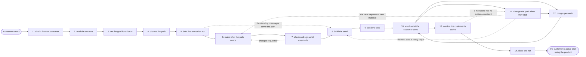

# Reference process: the onboarding email program

`ref/mkt/onboarding-email-program v1`

A lifecycle manager runs one customer through the onboarding program
from the day that customer starts. An account monitor reads what the
account has already done and where it stands, the lifecycle manager
writes down the milestones this customer has to reach and picks the
steps that should get them there, and a copywriter and a designer make
anything the standing messages do not cover. Brand and legal sign
whatever was newly made. An email producer assembles each step in the
sending system, builds the audience with the consent, opt-out and
suppression rules applied, and fires the send once the named owner says
go. The lifecycle manager then watches what the customer does, changes
the path when the customer stalls, and brings a person in when another
message will not help. The run reaches its end when the customer has met
the milestones that count as active. One run covers one customer, and
that is the difference between this process and designing the program
the customer is being run through.

## The activities

| # | Activity | What happens | Seats |
|---|---|---|---|
| 1 | take in the new customer | who started, what they bought, and when | [lifecycle-manager](../../agents/lifecycle-manager.md) |
| 2 | read the account | usage, support history and contract standing | [account-monitor](../../agents/account-monitor.md) |
| 3 | set the goal for this run | the milestones this customer has to reach | lifecycle-manager · account-monitor |
| 4 | choose the path | which messages and help this customer gets | lifecycle-manager |
| 5 | brief the seats that act | everyone hears the same account picture at once | lifecycle-manager · account-monitor · [email-producer](../../agents/email-producer.md) · [copywriter](../../agents/copywriter.md) · [designer](../../agents/designer.md) |
| 6 | make what the path needs | copy and design the standing messages do not cover | copywriter · designer · [editor](../../agents/editor.md) |
| 7 | check and sign what was made | brand, claims and rendering checked, then signed | [brand-check](../../agents/brand-check.md) · [accessibility-check](../../agents/accessibility-check.md) · brand owner (person) · legal reviewer (person) |
| 8 | build the send | consent, opt-outs and suppression applied, proofs out | email-producer |
| 9 | send the step | the named owner says go and the send fires | lifecycle-manager · email-producer |
| 10 | watch what the customer does | milestones met, messages opened, help asked for | account-monitor · [analytics](../../agents/analytics.md) |
| 11 | change the path when they stall | steps swapped, delayed or dropped, each change dated | lifecycle-manager |
| 12 | bring a person in | a person makes contact instead of a message | lifecycle-manager · account owner (person) |
| 13 | confirm the customer is active | milestones checked against the evidence under them | lifecycle-manager · account-monitor |
| 14 | close the run | what was sent, what the customer did, and the date | lifecycle-manager |

Activities 8 through 12 repeat once for each step of the path. The email
producer assembles and sends a step, the account monitor and the
analytics seat read what the customer did with it, and the lifecycle
manager decides what that customer gets next. The loop keeps running
until every milestone is met, until a person takes the customer over, or
until the organization stops trying.

The path a customer travels is drawn when the program itself is
designed, and that is a different process from this one. This process
runs one customer along that design, and it says when a customer needs
something the design did not anticipate.

## The graph



## The document, with the blanks marked

```
PROCESS: onboarding email program     id: <team>/onboarding-email-program   v1
from: ref/mkt/onboarding-email-program v1
owner: <who>                          effective: <date>
trigger: a customer starts, as <your system of record> records it
concurrency: runs always overlap - every customer who starts opens one,
             and <how many> stay open at once per holder of the
             lifecycle-manager seat
goal: a customer who has reached the milestones that count as active,
      by the date the program promises, having been sent only signed
      messages the consent record covers
phases:
  take-in-customer - human: read who started, what they bought and when
                     they started, and write down what this run has to
                     make happen
                     owner: lifecycle-manager  after: trigger
                     automation: <level>
  read-account     - human: the usage, the support history, the
                     contract position and the renewal standing, each
                     with the system it was read from and the date that
                     reading was current
                     owner: account-monitor    after: take-in-customer
                     by: <hours>               automation: <level>
  set-the-goal     - human: the milestones this customer has to reach,
                     read from the milestone list at its version, and
                     the date they are meant to reach them by
                     owner: lifecycle-manager  after: read-account
                     automation: <level>
  choose-the-path  - human: the steps this customer gets and the wait
                     before each one, with the reason every step was
                     chosen and every step was skipped
                     owner: lifecycle-manager  after: set-the-goal
                     automation: <level>
  brief-the-seats  - convenes briefing: the account picture and the
                     path, heard by every seat that acts at once
                     owner: lifecycle-manager  after: choose-the-path
                     automation: <level>
  make-material    - runs build-by-talent: the copy and the design for
                     the steps the standing messages do not cover
                     owner: lifecycle-manager  after: brief-the-seats
                     by: <days>                automation: <level>
  check-and-sign   - convenes approval: the brand and claims pass and
                     the rendering and accessibility pass, then brand
                     and legal sign as named signers against a version
                     owner: <your legal seat>  after: make-material
                     by: <days>                automation: never
  build-the-send   - human: the step assembled at the signed version,
                     the audience built with the consent, opt-out and
                     suppression rules applied, the schedule and the
                     send-time window set, and the proofs sent
                     owner: email-producer
                     after: check-and-sign + brief-the-seats
                     by: <days>                automation: <level>
  send-the-step    - human: the named owner records a go and the
                     sending system fires
                     owner: email-producer     after: build-the-send
                     automation: <level>
  watch            - human: which milestones the customer met, what
                     they opened and clicked, and what they asked
                     support for
                     owner: account-monitor    after: send-the-step
                     automation: <level>
  change-the-path  - human: the steps the customer's behaviour argues
                     against are swapped, delayed or dropped, and every
                     change is dated
                     owner: lifecycle-manager  after: watch
                     automation: <level>
  bring-in-person  - human: a named person makes contact instead of
                     another message, with everything the customer has
                     already been sent attached
                     owner: lifecycle-manager  after: watch
                     automation: never
  confirm-active   - human: every milestone checked against the
                     evidence recorded under it
                     owner: lifecycle-manager  after: watch
                     by: <days>                automation: <level>
  close-the-run    - human: the closing record, saying what was sent,
                     what the customer did, whether the goal was
                     reached, and the date the run ended
                     owner: lifecycle-manager  after: confirm-active
                     automation: <level>
run-scoped:
  progress - runs collect-and-report           owner: lifecycle-manager
             every: <cadence>
             from: send-the-step   until: run close
  delivery - runs collect-and-report           owner: email-producer
             every: after every send
             from: send-the-step   until: run close
  standing - human: the account read again, with the date of each
             reading and the system it came from
             owner: account-monitor
             every: <cadence>
             from: read-account   until: run close
handoffs:
  take-in-customer -> read-account: who started, what they bought, and
    the date they started
  read-account -> set-the-goal: what the account has done and where it
    stands, with the system behind every line and the date that line
    was current
  set-the-goal -> choose-the-path: the milestones this customer has to
    reach, the version of the milestone list they were read from, and
    the date they are meant to reach them by
  choose-the-path -> brief-the-seats: the path at a version, naming
    every step, the wait before it, and the reason it was chosen
  brief-the-seats -> make-material: the steps the standing messages do
    not cover, and what each one has to make the customer do
  brief-the-seats -> build-the-send: the same path and the same account
    picture. Both branches read one record
  make-material -> check-and-sign: the copy and the design at a version
  check-and-sign -> build-the-send: the approved material at the signed
    version. A later change voids the approval and the sign-off runs
    again
  build-the-send -> send-the-step: the audience count before and after
    the consent, opt-out and suppression rules were applied, the rule
    behind every removal, the schedule, and the proof record
  send-the-step -> watch: the version that went, the time it fired, and
    who said go
  watch -> change-the-path: what the customer did and did not do, set
    against what the path expected of them by now
  change-the-path -> build-the-send: the changed path at a new version,
    with the date it changed and what the customer did that changed it
  watch -> bring-in-person: everything the customer has already been
    sent, and what the person is being asked to do
  confirm-active -> close-the-run: every milestone with the evidence
    under it, and the date the last one was met
bindings:
  roster:  <who holds each seat - agents claiming the abstract agents
           above, and named people for the account owner, brand, legal
           and the owner who says go>
  systems: the sending system (write),
           the live sends (trigger, cap: <n> contacts per send),
           product usage data (read), the support system (read),
           the CRM (read), contract and renewal records (read),
           the consent record (read), the suppression lists (read),
           the asset store (write), the program run record (write),
           the commitment record (write),
           the task queue for the people who make contact (write),
           analytics (read)
  data:    brand guidelines <version>, <your claims register>,
           <your accessibility standard> <version>,
           <your consent rules> <version>, the milestone list
           <version>, the program design at a version
policy:
  nothing sends to a customer the consent record does not cover
  sign-off is a human gate and is never delegated to an agent
  material changed after sign-off goes back through sign-off
  a step fires only when the named owner records a go
  every step is recorded whether it was given or skipped, with the
    reason it was given or skipped
  a milestone counts as met only when the evidence for it is recorded
    with its date and the system it was read from
  a commitment made to the customer is recorded with who made it and
    when it is due, and it stays open until it is met
  a complaint, a legal threat or a request to stop being contacted
    stops the next step and goes to a person
  a path that goes outside what the program was approved to do is
    approved by <who> before the next step is set in motion
  a customer who is in more than one standing program goes to the one
    the precedence rule names, and <who> decides when the rule does not
    settle it
measures:
  cycle time: <target> from the day the customer starts to the day the
              last milestone is met
  volume: <customers starting per period>, <runs open at once>
  quality gate: nothing sends unsigned, nothing sends to a customer the
                consent record does not cover, and no milestone is
                recorded as met without its evidence
```

## The failure edges

- **A sign-off comes back with changes.** The run returns to
  make-material, and only the piece the signers named reopens. The
  signers see the changed version before anything is sent.
- **The customer stalls.** The watch shows a milestone the customer has
  not reached by the date the path expected. The lifecycle-manager
  changes the steps that are still to come, dates the change, and
  records what the customer did or failed to do that caused it. The run
  keeps going.
- **No change to the path will fix it.** The lifecycle-manager hands the
  customer to a person with everything already sent attached, and the
  run stays open until that person says what happened. Sending another
  message instead is not one of the choices.
- **The account turns out not to be in good standing.** The
  account-monitor reports a dispute, a breach notice or an account in
  collections, and <who> decides whether this customer may be approached
  at all. The next step waits for that answer.
- **The customer asks to stop being contacted.** The request reaches the
  suppression lists immediately and the next step is cancelled. The
  lifecycle-manager then decides whether a person takes the customer
  over or the run closes without the goal.
- **A commitment made to the customer is past its date.** The
  lifecycle-manager raises it to a person, and the commitment stays open
  in the record until it is met, whatever the rest of the path is doing.
- **A step will not build as the copy and the design supply it.** The
  email-producer says what will not fit and sends that piece back to the
  seat that made it. The step is never sent in a form nobody approved.
- **Two systems disagree about the same account.** The account-monitor
  records both readings with the system behind each one and raises the
  disagreement. The lifecycle-manager does not choose between them, and
  a person settles which reading the run acts on.
- **A milestone has no evidence under it.** The confirmation fails and
  the run goes back to change-the-path. A customer is never recorded as
  active on a milestone nobody can show.
- **The trigger fires while runs are in flight.** Runs always overlap,
  because every customer who starts opens one. The concurrency line says
  how many one holder of the lifecycle-manager seat carries at once, and
  the runs share the milestone list and the program design read-only.
- **A run is abandoned.** The customer stops receiving steps, any send
  already scheduled is pulled, and the closing record says the goal was
  not reached and why the organization stopped. Commitments already made
  to that customer stay open until they are met.
