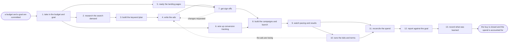

# Reference process: the paid search campaign

`ref/mkt/paid-search-campaign v1`

Somebody commits a budget and says what it has to return. The team works
out what people are searching for, decides which terms to bid on, writes
the ads, makes sure every page answers the query its ad was bought for,
and turns the campaigns on once the conversions can be counted. While
the ads run, the bids move toward whatever is producing results. The run
closes once the invoice has been reconciled and the cost per result has
been reported against the goal the budget was given.

## The activities

| # | Activity | What happens | Seats |
|---|---|---|---|
| 1 | take in the budget and goal | what the money must buy and how it is judged | [campaign-manager](../../agents/campaign-manager.md) · leadership (person) |
| 2 | research the search demand | what people search for and what a click costs | [search-optimizer](../../agents/search-optimizer.md) · [media-buyer](../../agents/media-buyer.md) |
| 3 | build the keyword plan | the terms to bid on, grouped, with the exclusions | media-buyer |
| 4 | write the ads | headlines and descriptions, several per group | [copywriter](../../agents/copywriter.md) |
| 5 | ready the landing pages | each page answers the query its ad was bought for | media-buyer · copywriter · [web-producer](../../agents/web-producer.md) |
| 6 | wire up conversion tracking | the conversions that count are wired and tested | [conversion-tracker](../../agents/conversion-tracker.md) · media-buyer |
| 7 | get sign-offs | brand and legal approve the ads and the pages | [brand-check](../../agents/brand-check.md) · brand owner (person) · legal reviewer (person) |
| 8 | build the campaigns and launch | the campaigns go live at their starting bids | media-buyer · campaign-manager |
| 9 | watch pacing and results | spend, clicks and conversions against the goal | [analytics](../../agents/analytics.md) · media-buyer |
| 10 | tune the bids and terms | bids move and wasted terms become exclusions | media-buyer |
| 11 | reconcile the spend | the invoice matches what the run recorded | media-buyer · finance (person) · leadership (person) |
| 12 | report against the goal | cost per result against what the budget bought | analytics · campaign-manager |
| 13 | record what was learned | which terms and ads to keep for next time | campaign-manager |

## The graph



## The document, with the blanks marked

```
PROCESS: paid search campaign         id: <team>/paid-search-campaign   v1
from: ref/mkt/paid-search-campaign v1
owner: <who>                          effective: <date>
trigger: a budget and a goal are committed by <your planning process>
concurrency: runs may overlap - <how many> live at once
goal: ads live on the terms the plan named, bids tuned toward what
      converts, and the spend reconciled and reported against the goal
      the budget was given
phases:
  take-in-budget   - human: read the budget and the goal, and write down
                     what one result is worth. <who> commits the money
                     owner: campaign-manager   after: trigger
                     automation: <level>
  research-demand  - human: what people search for on this subject, how
                     often, and what a click costs now
                     owner: search-optimizer   after: take-in-budget
                     by: <days>                automation: <level>
  keyword-plan     - human: the terms to bid on, grouped so that one ad
                     can answer a group, and the terms to exclude
                     owner: media-buyer        after: research-demand
                     by: <days>                automation: <level>
  write-ads        - runs build-by-talent: headlines and descriptions,
                     several per group, inside the brand voice
                     owner: campaign-manager   after: keyword-plan
                     by: <days>                automation: <level>
  ready-pages      - human: every landing page is read against the query
                     its ad was bought for, and what does not answer it
                     is rewritten and put live
                     owner: web-producer       after: take-in-budget
                     by: launch                automation: <level>
  wire-tracking    - human: the conversions that count are defined,
                     wired, and put through one real submission
                     owner: conversion-tracker after: take-in-budget
                     by: launch                automation: <level>
  get-sign-offs    - convenes approval: brand and legal sign, as named
                     signers, against a version of the ads and the pages
                     owner: <your legal seat>
                     after: write-ads + ready-pages
                     by: <days>                automation: never
  build-and-launch - human: the campaigns are built at their starting
                     bids, submitted to the platform, and turned on
                     owner: media-buyer
                     after: get-sign-offs + wire-tracking
                     automation: <level>
  watch            - human: spend, clicks and conversions read against
                     the goal, by group and by term
                     owner: analytics          after: build-and-launch
                     automation: <level>
  tune             - human: bids move toward what converts, and terms
                     that spend without converting are excluded
                     owner: media-buyer        after: watch
                     automation: <level>
  reconcile-spend  - human: the spend line closes. The platform invoice
                     is set against what the run recorded, and <who>
                     accepts the final figure
                     owner: media-buyer        after: watch + tune
                     automation: <level>
  report-goal      - runs collect-and-report: cost per result against
                     what the budget was supposed to buy
                     owner: campaign-manager   after: reconcile-spend
                     automation: <level>
  record-learnings - convenes debrief: which terms and which ads to keep
                     for next time, and which to leave behind
                     owner: campaign-manager   after: report-goal
                     automation: <level>
run-scoped:
  spend  - runs allocate-and-reconcile        owner: media-buyer
           cap: <n>/day
           from: build-and-launch   until: run close
  status - runs collect-and-report            owner: analytics
           every: <cadence>
           from: build-and-launch   until: run close
handoffs:
  take-in-budget -> research-demand: the goal in one line, and the
    number that has to buy it
  take-in-budget -> ready-pages / wire-tracking: the same goal, and the
    action that counts as a result. Both branches read one record
  research-demand -> keyword-plan: the terms people actually use, each
    with its demand figure and the date that figure was pulled
  keyword-plan -> write-ads: the groups, so that every ad answers the
    terms in its own group
  write-ads + ready-pages -> get-sign-offs: the ads and the pages at a
    version
  get-sign-offs -> build-and-launch: the approved ads at the signed
    version. A headline rewritten afterward voids the approval and
    sign-offs run again
  wire-tracking -> build-and-launch: the conversion definitions and the
    tracking parameters each campaign has to carry
  watch -> tune: the search terms report and the cost per result, by
    group
  tune -> reconcile-spend: every bid and budget move with its number
    and the reason it was made
  report-goal -> record-learnings: the report, as delivered
bindings:
  roster:  <who holds each seat - agents claiming the abstract agents
           above, and named people for the budget, brand, legal and
           finance seats>
  systems: ad platforms (write, cap: <n>/day),
           search demand data (read), analytics (write: tags and
           conversion definitions; read: reporting), the CMS (write),
           the CRM (write), <your billing record> (read)
  data:    brand guidelines <version>, <your claims register>,
           the budget and the goal it was given
policy:
  no claim ships without a citation in <your claims register>
  sign-off is a human gate and is never delegated to an agent
  an ad changed after sign-off goes back through sign-offs
  no campaign turns on until its conversions have been tested end to end
  a bid or budget move past <n> goes to a person before the money moves
  a landing page goes live when <who> says go
measures:
  cost per result: <target>
  cycle time: <target> from the budget to the ads being live
  spend accuracy: the invoice and the run record agree within <n>
  quality gate: no campaign spends against an untested conversion
```

## The failure edges

- **A sign-off comes back with changes.** The run returns to write-ads,
  or to ready-pages when the page is what the signers named, and only
  the piece they named reopens.
- **The platform rejects an ad on its own advertising rules.** The media
  buyer escalates the rejection, and a person decides whether to contest
  it or rewrite the ad. A rewrite goes back to write-ads and through
  sign-offs again before it runs.
- **The ads stop producing results while the campaign is live.** Tuning
  sends the run back to write-ads, and the replacements get a version
  and a sign-off like any other ads.
- **The trigger fires while runs are in flight.** Campaigns overlap
  normally and the concurrency line says how many. Two runs bidding on
  the same terms compete with each other, so a new keyword plan is
  checked against the plans already live before it reaches the ads.
- **A run is abandoned.** Somebody has to turn the campaigns off,
  because an abandoned run goes on spending until a person stops it. The
  tracking stays in place so that the clicks already bought can still be
  counted, and the spend line reconciles anyway.
