# Reference process: pitch earned media

`ref/mkt/pitch-earned-media v1`

**value stream:** [Story-to-Coverage](../../streams/marketing/story-to-coverage.md)
A communications manager takes a story angle somebody has decided is
worth telling, has the evidence behind it gathered, finds out which
reporters cover the subject, gets the pitch materials written and signed
off, sends each reporter the version written for them, answers what
comes back, and records every piece that ran. A reporter outside the
organization decides whether the story runs at all, so the middle of
this process is a sequence of offers and follow-ups, and each one waits
on an answer the organization does not control. The run stays open until
the coverage has been recorded and the run has been debriefed.

## The activities

| # | Activity | What happens | Seats |
|---|---|---|---|
| 1 | take in the story angle | work out what the story is and who it is for | [comms-manager](../../agents/comms-manager.md) |
| 2 | test the angle | decide whether a reporter would care about it | comms-manager · [press-relations](../../agents/press-relations.md) · media contact (person) |
| 3 | gather the proof | the numbers, the sources and who will confirm them | [researcher](../../agents/researcher.md) · subject matter expert (person) |
| 4 | choose the reporters | the outlets and writers this story actually fits | press-relations · comms-manager · media contact (person) |
| 5 | decide who speaks | the spokesperson and what they may say on record | comms-manager · leadership (person) · spokesperson (person) |
| 6 | produce the pitch materials | the pitch note, the release, the images and facts | [copywriter](../../agents/copywriter.md) · [editor](../../agents/editor.md) · [designer](../../agents/designer.md) · comms-manager |
| 7 | get sign-offs | brand, legal and the spokesperson approve it | [brand-check](../../agents/brand-check.md) · legal reviewer (person) · spokesperson (person) |
| 8 | set the timing | when the story is offered and when it may run | comms-manager · media contact (person) |
| 9 | send the pitches | each reporter gets the version written for them | press-relations · media contact (person) |
| 10 | follow up on the pitches | ask again and record what each reporter said | press-relations · media contact (person) |
| 11 | prepare the spokesperson | work through the questions a reporter will ask | comms-manager · press-relations · spokesperson (person) |
| 12 | run the interviews | the reporter talks to the spokesperson | spokesperson (person) · media contact (person) |
| 13 | answer what reporters ask | extra data, a fact check, another interview | researcher · press-relations · media contact (person) · subject matter expert (person) |
| 14 | log the coverage | record every piece that ran and what it said | [coverage-monitor](../../agents/coverage-monitor.md) · comms-manager |
| 15 | record what was learned | what to repeat, what to avoid | comms-manager |

## The graph

```mermaid
flowchart LR
  T([a story angle is worth telling]) --> A1[1. take in the story angle]
  A1 --> A2[2. test the angle]
  A2 -. the angle will not carry .-> A1
  A2 --> A3[3. gather the proof]
  A2 --> A4[4. choose the reporters]
  A4 --> A5[5. decide who speaks]
  A3 --> A6[6. produce the pitch materials]
  A5 --> A6
  A6 --> A7[7. get sign-offs]
  A7 -. changes requested .-> A6
  A7 --> A8[8. set the timing]
  A8 --> A9[9. send the pitches]
  A9 --> A10[10. follow up on the pitches]
  A10 -. a reporter wants a different angle .-> A6
  A10 --> A11[11. prepare the spokesperson]
  A10 --> A14[14. log the coverage]
  A11 --> A12[12. run the interviews]
  A12 --> A13[13. answer what reporters ask]
  A13 -. a claim needs a new source .-> A3
  A13 -. an answer nobody signed off .-> A7
  A13 --> A14
  A14 -. a piece ran with a wrong fact .-> A13
  A14 --> A15[15. record what was learned]
  A15 --> DONE([the placements are secured and the run is closed])
```



## The document, with the blanks marked

```
PROCESS: pitch earned media           id: <team>/pitch-earned-media  v1
from: ref/mkt/pitch-earned-media v1
owner: <who>                          effective: <date>
trigger: a story angle is judged worth telling in <your planning
         process>
concurrency: runs may overlap - <how many> stories in flight at once
goal: coverage from the reporters this story fits, offered out of
      material a named signer approved, with every contact logged and
      every piece that ran recorded
phases:
  take-in-angle    - human: read the angle and write down what the
                     story is, who it is for, and why it matters now
                     owner: comms-manager      after: trigger
                     automation: <level>
  test-angle       - convenes decide-and-announce: whether a reporter
                     would run this, with the reasons said out loud
                     owner: comms-manager      after: take-in-angle
                     automation: <level>
  gather-proof     - runs build-by-talent: the numbers, the primary
                     sources, and who will confirm each of them
                     owner: researcher         after: test-angle
                     by: <days>                automation: <level>
  choose-reporters - human: the outlets and writers this story fits,
                     each carrying the reason it is on the list
                     owner: press-relations    after: test-angle
                     by: <days>                automation: <level>
  decide-speaker   - human: <who> names the spokesperson and says what
                     that person may say on record
                     owner: comms-manager      after: choose-reporters
                     automation: never
  produce-material - runs build-by-talent: the pitch note, the release,
                     the fact sheet and the images
                     owner: comms-manager
                     after: gather-proof + decide-speaker
                     by: <days>                automation: <level>
  get-sign-offs    - convenes approval: brand, legal and the
                     spokesperson sign, as named signers, against a
                     version of the material
                     owner: <your legal seat>  after: produce-material
                     by: <days>                automation: never
  set-timing       - human: the date the story is offered, the date it
                     may run, and any exclusive <who> agreed to
                     owner: comms-manager      after: get-sign-offs
                     automation: <level>
  send-pitches     - human: each reporter gets the version written for
                     them, sent under the name that reporter knows
                     owner: press-relations    after: set-timing
                     automation: <level>
  follow-up        - human: ask again on the schedule <who> set, record
                     what each reporter said, and stop after <how many>
                     owner: press-relations    after: send-pitches
                     by: <days>                automation: <level>
  prepare-speaker  - convenes briefing: the questions a reporter will
                     ask, and the answers the sign-off allows
                     owner: comms-manager      after: follow-up
                     automation: <level>
  run-interviews   - human: the reporter talks to the spokesperson, and
                     what was said is written down the same day
                     owner: <your media contact>
                     after: prepare-speaker    automation: never
  answer-questions - human: the extra data, the fact check or the
                     second interview a reporter asked for
                     owner: press-relations    after: run-interviews
                     by: <hours>               automation: <level>
  log-coverage     - runs collect-and-report: every piece that ran,
                     with where it ran, who wrote it and what it said
                     owner: coverage-monitor   after: answer-questions
                     automation: <level>
  record-learnings - convenes debrief: what to repeat, what to avoid
                     owner: comms-manager      after: log-coverage
                     automation: <level>
run-scoped:
  status   - runs roll-call                    owner: press-relations
             every: <cadence>
             from: send-pitches   until: run close
  coverage - runs collect-and-report           owner: coverage-monitor
             every: <cadence>
             from: send-pitches   until: run close
handoffs:
  take-in-angle -> test-angle: what the story is, who it is for and why
    it matters now, in one line that every later decision can be tested
    against
  test-angle -> gather-proof: the claims the story rests on, each one
    marked as needing a source
  test-angle -> choose-reporters: the story as it will be offered, and
    the readers it is meant to reach
  gather-proof -> produce-material: the evidence, with a source line
    for every fact and the name of whoever will confirm it
  choose-reporters -> decide-speaker: the reporters, each with the
    reason they are on the list and how they want to be approached
  decide-speaker -> produce-material: the spokesperson's name and the
    subjects that person may speak on
  produce-material -> get-sign-offs: the pitch note, the release, the
    fact sheet and the images at a version
  get-sign-offs -> set-timing: the approved material at the signed
    version. A later change voids the approval and sign-offs run again
  set-timing -> send-pitches: the date the story is offered, the date
    it may run, and any exclusive that was agreed
  send-pitches -> follow-up: who was sent what, at which version, on
    which date
  follow-up -> prepare-speaker: which reporters agreed to talk, what
    each of them asked for, and the date each interview is booked for
  prepare-speaker -> run-interviews: the questions to expect and the
    answers the sign-off allows
  run-interviews -> answer-questions: what each reporter asked for
    afterwards, and the date it was promised
  answer-questions -> log-coverage: what was sent after each interview,
    at its version
  log-coverage -> record-learnings: the coverage record, as delivered
bindings:
  roster:  <who holds each seat - agents claiming the abstract agents
           above, and named people for the media contact, the
           spokesperson, legal and the expert>
  systems: the press and analyst contact record (write),
           the contact log (write),
           the outbound mail system (write, cap: <n>/day),
           the briefing calendar (write), the asset store (write),
           the source record (write), the coverage record (write)
  data:    brand guidelines <version>, <your claims register>,
           the story angle as it was approved, the embargo terms
policy:
  nothing goes to a reporter that a named signer has not approved
  sign-off is a human gate and is never delegated to an agent
  material changed after sign-off goes back through sign-offs
  <who> names the spokesperson before any interview is booked
  every contact with a reporter is logged on the day it happened
  a question the approved material does not answer goes to a person
measures:
  cycle time: <target> from the angle to the first placement
  volume: <stories pitched per period>
  quality gate: nothing goes out unsigned, and every contact is logged
```

## The failure edges

- **A sign-off comes back with changes.** The run returns to
  produce-material, and only the part the signers named reopens. Any
  reporter who already has the old version gets the corrected one, with
  a plain statement of what changed.
- **A reporter breaks the embargo.** The press-relations seat raises it
  the moment it sees the piece, and <who> decides whether the rest of
  the list is released early or held. That seat never releases anybody
  from an embargo on its own.
- **A story is spiked after the interview has happened.** The reason is
  recorded against that reporter, and the run continues with the
  reporters who are still open. If nobody is left, the run closes with
  no placement, and the record still shows who was approached and what
  each of them said.
- **A piece runs with a wrong fact or a misquoted spokesperson.** The
  coverage-monitor seat records the mention with the wrong sentence
  quoted and the correct source set beside it, and a person decides
  whether to ask for a correction and asks for it.
- **A reporter asks something the sign-off did not anticipate.** The
  question goes to a person, who answers it or declines to answer it. If
  the answer becomes material that anybody else will be sent, it goes
  back through sign-offs first.
- **Nobody takes the story.** The follow-up phase stops after the number
  of attempts <who> set, and the run closes without placements. The
  angle, the evidence and the material stay where they are at their
  versions, so a later run can offer them again.
- **The trigger fires while runs are in flight.** Stories overlap
  normally, and the concurrency line says how many. The comms-manager
  seat takes one story at a time, so every run in flight needs its own
  holder of that seat. Runs share the contact record, and <who> decides
  how often one reporter may be approached across all of them.
- **A run is abandoned.** Every reporter already holding embargoed
  material is told in writing that the story is withdrawn, the
  interviews that were booked are cancelled, and the contact log records
  the withdrawal the same as any other exchange.
