# Reference process: plan marketing capacity

`ref/mkt/plan-marketing-capacity v1`

**value stream:** [Objective-to-Commitment](../../streams/marketing/objective-to-commitment.md)
A planning cycle opens, or a manager finds that the work in front of the
department is more than it can carry. This process takes the work the
period already owes, measures what the department actually gets through,
and settles how the shortfall is closed. Filling a seat with an agent is
one option here, weighed beside hiring a person, contracting the work
out, cutting the work, and moving its date. Seven of the fifteen
activities turn on a person, and raising the automation level moves none
of them: leadership says what the department is held to, marks which
activities a person has to hold, picks the mix and names who holds each
seat; finance answers for what each option costs and releases the money;
a legal reviewer says whether an activity can be delegated at all. The
run closes when every activity in the period carries a named holder and
every seat still without one is recorded as a gap. Activity 8 of the
annual marketing plan asks leadership to judge how much work the
department can carry in a year, and this process sets out the activities
behind that judgment. It also runs on its own when a gap opens in the
middle of a year.

## The activities

| # | Activity | What happens | Seats |
|---|---|---|---|
| 1 | take in the planning trigger | what the cycle or the gap has to settle, and by when | [decision-coordinator](../../agents/decision-coordinator.md) · [capacity-manager](../../agents/capacity-manager.md) · leadership (person) |
| 2 | list the committed work | the runs and initiatives the period already owes | decision-coordinator · [campaign-manager](../../agents/campaign-manager.md) · [content-manager](../../agents/content-manager.md) · [media-buyer](../../agents/media-buyer.md) |
| 3 | break the work into activities | which processes run, how often, and the seats each needs | capacity-manager · campaign-manager · content-manager |
| 4 | measure what the department got through | runs closed, how long they took, where they waited | capacity-manager · [reporting-manager](../../agents/reporting-manager.md) |
| 5 | size the effort each run takes | the hours and the seat time one run actually costs | capacity-manager · [forecaster](../../agents/forecaster.md) |
| 6 | find the shortfall | where the demand passes what the department carries | capacity-manager · forecaster |
| 7 | sort the activities by who can hold them | which need a person and which an agent could hold | capacity-manager · leadership (person) |
| 8 | check what an agent seat would need | the grants, the standards, and what it escalates | [standards-keeper](../../agents/standards-keeper.md) · capacity-manager · legal reviewer (person) · systems owner (person) · security reviewer (person) |
| 9 | cost each way of closing the gap | hiring, contracting, agents, cutting work, moving dates | forecaster · [budget-keeper](../../agents/budget-keeper.md) · finance (person) |
| 10 | put the options to the people who decide | each option with its cost and what it rules out | decision-coordinator · forecaster |
| 11 | decide the mix | leadership says what people hold and what agents hold | leadership (person) · finance (person) · decision-coordinator |
| 12 | match the work to holders | every seat in the period gets a person or an agent | leadership (person) · capacity-manager |
| 13 | name the gaps that remain | work with no holder, and what happens to it | capacity-manager · decision-coordinator |
| 14 | commission the new capacity | hiring requests, seats to fill, access to be granted | leadership (person) · finance (person) · budget-keeper · [supplier-manager](../../agents/supplier-manager.md) |
| 15 | record what was learned | what to repeat, and what would reopen the plan | decision-coordinator · capacity-manager |

## The graph

```mermaid
flowchart LR
  T([a planning cycle opens or a capacity gap is raised]) --> A1[1. take in the planning trigger]
  A1 --> A2[2. list the committed work]
  A1 --> A4[4. measure what the department got through]
  A2 --> A3[3. break the work into activities]
  A4 --> A5[5. size the effort each run takes]
  A3 --> A6[6. find the shortfall]
  A5 --> A6
  A6 -. too few closed runs to size the work .-> A4
  A6 --> A7[7. sort the activities by who can hold them]
  A7 --> A8[8. check what an agent seat would need]
  A8 -. the activity cannot be delegated .-> A7
  A8 --> A9[9. cost each way of closing the gap]
  A9 --> A10[10. put the options to the people who decide]
  A10 --> A11[11. decide the mix]
  A11 -. no option fits what the money allows .-> A9
  A11 --> A12[12. match the work to holders]
  A12 --> A13[13. name the gaps that remain]
  A13 -. the gaps left are too large to accept .-> A11
  A13 --> A14[14. commission the new capacity]
  A14 --> A15[15. record what was learned]
  A15 --> DONE([every activity has a holder or a named gap])
```



## The document, with the blanks marked

```
PROCESS: plan marketing capacity      id: <team>/plan-marketing-capacity   v1
from: ref/mkt/plan-marketing-capacity v1
owner: <who>                          effective: <date>
trigger: the planning cycle opens on <your planning calendar>, or a
         seat is reported short in <your book of work>
concurrency: one run at a time - a planning cycle does not overlap
             itself, and a gap raised while a run is open joins that
             run instead of opening a second one
goal: an agreed split of the period's work between people and agents,
      with every activity carrying a named holder and every seat still
      without one recorded as a gap
phases:
  take-in-trigger  - human: write down what the cycle or the gap has to
                     settle, for which period, and by when
                     owner: decision-coordinator  after: trigger
                     automation: never
  list-commitments - runs collect-and-report: every area says what the
                     period already owes and on which dates
                     owner: decision-coordinator  after: take-in-trigger
                     by: <days>                   automation: <level>
  break-down-work  - system: each committed run broken into the
                     activities it runs and the seat each one needs
                     owner: capacity-manager      after: list-commitments
                     by: <days>                   automation: <level>
  measure-output   - runs collect-and-report: how many runs closed last
                     period, how long each took, and where they waited
                     owner: capacity-manager      after: take-in-trigger
                     by: <days>                   automation: <level>
  size-effort      - system: the seat time one run of each process
                     actually costs, taken from the closed runs
                     owner: capacity-manager      after: measure-output
                     automation: <level>
  find-shortfall   - system: what the period demands of each seat, set
                     against what the department carries in that seat
                     owner: capacity-manager
                     after: break-down-work + size-effort
                     automation: <level>
  sort-activities  - human: every activity in a short seat marked as one
                     a person has to hold or one an agent could hold
                     owner: capacity-manager      after: find-shortfall
                     by: <days>                   automation: <level>
  check-agent-seat - runs assessment: what an agent holding the seat
                     would be granted, which standards it works to, and
                     what it escalates to a person
                     owner: standards-keeper      after: sort-activities
                     by: <days>                   automation: <level>
  cost-options     - runs build-by-talent: what hiring, contracting,
                     filling the seat with an agent, cutting the work
                     and moving its date would each cost
                     owner: forecaster            after: check-agent-seat
                     by: <days>                   automation: <level>
  put-options      - human: each way of closing the gap written out with
                     its cost, what it rules out, and when it lands
                     owner: decision-coordinator  after: cost-options
                     automation: <level>
  decide-mix       - convenes decide-and-announce: <who> says which work
                     people hold and which work agents hold, and finance
                     confirms what that costs
                     owner: decision-coordinator  after: put-options
                     by: <days>                   automation: never
  match-holders    - human: every seat the period needs gets a named
                     person or a named agent, with the dates it holds
                     owner: <who>                 after: decide-mix
                     by: <days>                   automation: never
  name-gaps        - system: every seat still without a holder, the work
                     behind it, and what the decision said happens to it
                     owner: capacity-manager      after: match-holders
                     automation: <level>
  commission       - human: the hiring requests raised, the seats to be
                     filled, the money released, the access granted
                     owner: <who>                 after: name-gaps
                     by: <days>                   automation: never
  record-learnings - convenes debrief: where the estimates were wrong,
                     and what would bring the plan back
                     owner: decision-coordinator  after: commission
                     automation: <level>
run-scoped:
  status - runs roll-call                    owner: decision-coordinator
           every: <cadence>
           from: take-in-trigger   until: commission
  book   - runs collect-and-report           owner: capacity-manager
           every: <cadence>
           from: break-down-work   until: run close
handoffs:
  take-in-trigger -> list-commitments / measure-output: what the cycle
    or the gap has to settle, for which period, and the date the answer
    is due. Two branches read one record
  list-commitments -> break-down-work: every committed run and
    initiative with the dates it holds
  break-down-work -> find-shortfall: each committed run with the
    activities it runs and the seat each activity needs
  measure-output -> size-effort: the runs that closed last period, each
    with the time it took and the activities it waited at, and every
    run the record could not measure marked unmeasured
  size-effort -> find-shortfall: what one run of each process costs in
    seat time, and the closed runs that figure came from
  find-shortfall -> sort-activities: the demand of the period set
    against what the department carries, named seat by named seat
  sort-activities -> check-agent-seat: the activities in the short
    seats, each marked for a person or open to an agent, with the
    reason recorded under every mark
  check-agent-seat -> cost-options: for each seat an agent could hold,
    the grants it needs, the standards at the versions it works to, and
    what it escalates
  cost-options -> put-options: what each way of closing the gap would
    cost, with the assumptions beside the numbers and every rate that
    could not be sourced marked unsourced
  put-options -> decide-mix: the options in one format, each with what
    it costs, what it rules out, and the date it takes effect
  decide-mix -> match-holders: the agreed split of work between people
    and agents, and the record of what was ruled out and why
  match-holders -> name-gaps: every seat the period needs, with the
    person or the agent that holds it and the dates it holds
  name-gaps -> commission: every seat with no holder, the work behind
    it, and what the decision said happens to that work
  commission -> record-learnings: the hiring requests raised, the seats
    to be filled, the money released, and the access to be granted
bindings:
  roster:  <who holds each seat - agents claiming the abstract agents
           above, and named people for leadership, finance, the legal
           reviewer, the systems owner and the security reviewer>
  systems: the book of work (write), the process bindings (read),
           the seat roster (read), the run records (read),
           the decision record (write), the budget record (read),
           the model store (write), the standards store (read),
           the notification channel (write)
  data:    the plans and commitments for the period, the closed runs
           and what each one took, the marketing standards at their
           versions, <your delegation rules> at a version,
           <your job architecture>
policy:
  every activity in the period carries a named holder or appears as a
    named gap with the work behind it
  an activity a process marks for a person is never given to an agent
    by a capacity decision
  a seat is filled by an agent only after its grants, the standards it
    works to and what it escalates are written down and approved
  the split of work between people and agents is decided by named
    people and is never delegated to an agent
  a figure for what a run takes comes from the department's own closed
    runs, and a figure with no closed run behind it is marked as an
    estimate wherever it appears
  a change to the agreed mix goes out as a new version saying what
    moved and why, and the version it replaces stays where it was
measures:
  cycle time: <weeks> from the trigger to a matched period
  coverage: <share> of the period's activities carrying a named holder
  accuracy: <share> of runs finishing inside the seat time this plan
            allowed them
  quality gate: no seat is held by an agent without its grants, its
                standards and its escalations recorded first
```

## The failure edges

- **The record of closed runs is too thin to size the work.** The
  capacity-manager seat reports the runs it could not measure rather
  than estimating them, and the run goes back to the measurement.
  Leadership decides whether to plan on a stated estimate, and that
  estimate is marked as an estimate everywhere it appears.
- **An activity cannot be delegated at all.** The check on what an
  agent seat would need turns up a contract, a regulation or a security
  rule that requires a person. The activity goes back to the sort and
  is marked for a person, and the reason is recorded so the same
  question is not worked out from scratch next cycle.
- **No option fits what the money allows.** The run returns to the
  costing and the seats put up cheaper mixes, which means less work,
  later dates, or fewer new seats. Leadership sees what each cheaper
  mix gives up before it picks one.
- **The gaps left are larger than leadership will accept.** The run
  returns to the decision and the mix is chosen again. Accepting the
  gap is also an answer, and it is recorded with the person who
  accepted it and the work that goes unheld.
- **No agent exists yet for a seat the decision said an agent would
  hold.** The department has to go and find one, which is its own
  process for choosing a system, and the seat stays a gap until that
  process finishes. The period is planned as though nobody holds the
  seat.
- **The work changes after the mix is agreed.** A commitment lands or
  moves inside the period, and the run reopens at the shortfall with
  the new demand. The signers see the new version before any further
  seat is filled against it.
- **A run is abandoned.** The book of work, the measurements and the
  costed options stay where they are at their versions. The department
  still gets a record saying the period opened without an agreed mix,
  what it is running on instead, and who decided that.
