# Reference process: Launch Pricing Change

`ref/mkt/pricing-change v1`

**value stream:** [Concept-to-Market](../../streams/marketing/concept-to-market.md)
An approved pricing decision starts this process, and it closes when the
published prices and every existing customer are on the new terms. Two
halves run at the same time. The published half changes the price
everywhere the organization has already stated one, which is the pages,
the ads, the assets and the material sales carries into a deal, and all
of it changes on one date. The existing customers are the harder half,
because each of them is already paying something. Every one of them has
to be sorted by what the new prices do to them, held at the old price
where a grandfathering rule says so, told what is happening in the form
and by the deadline their agreement requires, and moved on the date they
were told. That date can be different for every customer, which is why
serving the notice and moving the customer are separate activities with
the notice period sitting between them.

## The activities

| # | Activity | What happens | Agents |
|---|---|---|---|
| 1 | Take in the Pricing Decision | what changes, from when, and why it is changing | [launch-coordinator](../../agents/launch-coordinator.md) · finance (person) · product (person) |
| 2 | Read the Affected Customers | what each customer pays now and what it becomes | [price-transition](../../agents/price-transition.md) · [forecaster](../../agents/forecaster.md) |
| 3 | Set the Terms of the Change | grandfathering, the notice period, and the new list | finance (person) · legal reviewer (person) · [standards-keeper](../../agents/standards-keeper.md) · price-transition · launch-coordinator |
| 4 | Plan the Transition | the checklist: what each branch owes and by when | launch-coordinator |
| 5 | Settle the Explanation | one reason for the change, said the same to everyone | [comms-manager](../../agents/comms-manager.md) · [copywriter](../../agents/copywriter.md) · product marketing (person) |
| 6 | Produce What Customers and Sellers Read | the notice, the questions, and the objection answers | copywriter · [designer](../../agents/designer.md) · [editor](../../agents/editor.md) · [sales-enablement-manager](../../agents/sales-enablement-manager.md) · sales leader (person) · support leader (person) |
| 7 | Restate the Price Everywhere It Is Published | every live page, ad and asset that names a price | [content-librarian](../../agents/content-librarian.md) · [web-producer](../../agents/web-producer.md) · [media-buyer](../../agents/media-buyer.md) · [conversion-tracker](../../agents/conversion-tracker.md) · [search-optimizer](../../agents/search-optimizer.md) |
| 8 | Get Sign-Offs | brand, legal, disclosure and finance approve it | [brand-check](../../agents/brand-check.md) · [disclosure-check](../../agents/disclosure-check.md) · legal reviewer (person) · finance (person) · brand owner (person) |
| 9 | Build the Notice Lists | one list per treatment, with the rules applied | price-transition · [audience-operator](../../agents/audience-operator.md) · [consent-manager](../../agents/consent-manager.md) · [email-producer](../../agents/email-producer.md) |
| 10 | Serve the Notice | every affected customer told, and the proof kept | price-transition · email-producer · [in-product-producer](../../agents/in-product-producer.md) · launch-coordinator |
| 11 | Answer What Comes Back | questions, objections, and accounts asking to leave | [community-manager](../../agents/community-manager.md) · [lifecycle-manager](../../agents/lifecycle-manager.md) · [account-monitor](../../agents/account-monitor.md) · account owner (person) |
| 12 | Change the Public Price | the new pages go live and the old ones redirect | launch-coordinator · web-producer · media-buyer · comms-manager |
| 13 | Move the Served Customers | each customer changes on the date they were told | price-transition · lifecycle-manager · finance (person) |
| 14 | Watch the Transition | who accepted, who left, and what new sales did | [analytics](../../agents/analytics.md) · price-transition · account-monitor |
| 15 | Report the Transition | results against what the change was meant to do | launch-coordinator · analytics · price-transition |
| 16 | Record What Was Learned | what to repeat, what to avoid | launch-coordinator |

## The graph

```mermaid
flowchart LR
  T([a pricing decision is approved]) --> A1[1. Take in the Pricing Decision]
  A1 --> A2[2. Read the Affected Customers]
  A2 --> A3[3. Set the Terms of the Change]
  A3 --> A4[4. Plan the Transition]
  A4 --> A5[5. Settle the Explanation]
  A4 --> A7[7. Restate the Price Everywhere It Is Published]
  A5 --> A6[6. Produce What Customers and Sellers Read]
  A6 --> A8[8. Get Sign-Offs]
  A8 -. changes requested .-> A6
  A8 --> A9[9. Build the Notice Lists]
  A8 --> A12[12. Change the Public Price]
  A7 --> A12
  A9 -. a customer no rule catches .-> A3
  A9 --> A10[10. Serve the Notice]
  A10 -. the effective date moved .-> A6
  A10 --> A11[11. Answer What Comes Back]
  A10 --> A13[13. Move the Served Customers]
  A11 -. a rule has to change .-> A3
  A11 --> A14[14. Watch the Transition]
  A13 -. the notice has not cleared .-> A10
  A12 --> A14
  A13 --> A14
  A14 --> A15[15. Report the Transition]
  A15 --> A16[16. Record What Was Learned]
  A16 --> DONE([the market and the customers are on the new prices])
```



## The document, with the blanks marked

```
PROCESS: launch pricing change        id: <team>/pricing-change   v1
from: ref/mkt/pricing-change v1
owner: <who>                          effective: <date>
trigger: a pricing decision is approved in <your pricing process>
concurrency: one change at a time per <plan family> - a customer is
             never inside two transitions at once
goal: the new prices published everywhere the old ones stood, and every
      existing customer sorted, told, given the notice their agreement
      requires, and moved on the date they were told
phases:
  take-in-decision - human: what changes, from when, and the reason the
                     organization will stand behind in public
                     owner: launch-coordinator  after: trigger
                     automation: <level>
  read-customers   - runs assessment: every paying customer sorted by
                     what they pay now and what the new prices would
                     make them pay
                     owner: price-transition    after: take-in-decision
                     by: <days>                 automation: <level>
  set-terms        - convenes decide-and-announce: the grandfathering
                     rules, the notice each agreement requires, and the
                     new price list issued at a version
                     owner: <your finance role> after: read-customers
                     by: <days>                 automation: never
  plan-transition  - convenes decide-and-announce: the checklist - what
                     each branch owes and by when, counted back from
                     the effective date
                     owner: launch-coordinator  after: set-terms
                     automation: <level>
  settle-reason    - convenes bake-off: one reason for the change,
                     chosen and written down, that the customer, the
                     press and the staff versions all say
                     owner: comms-manager       after: plan-transition
                     by: <days>                 automation: <level>
  produce-material - runs build-by-talent: the customer notice, the
                     questions and answers, and what a rep says when a
                     customer pushes back
                     owner: comms-manager       after: settle-reason
                     by: <days>                 automation: <level>
  restate-price    - human: every live page, ad, asset and enablement
                     piece that names a price, changed and staged
                     owner: content-librarian   after: plan-transition
                     by: effective date         automation: <level>
  get-sign-offs    - convenes approval: brand, disclosure, legal and
                     finance sign, as named signers, against a version
                     of everything a customer will read
                     owner: <your legal role>   after: produce-material
                     by: <days>                 automation: never
  notice-lists     - human: one list per treatment, built from the
                     transition register with the rules applied
                     owner: price-transition    after: get-sign-offs
                     by: <days>                 automation: <level>
  serve-notice     - human: every affected customer told by the route
                     their agreement requires, with the proof kept
                     owner: price-transition    after: notice-lists
                     by: effective date minus <the longest notice
                         period in force>
                     automation: <level>
  answer-replies   - human: the questions, the objections, and the
                     accounts saying they will leave
                     owner: community-manager   after: serve-notice
                     automation: <level>
  publish-prices   - human: the new prices go live, the old pages
                     redirect, and the ads carry the new figure
                     owner: launch-coordinator
                     after: get-sign-offs + restate-price
                     automation: <level>
  move-customers   - human: each customer's price changes on the date
                     they were told, and only after their own notice
                     has cleared its waiting time
                     owner: price-transition    after: serve-notice
                     automation: <level>
  watch-transition - human: who accepted, who left, and what the new
                     prices did to new business
                     owner: analytics
                     after: publish-prices + move-customers
                     automation: <level>
  report-change    - runs collect-and-report: the result set against
                     what the change was meant to do
                     owner: launch-coordinator  after: watch-transition
                     by: <weeks>                automation: <level>
  record-learnings - convenes debrief: what to repeat, what to avoid
                     owner: launch-coordinator  after: report-change
                     automation: <level>
run-scoped:
  status   - runs roll-call                     owner: launch-coordinator
             every: <cadence>
             from: plan-transition   until: move-customers
  notices  - runs collect-and-report            owner: price-transition
             every: <cadence>
             from: serve-notice   until: run close
  replies  - runs collect-and-report            owner: community-manager
             every: <cadence>
             from: serve-notice   until: run close
handoffs:
  take-in-decision -> read-customers: what changes and from when, in
    enough detail that a price can be recomputed for one customer
  read-customers -> set-terms: the register at a version, saying what
    each customer pays now, what the new prices make them pay, and how
    much of the base each proposed rule would catch
  set-terms -> plan-transition: the price list, the grandfathering
    rules and the notice periods, each at the version it was approved
    at
  set-terms -> read-customers: the approved rules, read back over the
    base so that every customer is sorted under a rule that exists
  plan-transition -> settle-reason / restate-price: each branch's
    deliverables and dates. Both branches read one checklist
  settle-reason -> produce-material: the reason as it was chosen, and
    the words every audience version has to use
  produce-material -> get-sign-offs: the notice, the questions and
    answers and the objection answers, at a version
  get-sign-offs -> notice-lists: the approved wording at the signed
    version. A later change voids the approval and sign-offs run again
  get-sign-offs -> publish-prices: the same approved wording for the
    pages and the ads
  notice-lists -> serve-notice: one list per treatment, each naming the
    notice that group is owed and the date it has to go by
  serve-notice -> move-customers: for each customer, the date the
    notice went, the version that went, the route it went by, and the
    date its waiting time runs out
  serve-notice -> answer-replies: what each customer was told, so that
    whoever answers them is reading the same wording
  watch-transition -> report-change: the numbers, each attributed to
    the system it came from
  report-change -> record-learnings: the report, as delivered
bindings:
  roster:  <who holds each role - agents claiming the abstract agents
           above, and named people for finance, legal, product, sales,
           support and the account owners>
  systems: the billing record (read), the contract record (read),
           the CRM (read), the transition register (write),
           the notice record (write),
           the scheduled price changes (trigger, cap: <n> customers),
           the website (write), the email platform (write),
           the product's messaging system (write),
           ad platforms (write, cap: <n>/day),
           the enablement library (write), analytics (read)
  data:    the approved pricing decision, the new price list <version>,
           the grandfathering rules <version>, the notice each
           agreement requires, brand guidelines <version>,
           <your claims register>, <your disclosure rules> <version>
policy:
  no customer's price changes before the notice that customer is owed
    has been served and its waiting time has run out
  a customer the rules do not settle is recorded as unsorted and waits
    for a person, and no notice goes to an unsorted customer
  a marketing opt-out never withholds a notice an agreement requires
  a price that changes after a notice carrying it has gone out starts
    that notice again from the beginning
  sign-off is a human gate and is never delegated to an agent
  material changed after sign-off goes back through sign-offs
  an exception granted to one customer is written into the register as
    a rule with an end date
measures:
  cycle time: <target> from the approved decision to the effective date
  coverage: every affected customer served, with proof, before their
            own change takes effect
  quality gate: no price change released against an unserved notice,
                and no customer left unsorted at the effective date
```

## The failure edges

- **A grandfathering rule does not catch a customer everyone assumed it
  covered.** The price-transition agent records that customer as
  unsorted rather than guessing which rule applies, and the run goes
  back to set-terms. Finance and the legal reviewer decide whether the
  rule widens to cover the customer or whether that customer is handled
  on their own. No notice goes to a customer who is still unsorted.
- **The notice period is longer than the plan allowed for.** Each
  agreement says how much warning that customer is owed and in what
  form, and the longest period in force sets the earliest date the
  change can take effect for the customers it binds. When the register
  shows a group whose notice runs past the effective date, the
  coordinator says so while the date can still move, and <who> decides
  whether the date moves for everyone or whether that group changes
  later than the rest.
- **A customer cannot be reached before their change is due.** The
  price-transition agent holds that customer's change back, records it
  as held with the number of days it has been held, and the run goes
  back to serve-notice with a new date for that one customer. The rest
  of the transition carries on around them.
- **The effective date moves after notices have gone out.** Every notice
  already served names a date that is now wrong. The run goes back to
  produce-material for the corrected wording and then to serve-notice,
  the waiting time starts again from the day the corrected notice goes,
  and nobody moves on the date the first notice named.
- **A sign-off comes back with changes.** The run returns to
  produce-material and only what the signers named reopens. If notices
  carrying the earlier wording have already gone out, the organization
  stands behind what those customers read until a corrected notice has
  been served and has run its own waiting time.
- **A customer refuses the new price.** The account goes to the account
  owner with everything that customer has been sent attached, and that
  customer's price change waits on a person. Whatever the account owner
  agrees is written back into the register as its own rule with an end
  date, so the next price change does not have to rediscover it.
- **A marketing opt-out covers a customer who is owed a notice.** The
  notice goes anyway, because the agreement requires it and the consent
  record governs marketing rather than contractual warnings. The
  consent-manager agent records which contacts came off the marketing
  lists, and the price-transition agent records that the notice was
  served and by which route.
- **The trigger fires while a run is in flight.** A second change
  reaching the same customers before the first has finished leaves those
  customers holding two notices with two dates. The concurrency line
  says whether that is allowed, and the register says which customers
  are already inside a run.
- **A run is abandoned.** Staged pages and ads come down and the
  published prices stay where they are. Every customer who was already
  served gets a second notice saying the change is not happening, and no
  customer's price moves.
