# Reference process: Prioritize Marketing Initiatives

`ref/mkt/prioritize-initiatives v1`

**value stream:** [Objective-to-Commitment](../../streams/marketing/objective-to-commitment.md)
More requests for marketing work arrive than the department can carry,
and this process decides which of them get done. The agents log every
request in one common form, read what the runs already in flight still
owe, work out what each agent has free in the period ahead, weigh each
request against the goals the department is already held to, put a cost
and a return on the ones that can carry a number, and rank the whole
list. Leadership says how far down the list the department commits, what
money and which agents go against each commitment, and what
already-committed work stops or waits to make room. The round closes
when every committed item has reached the agent that will run it and
every requester whose request was not committed has been told so and
given the reason. The declines matter as much as the commitments. A
round that recorded only the commitments would leave everybody below the
line waiting for an answer that never arrives.

This process is separate from the annual marketing plan. That run happens
once a fiscal cycle, sets the goals for the year and splits the year's
budget. This run happens on a repeating cadence inside the year, takes
those goals as already set, and answers the requests that keep arriving
after the plan was signed.

## The activities

| # | Activity | What happens | Agents |
|---|---|---|---|
| 1 | Open the Round | what the round covers and the date it decides | [decision-coordinator](../../agents/decision-coordinator.md) · [capacity-manager](../../agents/capacity-manager.md) |
| 2 | Take in the Requests | every request logged in one common form | capacity-manager · requester (person) |
| 3 | Screen the Requests | merge the repeats, return what cannot be judged | capacity-manager · requester (person) |
| 4 | Read What Is Already Committed | the runs in flight and what each still owes | capacity-manager · [reporting-manager](../../agents/reporting-manager.md) · [budget-keeper](../../agents/budget-keeper.md) |
| 5 | Work out What Is Free | what each agent can take on in the period | capacity-manager · [campaign-manager](../../agents/campaign-manager.md) · [content-manager](../../agents/content-manager.md) · [media-buyer](../../agents/media-buyer.md) · [audience-manager](../../agents/audience-manager.md) |
| 6 | Weigh the Requests against the Goals | how far each one moves the goals already set | decision-coordinator · [analytics](../../agents/analytics.md) |
| 7 | Put Numbers on Each Request | the cost, the return, and the assumptions under them | [forecaster](../../agents/forecaster.md) · media-buyer |
| 8 | Check the Requests against the Standards | whether each fits the positioning and the audience | [standards-keeper](../../agents/standards-keeper.md) · audience-manager |
| 9 | Rank the Requests | one ordered list, with a reason for each place | decision-coordinator |
| 10 | Choose What Gets Committed | how far down the list the department commits | leadership (person) · decision-coordinator · capacity-manager |
| 11 | Resource the Commitments | the agents, the dates and the money for each one | leadership (person) · finance (person) · budget-keeper · capacity-manager · decision-coordinator |
| 12 | Settle What Gets Displaced | work in flight that loses its place stops or waits | leadership (person) · decision-coordinator · campaign-manager · content-manager |
| 13 | Record the Declines | every request not committed, with its reason | decision-coordinator · capacity-manager |
| 14 | Tell the Requesters | each requester hears the answer to their request | decision-coordinator · capacity-manager · requester (person) |
| 15 | Hand over the Commitments | each committed item goes to the agent that runs it | decision-coordinator · campaign-manager · content-manager · media-buyer |
| 16 | Record What the Round Rests On | the assumptions, and what would reopen the ranking | decision-coordinator · forecaster · capacity-manager |

## The graph

```mermaid
flowchart LR
  T([more requests arrive than capacity allows]) --> A1[1. Open the Round]
  A1 --> A2[2. Take in the Requests]
  A1 --> A4[4. Read What Is Already Committed]
  A2 --> A3[3. Screen the Requests]
  A3 -. something needed to judge it is missing .-> A2
  A3 --> A6[6. Weigh the Requests against the Goals]
  A3 --> A7[7. Put Numbers on Each Request]
  A3 --> A8[8. Check the Requests against the Standards]
  A4 --> A5[5. Work out What Is Free]
  A6 --> A9[9. Rank the Requests]
  A7 --> A9
  A8 --> A9
  A9 -. a request cannot be placed without a number .-> A7
  A9 --> A10[10. Choose What Gets Committed]
  A5 --> A10
  A10 -. nothing above the line reaches the goals .-> A9
  A10 --> A11[11. Resource the Commitments]
  A10 --> A13[13. Record the Declines]
  A11 -. the money will not cover the set .-> A10
  A11 --> A12[12. Settle What Gets Displaced]
  A12 -. the displaced run is too far along to stop .-> A10
  A12 --> A15[15. Hand over the Commitments]
  A13 --> A14[14. Tell the Requesters]
  A14 -. the requester escalates the decline .-> A10
  A15 -. the agent cannot take the work after all .-> A10
  A15 --> A16[16. Record What the Round Rests On]
  A14 --> A16
  A16 --> DONE([the commitments and the declines are recorded])
```



## The document, with the blanks marked

```
PROCESS: prioritize initiatives    id: <team>/prioritize-initiatives   v1
from: ref/mkt/prioritize-initiatives v1
owner: <who>                          effective: <date>
trigger: the prioritization round opens on <your cadence>, or the queue
         passes <how many> waiting requests
concurrency: one round at a time - a request arriving mid-round waits for
         the next one unless <who> reopens the ranking
goal: a ranked list of requests, a commitment line drawn on it with the
      agents and the money behind every item above the line, and a
      recorded decline with its reason for every item below it
phases:
  open-round       - human: say what the round covers, which period it
                     commits, and the date the answers go out
                     owner: decision-coordinator  after: trigger
                     automation: <level>
  take-requests    - human: every request written in the same form, with
                     what it is for, who it is for, and when it is needed
                     owner: capacity-manager      after: open-round
                     by: <the cut-off date>       automation: <level>
  screen-requests  - runs assessment: each request scored against what a
                     request has to say before it can be judged
                     owner: capacity-manager      after: take-requests
                     by: <days>                   automation: <level>
  read-committed   - runs collect-and-report: every run in flight, what
                     it still owes, when it finishes, what it has drawn
                     owner: capacity-manager      after: open-round
                     by: <the cut-off date>       automation: <level>
  read-free        - runs roll-call: each delivery agent says what it can
                     take on and what it is already holding
                     owner: capacity-manager      after: read-committed
                     by: <days>                   automation: <level>
  weigh-goals      - human: how far each request moves a goal the
                     department is already held to, with the number
                     owner: decision-coordinator  after: screen-requests
                     by: <days>                   automation: <level>
  number-requests  - runs build-by-talent: the cost and the return on
                     each request that can carry a number
                     owner: forecaster            after: screen-requests
                     by: <days>                   automation: <level>
  check-standards  - runs assessment: each request read against the
                     positioning and the customer profile at their
                     versions
                     owner: standards-keeper      after: screen-requests
                     by: <days>                   automation: <level>
  rank-requests    - human: one ordered list, with the reason each
                     request sits where it sits
                     owner: decision-coordinator
                     after: weigh-goals + number-requests +
                            check-standards
                     by: <days>                   automation: <level>
  choose-commit    - convenes decide-and-announce: <who> says how far
                     down the list the department commits
                     owner: decision-coordinator
                     after: rank-requests + read-free
                     automation: never
  resource-commit  - convenes approval: the agents, the dates and the
                     money signed against a version of the list
                     owner: <your finance role>   after: choose-commit
                     by: <days>                   automation: never
  settle-displaced - convenes decide-and-announce: which work already
                     underway stops, which waits, and what that costs
                     owner: decision-coordinator  after: resource-commit
                     automation: never
  record-declines  - human: every request that was not committed, with
                     the reason it was not and where it sat in the list
                     owner: decision-coordinator  after: choose-commit
                     automation: <level>
  tell-requesters  - human: each requester is told the answer to their
                     request and the reason under it
                     owner: decision-coordinator  after: record-declines
                     by: <days>                   automation: <level>
  hand-over        - convenes briefing: each running agent hears what it
                     has been given, with what, and by when
                     owner: decision-coordinator  after: settle-displaced
                     automation: <level>
  record-basis     - convenes debrief: the assumptions the ranking rests
                     on, and what would reopen it before the next round
                     owner: decision-coordinator
                     after: hand-over + tell-requesters
                     automation: <level>
run-scoped:
  queue  - runs roll-call                       owner: capacity-manager
           every: <cadence>
           from: take-requests   until: run close
  budget - runs allocate-and-reconcile          owner: budget-keeper
           from: resource-commit   until: run close
handoffs:
  open-round -> take-requests: the period the round commits, and the
    date requests stop being taken in for it
  take-requests -> screen-requests: every request in the same form, so
    two requests can be compared without rewriting either one
  screen-requests -> weigh-goals: the requests that can be judged, with
    the repeats merged and the returned ones marked as returned
  read-committed -> read-free: what every run in flight still owes and
    when it finishes, in the units the requests are written in
  weigh-goals -> rank-requests: the goal each request moves and by how
    much, with the source under the number
  number-requests -> rank-requests: the cost and the return on each
    request, with every assumption written beside the number it drives
  check-standards -> rank-requests: the requests that sit outside the
    positioning, or reach an audience the profile does not cover
  rank-requests -> choose-commit: the ordered list, with the reason for
    each place and the capacity each item would take
  read-free -> choose-commit: what the department has room for in the
    period, in the units the list is written in
  choose-commit -> resource-commit: the line drawn on the list, naming
    who drew it and on what date
  choose-commit -> record-declines: everything that sits below the line
  resource-commit -> settle-displaced: the commitments that do not fit
    beside the work already underway
  settle-displaced -> hand-over: what stopped, what waits, and the new
    date on anything that moved
  record-declines -> tell-requesters: the answer for each request, with
    its reason, ready to go to the person who asked
bindings:
  roster:  <who holds each role - agents claiming the abstract agents
           above, and named people for leadership, finance and the
           requesters>
  systems: the request queue (write), the capacity record (write),
           the budget record (write), the decision record (write),
           the plans and commitments (read), analytics (read),
           the notification channel (write)
  data:    the marketing plan for the period and the goals it set,
           <your positioning> <version>, <your customer profile>
           <version>, the request queue as it stood at the cut-off
policy:
  every request gets a recorded answer, and a request that is not
    committed is recorded as declined with the reason it was declined
  no request is committed past the free capacity the round reported
    unless <who> records the overcommitment as a decision of their own
  the money behind a commitment is confirmed by a person, and no agent
    confirms its own number
  stopping work already underway is a person's decision, recorded with
    what stopping it cost
  a request that arrives after the cut-off waits for the next round
    unless <who> reopens the ranking
measures:
  cycle time: <target> from the cut-off to the last requester told
  volume: <requests per round>, <commitments per round>
  quality gate: no request leaves the round without a recorded answer
```

## The failure edges

- **A request cannot be judged.** The screen returns it to the person
  who asked and says which part is missing. The request keeps its place
  in the queue, comes back into the round if the answer arrives before
  the cut-off, and waits for the next round if it does not.
- **A request arrives after the cut-off.** It waits for the next round.
  <who> can reopen the ranking for a request that will not keep, and the
  reopening is recorded with the reason, because everything already
  ranked has to be ranked again against it.
- **Nothing above the line reaches the goals.** The run goes back to the
  ranking with what leadership said was missing. If the ranking cannot
  be redrawn to reach the goals, the round records that the requests on
  hand will not get the department where it has been asked to go, and
  that finding goes to the people who set the goals.
- **The money will not cover the set.** The run returns to the choice of
  what gets committed and the line moves up the list. Finance says how
  much is left, and leadership decides what comes off.
- **Leadership commits past the free capacity.** The run continues, and
  the overcommitment is recorded as a decision naming the person who
  made it and the capacity figure it overrode. The next round opens from
  the capacity that is actually left once the overcommitment is counted.
- **A displaced run is too far along to stop cheaply.** The run goes
  back to the choice of what gets committed with the cost of stopping
  attached. Leadership either pays that cost or drops the new commitment
  that displaced it.
- **An agent cannot take the work after all.** The handover finds that
  the free capacity reported during the round was wrong, and the run
  returns to the choice of what gets committed with the corrected
  figure. The commitment is re-dated or withdrawn, and the requester is
  told either way.
- **A requester escalates a decline.** The decline stands unless
  leadership reopens the choice, and reopening it means naming what
  comes off the list to make room. A decline that is overturned is
  recorded as overturned, with the reason and the name of whoever
  overturned it.
- **A round is abandoned.** The queue survives it. Every request stays
  where it was with its history attached, the capacity record keeps the
  reading it took, and the requesters are told that the round produced
  no answer and when the next one decides.
