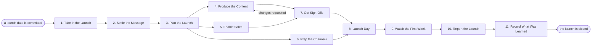

# Reference process: Launch Product

`ref/mkt/product-launch v1`

**value stream:** [Concept-to-Market](../../streams/marketing/concept-to-market.md)
A launch date is committed, and marketing has to arrive at it with the
story settled, the content made, sales ready to sell, and every channel
loaded - then fire everything in order on the day, watch the first week,
and report what happened. This is the process that coordinates the most
seats, which is why it earns a coordinator of its own.

## The activities

| # | Activity | What happens | Seats |
|---|---|---|---|
| 1 | Take in the Launch | what ships, when, and why anyone should care | [launch-coordinator](../../agents/launch-coordinator.md) · product (person) |
| 2 | Settle the Message | the positioning and the story, tested against personas | [copywriter](../../agents/copywriter.md) · product marketing (person) |
| 3 | Plan the Launch | the checklist: what every channel owes and by when | launch-coordinator |
| 4 | Produce the Content | the blog post, the page updates, the video, the social posts | copywriter · [designer](../../agents/designer.md) · [video-editor](../../agents/video-editor.md) |
| 5 | Enable Sales | battlecards, the FAQ, the objection answers | copywriter · sales leader (person) |
| 6 | Prep the Channels | web updates staged, emails loaded, ads built | [media-buyer](../../agents/media-buyer.md) · [web-producer](../../agents/web-producer.md) |
| 7 | Get Sign-Offs | brand, legal, and product accuracy | [brand-check](../../agents/brand-check.md) · legal reviewer (person) · product (person) |
| 8 | Launch Day | everything fires in order, and someone watches it fire | launch-coordinator |
| 9 | Watch the First Week | adoption, coverage, and the questions coming in | [analytics](../../agents/analytics.md) · [community-manager](../../agents/community-manager.md) |
| 10 | Report the Launch | results against the goals set on day one | launch-coordinator · analytics |
| 11 | Record What Was Learned | what to repeat, what to avoid | launch-coordinator |

## The graph



## The document, with the blanks marked

```
PROCESS: product launch               id: <team>/product-launch   v1
from: ref/mkt/product-launch v1
owner: <who>                          effective: <date>
trigger: a launch date is committed by <your product process>
concurrency: <one at a time | overlapping, and what they share>
goal: the launch arrives with the story settled, sales ready, every
      channel loaded, and a first-week report against the day-one goals
phases:
  take-in-launch  - human: what ships, when, and why it matters, from
                    the people building it
                    owner: launch-coordinator  after: trigger
                    automation: <level>
  settle-message  - convenes bake-off: positioning candidates, one
                    chosen and written down
                    owner: <your product marketing seat>
                    after: take-in-launch      by: <days>
                    automation: <level>
  plan-launch     - convenes decide-and-announce: the checklist -
                    every channel's deliverables and deadlines, told to
                    everyone at once
                    owner: launch-coordinator  after: settle-message
                    automation: <level>
  produce-content - runs build-by-talent: the blog post, the page
                    updates, the demo video, the social posts
                    owner: launch-coordinator  after: plan-launch
                    by: <days>                 automation: <level>
  enable-sales    - human: battlecards, the FAQ, the objection answers,
                    reviewed by the people who will use them
                    owner: <your sales leader> after: plan-launch
                    by: <days>                 automation: <level>
  prep-channels   - human: web updates staged, emails loaded, ads built
                    owner: media-buyer         after: plan-launch
                    by: launch-day             automation: <level>
  get-sign-offs   - convenes approval: brand, legal and product
                    accuracy, as named signers, against a version
                    owner: <your legal seat>
                    after: produce-content + enable-sales
                    by: <days>                 automation: never
  launch-day      - human: everything fires in the planned order, and
                    the coordinator watches it fire
                    owner: launch-coordinator
                    after: get-sign-offs + prep-channels
                    automation: <level>
  watch-week-one  - human: adoption, coverage, and the questions coming
                    in, gathered daily
                    owner: analytics           after: launch-day
                    automation: <level>
  report-launch   - runs collect-and-report: results against the goals
                    set in take-in-launch
                    owner: launch-coordinator  after: watch-week-one
                    automation: <level>
  record-learnings - convenes debrief: what to repeat, what to avoid
                    owner: launch-coordinator  after: report-launch
                    automation: <level>
handoffs:
  take-in-launch -> settle-message: what ships and for whom, in the
    builders' own words
  settle-message -> plan-launch: the positioning, written down, with
    the words sales and content will both use
  plan-launch -> produce-content / enable-sales / prep-channels: each
    branch's deliverables and deadlines. Three branches read one plan
  produce-content + enable-sales -> get-sign-offs: everything
    customer-facing, at a version
  get-sign-offs -> launch-day: the approved material at the signed
    version. A later change voids the approval
  watch-week-one -> report-launch: the daily gatherings, attributed
bindings:
  roster:  <who holds each seat - agents claiming the abstract agents
           above, and named people for product, sales and legal>
  systems: the CMS (write), email platform (write),
           ad platforms (write, cap: <n>), analytics (read),
           <your sales content store> (write)
  data:    the positioning document at a version, brand guidelines
           <version>, <your claims register>
policy:
  nothing customer-facing publishes unsigned
  the launch date moves only by <who> saying so, and the move is
    recorded
measures:
  the checklist: <n> deliverables, all landed by launch day
  cycle time: <weeks> from commitment to launch
  quality gate: first-week report delivered within <days> of launch
```

## The failure edges

- **A sign-off comes back with changes.** The run returns to
  produce-content, and only what the signers named reopens. The launch
  date does not move because a paragraph did.
- **A branch is going to miss launch day.** The coordinator says so out
  loud as soon as the deadline math fails, and <who> decides: cut the
  deliverable, or move the date. Discovering it on launch day is the
  failure this process exists to prevent.
- **The date moves.** Every branch's deadlines are relative to launch
  day, so the plan shifts once, in one place, and every seat hears the
  same announcement.
- **A run is abandoned.** Staged changes are pulled, loaded emails are
  cancelled, and whatever was already public gets a follow-up that says
  so. The books close on what was spent.
