# Reference process: Develop Product Positioning

`ref/mkt/product-positioning v1`

**value stream:** [Concept-to-Market](../../streams/marketing/concept-to-market.md)
Somebody asks a market question about one product, and the positioning
for that product has to be settled. A decision coordinator writes down
what the positioning has to answer and by when, reads the company-level
brand position at the version the standards keeper holds, and
commissions the evidence: what buyers weigh when they choose, what rival
products claim, what people search for, how the product is actually
used, what support keeps hearing about it, and what sellers run into
inside live deals. The people who build the product say what it does
today and what is coming. From that evidence the coordinator builds two
or three positions the product could credibly hold, has each one tested
against the evidence and then in front of buyers and sellers, and puts
them to the people who decide. The chosen position is written out as a
statement with the proof points that carry it and a version for each
audience it has to reach. Every claim carries the source it rests on,
brand and legal and product accuracy sign it, and the standards keeper
issues it as a numbered version. This process quotes the company-level
position at its version and stops there. Changing that position is the
brand positioning process.

## The activities

| # | Activity | What happens | Agents |
|---|---|---|---|
| 1 | Take in the Question | what the positioning has to settle, and by when | [decision-coordinator](../../agents/decision-coordinator.md) · product (person) |
| 2 | Read the Standards in Force | the company position and the profile, at their versions | [standards-keeper](../../agents/standards-keeper.md) · [audience-manager](../../agents/audience-manager.md) · decision-coordinator |
| 3 | Gather the Market Evidence | what buyers weigh, what rivals claim, what people search | [researcher](../../agents/researcher.md) · [search-optimizer](../../agents/search-optimizer.md) · [coverage-monitor](../../agents/coverage-monitor.md) |
| 4 | Read the Product's Own Record | how the product is used, and what support hears | [account-monitor](../../agents/account-monitor.md) · [analytics](../../agents/analytics.md) · support leader (person) |
| 5 | Read What Happens Inside Deals | what sellers run into, and the deals won and lost | [sales-enablement-manager](../../agents/sales-enablement-manager.md) · sales leader (person) |
| 6 | Interview the Makers | what the product does today, and what is coming | researcher · product (person) · subject matter expert (person) |
| 7 | Name the Competing Choices | what a buyer picks instead, including doing nothing | decision-coordinator · researcher |
| 8 | Draft the Candidate Positions | two or three positions, each with the case for it | decision-coordinator · [copywriter](../../agents/copywriter.md) |
| 9 | Test the Positions against the Evidence | whether the evidence carries what each one claims | [editor](../../agents/editor.md) · researcher |
| 10 | Try the Positions on Outsiders | buyers and sellers react to each one | researcher · sales leader (person) |
| 11 | Choose the Position | one is picked and the reasons are said out loud | leadership (person) · product (person) · decision-coordinator |
| 12 | Write the Messaging | the statement, the proof points, the audience versions | copywriter · editor · decision-coordinator |
| 13 | Record the Proof Behind Each Claim | a source under every claim the messaging makes | researcher |
| 14 | Get Sign-Offs | brand, legal and product accuracy sign at a version | [brand-check](../../agents/brand-check.md) · brand owner (person) · legal reviewer (person) · product (person) |
| 15 | Issue the Positioning at a Version | a numbered version, and every reader is told | standards-keeper · decision-coordinator |
| 16 | Set the Review Conditions | what has to change for this to be opened again | decision-coordinator · product (person) |
| 17 | Record What Was Learned | what to repeat, what to avoid | decision-coordinator |

## The graph

```mermaid
flowchart LR
  T([a market question about one product]) --> A1[1. Take in the Question]
  A1 --> A2[2. Read the Standards in Force]
  A2 --> A3[3. Gather the Market Evidence]
  A2 --> A4[4. Read the Product's Own Record]
  A2 --> A5[5. Read What Happens Inside Deals]
  A2 --> A6[6. Interview the Makers]
  A3 --> A7[7. Name the Competing Choices]
  A5 --> A7
  A7 --> A8[8. Draft the Candidate Positions]
  A4 --> A8
  A6 --> A8
  A8 --> A9[9. Test the Positions against the Evidence]
  A9 -. the evidence will not carry it .-> A8
  A9 --> A10[10. Try the Positions on Outsiders]
  A10 -. buyers do not recognize it .-> A8
  A10 --> A11[11. Choose the Position]
  A11 -. none is worth backing .-> A8
  A11 --> A12[12. Write the Messaging]
  A12 --> A13[13. Record the Proof Behind Each Claim]
  A13 -. a claim with no source .-> A12
  A13 --> A14[14. Get Sign-Offs]
  A14 -. changes requested .-> A12
  A14 --> A15[15. Issue the Positioning at a Version]
  A15 --> A16[16. Set the Review Conditions]
  A16 --> A17[17. Record What Was Learned]
  A17 --> DONE([the positioning is agreed and issued at a version])
```



## The document, with the blanks marked

```
PROCESS: product positioning          id: <team>/product-positioning v1
from: ref/mkt/product-positioning v1
owner: <who>                          effective: <date>
trigger: a market question about one product that <who> decides is
         worth settling
concurrency: one run per product - two runs would put two answers to
             the same question in front of the same people
goal: an agreed product-level positioning and messaging, sourced,
      signed, and issued at a numbered version that quotes the company
      position at the version in force
phases:
  take-in-question  - human: what the positioning has to settle, for
                      which product, and by when. <who> confirms it
                      owner: decision-coordinator
                      after: trigger
                      automation: <level>
  read-standards    - human: the company brand position and the
                      customer profile, each at its current version
                      owner: standards-keeper
                      after: take-in-question
                      by: <days>           automation: <level>
  market-evidence   - runs collect-and-report: what buyers weigh, what
                      rival products claim, and the words people use
                      owner: researcher
                      after: read-standards
                      by: <weeks>          automation: <level>
  product-record    - runs collect-and-report: how the product is used
                      across the base, and what support keeps hearing
                      owner: analytics
                      after: read-standards
                      by: <weeks>          automation: <level>
  deal-record       - runs collect-and-report: what sellers run into in
                      a live deal, and why deals were won and lost
                      owner: sales-enablement-manager
                      after: read-standards
                      by: <weeks>          automation: <level>
  interview-makers  - human: the people who build the product say what
                      it does today and what is coming
                      owner: researcher
                      after: read-standards
                      by: <weeks>          automation: <level>
  competing-choices - human: what a buyer picks instead of this
                      product, including doing nothing
                      owner: decision-coordinator
                      after: market-evidence + deal-record
                      by: <days>           automation: <level>
  draft-candidates  - runs build-by-talent: two or three positions the
                      product could hold, each with the case for it
                      owner: decision-coordinator
                      after: competing-choices + product-record +
                             interview-makers
                      by: <weeks>          automation: <level>
  test-on-evidence  - runs assessment: each position read against the
                      evidence, claim by claim
                      owner: editor
                      after: draft-candidates
                      by: <days>           automation: <level>
  test-on-outsiders - human: the positions put in front of real buyers
                      and sellers, with what each person said recorded
                      owner: researcher
                      after: test-on-evidence
                      by: <weeks>          automation: <level>
  choose-position   - convenes decide-and-announce: one position
                      chosen, with the reasons and any dissent recorded
                      owner: decision-coordinator
                      after: test-on-outsiders
                      by: <date>           automation: never
  write-messaging   - runs build-by-talent: the statement, the proof
                      points, and a version for each audience
                      owner: decision-coordinator
                      after: choose-position
                      by: <days>           automation: <level>
  record-proof      - runs layered-passes: the fact pass over the
                      messaging, every claim against its source
                      owner: researcher
                      after: write-messaging
                      by: <days>           automation: <level>
  get-sign-offs     - convenes approval: brand, legal and product
                      accuracy sign, as named signers, at a version
                      owner: <your legal role>
                      after: record-proof
                      by: <days>           automation: never
  issue-version     - runs decide-and-announce: the signed positioning
                      becomes a numbered version, and every reader
                      hears what it says and from when
                      owner: standards-keeper
                      after: get-sign-offs
                      by: <days>           automation: <level>
  review-conditions - human: what has to change in the product or the
                      market for this answer to be opened again
                      owner: decision-coordinator
                      after: issue-version
                      automation: <level>
  record-learnings  - convenes debrief: what to repeat, what to avoid
                      owner: decision-coordinator
                      after: review-conditions
                      automation: <level>
run-scoped:
  status - runs roll-call                 owner: decision-coordinator
           every: <cadence>
           from: take-in-question   until: issue-version
  spend  - runs allocate-and-reconcile    owner: researcher
           from: market-evidence   until: test-on-outsiders
handoffs:
  take-in-question -> read-standards: the question the positioning has
    to settle, the product it is about, and the date it is due
  read-standards -> market-evidence / product-record / deal-record /
    interview-makers: the company position and the customer profile,
    each at its version. Four sources read one record
  market-evidence -> competing-choices: what buyers weigh, what rival
    products claim, and the category's search demand, each line with
    its source and the date it was pulled
  product-record -> draft-candidates: which capabilities customers use
    and which they leave alone, and what support keeps hearing, each
    line naming the system it came from and the date of the reading
  deal-record -> competing-choices: what sellers run into in a live
    deal, and the reasons written on the deals won and lost
  interview-makers -> draft-candidates: what the product does today,
    attributed to the person who said it, and what is committed next
  competing-choices -> draft-candidates: what a buyer picks instead of
    this product, including doing nothing
  draft-candidates -> test-on-evidence: the candidate positions at a
    version, each with the case for it and what it would rule out
  test-on-evidence -> test-on-outsiders: the positions the evidence
    carries, and the claims it will not support in the others
  test-on-outsiders -> choose-position: what each buyer and seller
    said, attributed, beside the position it was said about
  choose-position -> write-messaging: the chosen position, the reasons
    for it, and anyone who disagreed and what they said
  write-messaging -> record-proof: the messaging at a version, claim
    by claim
  record-proof -> get-sign-offs: the messaging with a source under
    every claim, and any claim still unsourced marked as unsourced
  get-sign-offs -> issue-version: the signed positioning and messaging
    at the version the signers read
  issue-version -> review-conditions: the numbered version, what it
    says, and the date it applies from
  review-conditions -> record-learnings: the conditions that reopen
    this answer, and the date it comes back up anyway
bindings:
  roster:  <who holds each role - agents claiming the abstract agents
           above, and named people for the product owner, leadership,
           the sales leader, the support leader, legal, the brand
           owner and the expert>
  systems: the decision record (write), the evidence store (write),
           the source record (write), the standards store (write),
           search demand data (read), the coverage record (read),
           product usage data (read), the support system (read),
           the CRM (read), analytics platforms (read),
           the enablement library (read),
           the notification channel (write),
           the review schedule (write)
  data:    brand guidelines <version>, which carry the company position
           this run quotes, <your customer profile> <version>,
           <your claims register>, the evidence gathered for this
           decision
policy:
  the position is chosen by the named people and never by an agent
  this run quotes the company position at the version the standards
    keeper holds, and never restates it or amends it
  every claim the messaging makes carries a source recorded against it
  a claim the register does not already cover reaches the register
    through that register's own process, as a versioned amendment
  sign-off is a human gate and is never delegated to an agent
  anything changed after sign-off goes back through sign-offs
  an issued version is never edited. A change goes out as a new
    version, and the version it replaces stays readable
  material already in production is judged against the version it
    started under, until <who> says otherwise
measures:
  cycle time: <target> from the question to the issued version
  reach: every process and every agent that reads the positioning told
         within <days> of the version being issued
  quality gate: no version issues unsigned, and no claim in the
                messaging issues without its source
```

## The failure edges

- **The evidence will not carry a position.** The editor names the
  claims the evidence does not support and the run returns to
  draft-candidates. The position is narrowed to what the evidence
  carries, or the coordinator commissions the evidence that would carry
  it, and the test runs again on the version that comes back.
- **Buyers do not recognize the position.** The people the positions
  were tried on cannot see this product in any of them, or cannot tell
  it apart from what they already use. The run returns to
  draft-candidates with what each person actually said, and the round
  that follows tests the rewritten positions on people who have not
  seen the earlier ones.
- **None of the candidates is worth backing.** The people who decide
  can decline every position in front of them, and that answer is
  recorded like any other. The run returns to draft-candidates, and the
  coordinator records what was rejected and why, so the next set of
  candidates leaves out what was already turned down.
- **A candidate position contradicts the company position.** The
  coordinator reports the contradiction with the company position
  quoted beside the candidate. This run has no power to change the
  company position, so either the candidate is dropped or <who> opens
  the brand positioning process, and this run waits for the version
  that comes out of it.
- **A claim in the messaging has no source.** The researcher reports it
  as unsourced and the run goes back to write-messaging. The messaging
  drops the claim or the researcher finds the source. A claim that
  survives goes to the claims register through that register's own
  process as an amendment, and the messaging is only scorable once the
  amendment is issued.
- **A sign-off comes back with changes.** The run returns to
  write-messaging, and only the part the signers named reopens. The
  signers see the changed version before it is issued.
- **The product changes while the run is open.** The product owner
  brings the change to the coordinator, and the coordinator says which
  evidence the change invalidates. Evidence gathered before the change
  is read again against it, and a position that rested on a capability
  that is no longer coming goes back to draft-candidates.
- **The company position is reissued while the run is open.** The
  standards keeper tells this run which version now applies. The
  coordinator reads the candidates against the new version, and <who>
  says whether the run continues on the evidence it has or reopens the
  question it started from.
- **The trigger fires again for the same product.** Only one run per
  product is open at a time. A second question either goes into the
  open run, or waits for the version to issue, and <who> decides which.
  Questions about different products run at the same time normally.
- **A run is abandoned.** Whatever positioning is in force stays in
  force and nothing about it changes. The evidence, the candidate
  positions and anything the buyers and sellers said stay at their
  versions so a later run can pick them up, and the spend line
  reconciles anyway.
