# Reference process: Conduct Quarterly Business Review

`ref/mkt/quarterly-business-review v1`

**value stream:** [Objective-to-Commitment](../../streams/marketing/objective-to-commitment.md)
A quarter closes, and the department has to examine what it did and say
what it will be held to next. The report for the quarter arrives already
published from `ref/mkt/marketing-performance-report`, and this review
starts from it. The agents here set the quarter's results against what
the annual plan said the year would do, read the budget position and the
conditions outside the company, re-forecast the quarters that are left,
and say what each change an area proposes would cost, return and
displace. Leadership then examines the quarter, says which of the plan
stands, resets what each area is held to, and settles the money that
moves between the lines. Four of the sixteen activities turn on a
person: finance confirms the budget position, leadership examines the
quarter, leadership sets the new commitments, and leadership and finance
move the money. Raising the automation level moves none of those four.
The run closes when the reset commitments are published and every agent
has heard what it owes.

## The activities

| # | Activity | What happens | Agents |
|---|---|---|---|
| 1 | Set What the Review Covers | the quarter, the plan lines, and the questions | [decision-coordinator](../../agents/decision-coordinator.md) · leadership (person) |
| 2 | Take in the Period Report | the published report, and what it could not answer | [reporting-manager](../../agents/reporting-manager.md) |
| 3 | Set the Quarter against the Annual Goals | each result beside what the plan said the year would do | reporting-manager · [analytics](../../agents/analytics.md) |
| 4 | Read the Budget Position | what was allocated, what was drawn, and what is left | [budget-keeper](../../agents/budget-keeper.md) · finance (person) |
| 5 | Read the Outside Conditions | the market, the competitors, and what buyers now ask | [researcher](../../agents/researcher.md) |
| 6 | Re-Forecast the Rest of the Year | what the remaining quarters look like from here | [forecaster](../../agents/forecaster.md) |
| 7 | Name the Gaps Worth Acting On | which misses matter and which sit inside the noise | decision-coordinator · reporting-manager · [statistician](../../agents/statistician.md) |
| 8 | Ask Each Area What It Would Change | one request, one format, one due date | decision-coordinator · [campaign-manager](../../agents/campaign-manager.md) · [content-manager](../../agents/content-manager.md) · [media-buyer](../../agents/media-buyer.md) · [audience-manager](../../agents/audience-manager.md) |
| 9 | Put Numbers on the Proposed Changes | what each change costs, returns, and would displace | forecaster · media-buyer · [capacity-manager](../../agents/capacity-manager.md) |
| 10 | Hold the Review | leadership examines the quarter and says what stands | leadership (person) · decision-coordinator |
| 11 | Reset the Commitments | what each area is held to for the coming quarter | leadership (person) · decision-coordinator |
| 12 | Move the Money | budget shifted between the lines of the plan | leadership (person) · finance (person) · budget-keeper · decision-coordinator |
| 13 | Update What Gets Measured | the measures adjusted to the reset commitments | reporting-manager · analytics |
| 14 | Publish the Reset Commitments | the record goes out at a version on its date | decision-coordinator |
| 15 | Brief the Department | every agent hears what changed and what it owes | decision-coordinator · campaign-manager · content-manager · media-buyer · audience-manager · reporting-manager |
| 16 | Record What the Review Rests On | the assumptions, and what would reopen the reset | decision-coordinator · forecaster |

## The graph

```mermaid
flowchart LR
  T([a quarter closes]) --> A1[1. Set What the Review Covers]
  A1 --> A2[2. Take in the Period Report]
  A1 --> A4[4. Read the Budget Position]
  A1 --> A5[5. Read the Outside Conditions]
  A2 --> A3[3. Set the Quarter against the Annual Goals]
  A3 -. a figure the report does not carry .-> A2
  A3 --> A6[6. Re-Forecast the Rest of the Year]
  A4 --> A6
  A5 --> A6
  A6 --> A7[7. Name the Gaps Worth Acting On]
  A7 --> A8[8. Ask Each Area What It Would Change]
  A8 --> A9[9. Put Numbers on the Proposed Changes]
  A9 -. the numbers do not close the gaps .-> A8
  A9 --> A10[10. Hold the Review]
  A10 -. more change is needed than was proposed .-> A8
  A10 --> A11[11. Reset the Commitments]
  A11 --> A12[12. Move the Money]
  A11 --> A13[13. Update What Gets Measured]
  A12 -. the money will not cover the reset .-> A11
  A13 -. a commitment cannot be measured .-> A11
  A12 --> A14[14. Publish the Reset Commitments]
  A13 --> A14
  A14 --> A15[15. Brief the Department]
  A15 --> A16[16. Record What the Review Rests On]
  A16 --> DONE([performance is examined and the commitments are reset])
```



## The document, with the blanks marked

```
PROCESS: quarterly business review    id: <team>/quarterly-business-review   v1
from: ref/mkt/quarterly-business-review v1
owner: <who>                          effective: <date>
trigger: a quarter closes on <your fiscal calendar>
         watch: every=<your fiscal quarter>
concurrency: one run at a time - a quarter is reviewed once, and a
             change made after the reset goes in as a new version
goal: the quarter examined against the plan, what each area is held to
      next quarter reset at a version, and the department briefed on
      what changed
phases:
  set-scope         - human: the quarter, the plan lines it covers, and
                      the questions <who> wants the review to settle
                      owner: decision-coordinator  after: trigger
                      automation: <level>
  take-in-report    - human: the published report for the quarter, read
                      as it stands, with everything it could not answer
                      recorded beside it
                      owner: reporting-manager     after: set-scope
                      by: <days>                   automation: <level>
  set-against-year  - human: each result of the quarter put next to what
                      the plan said the year would do, with every gap
                      marked as a gap
                      owner: reporting-manager     after: take-in-report
                      by: <days>                   automation: <level>
  budget-position   - human: what each line was allocated, what has been
                      drawn against it, and what is left to draw. <who>
                      confirms the money already committed
                      owner: budget-keeper         after: set-scope
                      by: <days>                   automation: never
  outside-reading   - runs build-by-talent: the market, the competitors,
                      and what buyers are now asking for
                      owner: researcher            after: set-scope
                      by: <days>                   automation: <level>
  re-forecast       - runs build-by-talent: what the remaining quarters
                      produce from the position this one leaves, with
                      the assumptions written beside every number
                      owner: forecaster
                      after: set-against-year + budget-position +
                             outside-reading
                      by: <days>                   automation: <level>
  name-gaps         - human: which misses are large enough to act on,
                      and which sit inside the noise the measure already
                      carries
                      owner: decision-coordinator  after: re-forecast
                      automation: <level>
  ask-areas         - runs collect-and-report: one request, one format
                      and one due date, sent to every area that would
                      have to change what it is doing
                      owner: decision-coordinator  after: name-gaps
                      by: <days>                   automation: <level>
  size-changes      - runs build-by-talent: what each proposed change
                      costs, what it returns, and what it displaces in
                      the quarter ahead
                      owner: forecaster            after: ask-areas
                      by: <days>                   automation: <level>
  hold-review       - convenes decide-and-announce: <who> examines the
                      quarter and says which of the plan stands
                      owner: decision-coordinator  after: size-changes
                      by: <days>                   automation: never
  new-commitments   - convenes decide-and-announce: <who> says what each
                      area is held to for the coming quarter, and the
                      department hears it at once
                      owner: decision-coordinator  after: hold-review
                      automation: never
  move-money        - human: the budget shifted between the lines of the
                      plan, one line for each move. <who> decides the
                      move and finance confirms it
                      owner: <your finance role>   after: new-commitments
                      by: <days>                   automation: never
  update-measures   - human: the measure each reset commitment will be
                      reported against, defined so the period report can
                      produce it without argument
                      owner: reporting-manager     after: new-commitments
                      by: <days>                   automation: <level>
  publish-reset     - human: the reset commitments go to <who> and to
                      the department, at a version, on the date the
                      review is due
                      owner: decision-coordinator
                      after: move-money + update-measures
                      automation: <level>
  brief-department  - convenes briefing: every agent hears what changed,
                      what it owes and from when, at once
                      owner: decision-coordinator  after: publish-reset
                      by: <days>                   automation: <level>
  record-basis      - human: what the reset rests on, and the conditions
                      that bring it back before the next quarter closes
                      owner: decision-coordinator  after: brief-department
                      automation: <level>
run-scoped:
  status - runs roll-call                    owner: decision-coordinator
           every: <cadence>
           from: set-scope   until: publish-reset
  budget - runs allocate-and-reconcile       owner: budget-keeper
           from: move-money   until: run close
handoffs:
  set-scope -> take-in-report / budget-position / outside-reading
    [review-scope]: the quarter, the plan lines it covers and the
    questions, in one record all three branches read
  take-in-report -> set-against-year [period-report]: the report as
    published, and the list of what it could not answer
  set-against-year -> re-forecast [results-against-plan]: each result
    of the quarter beside what the plan said the year would do, with
    every gap left visible
  budget-position -> re-forecast [budget-left]: what is left against
    each line of the plan, at the figures the review will carry
  outside-reading -> re-forecast [outside-conditions]: the market, the
    competitors and what buyers are asking, each fact carrying its
    source and the date it was read
  re-forecast -> name-gaps [rest-of-year-forecast]: what the remaining
    quarters produce from here, with the assumptions beside every
    number and every rate that could not be sourced marked unsourced
  name-gaps -> ask-areas [gaps-worth-acting-on]: the gaps worth acting
    on, and separately the differences the measurement cannot tell
    apart from noise
  ask-areas -> size-changes [proposed-changes]: every proposed change
    in one format, saying what it would do, what it would need, and by
    when
  size-changes -> hold-review [change-costings]: what each change
    costs, what it returns, and what it would displace in the quarter
    ahead
  hold-review -> new-commitments [review-verdict]: what <who> says
    still stands from the plan, and what <who> says has to change
  new-commitments -> move-money [reset-commitments]: what each area is
    held to for the coming quarter, and the lines the money no longer
    matches
  new-commitments -> update-measures [measurable-commitments]: the same
    commitments, each one stated so a measure can be defined for it
  move-money -> publish-reset [moved-budget]: the money against each
    line at the figures the reset will carry
  update-measures -> publish-reset [commitment-measures]: the measure
    each commitment will be reported against
  publish-reset -> brief-department [published-reset]: the reset at a
    version, and what each agent owes against it
  brief-department -> record-basis [briefing-response]: what each agent
    took away, and anything an agent said it could not do
deviations:
  set-against-year -> take-in-report [figure-missing]: the report does
    not carry a figure the quarter has to be set against, so it is
    taken in again with that figure
  size-changes -> ask-areas [changes-fall-short]: the numbers on the
    proposed changes do not close the gaps, so the areas are asked
    again with the remaining gap named
  hold-review -> ask-areas [more-change-needed]: the review wants more
    change than the areas proposed, so the request goes back out
  move-money -> new-commitments [money-short]: the money will not cover
    the reset, so the commitments are set again against what it carries
  update-measures -> new-commitments [commitment-unmeasurable]: a reset
    commitment cannot be measured, so it goes back to be restated
bindings:
  roster:  <who holds each role - agents claiming the abstract agents
           above, and named people for leadership and finance>
  systems: the decision record (write), the plan store (write),
           the budget record (write), the book of work (write),
           the report store (read), the model store (write),
           analytics platforms (read), the notification channel (write)
  data:    the published report for the quarter, the approved plan at
           its version, what each area committed to for the quarter,
           <your measure definitions> at a version, the fiscal calendar
policy:
  the review reads the published report for the quarter, and the
    channels are asked for their numbers once, by the process that
    writes that report
  every figure in the reset names the report line or the model version
    it came from
  a difference the measurement cannot tell apart from noise is recorded
    as such, and the reset treats it as a difference nobody can rely on
  the reset commitments and the money moved between lines are decided
    by named people and are never delegated to an agent
  a change to the reset after it is published goes out as a new version
    saying what moved and why, and the version it replaces stays where
    it was
  a change that moves the goals for the year leaves this process for
    <your annual planning process>
measures:
  cycle time: <days> from the quarter closing to the published reset
  coverage: <share> of the plan's lines carrying a result for the
            quarter and a commitment for the next one
  quality gate: nothing is reset without the report line or the model
                version under it
```

## The failure edges

- **The report is late or does not answer everything.** The review is
  held on its date anyway. The run records which figures were missing
  when it was held, and the reset commitments say which figures they
  rest on. A figure that arrives afterwards goes into the record of what
  the review rests on, and it reopens the reset only if it crosses a
  condition written there.
- **The re-forecast says the goals for the year are out of reach.** No
  change the department can propose closes the gap, so that question
  leaves this process for the one that owns the annual plan. The review
  still resets what each area is held to for the coming quarter, and the
  record says the goals for the year are open.
- **The proposed changes do not close the gaps.** The run returns to the
  request to the areas with the size of the remaining gap named. If a
  second round leaves the gap open, leadership accepts it in writing or
  funds something outside what the areas proposed, and whichever it does
  is recorded with the reset.
- **The money will not cover the reset.** The run returns to the
  commitments, and leadership drops or shrinks what the money will not
  carry. What was dropped is recorded, so the same commitment does not
  come back next quarter as though it had never been seen.
- **A reset commitment cannot be measured.** The run returns to the
  commitments. The commitment is restated in terms the period report can
  produce, or it stands as it is and is marked unmeasured in every
  report that carries it.
- **Money moves between reviews.** A commitment changes or a budget line
  moves before the next quarter closes. The change goes in as a new
  version of the reset saying what moved, who decided it and when, and
  the version it replaces stays where it was.
- **A run is abandoned.** The quarter still gets a record. The report,
  the re-forecast and the proposed changes stay where they are at their
  versions, and the department is told that the quarter went unreviewed,
  why it did, and which commitments it is still running on.
