# Reference process: reallocate media spend

`ref/mkt/reallocate-media-spend v1`

**value stream:** [Plan-to-Reconcile](../../streams/marketing/plan-to-reconcile.md)
A media plan is running and one of its lines is not doing what the plan
assumed. One channel is spending faster than its flight can absorb.
Another is spending too slowly to finish on its end date. A third is
returning results at a cost nobody expected when the plan was built.
This process moves committed money between live lines of that plan
while the flights are still running. The team confirms the figures
behind the signal, reads how much of each line is still free to move,
works out what the move costs in notice periods and minimum
commitments, and puts the amount in front of the person who owns the
money. Once the money has moved, the daily limits and the flight
weights are reset so the rest of each flight lands on its end date, and
the reason for the move is written down against the version of the plan
it produced. That reason is what the reconciliation at the end of the
period reads when it finds an order that changed while it was live. The
total the department has to spend was set somewhere else, and the plan
this process amends was built somewhere else too. What changes here is
where committed money sits inside that plan while the flights run.

## The activities

| # | Activity | What happens | Seats |
|---|---|---|---|
| 1 | take in the pacing signal | which line is off, in which direction, and by how much | [media-buyer](../../agents/media-buyer.md) · [analytics](../../agents/analytics.md) |
| 2 | confirm the numbers hold | the figures behind the signal are real and current | analytics · [conversion-tracker](../../agents/conversion-tracker.md) |
| 3 | read the current position | what is committed, what is spent, what is still free | [media-planner](../../agents/media-planner.md) · media-buyer |
| 4 | name the candidate moves | which lines give money up and which lines take it | media-planner · media-buyer · [campaign-manager](../../agents/campaign-manager.md) |
| 5 | check what a move would cost | notice, minimums, rate tiers and cancellation terms | media-buyer · media-planner |
| 6 | size what each move returns | what each candidate move is modelled to return | [forecaster](../../agents/forecaster.md) |
| 7 | check the move against the rules | the move scored against the plan and the terms | [buy-check](../../agents/buy-check.md) · media-planner |
| 8 | decide the move | the person who owns the money agrees the amount | [decision-coordinator](../../agents/decision-coordinator.md) · finance (person) · leadership (person) |
| 9 | amend the media plan | the new split lands as a version of the plan | media-planner |
| 10 | move the money in the platforms | budgets change in the platforms the buy runs on | media-buyer |
| 11 | correct the pacing | daily limits reset so each flight lands on its date | media-buyer · analytics |
| 12 | check the change took | what is set is read back against what was decided | buy-check · media-buyer |
| 13 | tell the seats that read the plan | every seat on the old split hears the new one | campaign-manager · media-planner · [spend-reconciler](../../agents/spend-reconciler.md) · [reporting-manager](../../agents/reporting-manager.md) |
| 14 | record why the money moved | the reason and the figures behind it, at a version | media-planner · decision-coordinator |

## The graph

```mermaid
flowchart LR
  T([a live plan line is off its pacing or its cost]) --> A1[1. take in the pacing signal]
  A1 --> A2[2. confirm the numbers hold]
  A1 --> A3[3. read the current position]
  A2 -. the figures do not hold .-> A1
  A2 --> A4[4. name the candidate moves]
  A3 --> A4
  A4 --> A5[5. check what a move would cost]
  A4 --> A6[6. size what each move returns]
  A5 --> A7[7. check the move against the rules]
  A6 --> A7
  A7 -. the move breaks a term or a rule .-> A4
  A7 --> A8[8. decide the move]
  A8 -. a smaller move is wanted .-> A4
  A8 --> A9[9. amend the media plan]
  A9 --> A10[10. move the money in the platforms]
  A10 --> A11[11. correct the pacing]
  A11 --> A12[12. check the change took]
  A12 -. what is running is not what was decided .-> A10
  A12 -. the rest of the flight still misses .-> A11
  A12 --> A13[13. tell the seats that read the plan]
  A13 --> A14[14. record why the money moved]
  A14 --> DONE([the money is moved and the reason is on the record])
```



## The document, with the blanks marked

```
PROCESS: reallocate media spend       id: <team>/reallocate-media-spend   v1
from: ref/mkt/reallocate-media-spend v1
owner: <who>                          effective: <date>
trigger: in-flight performance crosses <your pacing threshold> or
         <your cost threshold> on a live line of the media plan
concurrency: runs may overlap - <how many> reallocations open at once
             against one plan
goal: committed money moved between live lines of the plan, the rest of
      each flight paced to land on its end date, and the reason on the
      record before the period closes
phases:
  take-signal      - human: which line is off, in which direction, by
                     how much, and how much of the flight is left
                     owner: media-buyer         after: trigger
                     automation: <level>
  confirm-numbers  - human: the delivery and result figures behind the
                     signal, each with the date it was pulled
                     owner: analytics           after: take-signal
                     by: <days>                 automation: <level>
  read-position    - human: what is committed, what is spent and what
                     is still free on every line of the plan
                     owner: media-planner       after: take-signal
                     by: <days>                 automation: <level>
  name-candidates  - human: which lines give money up and which lines
                     take it, with an amount against each pairing
                     owner: media-planner
                     after: confirm-numbers + read-position
                     automation: <level>
  cost-the-move    - human: the notice periods, minimum commitments,
                     rate tiers and cancellation terms each move hits
                     owner: media-buyer         after: name-candidates
                     by: <days>                 automation: <level>
  size-the-return  - human: what each candidate move is modelled to
                     return, with the assumptions written beside it
                     owner: forecaster          after: name-candidates
                     by: <days>                 automation: <level>
  check-the-move   - runs assessment: each pairing scored against the
                     plan and the terms the buy was made under
                     owner: buy-check
                     after: cost-the-move + size-the-return
                     by: <days>                 automation: <level>
  decide-the-move  - convenes approval: <who> agrees the amount, the
                     lines it leaves and the lines it lands on
                     owner: <your finance seat> after: check-the-move
                     by: <days>                 automation: never
  amend-the-plan   - human: the new split lands as a version of the
                     media plan, and the version it replaces is kept
                     owner: media-planner       after: decide-the-move
                     automation: <level>
  move-the-money   - human: the budgets change in the platforms the buy
                     runs on, one line at a time
                     owner: media-buyer         after: amend-the-plan
                     by: <days>                 automation: <level>
  correct-pacing   - human: the daily limits and the flight weights are
                     reset so the rest of each flight lands on its date
                     owner: media-buyer         after: move-the-money
                     automation: <level>
  check-it-took    - runs assessment: what is actually set in the
                     platforms, read back against what was decided
                     owner: buy-check           after: correct-pacing
                     by: <days>                 automation: <level>
  tell-the-readers - convenes decide-and-announce: every seat working
                     to the old split hears the new one at once
                     owner: campaign-manager    after: check-it-took
                     automation: <level>
  record-the-why   - human: the reason, the figures it rested on and
                     the terms it cost, filed against the plan version
                     owner: media-planner       after: tell-the-readers
                     automation: <level>
run-scoped:
  pacing - runs collect-and-report            owner: analytics
           every: <cadence>
           from: take-signal   until: run close
  spend  - runs allocate-and-reconcile        owner: media-buyer
           from: move-the-money   until: run close
handoffs:
  take-signal -> confirm-numbers: the line, the direction and the size
    of the gap, and how much of the flight is left to run
  take-signal -> read-position: the same signal. Both branches read one
    record
  confirm-numbers -> name-candidates: the delivery and result figures
    behind the signal, each with its source and the date it was pulled
  read-position -> name-candidates: what is committed, what is spent
    and what is still free on every line of the plan
  name-candidates -> cost-the-move: each pairing of a line that gives
    money up and a line that takes it, with an amount written on it
  name-candidates -> size-the-return: the same pairings, to be modelled
  cost-the-move -> check-the-move: the notice, the minimums and the
    terms each pairing runs into, at the versions they were agreed at
  size-the-return -> check-the-move: what each pairing is modelled to
    return, with the assumptions it rests on
  check-the-move -> decide-the-move: a verdict on every pairing, each
    verdict citing the plan line or the term behind it
  decide-the-move -> amend-the-plan: the amount, the lines it leaves,
    the lines it lands on, who agreed it and on what date
  amend-the-plan -> move-the-money: the new split at a version, with
    the version it replaces kept where it was
  move-the-money -> correct-pacing: what changed on each platform, and
    how many days each flight has left to spend it
  correct-pacing -> check-it-took: the daily limits and the flight
    weights as they are now set
  check-it-took -> tell-the-readers: what is running, read back against
    what was decided, with every difference named
  tell-the-readers -> record-the-why: the new split as every seat heard
    it, and the date it applies from
bindings:
  roster:  <who holds each seat - agents claiming the abstract agents
           above, and named people for the finance and leadership
           seats>
  systems: the media plan and its orders (write),
           ad platforms (write, cap: <n> per move),
           analytics platforms (read), the agreed rates and terms
           (read), the decision record (write),
           the reconciliation record (write),
           the notification channel (write)
  data:    the media plan at its live version, <your pacing
           thresholds>, <your cost thresholds>, <your agreed terms>
           <version>, the budget the plan was set inside
policy:
  no money moves on figures nobody has confirmed
  the amount, the lines it leaves and the lines it lands on are agreed
    by a person and are never settled by an agent alone
  a move larger than <n> goes to <who> before anything changes in a
    platform
  a move that breaks a commitment already signed goes to <who> first,
    and the term is read at the version it was agreed at
  no line is taken below the minimum its agreement commits to
  the plan is amended before the platforms change, so the plan is
    never behind what is running
  every move carries a reason recorded against it, and a run does not
    close until the reason is filed
measures:
  cycle time: <target> from the pacing signal to the money moved
  pacing: <share> of live plan lines inside their pacing band
  timeliness: <share> of the flight still left to run when a move is
              made
  quality gate: no move without a recorded reason and a named person
                who agreed it
```

## The failure edges

- **The figures behind the signal do not hold.** The delivery numbers
  sit inside an attribution window that has not closed, or the
  conversion-tracker seat reports that a conversion stopped firing. The
  run goes back to take-signal and no money moves, because a move made
  on numbers that turn out to be wrong is harder to undo than the
  problem it was meant to fix.
- **The move breaks a term the buy is already committed to.** The
  buy-check seat reports the pairing as a failure and cites the term,
  and the run returns to name-candidates. A move that has to break a
  signed commitment goes to <who> as a decision about the agreement
  before it goes back into the process as a pairing.
- **The person who owns the money wants a smaller move.** The run
  returns to name-candidates with the amount the person is willing to
  move, and the pairings are named again inside it. The larger move stays on the
  record with the reason it was refused.
- **What is running does not match what was decided.** The check reads
  the platforms back and finds a budget that did not take, a change
  that landed on the wrong line, or a daily limit still set to the old
  figure. Only the lines the check named go back to move-the-money, and
  the check runs again on what comes back.
- **The receiving line has too few days left to spend the money.** A
  line with three days to run will not absorb what the move gives it,
  so the run records the amount that cannot go out and hands that
  amount back to name-candidates. If no live line can absorb it, the
  amount is reported to <who> as money the period will not spend.
- **The money moves outside the process.** Somebody changes a budget
  directly in a platform, and the plan is then behind what is running.
  The difference shows up as a pacing signal like any other, and the
  run records the change against the plan so the reconciliation has
  something to match the invoice line to.
- **A second signal fires while a run is in flight.** Reallocations
  overlap, and the concurrency line says how many. Two runs working on
  the same plan read one position record, and the second run reads the
  position as the first run left it rather than as it was when the
  first run started.
- **The move lands after the period has closed.** The amended plan
  carries the date the money moved, and a move made after the close is
  reconciled into the next period. The reconciler is told which spend
  belongs to which period, because the order it holds no longer matches
  the plan the order was placed against.
- **A run is abandoned.** The plan stays at the version it reached. If
  the plan was amended and the platforms were never changed, the
  amendment is withdrawn as a new version so the plan describes what is
  actually running, and the reason for withdrawing it is recorded like
  any other move.
