# Reference process: Reconcile Media Spend

`ref/mkt/reconcile-media-spend v1`

**value stream:** [Plan-to-Reconcile](../../streams/marketing/plan-to-reconcile.md)
A period of paid media closes, and the department has to prove that what
it was billed matches what it ordered and what actually ran. Three
records go into that proof. The invoices come from the companies that
sold the media, the delivery figures come from the platforms that ran
it, and the order record is the department's own. Two of the three are
kept by somebody else. The reconciler sets the three records beside each
other one line at a time, takes every line that does not match back to
whoever issued the invoice, and records the answer against the line it
answers. Finance decides the lines that never settle and signs the spend
figure for the period, and no report carries a spend number that finance
did not sign.

## The activities

| # | Activity | What happens | Seats |
|---|---|---|---|
| 1 | Set What the Close Covers | which accounts, campaigns and dates are being closed | [spend-reconciler](../../agents/spend-reconciler.md) · [media-buyer](../../agents/media-buyer.md) |
| 2 | Collect the Invoices | every invoice and statement for the period, in one place | spend-reconciler |
| 3 | Pull the Delivery Record | what each platform recorded as delivered and spent | [analytics](../../agents/analytics.md) · media-buyer |
| 4 | Pull the Order Record | what was ordered, at the rates that were agreed | media-buyer · spend-reconciler |
| 5 | Match the Invoice Lines | each invoice line set against its order and delivery | spend-reconciler |
| 6 | Check the Rates and Fees | rates, fees, taxes and discounts against what was agreed | spend-reconciler |
| 7 | List the Differences | every line that does not match, with the amount | spend-reconciler |
| 8 | Clear the Explained Differences | differences the buy's own records already explain | spend-reconciler · media-buyer |
| 9 | Raise the Queries | each unexplained line goes back to whoever billed it | spend-reconciler |
| 10 | Track the Answers | each query gets a credit, a fix, a make-good or a no | spend-reconciler · media-buyer |
| 11 | Decide the Open Lines | finance decides what to pay, withhold or write off | spend-reconciler · finance (person) · leadership (person) |
| 12 | Approve the Verified Spend | finance signs the spend figure for the period | spend-reconciler · finance (person) |
| 13 | Release the Figures | the verified spend goes to the books and the reports | spend-reconciler · [reporting-manager](../../agents/reporting-manager.md) |
| 14 | Record What Was Learned | which lines and which issuers to check first next time | spend-reconciler · media-buyer |

## The graph

```mermaid
flowchart LR
  T([a media period closes]) --> A1[1. Set What the Close Covers]
  A1 --> A2[2. Collect the Invoices]
  A1 --> A3[3. Pull the Delivery Record]
  A1 --> A4[4. Pull the Order Record]
  A2 --> A5[5. Match the Invoice Lines]
  A3 --> A5
  A4 --> A5
  A5 --> A6[6. Check the Rates and Fees]
  A6 --> A7[7. List the Differences]
  A7 --> A8[8. Clear the Explained Differences]
  A8 -. the order record does not explain it .-> A9[9. Raise the Queries]
  A8 --> A12[12. Approve the Verified Spend]
  A9 --> A10[10. Track the Answers]
  A10 -. the issuer reissues the invoice .-> A5
  A10 --> A11[11. Decide the Open Lines]
  A10 --> A12
  A11 --> A12
  A12 -. finance will not sign the figure .-> A11
  A12 --> A13[13. Release the Figures]
  A13 --> A14[14. Record What Was Learned]
  A14 --> DONE([the spend for the period is verified and signed])
```



## The document, with the blanks marked

```
PROCESS: reconcile media spend        id: <team>/reconcile-media-spend   v1
from: ref/mkt/reconcile-media-spend v1
owner: <who>                          effective: <date>
trigger: a media period closes on <your finance calendar>
concurrency: runs may overlap - a period can close while the last one
             is still open
goal: every invoice line for the period matched against what was
      ordered and what ran, every difference explained, credited or
      decided by a person, and the spend figure signed
phases:
  set-scope        - human: which accounts, which campaigns and which
                     dates this close covers
                     owner: spend-reconciler    after: trigger
                     automation: <level>
  collect-invoices - runs collect-and-report: every invoice and
                     statement for the period, gathered in one place
                     owner: spend-reconciler    after: set-scope
                     by: <days>                 automation: <level>
  pull-delivery    - system: what each platform recorded as delivered
                     and what it recorded as spent
                     owner: analytics           after: set-scope
                     by: <days>                 automation: <level>
  pull-orders      - human: what was ordered, at the rates and on the
                     terms that were agreed, at their versions
                     owner: media-buyer         after: set-scope
                     by: <days>                 automation: <level>
  match-lines      - runs assessment: each invoice line scored against
                     the order it came from and the delivery recorded
                     owner: spend-reconciler
                     after: collect-invoices + pull-delivery +
                            pull-orders
                     by: <days>                 automation: <level>
  check-rates      - runs assessment: the rates, the fees, the taxes
                     and the discounts against what was agreed
                     owner: spend-reconciler    after: match-lines
                     by: <days>                 automation: <level>
  list-differences - human: one list of every line that does not match,
                     each carrying the amount at stake
                     owner: spend-reconciler    after: check-rates
                     automation: <level>
  clear-explained  - human: a difference the buy's own record already
                     explains closes against that record
                     owner: spend-reconciler    after: list-differences
                     automation: <level>
  raise-queries    - human: every line still unexplained goes back to
                     whoever issued the invoice, with the question
                     owner: spend-reconciler    after: clear-explained
                     by: <days>                 automation: <level>
  track-answers    - runs collect-and-report: each answer recorded
                     against the line it answers, and what it settled
                     owner: spend-reconciler    after: raise-queries
                     by: <days>                 automation: <level>
  decide-open      - convenes approval: <who> decides each line that
                     did not settle - pay it, withhold it, write it off
                     owner: <your finance seat> after: track-answers
                     by: <days>                 automation: never
  approve-spend    - convenes approval: finance signs the spend figure
                     for the period, as a named signer
                     owner: <your finance seat>
                     after: clear-explained + track-answers +
                            decide-open
                     by: <days>                 automation: never
  release-figures  - human: the signed figure goes to the books and to
                     every report that carries a spend number
                     owner: spend-reconciler    after: approve-spend
                     automation: <level>
  record-learnings - convenes debrief: which lines and which issuers to
                     check first next time
                     owner: spend-reconciler    after: release-figures
                     automation: <level>
run-scoped:
  open-lines - runs roll-call                 owner: spend-reconciler
               every: <cadence>
               from: raise-queries   until: approve-spend
  status     - runs collect-and-report        owner: spend-reconciler
               every: <cadence>
               from: set-scope   until: run close
handoffs:
  set-scope -> collect-invoices / pull-delivery / pull-orders: the
    accounts, the campaigns and the dates this close covers. Three
    branches read one record
  collect-invoices -> match-lines: every invoice and statement for the
    period, each with the date it arrived
  pull-delivery -> match-lines: what each platform recorded as
    delivered and spent, with the date the figures were pulled
  pull-orders -> match-lines: what was ordered and at what rate, at the
    version it was ordered at
  match-lines -> check-rates: each invoice line with its order and its
    delivery beside it
  check-rates -> list-differences: a verdict on every line, each
    verdict citing the term it was scored against
  list-differences -> clear-explained: every line that does not match,
    with the amount at stake written on it
  clear-explained -> raise-queries: the lines the buy's own record does
    not explain
  raise-queries -> track-answers: the question that went to each issuer
    and the date it went
  track-answers -> decide-open: the lines the issuer refused or would
    not answer, each with its amount and how long it has been open
  track-answers -> approve-spend: the lines a credit or a correction
    settled, and what settled them
  decide-open -> approve-spend: what <who> decided for each open line,
    with the reason recorded against it
  approve-spend -> release-figures: the spend figure for the period as
    finance signed it, at a version
bindings:
  roster:  <who holds each seat - agents claiming the abstract agents
           above, and named people for the finance and leadership
           seats>
  systems: the invoice record (read), the media plan and its orders
           (read), the agreed rates and terms (read),
           ad platforms (read), analytics platforms (read),
           the accounting record (read),
           the reconciliation record (write),
           the issuer query record (write), the report store (write)
  data:    <your rate card> <version>, <your agreed terms> <version>,
           the media plan for the period, the finance calendar
policy:
  the seat that spent the money does not verify the invoice for it
  a line stays open until it is explained, credited, or decided by a
    person
  a settlement is agreed by a person and is never delegated to an agent
  no payment is released by an agent
  a difference larger than <n> goes to <who> on the day it is found
  an invoice for an account or a campaign that appears in no order
    record goes to a person before it is matched
  the period closes only when every line has a verdict recorded
  no report carries a spend figure that finance did not sign
measures:
  cycle time: <days> from the period closing to the signed figure
  match rate: <share> of invoice lines matched without a query
  recovery: <amount> credited back per period
  aging: <days> is the longest a queried line stays unanswered
  quality gate: no spend figure leaves the period unsigned
```

## The failure edges

- **The issuer reissues the invoice.** A corrected invoice is a new
  document and the run matches it from the start, so it goes back to
  match-lines and through the rate check again. The lines the first
  invoice settled are checked once more against the reissued figures.
- **Finance will not sign the figure.** The run returns to decide-open
  with the lines finance named, and only those lines reopen. No report
  carries the figure until it is signed.
- **The issuer will not answer a query.** The reconciler records the
  line as unanswered with its age and its amount, and it goes to
  decide-open like any other unsettled line. A line that stays
  unanswered past <how long> goes to <who> before the close is due.
- **A line is billed against no order.** The reconciler cannot score a
  line it has no order for, so the line goes to a person before it is
  matched. Either the order was placed outside the order record, which
  is a problem with how the buy was booked, or the charge does not
  belong to this organization.
- **A platform restates what it recorded.** Platforms revise delivery
  figures inside their attribution windows, so every delivery figure
  records the date it was pulled, and a figure pulled before its window
  closed is pulled again before the spend is signed.
- **An invoice arrives after the period is signed.** The signed figure
  stays where it is and the late invoice is reconciled into the next
  period, with a note recorded against both periods saying which spend
  belongs to which. A restatement of a signed period is a decision for
  <who>, and it goes out as a new version.
- **The same discrepancy appears in more than one period.** The
  reconciler raises it as a question about the agreement instead of
  querying the same line again. The rates and the terms are read at
  their versions, and <who> decides whether the agreement or the buy
  has to change.
- **The trigger fires while a run is in flight.** A period closes while
  the last close is still open, and the new run starts anyway on its
  own scope and its own date. Each run names the period it covers, and
  a credit recorded in one period is carried into the check of the
  next.
- **A run is abandoned.** The period still gets a record. The
  reconciler files the lines it matched, lists the lines still open
  with their amounts, and says the period went unverified. An
  unverified period is reported as unverified everywhere its spend
  figure would have been used.
