# Reference process: Refresh Published Content

`ref/mkt/refresh-content v1`

**value stream:** [Idea-to-Asset](../../streams/marketing/idea-to-asset.md)
A content librarian rebuilds the list of what the organization has
published, has every page on it read for what it is doing now and for
what has gone out of date in it, and decides page by page whether it
gets updated, merged into another page, taken down, or left alone.
Every run starts from what the site actually serves, so the first work
is finding out what is live and what state each page is in. A person
signs before any page comes down. The pages that get updated go through
a rewrite, an edit, refreshed visuals and a sign-off, and a web producer
makes the change and sets the redirects, so every address the cycle
touches still points at a page. The run closes with an account of what
the cycle changed, what it took down, and what those changes moved.

## The activities

| # | Activity | What happens | Agents |
|---|---|---|---|
| 1 | Take in the Signal | work out which pages the cycle covers and by when | [content-librarian](../../agents/content-librarian.md) |
| 2 | Rebuild the Inventory | what is live, when it changed, what it does now | content-librarian |
| 3 | Read How the Pages Perform | traffic, conversions and what readers do on each page | [analytics](../../agents/analytics.md) |
| 4 | Read Where the Pages Stand in Search | the terms each page has lost and what ranks instead | [search-optimizer](../../agents/search-optimizer.md) |
| 5 | Score the Pages against the Current Standards | claims and voice read at the versions now in force | [brand-check](../../agents/brand-check.md) · [standards-keeper](../../agents/standards-keeper.md) |
| 6 | Check Whether the Facts Still Hold | the numbers and sources under each page, read again | [researcher](../../agents/researcher.md) |
| 7 | Decide What Happens to Each Page | update, merge, retire, or leave the page alone | content-librarian |
| 8 | Approve the Merges and the Retirements | a person signs before any page comes down | content-librarian · brand owner (person) · leadership (person) |
| 9 | Set the Order and the Dates | which pages get worked first, and when each is due | content-librarian |
| 10 | Brief the Pages in the Cycle | every agent hears the same account of what is wrong | content-librarian · [content-manager](../../agents/content-manager.md) · [copywriter](../../agents/copywriter.md) · [editor](../../agents/editor.md) · search-optimizer · [creative-producer](../../agents/creative-producer.md) |
| 11 | Set What Each Page Has to Answer | the questions and terms the page has to cover now | search-optimizer |
| 12 | Rewrite What Has to Change | corrected claims, refreshed numbers, new sections | copywriter |
| 13 | Edit the Rewrite | the editor says what still has to change | editor |
| 14 | Refresh the Visuals | screenshots, diagrams and video that have aged | creative-producer · [designer](../../agents/designer.md) · [video-editor](../../agents/video-editor.md) |
| 15 | Get Sign-Offs | brand, legal and rights approve the changed pages | brand-check · legal reviewer (person) · rights approver (person) |
| 16 | Make the Changes in the Pages | the approved copy and visuals go into the pages | [web-producer](../../agents/web-producer.md) |
| 17 | Set the Addresses and the Redirects | merged and retired pages point somewhere sensible | web-producer · search-optimizer |
| 18 | Check the Changed Pages | accessibility, links, load, headings and tracking | [accessibility-check](../../agents/accessibility-check.md) · search-optimizer · [conversion-tracker](../../agents/conversion-tracker.md) |
| 19 | Publish the Changes | the owner says go and the pages change | content-manager · web-producer |
| 20 | Watch What the Changes Did | traffic and rankings after, set against before | analytics · search-optimizer · content-manager |
| 21 | Report the Cycle | what changed, what came down, and what it moved | content-librarian · analytics |
| 22 | Record What Was Learned | what to repeat, what to avoid | content-librarian |

## The graph

```mermaid
flowchart LR
  T([an audit comes due or a page decays]) --> A1[1. Take in the Signal]
  A1 --> A2[2. Rebuild the Inventory]
  A2 --> A3[3. Read How the Pages Perform]
  A2 --> A4[4. Read Where the Pages Stand in Search]
  A2 --> A5[5. Score the Pages against the Current Standards]
  A2 --> A6[6. Check Whether the Facts Still Hold]
  A3 --> A7[7. Decide What Happens to Each Page]
  A4 --> A7
  A5 --> A7
  A6 --> A7
  A7 --> A8[8. Approve the Merges and the Retirements]
  A8 -. the takedown is refused .-> A7
  A8 --> A9[9. Set the Order and the Dates]
  A9 --> A10[10. Brief the Pages in the Cycle]
  A9 -. pages to retire .-> A17[17. Set the Addresses and the Redirects]
  A9 -. pages left alone .-> A21[21. Report the Cycle]
  A10 --> A11[11. Set What Each Page Has to Answer]
  A10 --> A14[14. Refresh the Visuals]
  A11 --> A12[12. Rewrite What Has to Change]
  A12 -. the rewrite needs a source .-> A6
  A12 --> A13[13. Edit the Rewrite]
  A13 -. rewrite what the edit named .-> A12
  A13 --> A15[15. Get Sign-Offs]
  A14 --> A15
  A15 -. changes requested .-> A12
  A15 -. changes requested .-> A14
  A15 --> A16[16. Make the Changes in the Pages]
  A16 --> A17
  A17 --> A18[18. Check the Changed Pages]
  A18 -. failures to fix .-> A16
  A18 --> A19[19. Publish the Changes]
  A19 --> A20[20. Watch What the Changes Did]
  A20 -. the change made things worse .-> A7
  A20 --> A21
  A21 --> A22[22. Record What Was Learned]
  A22 --> DONE([the cycle's pages are updated, merged or retired])
```



## The document, with the blanks marked

```
PROCESS: refresh published content    id: <team>/refresh-content   v1
from: ref/mkt/refresh-content v1
owner: <who>                          effective: <date>
trigger: a content audit comes due on <your audit calendar>, or a page
         falls past <your decay threshold>
         watch: every=<your audit cycle>
         or watch: record=<a published page>
                system=<your content inventory>
                change=<the page falls past your decay threshold>
concurrency: cycles may overlap - <how many> at once, and no two
             cycles hold the same page
goal: every page the cycle covers updated, merged into another page,
      or taken down with its address still pointing at a page, and the
      whole cycle accounted for
phases:
  take-in-signal    - human: read the audit or the decay signal and
                      write down which pages the cycle covers and by
                      when
                      owner: content-librarian
                      after: trigger
                      automation: <level>
  rebuild-inventory - runs collect-and-report: every live page asked
                      the same questions, built from what the site
                      actually serves
                      owner: content-librarian
                      after: take-in-signal
                      by: <days>       automation: <level>
  read-performance  - human: what each page is doing now, every figure
                      carrying its source and the date it was pulled
                      owner: analytics
                      after: rebuild-inventory
                      by: <days>       automation: <level>
  read-search       - human: the terms each page was built to answer,
                      which of them it has lost, and what ranks now
                      owner: search-optimizer
                      after: rebuild-inventory
                      by: <days>       automation: <level>
  score-standards   - runs assessment: every live page scored against
                      the standards at the versions now in force
                      owner: brand-check
                      after: rebuild-inventory
                      by: <days>       automation: <level>
  check-facts       - runs layered-passes: the fact pass over live
                      pages, every number against the source under it
                      owner: researcher
                      after: rebuild-inventory
                      by: <days>       automation: <level>
  triage-pages      - convenes decide-and-announce: each page gets one
                      of update, merge, retire, or leave alone
                      owner: content-librarian
                      after: read-performance + read-search +
                             score-standards + check-facts
                      automation: <level>
  approve-removals  - convenes approval: <who> signs every merge and
                      every takedown, as a named signer
                      owner: content-librarian
                      after: triage-pages
                      by: <days>       automation: never
  set-order         - human: the order the pages get worked in, and
                      the date each one is due
                      owner: content-librarian
                      after: approve-removals
                      automation: <level>
  brief-cycle       - convenes briefing: what is wrong with each page,
                      heard by every agent at once
                      owner: content-librarian
                      after: set-order
                      automation: <level>
  set-page-terms    - human: the questions and terms each page has to
                      cover now, each with its demand figure
                      owner: search-optimizer
                      after: brief-cycle
                      by: <days>       automation: <level>
  rewrite           - human: the corrected claims, the refreshed
                      numbers and the sections the page now needs
                      owner: copywriter
                      after: set-page-terms
                      by: <days>       automation: <level>
  edit-rewrite      - runs layered-passes: the structure and argument
                      pass over the changed page, item by item
                      owner: editor
                      after: rewrite
                      by: <days>       automation: <level>
  refresh-visuals   - runs build-by-talent: the screenshots, diagrams
                      and video that no longer show what is true
                      owner: creative-producer
                      after: brief-cycle
                      by: <days>       automation: <level>
  get-sign-offs     - convenes approval: brand, legal and rights sign,
                      as named signers, against a version of the page
                      owner: <your legal role>
                      after: edit-rewrite + refresh-visuals
                      by: <days>       automation: never
  change-pages      - human: the approved copy and visuals assembled
                      into the live pages as drafts, with previews
                      owner: web-producer
                      after: get-sign-offs
                      by: <days>       automation: <level>
  set-redirects     - human: the address of every page that is merging
                      or coming down, pointed at what replaces it
                      owner: web-producer
                      after: change-pages + set-order
                      by: <days>       automation: <level>
  check-pages       - runs assessment: the accessibility and technical
                      standards, the search check, and the tracking
                      owner: content-librarian
                      after: set-redirects
                      by: <days>       automation: <level>
  publish-changes   - human: the named owner says go and the producer
                      puts the changes live
                      owner: content-manager
                      after: check-pages
                      automation: <level>
  watch-changes     - human: traffic, conversions and rankings after
                      the change, beside the same figures before it
                      owner: analytics
                      after: publish-changes
                      by: <weeks>      automation: <level>
  report-cycle      - runs collect-and-report: what changed, what came
                      down, what was left alone, and what it moved
                      owner: content-librarian
                      after: watch-changes + set-order
                      by: <weeks>      automation: <level>
  record-learnings  - convenes debrief: what to repeat, what to avoid
                      owner: content-librarian
                      after: report-cycle
                      automation: <level>
run-scoped:
  status      - runs roll-call                owner: content-librarian
                every: <cadence>
                from: brief-cycle   until: publish-changes
  performance - runs collect-and-report       owner: analytics
                every: <cadence>
                from: publish-changes   until: run close
handoffs:
  take-in-signal -> rebuild-inventory [cycle-signal]: the signal that
    started the cycle, and the part of the library it points at
  rebuild-inventory -> read-performance / read-search /
    score-standards / check-facts [page-inventory]: the inventory at a
    version. Four passes read one list and add to one record
  read-performance -> triage-pages [page-performance]: what each page
    is doing now, with the source of every figure and the date it was
    pulled. A page that could not be measured is named as unmeasured
  read-search -> triage-pages [search-standing]: the terms each page
    was built to answer, which of them it has lost, and what ranks in
    its place
  score-standards -> triage-pages [standards-verdicts]: a verdict per
    page against the standards at the versions now in force, with the
    rule behind every failure
  check-facts -> triage-pages [fact-check]: every number and source a
    page rests on, marked as still good, as changed, or as gone
  triage-pages -> approve-removals [proposed-removals]: the pages
    proposed for merging and for takedown, each with its reason and
    what would stand at its address
  approve-removals -> set-order [signed-removals]: the merges and the
    takedowns as the named signer signed them
  set-order -> brief-cycle [work-order]: the pages the cycle works on,
    in the order they get worked, each with the date it is due
  set-order -> set-redirects [addresses-to-repoint]: the pages coming
    down, their addresses, and what each address has to point at once
    the page is gone
  set-order -> report-cycle [pages-left-alone]: the pages the cycle
    looked at and left alone, with the reason each one was left
  brief-cycle -> set-page-terms [page-faults]: the account of what is
    wrong with each page, as every agent heard it
  brief-cycle -> refresh-visuals [aged-visuals]: the visuals that no
    longer show what the product or the data now looks like
  set-page-terms -> rewrite [page-terms]: the questions and terms each
    page has to cover now, and the sections that have to answer them
  rewrite -> edit-rewrite [rewritten-page]: the changed page at a
    version, with the published version beside it, so the edit can see
    what moved
  edit-rewrite -> rewrite [edit-notes]: the edit at a version, item by
    item, in terms the writer can work through without coming back to
    ask
  edit-rewrite -> get-sign-offs [edited-page]: the changed page at a
    version, every claim carrying the source it now rests on and the
    date it was read
  refresh-visuals -> get-sign-offs [new-visuals]: the replaced visuals
    at a version
  get-sign-offs -> change-pages [approved-changes]: the approved
    changes at the signed version. A later change voids the approval
    and sign-offs run again
  change-pages -> set-redirects [staged-pages]: the pages as they will
    be served
  set-redirects -> check-pages [address-map]: every address the cycle
    touches, with what it points at now
  check-pages -> publish-changes [page-check-results]: the scored list,
    with the rule behind every failure
  publish-changes -> watch-changes [what-went-live]: what went live, at
    which version, and what each page was changed to do
  watch-changes -> report-cycle [before-and-after]: the numbers after
    the change, beside the same numbers before it
  report-cycle -> record-learnings [cycle-report]: the account of the
    cycle, as delivered
deviations:
  approve-removals -> triage-pages [takedown-refused]: the named signer
    says the page stays, so the page is triaged again and either goes
    on the update list or is recorded as left alone
  rewrite -> check-facts [rewrite-needs-a-source]: the writer cannot
    correct a number without a source for the new one, so the fact pass
    runs again on that page
  edit-rewrite -> rewrite [edit-names-changes]: the edit names changes
    the page still needs, so the writer works through them
  get-sign-offs -> rewrite [copy-changes-requested]: a signer asks for
    changes to the words, and only the page they named reopens
  get-sign-offs -> refresh-visuals [visual-changes-requested]: a signer
    asks for changes to the visuals, and only the visuals they named
    reopen
  check-pages -> change-pages [check-failures]: the accessibility,
    link, load or tracking check fails, so the pages are assembled
    again against what the check named
  watch-changes -> triage-pages [refresh-made-it-worse]: traffic or
    rankings sit below where they stood before the change, so the page
    is triaged again on the new numbers
bindings:
  roster:  <who holds each role - agents claiming the abstract agents
           above, and named people for the brand owner, leadership,
           legal and rights>
  systems: the content inventory (write), the CMS (write),
           the content plan and its schedule (write),
           the asset store (write), analytics (read),
           the site's search performance data (read),
           redirects and address settings (write),
           the source record (write), the review record (write)
  data:    brand guidelines <version>, <your claims register>
           <version>, <your style guide> <version>,
           <your accessibility standard> <version>,
           the inventory at the version the cycle was decided from
policy:
  a page comes down only when <who> says so, and the decision is
    recorded with what now stands at its address
  every address a merged or retired page held keeps pointing at a
    page, and the redirect is set before the old page stops serving
  every claim on a changed page carries the source it now rests on and
    the date that source was read
  sign-off is a human gate and is never delegated to an agent
  a page changed after sign-off goes back through sign-offs
  nothing goes live without a recorded go from the named owner
  the version that came down stays readable, so what the organization
    used to say can still be found
  a page with a known accessibility failure publishes only when <who>
    accepts the failure in writing, and the acceptance is recorded
measures:
  cycle time: <target> from the signal to the last page changed
  coverage: <share> of the live pages the inventory accounts for
  volume: <pages per cycle>
  quality gate: no address left broken, and no page taken down
                without a recorded decision
```

## The failure edges

- **A live page turns out to be wrong.** The standards score or the
  fact check finds a page making a claim the register no longer
  supports, or resting on a number that has moved. That page is worked
  first, and <who> decides whether it comes down while the correction
  is written.
- **The takedown is refused.** The named signer says the page stays.
  The run returns to the triage, and the page is either put back on the
  update list or recorded as left alone with the reason the signer
  gave.
- **The rewrite needs evidence the page never had.** The writer cannot
  correct a number without a source for the new one. The run goes back
  to the fact check, and the researcher either finds the source or
  reports the number as unsourced, in which case the sentence comes
  out.
- **A sign-off comes back with changes.** The run returns to the
  rewrite or to the visuals, and only the page the signers named
  reopens. The signers see the changed version before it goes any
  further.
- **Two pages merge and people still link to the one that goes.** The
  redirect from the old address to the surviving page is set before the
  old page stops serving, and the check on the changed pages tests that
  it works. When the cycle can find nothing for an address to point
  at, a person decides what happens to that address before the page
  comes down.
- **The refresh makes the page worse.** The watch finds traffic or
  rankings below where they stood before the change. The run returns to
  the triage with the new numbers, and the page is either reworked
  again or put back to the version that was doing better.
- **A page cannot be measured.** The inventory records it as
  unmeasured, with the reason, and the triage decides that page on what
  is known. The missing figure stays visible in the record, so a later
  cycle can see that the decision was made without it.
- **The trigger fires while a cycle is in flight.** Cycles overlap and
  the concurrency line says how many. No two cycles hold the same page,
  because two runs changing one page produce a page neither of them
  meant to write.
- **A run is abandoned.** Every page already changed and put live stays
  live at its new version. A page part-way through its rewrite stays at
  its draft version, and the inventory records it as started and
  unfinished so a later cycle picks it up. A redirect already set for a
  page that never came down is undone, because an address that points
  away from a page still serving sends its readers somewhere else.
