# Reference process: Produce Sales Enablement Kit

`ref/mkt/sales-enablement-kit v1`

**value stream:** [Concept-to-Market](../../streams/marketing/concept-to-market.md)
Sales names a gap it cannot close in a live deal, and marketing builds
the material that closes it. A sales enablement manager takes the gap
in, agrees with the sales leader what marketing will produce and what
sales will send back, has the objections collected from the reps who
heard them, gets a deck, a one-pager and a set of objection answers
written and signed, tries them on a few reps before the rest of the
team gets them, and hands the kit over at a version everyone can name.
The run stays open after the hand-over, because sales still owes a
report on which objections came up in real deals and whether the
answers worked. A product launch calls this process when it needs a
kit, and sales starts it on its own when a gap turns up outside a
launch. The kit is material for reps to use inside a deal, so nothing
here goes on the public website.

## The activities

| # | Activity | What happens | Agents |
|---|---|---|---|
| 1 | Take in the Gap | what sales cannot answer today, and in which deals | [sales-enablement-manager](../../agents/sales-enablement-manager.md) · sales leader (person) |
| 2 | Settle What Each Side Owes | what marketing owes and what sales owes back | sales-enablement-manager · sales leader (person) |
| 3 | Hear the Field | what reps are actually asked in live deals | [researcher](../../agents/researcher.md) · account owner (person) · sales leader (person) |
| 4 | Gather the Proof | the source under every answer the kit will give | researcher · subject matter expert (person) |
| 5 | Settle the Answers | each objection paired with the answer it gets | sales-enablement-manager · [copywriter](../../agents/copywriter.md) · researcher |
| 6 | Brief the Makers | every making agent hears the same request at once | sales-enablement-manager · [creative-producer](../../agents/creative-producer.md) · copywriter · [designer](../../agents/designer.md) |
| 7 | Build the Deck | the story a rep tells a buyer, slide by slide | creative-producer · copywriter · designer |
| 8 | Write the One-Pager | one page a rep can leave behind after the call | creative-producer · copywriter · designer |
| 9 | Write the Objection Answers | every objection with its answer and its proof | copywriter · researcher |
| 10 | Score the Kit | every claim and every asset against the standards | [brand-check](../../agents/brand-check.md) |
| 11 | Get Sign-Offs | brand, legal and product accuracy sign the kit | brand owner (person) · legal reviewer (person) · subject matter expert (person) |
| 12 | Try the Kit on Reps | a few reps use it in a real conversation | sales-enablement-manager · account owner (person) · sales leader (person) |
| 13 | Hand the Kit to Sales | sales is walked through it and told where it lives | sales-enablement-manager · sales leader (person) |
| 14 | Watch What Sales Does with It | who opened it, who used it, what deals it touched | [analytics](../../agents/analytics.md) · sales-enablement-manager |
| 15 | Report against the Gap | what the kit did about the gap it was asked to close | sales-enablement-manager · analytics · sales leader (person) |
| 16 | Record What Was Learned | what to repeat, what to avoid | sales-enablement-manager |

## The graph

```mermaid
flowchart LR
  T([sales asks for a gap to be closed]) --> A1[1. Take in the Gap]
  A1 --> A2[2. Settle What Each Side Owes]
  A2 --> A3[3. Hear the Field]
  A3 --> A4[4. Gather the Proof]
  A4 --> A5[5. Settle the Answers]
  A5 --> A6[6. Brief the Makers]
  A6 --> A7[7. Build the Deck]
  A6 --> A8[8. Write the One-Pager]
  A6 --> A9[9. Write the Objection Answers]
  A7 --> A10[10. Score the Kit]
  A8 --> A10
  A9 --> A10
  A10 -. failures to fix .-> A7
  A10 -. failures to fix .-> A8
  A10 -. failures to fix .-> A9
  A10 --> A11[11. Get Sign-Offs]
  A11 -. changes requested .-> A7
  A11 -. changes requested .-> A9
  A11 --> A12[12. Try the Kit on Reps]
  A12 -. an answer did not hold .-> A9
  A12 --> A13[13. Hand the Kit to Sales]
  A13 --> A14[14. Watch What Sales Does with It]
  A14 --> A15[15. Report against the Gap]
  A15 --> A16[16. Record What Was Learned]
  A16 --> DONE([reps hold the kit and sales has reported back])
```



## The document, with the blanks marked

```
PROCESS: sales enablement kit         id: <team>/sales-enablement-kit   v1
from: ref/mkt/sales-enablement-kit v1
owner: <who>                          effective: <date>
trigger: sales names a gap it cannot close in a live deal, or <your
         launch process> asks for a kit
concurrency: runs may overlap - <how many> kits in production at once
goal: a deck, a one-pager and objection answers, signed, tried on reps,
      in the hands of the sales team at a version everyone can name,
      and reported against the gap sales asked to close
phases:
  take-in-gap      - human: what sales cannot answer today, which
                     deals it came up in, and what a rep has to say
                     owner: sales-enablement-manager
                     after: trigger
                     automation: <level>
  set-obligations  - convenes decide-and-announce: what marketing will
                     produce, and what sales will send back
                     owner: sales-enablement-manager
                     after: take-in-gap
                     automation: never
  hear-the-field   - human: the reps who sat in the deals say what
                     buyers actually pushed back on
                     owner: researcher
                     after: set-obligations
                     by: <days>           automation: <level>
  gather-proof     - runs build-by-talent: the source under every
                     answer the kit will give
                     owner: researcher
                     after: hear-the-field
                     by: <days>           automation: <level>
  settle-answers   - convenes decide-and-announce: each objection with
                     the answer it gets and the proof behind it
                     owner: sales-enablement-manager
                     after: gather-proof
                     automation: <level>
  brief-the-makers - convenes briefing: the objections and the agreed
                     answers, heard by every making agent at once
                     owner: sales-enablement-manager
                     after: settle-answers
                     automation: <level>
  build-deck       - runs build-by-talent: the story a rep tells a
                     buyer, slide by slide
                     owner: creative-producer
                     after: brief-the-makers
                     by: <days>           automation: <level>
  write-one-pager  - runs build-by-talent: one page a rep can leave
                     behind after the call
                     owner: creative-producer
                     after: brief-the-makers
                     by: <days>           automation: <level>
  write-objections - human: every objection with its answer and the
                     source the answer rests on
                     owner: copywriter
                     after: brief-the-makers
                     by: <days>           automation: <level>
  score-kit        - runs assessment: every claim against the claims
                     register, every asset against the guidelines
                     owner: brand-check
                     after: build-deck + write-one-pager +
                            write-objections
                     by: <days>           automation: <level>
  get-sign-offs    - convenes approval: brand, legal and product
                     accuracy sign, as named signers, at a version
                     owner: <your legal role>
                     after: score-kit
                     by: <days>           automation: never
  try-on-reps      - human: <how many> reps use the signed kit in a
                     real conversation and say what happened
                     owner: sales-enablement-manager
                     after: get-sign-offs
                     by: <days>           automation: <level>
  hand-to-sales    - convenes decide-and-announce: the sales team is
                     walked through the kit and told where it lives
                     owner: sales-enablement-manager
                     after: try-on-reps
                     automation: <level>
  watch-usage      - human: which pieces reps opened, in which deals,
                     and what reps reported as wrong
                     owner: analytics
                     after: hand-to-sales
                     by: <weeks>          automation: <level>
  report-the-gap   - runs collect-and-report: what the kit did about
                     the gap, read back by the sales leader
                     owner: sales-enablement-manager
                     after: watch-usage
                     by: <weeks>          automation: <level>
  record-learnings - convenes debrief: what to repeat, what to avoid
                     owner: sales-enablement-manager
                     after: report-the-gap
                     automation: <level>
run-scoped:
  status - runs roll-call            owner: sales-enablement-manager
           every: <cadence>
           from: brief-the-makers   until: hand-to-sales
  usage  - runs collect-and-report   owner: analytics
           every: <cadence>
           from: hand-to-sales   until: run close
handoffs:
  take-in-gap -> set-obligations: the gap in one line, the deals it
    came up in, and what a rep has to be able to say
  set-obligations -> hear-the-field: the reps sales has committed to
    the interviews, and the dates they are available
  set-obligations -> report-the-gap: what sales agreed to send back
    and by when, written down before any of the material is made
  hear-the-field -> gather-proof: what buyers actually pushed back on,
    attributed to the rep who heard it and the deal it was said in
  gather-proof -> settle-answers: a source line under every answer,
    and any answer still unsourced marked as unsourced
  settle-answers -> brief-the-makers: each objection with the answer
    it gets, the proof behind it, and what may not be said
  brief-the-makers -> build-deck / write-one-pager / write-objections:
    the request as every agent heard it, and the date the kit is
    promised. Three pieces read one record
  build-deck -> score-kit: the deck at a version
  write-one-pager -> score-kit: the one-pager at a version
  write-objections -> score-kit: the objection answers at a version,
    every answer carrying the source it rests on
  score-kit -> get-sign-offs: the scored list, with the rule and its
    version behind every failure
  get-sign-offs -> try-on-reps: the approved kit at the signed
    version. A later change voids the approval and sign-offs run again
  try-on-reps -> hand-to-sales: what happened in each conversation,
    attributed to the rep, beside the piece it was said about
  hand-to-sales -> watch-usage: the version reps hold, the date they
    got it, and where it lives
  watch-usage -> report-the-gap: which pieces reps opened, in which
    deals, and what reps reported as wrong
  report-the-gap -> record-learnings: the report as delivered, and
    what the sales leader said about it
bindings:
  roster:  <who holds each role - agents claiming the abstract agents
           above, and named people for the sales leader, the account
           owners, the expert, legal and brand>
  systems: the enablement library (write), the asset store (write),
           the source record (write), the CRM (read),
           the usage record for the material (read),
           the notification channel (write)
  data:    brand guidelines <version>, <your claims register>,
           <your competitive record> <version>, the gap sales named
policy:
  every answer in the kit carries a source recorded against it
  sign-off is a human gate and is never delegated to an agent
  a piece changed after sign-off goes back through sign-offs
  nothing reaches a rep before its sign-offs are recorded
  a comparison that names another organization is signed by <who>
  pricing, discount and contract wording are signed by <who>
  a claim the kit rests on that stops being true takes the version out
    of the reps' hands the same day, and the sales leader is told
measures:
  cycle time: <target> from the gap arriving to reps holding the kit
  volume: <kits per period>
  quality gate: nothing reaches a rep unsigned, and no answer reaches
                a rep without its source
```

## The failure edges

- **A sign-off comes back with changes.** The run returns to the deck or
  to the objection answers, and only the piece the signers named
  reopens. The signers see the changed version before it goes any
  further.
- **An answer does not survive a real conversation.** A rep tries the
  kit and the answer does not hold in front of a buyer. The run goes
  back to write-objections, and the sign-offs run again on what comes
  back before any other rep sees it.
- **Sales never names the reps.** The interviews in hear-the-field or
  the trial in try-on-reps have nobody to run with, and the run stalls.
  <who> decides whether to build the kit on the evidence already
  gathered or to stop, and the decision is recorded either way.
- **The gap is a product problem.** No material closes it, because what
  sales is being asked for is something the product does not do. The
  sales-enablement-manager agent escalates this before anything is made,
  and <who> takes it to the product side.
- **A claim stops being true after reps have it.** The version comes out
  of the enablement library the day it is found, the sales leader is
  told the same day, and the piece goes back through the sign-offs
  before it returns.
- **The trigger fires while runs are in flight.** Kits overlap normally,
  and the concurrency line says how many. Two kits that answer the same
  objection have to give it the same answer, so they share their
  reference data read-only and the second run reads what the first one
  settled.
- **A run is abandoned.** The evidence, the drafts and the design stay
  where they are at their versions, so a later run can pick them up.
  Anything already in a rep's hands comes out of the library, and the
  sales leader hears that the gap is still open.
