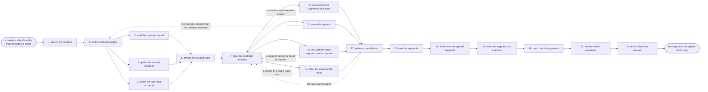

# Reference process: segment the market

`ref/mkt/segment-the-market v1`

A decision coordinator takes a question about how the market divides,
has leadership settle what counts as inside that market, and
commissions three kinds of evidence: what the organization's own record
says about who bought and who stayed, what published and licensed
sources say about the market outside, and what buyers and sellers say
when somebody asks them directly. The traits the market will be divided
on are chosen and written down before anybody draws a division. A
forecaster then draws two or three candidate divisions, a statistician
says whether the groups inside each one really differ, and every
candidate is sized, tested for whether the organization can find and
reach the people in it, and cleared with legal on the data and the
traits behind it. Leadership and the sales side pick one division and
put its segments in order. The run ends with the segments written down
at a version, each carrying its size, its place in the order, the
reasoning behind it, and the names of anyone who disagreed. What this
process produces is an argument that other processes quote. No list of
contacts or accounts is built in any platform during this run, because
building the list is a separate process that reads the segments this
one records.

## The activities

| # | Activity | What happens | Seats |
|---|---|---|---|
| 1 | take in the question | work out what the segmentation must settle and by when | [decision-coordinator](../../agents/decision-coordinator.md) · leadership (person) |
| 2 | set the market boundary | what counts as inside this market and what does not | decision-coordinator · [researcher](../../agents/researcher.md) · leadership (person) |
| 3 | read the customer record | who bought, what they spent, and who stayed | [analytics](../../agents/analytics.md) · [forecaster](../../agents/forecaster.md) |
| 4 | gather the outside evidence | market reports, public data, and what buyers search for | researcher · [search-optimizer](../../agents/search-optimizer.md) |
| 5 | collect the first-hand accounts | what buyers and sellers say they choose between | [study-manager](../../agents/study-manager.md) · sales leader (person) · subject matter expert (person) |
| 6 | choose the dividing traits | which traits the market gets divided on, and why | decision-coordinator · forecaster · researcher |
| 7 | draw the candidate divisions | two or three ways of dividing it, each written out | forecaster · decision-coordinator |
| 8 | test whether the segments hold apart | whether each group behaves alike and unlike the rest | forecaster · [statistician](../../agents/statistician.md) |
| 9 | size each segment | how many buyers, and how much money sits in each | researcher · forecaster |
| 10 | test whether each segment can be reached | whether the data finds them and the channels reach them | [lead-scorer](../../agents/lead-scorer.md) · [audience-manager](../../agents/audience-manager.md) · [media-buyer](../../agents/media-buyer.md) |
| 11 | clear the data and the traits | the source terms, and which traits may be targeted | researcher · legal reviewer (person) |
| 12 | settle on one division | one way of dividing the market is chosen | decision-coordinator · leadership (person) · sales leader (person) |
| 13 | rank the segments | which segments come first, and what that rests on | decision-coordinator · forecaster · leadership (person) · sales leader (person) |
| 14 | write down the agreed segments | name, size, priority, rationale, and who disagreed | decision-coordinator |
| 15 | issue the segments as a version | the set numbered, and the seats that read it told | [standards-keeper](../../agents/standards-keeper.md) |
| 16 | hand over the segments | each receiving seat says what it changes | decision-coordinator · audience-manager · [campaign-manager](../../agents/campaign-manager.md) · media-buyer · lead-scorer |
| 17 | set the review conditions | the review date, and what would change the answer | decision-coordinator · leadership (person) |
| 18 | record what was learned | what to repeat, what to avoid | decision-coordinator |

## The graph



## The document, with the blanks marked

```
PROCESS: segment the market           id: <team>/segment-the-market   v1
from: ref/mkt/segment-the-market v1
owner: <who>                          effective: <date>
trigger: a question about how the market divides is opened in <your
         planning process>, or the review date on a recorded set of
         segments arrives
concurrency: one run at a time for the same market, because two agreed
             divisions of one market leave nobody with one. Runs for
             different markets overlap
goal: one agreed set of named segments, each carrying its size, its
      place in the order, the reasoning behind it and the disagreement
      with it, recorded at a version and in use by every seat that
      plans, targets or qualifies against it
phases:
  take-in-question - convenes briefing: what the segmentation has to
                     settle, who decides it, what evidence each seat
                     owes, and the date the answer is due
                     owner: decision-coordinator  after: trigger
                     automation: <level>
  set-boundary     - convenes decide-and-announce: what counts as
                     inside this market, what is left outside, and the
                     reason for the line
                     owner: decision-coordinator  after: take-in-question
                     by: <days>                   automation: never
  read-record      - human: who bought, what they spent, who renewed
                     and who left, over <what period>
                     owner: analytics             after: set-boundary
                     by: <days>                   automation: <level>
  outside-evidence - human: the market reports, the public data, and
                     the terms buyers search for
                     owner: researcher            after: set-boundary
                     by: <days>                   automation: <level>
  first-hand       - runs collect-and-report: what buyers and sellers
                     say they choose between, with the responses kept
                     under each finding
                     owner: study-manager         after: set-boundary
                     by: <days>                   automation: <level>
  choose-traits    - convenes decide-and-announce: the traits the
                     market gets divided on, written down before any
                     division is drawn
                     owner: decision-coordinator
                     after: read-record + outside-evidence + first-hand
                     by: <days>                   automation: <level>
  draw-candidates  - runs build-by-talent: two or three ways of
                     dividing the market, each written out with the
                     evidence under it
                     owner: forecaster            after: choose-traits
                     by: <days>                   automation: <level>
  test-separation  - system: whether the accounts inside each segment
                     behave alike, and whether the segments differ from
                     each other by more than the noise
                     owner: statistician          after: draw-candidates
                     by: <days>                   automation: <level>
  size-segments    - human: how many buyers and how much money sit in
                     each segment, and where the count came from
                     owner: researcher            after: draw-candidates
                     by: <days>                   automation: <level>
  test-reach       - system: whether the record identifies who belongs
                     to each segment, how much of the contact base
                     falls in it, and whether the channels reach it
                     owner: lead-scorer           after: draw-candidates
                     by: <days>                   automation: <level>
  clear-data       - convenes approval: legal signs that the analysis
                     may rest on this data and that these traits may be
                     used to target
                     owner: <your legal seat>     after: draw-candidates
                     by: <days>                   automation: never
  settle-division  - convenes bake-off: two or three divisions, one
                     chosen, with the reasons said out loud
                     owner: decision-coordinator
                     after: test-separation + size-segments +
                            test-reach + clear-data
                     by: <days>                   automation: never
  rank-segments    - convenes decide-and-announce: which segments come
                     first, what that order rests on, and what each
                     one is expected to return
                     owner: decision-coordinator  after: settle-division
                     by: <days>                   automation: never
  write-segments   - human: each segment with its name, its size, its
                     place in the order, the reasoning behind it, and
                     who disagreed and on what
                     owner: decision-coordinator  after: rank-segments
                     automation: <level>
  issue-version    - human: the agreed segments issued as a numbered
                     version, with the version it replaces left readable
                     owner: standards-keeper      after: write-segments
                     automation: <level>
  hand-over        - runs decide-and-announce: every seat that plans,
                     targets or qualifies hears the segments at once
                     and says what it changes because of them
                     owner: decision-coordinator  after: issue-version
                     by: <days>                   automation: <level>
  set-review       - human: the date the segments come back up, and the
                     conditions that would bring them back sooner
                     owner: decision-coordinator  after: hand-over
                     automation: <level>
  record-learnings - convenes debrief: what to repeat, what to avoid
                     owner: decision-coordinator  after: set-review
                     automation: <level>
run-scoped:
  outstanding - runs roll-call              owner: decision-coordinator
                every: <cadence>
                from: take-in-question   until: hand-over
handoffs:
  take-in-question -> set-boundary: the question, what it has to settle,
    who decides it, and the date it is owed
  set-boundary -> read-record / outside-evidence / first-hand: the
    market as it was drawn, and what each seat owes against it. Three
    seats read one record
  read-record -> choose-traits: the accounts, what each one bought and
    renewed, and when each one left
  outside-evidence -> choose-traits: the market evidence, with a source
    line under every fact and the date it was read
  first-hand -> choose-traits: what the buyers and the sellers said,
    attributed to the person who said it, with the responses kept under
    each finding
  choose-traits -> draw-candidates: the traits the division rests on,
    and the reason each one was kept
  draw-candidates -> test-separation: the candidate divisions in the
    form they will be tested in
  draw-candidates -> size-segments: the same candidates
  draw-candidates -> test-reach: the same candidates, with the traits
    that would identify a member of each segment
  draw-candidates -> clear-data: the traits, the data sets under them,
    and the terms each set came with. Four branches read one record
  test-separation -> settle-division: for each candidate, how alike the
    accounts inside a segment are, how far apart the segments sit, and
    whether that distance is larger than the noise
  size-segments -> settle-division: how many buyers and how much money
    sit in each segment, and where the count came from
  test-reach -> settle-division: how much of each segment the record
    already identifies, what the rest costs to identify, and which
    channels can reach it
  clear-data -> settle-division: the data the analysis may rest on, and
    the traits that may be used to target
  settle-division -> rank-segments: the chosen division, why it won over
    the others, and everyone who disagreed and on what
  rank-segments -> write-segments: the order, what it rests on, and what
    each segment is expected to return
  write-segments -> issue-version: the segments in the wording they were
    agreed in
  issue-version -> hand-over: the segments at their number, and what
    changed from the version they replace
  hand-over -> set-review: what each receiving seat said it would
    change, and the date it said it by
  set-review -> record-learnings: the review date and the conditions
    that bring the segments back sooner
bindings:
  roster:  <who holds each seat - agents claiming the abstract agents
           above, and named people for leadership, the sales side, the
           expert and legal>
  systems: the customer and revenue record (read), the CRM (read),
           analytics platforms (read), enrichment sources (read),
           licensed market data (read, cap: <what may be bought
           without asking>), ad platforms (read),
           the survey and interview system (trigger),
           the response record (write), the model store (write),
           the calculation record (write), the evidence store (write),
           the decision record (write), the standards store (write),
           the review schedule (write), the notification channel (write)
  data:    the question the segmentation has to settle,
           <your market definitions>, <your account and revenue
           history> over <what period>, the terms attached to every
           data set the analysis rests on, <your recorded ideal
           customer profile> <version>
policy:
  the market boundary is set by named people before any evidence is
    gathered, and the evidence is gathered against that boundary
  every fact in the evidence carries the source it came from and the
    date it was read
  the traits the market is divided on are written down before any
    candidate division is drawn
  a difference the data cannot support is reported as inside the noise,
    and no candidate division rests on it
  no candidate division reaches the room without its size, its reach
    test and its separation test
  the division is chosen by named people, and the choice is never
    delegated to an agent
  the people who sell to these segments sit in the room where the
    division is settled, and a division settled without them is not
    recorded
  a disagreement is recorded with the segments, naming who disagreed
    and what they disagreed with
  the run does not close until every seat that plans, targets or
    qualifies against the segments has said what it changes, and a seat
    that changes nothing says why
  no list of contacts or accounts is built in any platform in this run
  a recorded set of segments is never edited in place. A change goes in
    as a new version, and the version it replaces stays readable
measures:
  cycle time: <target> from the question to the recorded segments
  coverage: <share> of the revenue in <what period> that falls inside a
            named segment
  reach: <share> of each segment the organization can already identify
         in its own record
  quality gate: no segment set is recorded without its sizes, its
                separation test, its disagreement, and an answer from
                every seat that acts on it
```

## The failure edges

- **No division separates the groups.** The statistician reports that
  the segments differ by less than the noise in the measurement, and the
  run returns to draw-candidates with the traits the failed division
  rested on. A division that the data cannot support is the failure this
  test exists to catch.
- **The market turns out to be smaller than the question assumed.**
  Sizing sends the run back to set-boundary, because the problem is with
  the boundary the run was given. Leadership either widens the market
  and the evidence is gathered again, or accepts the smaller market and
  the run carries on inside it.
- **A segment cannot be found or reached.** The run returns to
  draw-candidates. Either the segment is redrawn on traits the record
  already carries, or it stays and is recorded as a segment the
  organization can describe but cannot yet address, with what it would
  cost to address it written beside it.
- **Legal rules out a source or a trait.** Every candidate division
  resting on it goes back to draw-candidates to be rebuilt without it or
  dropped. Better analysis does not overturn this check, because the
  question it answers is whether the organization may use the data at
  all.
- **The evidence contradicts the division the room wants.** The
  coordinator puts the contradiction in front of the room and it stays
  in the record whichever way the room decides. Leaving it out is not
  one of the choices.
- **The room does not agree.** The coordinator records what each side
  said and takes the disagreement to <who>. Deciding on a coarser
  division and waiting for more evidence are both a person's call, and
  the coordinator makes neither.
- **The segments are agreed and nothing changes.** This is the failure
  the process exists to prevent, and it leaves no trace unless somebody
  goes looking for it. The process answers it in three places: the sales
  side sits in the room where the division is settled, every receiving
  seat says at the handover what it changes, and the coverage measure is
  read on the review date against the revenue the organization has
  actually earned.
- **The trigger fires while a run is in flight.** Two runs against the
  same market do not overlap, because the second one would produce a
  second agreed division and leave the organization with neither. A
  question about a different market starts its own run, and a question
  about the market already under way joins the run in flight.
- **A run is abandoned.** The evidence stays where it is at its
  versions, and a later run picks it up with the dates it was gathered
  on. No segments are recorded, the seats that plan and target keep
  working to the segments they already had, and the coordinator records
  that the question went unanswered and why.
