# Reference process: Select Marketing Technology

`ref/mkt/select-marketing-technology v1`

**value stream:** [Objective-to-Commitment](../../streams/marketing/objective-to-commitment.md)
Somebody reports that the department cannot do something it needs to
do, and this process ends with one tool chosen and under an agreement.
The requirements and the scoring criteria are written down and dated
before any candidate is looked at, so every candidate is judged against
the same list whenever it arrived. The department goes to market with
one set of questions, scores what comes back, checks the terms, the
security and the standards alongside the scoring, and tries the
finalists on work it actually has. Named people choose the tool and
sign the agreement, and the run closes once the entry is in the
register with an owner, a cost, a term and a renewal date against it.

## The activities

| # | Activity | What happens | Agents |
|---|---|---|---|
| 1 | Take in the Gap | say what the department cannot do today | [supplier-manager](../../agents/supplier-manager.md) · requester (person) |
| 2 | Check What Is Already Owned | look in the register for something that does it | supplier-manager |
| 3 | Write down the Requirements | what the tool has to do, ranked and testable | supplier-manager · requester (person) · systems owner (person) |
| 4 | Set the Scoring Criteria | how a candidate is judged, fixed beforehand | [supplier-check](../../agents/supplier-check.md) · supplier-manager |
| 5 | Brief the Selection | every agent hears the same requirements at once | supplier-manager · supplier-check · [budget-keeper](../../agents/budget-keeper.md) · [capacity-manager](../../agents/capacity-manager.md) · [consent-manager](../../agents/consent-manager.md) · [researcher](../../agents/researcher.md) |
| 6 | Size What the Tool Has to Carry | the work it would take on and the agents that use it | capacity-manager · [forecaster](../../agents/forecaster.md) |
| 7 | Say What Money There Is | what can be spent this year and in the years after | budget-keeper · finance (person) |
| 8 | Search the Market | find every candidate worth looking at | supplier-manager · researcher |
| 9 | Cut to a Shortlist | drop the candidates that miss a requirement | supplier-manager · supplier-check |
| 10 | Score the Shortlist | a verdict on every requirement, per candidate | supplier-check |
| 11 | Check the Terms and the Data | what the agreement allows and where data sits | consent-manager · legal reviewer (person) |
| 12 | Check the Security and the Connections | how it is secured and what it would connect to | systems owner (person) · security reviewer (person) |
| 13 | Check It against the Standards | whether its output can meet the standards in force | [standards-keeper](../../agents/standards-keeper.md) · [accessibility-check](../../agents/accessibility-check.md) |
| 14 | Try the Finalists on Real Work | a trial on work the department actually has | supplier-manager · requester (person) · [statistician](../../agents/statistician.md) |
| 15 | Work out the Whole Cost | licence, setup, the people, and the cost to leave | budget-keeper · forecaster · finance (person) |
| 16 | Compare the Finalists | scores, trial and cost set side by side | [decision-coordinator](../../agents/decision-coordinator.md) · supplier-check · statistician |
| 17 | Choose the Tool | the named decider picks one and says why | decision-coordinator · leadership (person) |
| 18 | Agree the Terms and Sign | price, term, exit, and what the supplier must meet | supplier-manager · legal reviewer (person) · finance (person) |
| 19 | Write It into the Register | owner, cost, term and renewal date | supplier-manager · budget-keeper |
| 20 | Hand It to the Owner | the owner takes it on with a date to review it | supplier-manager · systems owner (person) · capacity-manager · [analytics](../../agents/analytics.md) |
| 21 | Record What Was Learned | what to repeat, what to avoid | supplier-manager · decision-coordinator |

## The graph

```mermaid
flowchart LR
  T([a capability gap is identified]) --> A1[1. Take in the Gap]
  A1 --> A2[2. Check What Is Already Owned]
  A2 --> A3[3. Write down the Requirements]
  A3 --> A4[4. Set the Scoring Criteria]
  A4 --> A5[5. Brief the Selection]
  A5 --> A6[6. Size What the Tool Has to Carry]
  A5 --> A7[7. Say What Money There Is]
  A5 --> A8[8. Search the Market]
  A6 --> A9[9. Cut to a Shortlist]
  A7 --> A9
  A8 --> A9
  A9 --> A10[10. Score the Shortlist]
  A10 --> A11[11. Check the Terms and the Data]
  A10 --> A12[12. Check the Security and the Connections]
  A10 --> A13[13. Check It against the Standards]
  A10 --> A14[14. Try the Finalists on Real Work]
  A10 -. a requirement nobody could test .-> A8
  A10 -. every candidate fails a requirement .-> A3
  A11 -. terms the organization cannot accept .-> A9
  A12 -. findings the candidate has to answer .-> A10
  A13 -. the output cannot meet the standards .-> A9
  A14 -. the trial shows it cannot do the work .-> A9
  A14 --> A15[15. Work out the Whole Cost]
  A15 -. the cost is past what there is .-> A7
  A11 --> A16[16. Compare the Finalists]
  A12 --> A16
  A13 --> A16
  A15 --> A16
  A16 -. no finalist is worth taking .-> A8
  A16 --> A17[17. Choose the Tool]
  A17 -. the choice needs more evidence .-> A14
  A17 --> A18[18. Agree the Terms and Sign]
  A18 -. the terms will not come right .-> A17
  A18 --> A19[19. Write It into the Register]
  A19 --> A20[20. Hand It to the Owner]
  A20 --> A21[21. Record What Was Learned]
  A21 --> DONE([the tool is chosen, contracted and owned])
```



## The document, with the blanks marked

```
PROCESS: select marketing technology
id: <team>/select-marketing-technology   v1
from: ref/mkt/select-marketing-technology v1
owner: <who>                          effective: <date>
trigger: a capability gap is raised in <your planning process>
concurrency: runs may overlap - <how many> searches open at once, and
             two searches for the same capability are merged into one
goal: one tool chosen against requirements written down before any
      candidate was seen, contracted on terms the organization accepts,
      and recorded in the register with an owner and a renewal date
phases:
  take-in-gap      - human: read the gap as the requester states it and
                     write down what the department cannot do today
                     owner: supplier-manager      after: trigger
                     automation: <level>
  check-owned      - system: read the register for something the
                     department already buys that does the job or comes
                     near it
                     owner: supplier-manager      after: take-in-gap
                     by: <days>                   automation: <level>
  requirements     - human: what the tool has to do, ranked, each one
                     written so a candidate can be tested against it
                     owner: supplier-manager      after: check-owned
                     by: <days>                   automation: <level>
  set-criteria     - human: how a candidate is judged and what a pass
                     takes, fixed at a version and dated
                     owner: supplier-check        after: requirements
                     by: <days>                   automation: <level>
  brief-selection  - convenes briefing: every agent hears the same
                     requirements, the criteria and the due date at once
                     owner: supplier-manager      after: set-criteria
                     automation: <level>
  size-load        - human: the volume of work the tool would carry and
                     the agents that would use it
                     owner: capacity-manager      after: brief-selection
                     by: <days>                   automation: <level>
  confirm-money    - human: what can be spent this year and what a
                     renewal would take in the years after. <who>
                     confirms the figure
                     owner: budget-keeper         after: brief-selection
                     automation: <level>
  search-market    - runs collect-and-report: one set of questions in
                     one format to every candidate, every answer kept
                     against the candidate that gave it
                     owner: supplier-manager      after: brief-selection
                     by: <weeks>                  automation: <level>
  shortlist        - human: the candidates that miss a requirement are
                     dropped, each with the requirement it failed
                     owner: supplier-manager
                     after: size-load + confirm-money + search-market
                     by: <days>                   automation: <level>
  score-shortlist  - runs assessment: every requirement gets a verdict
                     for every candidate, against the list at the
                     version it was fixed at
                     owner: supplier-check        after: shortlist
                     by: <days>                   automation: <level>
  check-terms      - runs assessment: what the agreement allows, where
                     the data would sit, and what the consent record
                     covers
                     owner: <your legal role>     after: score-shortlist
                     by: <days>                   automation: never
  check-security   - human: how the candidate secures the data, what it
                     would connect to, and what it would be given
                     owner: <your systems owner>  after: score-shortlist
                     by: <days>                   automation: never
  check-standards  - runs assessment: whether the work the tool produces
                     can meet the standards in force
                     owner: standards-keeper      after: score-shortlist
                     by: <days>                   automation: <level>
  trial-finalists  - runs bake-off: each finalist takes the same work
                     the department actually has, over the same period,
                     measured the same way
                     owner: supplier-manager      after: score-shortlist
                     by: <weeks>                  automation: <level>
  whole-cost       - human: the licence, the setup, the people it takes
                     to run, and what leaving would cost
                     owner: budget-keeper         after: trial-finalists
                     by: <days>                   automation: <level>
  compare          - human: the finalists side by side against one list,
                     with what each one would rule out
                     owner: decision-coordinator
                     after: check-terms + check-security +
                            check-standards + whole-cost
                     by: <days>                   automation: <level>
  choose-tool      - convenes decide-and-announce: <who> picks one, says
                     why, and every agent waiting on it hears at the
                     same time
                     owner: decision-coordinator  after: compare
                     by: <days>                   automation: never
  agree-terms      - convenes approval: the price, the term, the notice
                     a cancellation needs, and what the supplier has to
                     meet. Legal and finance sign as named signers
                     owner: <your legal role>     after: choose-tool
                     by: <weeks>                  automation: never
  register-entry   - human: the entry lands with what it is for, its
                     owner, its cost, its term and its renewal date
                     owner: supplier-manager      after: agree-terms
                     automation: <level>
  hand-over        - human: the owner takes the tool on, the work to put
                     it into use goes in the book, and the date it comes
                     back up is set
                     owner: supplier-manager      after: register-entry
                     by: <days>                   automation: <level>
  record-learnings - convenes debrief: what to repeat, what to avoid
                     owner: supplier-manager      after: hand-over
                     automation: <level>
run-scoped:
  status - runs roll-call                     owner: supplier-manager
           every: <cadence>
           from: brief-selection   until: choose-tool
  money  - runs allocate-and-reconcile        owner: budget-keeper
           from: confirm-money   until: run close
handoffs:
  take-in-gap -> check-owned: what the department cannot do today, in
    one line the requirements are written from
  check-owned -> requirements: what the register already holds that
    comes near, and what each of those falls short on
  requirements -> set-criteria: the requirements ranked, each written
    so a candidate can be tested against it
  set-criteria -> brief-selection: the requirements and the criteria at
    a version, dated before any candidate was looked at
  brief-selection -> search-market: the requirements as every agent
    heard them, and the date the choice is due
  size-load -> shortlist: the volume of work the tool would carry and
    the agents that would use it
  confirm-money -> shortlist: what is available this year, and what a
    renewal would take in the years after
  search-market -> shortlist: every candidate found, with where it came
    from and what it answered, and a candidate that did not answer
    recorded as missing
  shortlist -> score-shortlist: the candidates left, and the
    requirement each dropped candidate failed
  score-shortlist -> trial-finalists: a verdict per requirement per
    candidate with the evidence behind it, and every requirement that
    could not be tested marked as not tested
  check-terms -> compare: what the agreement allows, where the data
    would sit, and what the consent record covers
  check-security -> compare: how the candidate secures the data, what
    it would connect to, and what it would be given
  check-standards -> compare: whether the work the tool produces can
    meet the standards in force, with the rule behind every failure
  trial-finalists -> whole-cost: what each finalist did on the same
    work, with the figures and the range around each one
  whole-cost -> compare: the licence, the setup, the people it takes to
    run, and what leaving would cost
  compare -> choose-tool: the finalists set side by side against one
    list, and what taking each one would rule out
  choose-tool -> agree-terms: the chosen tool, who decided, on what
    date, for what reasons, and anyone who disagreed
  agree-terms -> register-entry: the signed agreement, the price, the
    term, and the notice a cancellation needs
  register-entry -> hand-over: the entry with its owner, its cost, its
    term and its renewal date
  hand-over -> record-learnings: what the owner took on, and what will
    be measured to tell whether the tool earned its place
bindings:
  roster:  <who holds each role - agents claiming the abstract agents
           above, and named people for the requester, the systems
           owner, the security reviewer, legal, finance and leadership>
  systems: the supplier and registration record (write),
           the requirements record (write), the scoring record (write),
           the budget record (write), the book of work (write),
           the decision record (write), a trial environment (read),
           the accounting record for the period (read),
           the consent record (read)
  data:    the requirements and the criteria at the version they were
           fixed at, <your security and privacy standards> <version>,
           <your accessibility standard> <version>, the marketing
           standards at their versions, the budget for the period,
           the register as it stands
policy:
  the requirements and the criteria are written down and dated before
    any candidate is looked at
  every candidate is scored against the same list, and a requirement
    that could not be tested is recorded as not tested
  a change to the requirements after candidates have been seen goes in
    as a new version, and every score made against the earlier version
    is marked
  a candidate with a relationship to the organization or to anyone
    deciding is declared before scoring starts
  no agreement is entered into by an agent. Named people sign it and
    finance commits the money
  a tool that would hold contact data goes into use only when the
    consent record covers what it will do with that data
  no entry goes into the register without a named owner and a renewal
    date
measures:
  cycle time: <target> from the gap to the signed agreement
  coverage: <share> of the requirements carrying a tested verdict on
            the tool that was chosen
  quality gate: nothing is signed without a scored comparison behind it
                and a named person who decided
```

## The failure edges

- **The register already holds something that does the job.** The run
  closes at check-owned. The supplier-manager agent records the entry it
  found and tells the requester which one it is and who owns it, and no
  agreement is entered into.
- **Every candidate fails a requirement.** The run goes back to the
  requirements. <who> decides whether the requirement comes down,
  whether the department builds what it cannot buy, or whether it does
  without, and the decision is recorded with the scores behind it.
- **A requirement cannot be tested with what a candidate supplied.** The
  supplier-check agent records it as not tested with the reason, and the
  supplier-manager agent puts the question back to the candidate while
  the selection is still open. A requirement nobody tested has not
  passed.
- **The requirements change after candidates have been seen.** The
  changed list goes in as a new version, every score made against the
  earlier version is marked, and a person decides which candidates are
  scored again.
- **The trial shows a finalist cannot do the work.** That candidate
  drops out of the shortlist and the run carries on with the ones left.
  If none are left, the run goes back to the market.
- **The terms will not come right.** The run returns to the choice, and
  the people who decide take the next candidate or reopen the search.
  Nobody signs terms the legal reviewer has objected to.
- **The whole cost is past what there is.** The run goes back to the
  money. Leadership finds the money, takes a smaller version of the
  tool, or stops the search, and whichever it does is recorded with the
  figures it was decided on.
- **Only one candidate meets the requirements.** The supplier-manager
  agent says so before the comparison, because a decision with one
  option in front of it is a person's call.
- **The trigger fires while runs are in flight.** Searches overlap
  normally, and the concurrency line says how many. Two searches for the
  same capability are merged into one so the department does not buy the
  same thing twice, and the runs share their reference data read-only.
- **A run is abandoned.** The requirements, the criteria and the scores
  stay where they are at their versions, so a later run can pick them
  up. Any trial account is closed and the data the department put into
  it is retrieved or destroyed, and the candidates that answered are
  told the search has stopped.
