# Reference process: Set Marketing Budget

`ref/mkt/set-marketing-budget v1`

**value stream:** [Objective-to-Commitment](../../streams/marketing/objective-to-commitment.md)
The planning cycle opens and the department has to come out of it with a
budget that leadership and finance have both signed. This process
settles the money itself. It works out how much marketing has for the
year, how that money is divided among the functions, how much is held
back for changes during the year, when each function's share becomes
available, and who may move money between functions once the year has
started. Three neighboring processes handle work this one leaves alone.
The annual marketing plan chooses which campaigns and which pieces get
made. The media plan commits one campaign's channel mix. The
reallocation of media spend moves money between channels while a
campaign is running. This process runs ahead of all three and gives each
of them the number it has to work inside. Six of the fifteen activities
turn on a person. Finance says what marketing has to work within and
names the agreements signed outside the department. Leadership sizes the reserve and divides the money among the
functions. Leadership and finance together set the rules for moving
money and sign the budget. Raising the automation level moves none of
those six. The run closes when every function has been told its number
and the rules that come with it, and somebody has written down what the
budget rests on and what would reopen it.

## The activities

| # | Activity | What happens | Seats |
|---|---|---|---|
| 1 | Take in the Planning Guidance | what finance gives marketing to work within | finance (person) · leadership (person) · [decision-coordinator](../../agents/decision-coordinator.md) |
| 2 | Read Last Year's Spend | what each function spent against what it was given | [reporting-manager](../../agents/reporting-manager.md) · [analytics](../../agents/analytics.md) · [spend-reconciler](../../agents/spend-reconciler.md) |
| 3 | List the Money Already Committed | contracts and licenses that run into the coming year | [budget-keeper](../../agents/budget-keeper.md) · [supplier-manager](../../agents/supplier-manager.md) · finance (person) |
| 4 | Collect What Each Function Asks For | one request format and one date, from every function | decision-coordinator · [campaign-manager](../../agents/campaign-manager.md) · [content-manager](../../agents/content-manager.md) · [media-buyer](../../agents/media-buyer.md) · [comms-manager](../../agents/comms-manager.md) · [event-manager](../../agents/event-manager.md) · [audience-manager](../../agents/audience-manager.md) |
| 5 | Price the Requests | cost and return at each level of spend, with assumptions | [forecaster](../../agents/forecaster.md) · media-buyer |
| 6 | Test the Asks against the Goals | whether the money asked for can reach the year's goals | forecaster · decision-coordinator · reporting-manager |
| 7 | Size the Reserve | how much is held back for changes during the year | leadership (person) · finance (person) · decision-coordinator · forecaster |
| 8 | Settle the Split across Functions | leadership divides the money among the functions | leadership (person) · finance (person) · decision-coordinator |
| 9 | Set the Rules for Moving Money | who may move money between functions, and when | leadership (person) · finance (person) · decision-coordinator · budget-keeper |
| 10 | Phase the Money across the Year | when each function's money becomes available | decision-coordinator · budget-keeper · reporting-manager |
| 11 | Name What the Budget Is Reported Against | the measures each function's money is reported on | reporting-manager · analytics |
| 12 | Get the Budget Approved | leadership and finance sign the budget at a version | leadership (person) · finance (person) |
| 13 | Load the Allocations | each function's number recorded where spend is tracked | budget-keeper |
| 14 | Tell Every Function What It Has | each function hears its number and the rules with it | decision-coordinator · campaign-manager · content-manager · media-buyer · comms-manager · event-manager · audience-manager · reporting-manager |
| 15 | Record What the Budget Rests On | the assumptions, and what would reopen the budget | decision-coordinator · forecaster · budget-keeper |

## The graph

```mermaid
flowchart LR
  T([the planning cycle opens]) --> A1[1. Take in the Planning Guidance]
  A1 --> A2[2. Read Last Year's Spend]
  A1 --> A3[3. List the Money Already Committed]
  A2 --> A4[4. Collect What Each Function Asks For]
  A3 --> A4
  A4 --> A5[5. Price the Requests]
  A5 --> A6[6. Test the Asks against the Goals]
  A6 -. the asks will not reach the goals .-> A4
  A6 --> A7[7. Size the Reserve]
  A7 --> A8[8. Settle the Split across Functions]
  A8 -. the requests exceed what there is .-> A4
  A8 --> A9[9. Set the Rules for Moving Money]
  A8 --> A10[10. Phase the Money across the Year]
  A9 --> A12[12. Get the Budget Approved]
  A10 --> A11[11. Name What the Budget Is Reported Against]
  A11 --> A12
  A12 -. changes requested .-> A8
  A12 --> A13[13. Load the Allocations]
  A13 -. a commitment the record did not know about .-> A3
  A13 --> A14[14. Tell Every Function What It Has]
  A14 --> A15[15. Record What the Budget Rests On]
  A15 --> DONE([the budget is approved and every function holds its share])
```



## The document, with the blanks marked

```
PROCESS: set marketing budget         id: <team>/set-marketing-budget   v1
from: ref/mkt/set-marketing-budget v1
owner: <who>                          effective: <date>
trigger: the planning cycle opens on <your finance calendar>
concurrency: one run at a time - a budget cycle does not overlap
             itself, and an in-year change goes in as a new version
goal: an approved budget for the year, divided across the functions,
      with a reserve, a release schedule, rules for moving money
      between functions, and every function told what it holds
phases:
  take-guidance     - human: read what finance says marketing has to
                      work within, and write down the figure, the
                      period it covers, and what it leaves out
                      owner: decision-coordinator  after: trigger
                      automation: never
  read-last-spend   - runs collect-and-report: what each function spent
                      last year against what it was given, at the
                      checked figure for every closed period
                      owner: reporting-manager     after: take-guidance
                      by: <weeks>                  automation: <level>
  list-commitments  - system: the agreements, retainers, licenses and
                      renewals already signed that run into the coming
                      year, each with its owner and its renewal date
                      owner: budget-keeper         after: take-guidance
                      by: <weeks>                  automation: <level>
  collect-requests  - runs collect-and-report: one request format and
                      one due date to every function, saying what it
                      would spend and what that money would produce
                      owner: decision-coordinator
                      after: read-last-spend + list-commitments
                      by: <weeks>                  automation: <level>
  price-requests    - runs build-by-talent: what each request would
                      cost and return at each level of spend, with the
                      assumptions written beside every number
                      owner: forecaster            after: collect-requests
                      by: <weeks>                  automation: <level>
  test-the-asks     - human: whether the money the functions are asking
                      for can reach the goals the year carries, and the
                      size of the gap where it cannot
                      owner: decision-coordinator  after: price-requests
                      by: <days>                   automation: <level>
  size-reserve      - convenes decide-and-announce: <who> says how much
                      is held back for changes during the year, and on
                      what conditions it is released
                      owner: <your finance seat>   after: test-the-asks
                      by: <days>                   automation: never
  settle-split      - convenes decide-and-announce: <who> divides the
                      money among the functions, and says what each
                      function did not get and why
                      owner: <your finance seat>   after: size-reserve
                      by: <days>                   automation: never
  movement-rules    - human: who may move money between functions, up
                      to what amount, who approves each move, and what
                      has to be recorded when one is made
                      owner: <your finance seat>   after: settle-split
                      automation: never
  phase-money       - human: the date each function's money becomes
                      available, and the share held until a named
                      condition is met
                      owner: budget-keeper         after: settle-split
                      by: <days>                   automation: <level>
  name-measures     - human: the measure each function's allocation is
                      reported against, defined so the period report
                      can produce it without argument
                      owner: reporting-manager     after: phase-money
                      automation: <level>
  approve-budget    - convenes approval: <who> and finance sign, as
                      named signers, against a version of the budget
                      owner: <your finance seat>
                      after: movement-rules + name-measures
                      by: <days>                   automation: never
  load-allocations  - system: each function's number recorded in the
                      budget record at the signed version, with what
                      was already committed against it
                      owner: budget-keeper         after: approve-budget
                      by: <days>                   automation: <level>
  tell-functions    - convenes decide-and-announce: every function
                      hears its number, its dates and the movement
                      rules at the same time
                      owner: decision-coordinator  after: load-allocations
                      by: <days>                   automation: <level>
  record-basis      - human: what the budget rests on, and the
                      conditions that bring it back to be changed
                      owner: decision-coordinator  after: tell-functions
                      automation: <level>
run-scoped:
  status      - runs roll-call                 owner: decision-coordinator
                every: <cadence>
                from: take-guidance   until: approve-budget
  allocations - runs allocate-and-reconcile    owner: budget-keeper
                from: load-allocations   until: run close
handoffs:
  take-guidance -> read-last-spend / list-commitments: the figure
    marketing has to work within, what it covers, and the date the
    budget is due. Two branches read one record
  read-last-spend -> collect-requests: what each function spent against
    what it was given, at the checked figure, with any period that has
    not closed marked as an estimate
  list-commitments -> collect-requests: the money already committed for
    the coming year, one line per agreement, with the date each one
    renews and the notice a cancellation needs
  collect-requests -> price-requests: every request in one format,
    saying what the function would spend, on what, and what that money
    is meant to produce
  price-requests -> test-the-asks: what each request would cost and
    return at each level of spend, with the assumptions beside the
    numbers and every rate that could not be sourced marked unsourced
  test-the-asks -> size-reserve: the gap between what the requests add
    up to and what the goals need, written as a figure
  size-reserve -> settle-split: the amount held back, and the
    conditions under which it is released
  settle-split -> movement-rules: the money against each function, at
    the figures the budget will carry
  settle-split -> phase-money: the same split. Both branches read one
    record
  movement-rules -> approve-budget: who may move money between
    functions, up to what amount, and who approves each move
  phase-money -> name-measures: the date each function's money becomes
    available, and the share held against a named condition
  name-measures -> approve-budget: the budget at a version, with the
    measure each allocation will be reported against
  approve-budget -> load-allocations: the budget at the signed version.
    A later change voids the approval and the signers see it again
  load-allocations -> tell-functions: each function's allocation as the
    record now holds it, and what was already committed against it
    before the year began
  tell-functions -> record-basis: what each function took away, and
    anything a function said it could not do inside its number
bindings:
  roster:  <who holds each seat - agents claiming the abstract agents
           above, and named people for leadership and finance>
  systems: the budget record (write), the decision record (write),
           the commitments already made (read),
           the supplier record (read),
           the reconciliation record (read), the model store (write),
           the report store (read), analytics platforms (read),
           ad platforms (read), the notification channel (write)
  data:    the closed periods' reports, the approved plan for the year
           at its version, <your finance calendar>,
           <your measure definitions> at a version
policy:
  the money is divided by named people and is never delegated to an
    agent
  no allocation is loaded before <who> and finance have both signed
    the version it comes from
  a move of money between functions is recorded only after the person
    the rules name has approved it
  every figure in the budget names the source or the model version it
    came from
  a rate the model cannot source appears in the budget as unsourced,
    and nobody fills it in with a figure that merely looks reasonable
  a spend figure from a period that has not closed is marked as an
    estimate wherever it appears
  a change to an approved budget goes out as a new version saying what
    moved and why, and the version it replaces stays where it was
measures:
  cycle time: <weeks> from the cycle opening to the approved budget
  coverage: <share> of the year's committed spend sitting inside an
            allocation with a named owner
  quality gate: nothing is allocated without a cost and a return under
                it and the assumptions those rest on
```

## The failure edges

- **The requests add up to more than there is.** The run goes back to
  the collection of requests carrying the gap as a figure, and each
  function cuts its own request. The record keeps both the original
  request and the cut one, so the next cycle can see what was given up.
- **A request rests on a rate nobody can source.** The forecaster
  reports the rate as unsourced and it stays unsourced in the budget.
  Leadership decides whether to fund the request on a stated assumption,
  and the assumption goes into the record of what the budget rests on.
- **The last period has not closed when the cycle opens.** The spend
  figures for that period are marked as estimates wherever they appear,
  and the budget is checked against the real number once the
  reconciliation closes. A material difference reopens the split.
- **The record turns up a commitment nobody allocated for.** Loading
  the allocations finds a renewal or an agreement the list of
  commitments missed, and the run goes back to that list. The money it
  needs comes out of the reserve or out of a function's allocation, and
  a person decides which.
- **The reserve runs out before the year does.** The budget-keeper says
  so on the day the arithmetic stops working, and leadership opens the
  split again to decide where the rest of the year's money comes from.
  A function that spends late in the year gets the same answer as one
  that spends early.
- **Finance cuts the envelope after the budget is signed.** The run
  reopens at the split with the new figure, the signed version stays
  where it is, and the reduced budget goes out as a new version that
  every function is told about.
- **The year starts before the budget is signed.** <who> says what each
  function may spend in the meantime and against which line it is
  recorded, and those draws are set against the allocation the signed
  budget gives that function.
- **A run is abandoned.** The functions keep working to the previous
  year's numbers until a new budget is signed, the commitments already
  made stand, and the requests stay in the record at their versions for
  the cycle that picks the work up again.
