# Reference process: Size Market Opportunity

`ref/mkt/size-market-opportunity v1`

**value stream:** [Market-to-Audience](../../streams/marketing/market-to-audience.md)
A decision coordinator takes a question about how large a market or a
segment is, works out what the answer has to settle and by when, and has
the boundary of the market drawn before anything is counted. A forecaster
chooses how the market will be sized and computes it more than one way,
and a researcher finds the outside figures the calculation rests on. The
numbers the methods produce are set beside each other and every
difference between them is explained. Somebody who did not build the
model traces each figure back to its source and redoes the arithmetic,
and a legal reviewer says which figures the organization may quote
outside. The run ends with one number recorded at a version, carrying the
boundary it was computed inside, the method that produced it, the period
it covers, and the assumptions it rests on. A number that arrives without
its method cannot be used by anyone downstream, so the method is part of
what this process delivers.

## The activities

| # | Activity | What happens | Seats |
|---|---|---|---|
| 1 | Take in the Question | what the sizing has to settle, and by when | [decision-coordinator](../../agents/decision-coordinator.md) · leadership (person) |
| 2 | Draw the Market Boundary | what counts inside this market and what does not | decision-coordinator · [researcher](../../agents/researcher.md) · subject matter expert (person) |
| 3 | Choose the Sizing Method | top down, bottom up or from the record, and why | [forecaster](../../agents/forecaster.md) · decision-coordinator |
| 4 | Gather the Outside Evidence | published figures, public counts, search demand | researcher · [search-optimizer](../../agents/search-optimizer.md) |
| 5 | Count the Buyers | how many buyers of that shape actually exist | researcher · forecaster |
| 6 | Set the Rate Assumptions | the price, the frequency, and where each came from | forecaster · [analytics](../../agents/analytics.md) · finance (person) |
| 7 | Compute the Size Each Way | each method run through to its own number | forecaster |
| 8 | Reconcile the Methods | where the numbers disagree, and what explains it | forecaster · decision-coordinator |
| 9 | Test the Assumptions | each assumption moved, and the swing recorded | forecaster |
| 10 | Check the Method | figures traced, arithmetic redone, method compared | [statistician](../../agents/statistician.md) · researcher |
| 11 | Clear the Sources | which figures may be used outside the company | researcher · legal reviewer (person) |
| 12 | Settle on the Number | one number accepted, with the reasons said out loud | decision-coordinator · leadership (person) · finance (person) |
| 13 | Write down the Sizing | number, boundary, method, window, assumptions | decision-coordinator · forecaster |
| 14 | Issue the Sizing as a Version | the sizing numbered, and the seats that read it told | [standards-keeper](../../agents/standards-keeper.md) |
| 15 | Set the Review Conditions | the review date, and what would change the answer | decision-coordinator · leadership (person) |
| 16 | Record What Was Learned | what to repeat, what to avoid | decision-coordinator |

## The graph

```mermaid
flowchart LR
  T([a segment or category question is asked]) --> A1[1. Take in the Question]
  A1 --> A2[2. Draw the Market Boundary]
  A2 --> A3[3. Choose the Sizing Method]
  A3 --> A4[4. Gather the Outside Evidence]
  A3 --> A6[6. Set the Rate Assumptions]
  A4 --> A5[5. Count the Buyers]
  A5 -. no list of buyers exists .-> A3
  A4 --> A11[11. Clear the Sources]
  A6 -. a rate cannot be sourced .-> A4
  A5 --> A7[7. Compute the Size Each Way]
  A6 --> A7
  A7 --> A8[8. Reconcile the Methods]
  A8 -. the methods disagree too far .-> A2
  A8 --> A9[9. Test the Assumptions]
  A9 --> A10[10. Check the Method]
  A10 -. the method was not followed .-> A7
  A11 -. a figure may not be used outside .-> A4
  A10 --> A12[12. Settle on the Number]
  A11 --> A12
  A12 -. the number is not accepted .-> A3
  A12 --> A13[13. Write down the Sizing]
  A13 --> A14[14. Issue the Sizing as a Version]
  A14 --> A15[15. Set the Review Conditions]
  A15 --> A16[16. Record What Was Learned]
  A16 --> DONE([the sizing is recorded and in use])
```



## The document, with the blanks marked

```
PROCESS: size market opportunity      id: <team>/size-market-opportunity   v1
from: ref/mkt/size-market-opportunity v1
owner: <who>                          effective: <date>
trigger: a segment or category question is opened in <your planning
         process>, or the review date on a recorded sizing arrives
concurrency: one run at a time for the same market, because two
             accepted sizes for one market leave nobody with one. Runs
             for different markets overlap
goal: one number for the size of the named market, recorded with the
      boundary it was computed inside, the method that produced it, the
      period it covers and the assumptions it rests on, and accepted by
      the people who will plan against it
phases:
  take-in-question - convenes briefing: what the sizing has to settle,
                     who accepts the answer, what evidence each seat
                     owes, and the date it is due
                     owner: decision-coordinator  after: trigger
                     automation: <level>
  draw-boundary    - convenes decide-and-announce: what counts inside
                     this market and what is excluded, heard at once by
                     every seat that will compute against it
                     owner: decision-coordinator  after: take-in-question
                     by: <days>                   automation: <level>
  choose-method    - human: top down from a published market figure,
                     bottom up from a count of buyers, or out of the
                     organization's own record, and why that one
                     owner: forecaster            after: draw-boundary
                     by: <days>                   automation: <level>
  outside-evidence - runs build-by-talent: the published figures, the
                     public counts and the search demand the chosen
                     method needs
                     owner: researcher            after: choose-method
                     by: <days>                   automation: <level>
  count-buyers     - human: how many buyers of the shape the boundary
                     describes actually exist, and where that count was
                     read from
                     owner: researcher            after: outside-evidence
                     by: <days>                   automation: <level>
  rate-assumptions - human: what a buyer pays, how often, and where
                     each of those figures came from. <who> confirms
                     they match how the company reports revenue
                     owner: forecaster            after: choose-method
                     by: <days>                   automation: <level>
  compute-sizes    - system: each method run through to its own number,
                     with the working left where somebody can redo it
                     owner: forecaster
                     after: count-buyers + rate-assumptions
                     automation: <level>
  reconcile        - human: the numbers set beside each other, and an
                     explanation written for every difference between
                     them
                     owner: forecaster            after: compute-sizes
                     by: <days>                   automation: <level>
  test-assumptions - system: each assumption moved across the range it
                     could plausibly take, and the swing in the answer
                     recorded beside it
                     owner: forecaster            after: reconcile
                     automation: <level>
  check-method     - runs layered-passes: the method pass, every figure
                     traced to its source and its date, the arithmetic
                     redone, and the executed method read against the
                     method that was chosen
                     owner: statistician          after: test-assumptions
                     by: <days>                   automation: <level>
  clear-sources    - convenes approval: legal signs which figures may
                     be quoted outside the company and which may be
                     used only inside it
                     owner: <your legal seat>     after: outside-evidence
                     by: <days>                   automation: never
  settle-number    - convenes bake-off: the number each method
                     produced, one of them accepted, with the reasons
                     said out loud
                     owner: decision-coordinator
                     after: check-method + clear-sources
                     by: <days>                   automation: never
  write-sizing     - human: the number, the boundary, the method, the
                     period it covers, every assumption under it, and
                     who disagreed and on what
                     owner: decision-coordinator  after: settle-number
                     automation: <level>
  issue-version    - human: the accepted sizing issued as a numbered
                     version, with the version it replaces left readable
                     owner: standards-keeper      after: write-sizing
                     automation: <level>
  set-review       - human: the date the sizing comes back up, and the
                     changes in the market that would bring it back
                     sooner
                     owner: decision-coordinator  after: issue-version
                     automation: <level>
  record-learnings - convenes debrief: what to repeat, what to avoid
                     owner: decision-coordinator  after: set-review
                     automation: <level>
run-scoped:
  outstanding - runs roll-call              owner: decision-coordinator
                every: <cadence>
                from: take-in-question   until: settle-number
handoffs:
  take-in-question -> draw-boundary: the question, what it has to
    settle, who accepts the answer, and the date it is due
  draw-boundary -> choose-method: what counts inside the market and
    what is excluded, in wording a later number can be tested against
  choose-method -> outside-evidence: the method, and the figures it
    needs before it can be computed
  choose-method -> rate-assumptions: the rates the method needs, and
    how far each one has to be broken down
  outside-evidence -> count-buyers: the figures, each with its source,
    the date it was pulled, and the part of the source it came from
  outside-evidence -> clear-sources: the same figures and the terms
    each source came with. Two branches read one record
  count-buyers -> compute-sizes: how many buyers of that shape exist,
    and the count behind that figure
  rate-assumptions -> compute-sizes: what a buyer pays and how often,
    each carrying where it came from
  compute-sizes -> reconcile: the number each method produced, with
    the working behind it
  reconcile -> test-assumptions: the differences between the methods,
    and what explains each one
  test-assumptions -> check-method: the sizing with every assumption
    moved through its range and the swing recorded beside it
  check-method -> settle-number: the scored list, with a verdict on
    every figure and the rule behind each failure
  clear-sources -> settle-number: the figures that may be quoted
    outside, and the figures that may be used only inside
  settle-number -> write-sizing: the accepted number, why it was
    accepted over the others, and everyone who disagreed and on what
  write-sizing -> issue-version: the sizing in the wording it was
    accepted in
  issue-version -> set-review: the sizing at its number, and what
    changed from the version it replaces
  set-review -> record-learnings: the review date, and the conditions
    that bring the sizing back sooner
bindings:
  roster:  <who holds each seat - agents claiming the abstract agents
           above, and named people for leadership, finance, legal and
           the expert who knows how this market buys>
  systems: licensed market data (read, cap: <what may be bought
           without asking>), public data sources (read),
           search demand data sources (read),
           the customer and revenue record (read),
           analytics platforms (read), the model store (write),
           the evidence store (write), the source record (write),
           the decision record (write), the standards store (write),
           the review schedule (write),
           the notification channel (write)
  data:    the segment or category question, <your market
           definitions>, <your revenue reporting definitions>,
           the terms attached to every source the sizing rests on
policy:
  the market boundary is written down and agreed before any number is
    computed
  every figure in the sizing carries its source, the date it was
    pulled, and the part of the source it came from
  a rate the model cannot source is reported as unsourced, and no
    estimate is put in its place
  no number leaves the run without the method that produced it, the
    boundary it was computed inside, and the period it covers
  the seat that computed a number does not check it
  a figure the organization may not quote outside is marked as
    internal, and a sizing sent outside carries cleared figures only
  the number is accepted by named people, and the acceptance is never
    delegated to an agent
  a disagreement is recorded with the sizing, naming who disagreed and
    what they disagreed with
  a recorded sizing is never edited in place. A change goes in as a new
    version, and the version it replaces stays readable
measures:
  cycle time: <target> from the question to the recorded sizing
  traceability: <share> of the figures in the sizing that trace to a
                source and the date it was pulled
  spread: <how far> the methods may disagree before the run goes back
          to the boundary
  quality gate: no sizing is recorded without its method, its
                assumptions and its unsourced rates
```

## The failure edges

- **The methods disagree by more than the process allows.** The run goes
  back to the boundary, because two methods that were computed correctly
  and still disagree have usually counted different things. The boundary
  is redrawn or the difference is written down as an explanation, and
  the numbers are computed again inside the boundary that comes out.
- **A rate cannot be sourced.** The forecaster reports it as unsourced
  and never supplies a figure of its own. The run goes back to the
  evidence for a rate somebody can point at, and if none is found,
  <who> decides whether the sizing proceeds with the gap stated in it.
- **There is no list of buyers to count.** A bottom-up method needs a
  count that can actually be made, and when there is none the run goes
  back to the method and the market is sized another way. Commissioning
  a study to produce the count is a decision <who> makes, and the
  sizing waits for it.
- **The check finds the executed method departing from the chosen one.**
  The findings go back to the calculation with the rule attached to each
  one, the forecaster fixes what the findings name, and the same check
  runs again on the corrected sizing.
- **A figure the calculation rests on cannot be cleared for outside
  use.** A licensed report often allows internal use and forbids
  republication. The run goes back to the evidence for a figure the
  organization may quote, and the sizing is recomputed on that figure.
- **The people who decide will not accept the number.** The run goes
  back to the method, and what they would not accept is recorded with
  the reasons they gave. A number accepted without those reasons cannot
  be used by the seats that plan against it.
- **The sizing goes stale.** The review conditions say what would change
  the answer, and a market that moves in one of those ways brings the
  sizing back before its review date.
- **The trigger fires while runs are in flight.** Sizings for different
  markets overlap normally, and the concurrency line says how many. Two
  runs for the same market are the same question asked twice, so the
  second one joins the first.
- **A run is abandoned.** The evidence, the workings and the assumptions
  stay where they are at their versions, with the boundary they were
  computed inside recorded beside them, so a later run can pick them up
  and see what was already settled.
